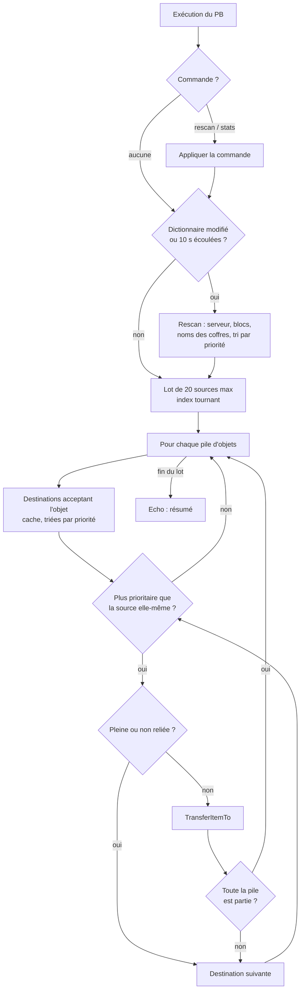

# Tri Automatique des Inventaires

> [!summary] Résumé
> Ce script range automatiquement les objets de la base dans des coffres dont le **nom** décrit le contenu (`Coffre {ore}[*-pierre]0`). Il vide les conteneurs, connecteurs, foreuses, broyeuses, collecteurs et la **sortie** des raffineries / assembleurs, sans jamais toucher au carburant, aux munitions des tourelles ni aux vaisseaux amarrés. Les mots français sont traduits grâce au [[Serveur Dictionnaire]].

---

## 1. Prérequis en jeu

| Bloc | Nom exact | Rôle |
|---|---|---|
| Bloc programmable | libre (ex. `PB Tri`) | Exécute le script |
| Conteneurs cargo et/ou connecteurs | `… {categorie}[liste]priorite` | Destinations du tri |
| Un bloc quelconque (optionnel) | `SERVEUR_DICTIONNAIRE` | Traductions — voir [[Serveur Dictionnaire]] |

Tous les blocs doivent être **reliés par convoyeurs** au reste de la base (le script ne téléporte rien : il passe par les convoyeurs, comme un joueur).

### Syntaxe des noms de destination

`<texte libre> {categorie}[liste]priorite`

| Partie | Signification | Exemples |
|---|---|---|
| `{categorie}` | Famille d'objets : catégorie du jeu **ou** alias de `[Categories]` | `{ore}`, `{minerai}`, `{ingot}`, `{lingots}`, `{component}`, `{munitions}` |
| `[*]` | Accepte **tout** dans la catégorie | `{component}[*]` |
| `[*-a;b]` | Accepte tout **sauf** a et b | `{ore}[*-pierre;glace]` |
| `[a;b]` | Accepte **uniquement** a et b | `{ingot}[fer;nickel]` |
| `priorite` | Nombre après `]` : **0 = le plus prioritaire**. Absent = 99 | `0`, `1`, `5` |

Les objets peuvent être écrits en français, en anglais, en symbole chimique ou avec le `SubtypeId` du jeu (`fer`, `fe`, `iron`, `Iron`) — majuscules et accents selon le dictionnaire.

Exemples :

```text
Coffre Minerais {ore}[*-stone]0
Coffre Pierre {minerai}[pierre]0
Coffre Lingots A {ingot}[fer;nickel;silicium]1
Coffre Lingots B {lingot}[*]2
Coffre Composants {component}[*]
Connecteur Glace {ore}[glace]0
```

### Balise `[NoTri]`

Ajoutez `[NoTri]` n'importe où dans le nom d'un bloc pour que le script ne le **vide jamais** (coffre personnel, connecteur de chargement d'un vaisseau…). Un coffre `[NoTri]` reste une destination s'il possède aussi une syntaxe `{…}[…]`.

### Custom Data du serveur (optionnel)

```ini
[Categories]
ore=minerai, minerais
ingot=lingot, lingots

[Alias]
Iron=fer, fe
Stone=pierre, gravier
```

Le contenu complet est dans [[Serveur Dictionnaire]].

## 2. Installation

1. (Optionnel mais conseillé) Installez le [[Serveur Dictionnaire]].
2. Construisez un bloc programmable et ouvrez **Éditer**.
3. Effacez tout, collez le code de la section 9, cliquez **Vérifier le code** puis **OK**.
4. Renommez vos coffres de destination avec la syntaxe ci-dessus.
5. Regardez la console du bloc programmable (à droite dans le terminal) : sources, destinations et éventuelles erreurs de nommage s'y affichent. Le script tourne tout seul toutes les ~1,6 s.

> [!tip] Après avoir renommé des coffres
> Les noms sont relus automatiquement toutes les 10 s. Pour un effet immédiat : lancez le PB avec l'argument `rescan`.

## 3. Configuration

### Constantes (en tête du script)

| Constante | Défaut | Effet |
|---|---|---|
| `NOM_SERVEUR_DICTIONNAIRE` | `"SERVEUR_DICTIONNAIRE"` | Nom du bloc qui porte le dictionnaire |
| `BALISE_EXCLUSION_SOURCE` | `"[NoTri]"` | Balise qui empêche de vider un bloc (insensible à la casse) |
| `SEULEMENT_CETTE_CONSTRUCTION` | `true` | Ignore les vaisseaux amarrés par connecteur |
| `INTERVALLE_RESCAN_SECONDES` | `10.0` | Délai entre deux relectures des blocs et des noms |
| `SOURCES_PAR_EXECUTION` | `20` | Nombre d'inventaires vidés par exécution (lots) |
| `FRACTION_MAX_INSTRUCTIONS` | `0.5` | Le lot s'arrête si 50 % de la limite d'instructions est atteinte |
| `PRIORITE_PAR_DEFAUT` | `99` | Priorité d'un coffre sans nombre après `]` |
| `NB_MAX_ERREURS_AFFICHEES` | `5` | Erreurs de nommage listées dans la console |
| `FREQUENCE_EXECUTION` | `Update100` | Cadence automatique (~1,6 s). `Update10` = 10× plus souvent, plus coûteux |

### Clés de Custom Data utilisées (bloc `SERVEUR_DICTIONNAIRE`)

| Section | Format | Usage par ce script |
|---|---|---|
| `[Categories]` | `ore=minerai, minerais` | Alias acceptés entre `{ }` |
| `[Alias]` | `Iron=fer, fe` | Alias acceptés entre `[ ]` |
| `[Dictionnaire]` (ancien) | `fer=Iron` | Toujours lu pour compatibilité ; `[Alias]` l'emporte |
| `[Affichage]` | `Iron=Fer` | Non utilisé ici (écrans : [[Affichage Data Center]]) |

## 4. Commandes

| Argument | Effet |
|---|---|
| *(vide)* | Exécution normale (automatique) |
| `rescan` | Relit immédiatement les blocs, les noms des coffres et le dictionnaire |
| `stats` | Affiche / masque la liste détaillée des destinations (priorité, catégorie, plein ou non) dans la console |

Pour lier une commande à un bouton : panneau de boutons ou barre d'outils du cockpit → glisser le bloc programmable → action **Exécuter** → saisir l'argument (`rescan`).

## 5. Fonctionnement

### Algorithme (en français)

1. **Au démarrage** : le script règle sa fréquence (Update100) et fait un premier scan.
2. **Scan (toutes les 10 s, ou `rescan`, ou si le dictionnaire / un bloc a changé)** :
   1. Il cherche `SERVEUR_DICTIONNAIRE` (d'abord sur sa propre construction). Si le Custom Data a changé depuis la dernière lecture, il reconstruit les tables d'alias : l'ancienne section `[Dictionnaire]` d'abord, puis `[Categories]` et `[Alias]` qui ont le dernier mot.
   2. Il récupère **en un seul appel** tous les blocs à inventaire de sa construction.
   3. Chaque conteneur / connecteur dont le nom contient `{` est analysé : catégorie (traduite), liste (traduite, rangée dans un `HashSet` insensible à la casse), priorité (99 par défaut). Un nom mal formé est noté comme erreur.
   4. Il construit la liste des **sources** : conteneurs, connecteurs, collecteurs, foreuses, broyeuses, et la **sortie** des blocs de production — sauf ceux balisés `[NoTri]`.
   5. Il **trie les destinations par priorité** et vide le cache « objet → destinations ».
3. **À chaque exécution** : il traite un **lot** de 20 sources maximum, en reprenant là où il s'était arrêté (index tournant). Il s'interrompt aussi si la moitié de la limite d'instructions est consommée.
4. **Pour chaque pile d'objets d'une source** :
   1. Il détermine la catégorie (`MyObjectBuilder_Ore` → `ore`) et le `SubtypeId` (`Iron`).
   2. Il obtient (depuis le cache) la liste triée des destinations qui acceptent cet objet.
   3. **Anti ping-pong** : si la source est elle-même une destination valide de priorité P pour cet objet, seules les destinations de priorité **strictement inférieure** à P sont envisagées. Un objet bien rangé ne bouge donc plus.
   4. Il essaie les destinations dans l'ordre : il saute celles qui sont **pleines** ou **non reliées** par convoyeur, tente le transfert, et continue avec la suivante tant que toute la pile n'est pas partie.
5. Il affiche un résumé dans la console.



### Quels inventaires sont vidés ?

| Bloc | Vidé ? | Pourquoi |
|---|---|---|
| Conteneur cargo, connecteur | Oui (sauf `[NoTri]`) | Stockage général |
| Collecteur, foreuse, broyeuse | Oui | Ils accumulent ce qu'ils ramassent |
| Raffinerie, assembleur | **Sortie seulement** | L'entrée contient le minerai / les lingots en cours de traitement |
| Assembleur en mode **désassemblage** | Non | Il prend justement les objets dans sa sortie |
| Réacteur, générateur O2/H2, tourelle, cockpit, soudeuse… | **Jamais** | Ce sont leurs carburants / munitions / outils |
| Blocs d'un vaisseau amarré | **Jamais** | Filtre `IsSameConstructAs(Me)` |

## 6. Optimisations et corrections par rapport à l'original

| Problème d'origine | Conséquence en jeu | Correction |
|---|---|---|
| `Priorite = 99; int.TryParse(texte, out Priorite);` | `TryParse` écrit **0** en cas d'échec : un coffre **sans** priorité devenait le **plus** prioritaire | Variable temporaire : 99 réel par défaut, et erreur affichée si le texte n'est pas un nombre |
| Le tri vidait **tous** les inventaires | Minerai aspiré hors des raffineries, uranium retiré des réacteurs, glace des générateurs, munitions des tourelles, contenu des cockpits… | Sources limitées aux conteneurs, connecteurs, collecteurs, foreuses, broyeuses et à la **sortie** des blocs de production ; balise `[NoTri]` |
| Aucun filtre de construction | Pillage des vaisseaux amarrés au connecteur | `IsSameConstructAs(Me)` (constante `SEULEMENT_CETTE_CONSTRUCTION`) |
| `List.Contains` sensible à la casse | `[Iron]` marchait, `[iron]` sans dictionnaire non | `HashSet<string>` avec `StringComparer.OrdinalIgnoreCase` |
| Un seul « meilleur » coffre, résultat de `TransferItemTo` ignoré | Coffre prioritaire plein = l'objet ne bougeait **plus jamais** | Destinations triées par priorité, essai de la suivante ; `IsFull`, `CanTransferItemTo` et le `bool` de `TransferItemTo` vérifiés ; reste d'une pile partiellement transférée envoyé au coffre suivant |
| `GetBlocks` + analyse de tous les noms **à chaque exécution** | Charge inutile, toutes les 1,6 s, sur toute la grille | Cache des blocs, rescan toutes les 10 s ou sur `rescan` ; cache « objet → destinations » |
| Dictionnaire lu une seule fois à la compilation | Modifier le serveur demandait de recompiler le PB | Rechargement automatique dès que le Custom Data du serveur change |
| Toutes les sources traitées en une exécution | Risque de dépasser la limite d'instructions sur une grande base (script arrêté par le jeu) | Lots de 20 sources avec index tournant + garde-fou à 50 % de `MaxInstructionCount` |
| Destinations limitées aux conteneurs cargo | Impossible d'utiliser un connecteur comme point de collecte | Destinations : conteneurs cargo **et** connecteurs |
| `new List<>` à chaque inventaire | Allocations mémoire répétées | Tampons réutilisés (`List`, `StringBuilder`, `MyIni`) |
| Anti ping-pong | (déjà présent) | Conservé : déplacement seulement vers une destination **strictement** plus prioritaire que la source |
| Aucune information en console | Impossible de diagnostiquer un coffre mal nommé | Echo : sources, destinations, déplacements, `LastRunTimeMs`, erreurs de nommage ; `stats` pour le détail |
| Accolades / crochets cherchés n'importe où | `[NoTri] Coffre {ore}[*]` aurait été rejeté | Recherche dans l'ordre `{` → `}` → `[` → `]`, balise `[NoTri]` retirée avant l'analyse |

## 7. Limites connues

- **Transfert partiel** : on suppose que `TransferItemTo(..., null)` transfère ce qui rentre quand la destination n'a pas assez de place. Si le jeu refuse au lieu de transférer partiellement, la pile ira dans le coffre suivant ou restera sur place jusqu'au prochain passage — sans perte d'objet.
- **Assembleur en désassemblage** : détecté via `IMyAssembler.Mode == MyAssemblerMode.Disassembly`. Les autres blocs de production (kit de survie…) sont traités comme des raffineries : seule leur sortie est vidée.
- **Délai de détection** : un coffre construit ou renommé est pris en compte au rescan suivant (≤ 10 s) ; un serveur dictionnaire construit après le PB aussi.
- **Sur une très grande base**, un passage complet prend plusieurs exécutions (ex. 100 sources = 5 exécutions ≈ 8 s). Augmentez `SOURCES_PAR_EXECUTION` si votre base est petite.
- **Objets inconnus** : un mot absent du dictionnaire est utilisé tel quel comme `SubtypeId`. Une faute de frappe ne provoque pas d'erreur, l'objet n'est simplement jamais accepté (utilisez `stats` pour vérifier).
- **Ancien format `[Dictionnaire]`** : ses clés contiennent des espaces et des accents. Le script les lit tel que `MyIni` les fournit ; si une clé pose problème, migrez la ligne vers `[Alias]`.
- Le script ne range que ce qui est **relié par convoyeurs** (petits convoyeurs : attention aux gros objets comme certains composants qui ne passent pas).

## 8. Dépannage

| Symptôme | Cause probable | Solution |
|---|---|---|
| `Destinations : 0` | Aucun nom valide, ou coffres sur un autre vaisseau | Vérifier la syntaxe `{ore}[*]`, lancer `rescan` |
| Erreur « il faut [liste] APRÈS {categorie} » | Crochets avant les accolades ou manquants | Écrire `{ore}[*]0`, pas `[*]{ore}0` |
| Erreur « priorité 'x' illisible » | Texte après `]` qui n'est pas un nombre | Mettre le texte libre **avant** `{`, le nombre seul après `]` |
| Un objet ne bouge jamais | Aucun coffre ne l'accepte, ou pas de liaison convoyeur | `stats` pour voir les destinations ; vérifier les convoyeurs (petit/grand) |
| `{minerai}` ne marche pas | Serveur absent ou sans `[Categories]` | Installer le [[Serveur Dictionnaire]] ou écrire `{ore}` |
| `Dictionnaire : ERREUR INI` | Faute de syntaxe dans le Custom Data du serveur | Corriger la ligne indiquée (section entre `[ ]`, une clé `=` par ligne) |
| La raffinerie ne se vide pas de son minerai | Comportement voulu | Seule la **sortie** (lingots) est vidée |
| Le cargo d'un vaisseau amarré n'est pas rangé | Comportement voulu | Mettre `SEULEMENT_CETTE_CONSTRUCTION = false` (déconseillé) |
| « Budget d'instructions atteint » | Très grosse base, inventaires énormes | Baisser `SOURCES_PAR_EXECUTION` ; normal si occasionnel |

## 9. Code complet

```csharp
// ==============================================================================
// TRI AUTOMATIQUE DES INVENTAIRES - CLIENT DU DATA CENTER (version optimisée)
// ==============================================================================
// RÔLE
//   Range automatiquement les objets de la base dans des coffres (ou connecteurs)
//   dont le NOM décrit ce qu'ils acceptent. Les mots du joueur ("fer", "pierre",
//   "{minerai}"...) sont traduits en identifiants du jeu grâce au bloc
//   SERVEUR_DICTIONNAIRE (optionnel).
//
// NOMENCLATURE DES DESTINATIONS (conteneurs cargo ET connecteurs)
//   Nom du bloc : <texte libre> {categorie}[liste]priorite
//     {ore}[*]            -> accepte TOUS les minerais, priorité 99 (par défaut)
//     {ore}[*-stone]0     -> tous les minerais SAUF la pierre, priorité 0 (la plus haute)
//     {ingot}[fer;nickel]1 -> UNIQUEMENT les lingots de fer et de nickel, priorité 1
//     {minerai}[glace]    -> la catégorie accepte aussi les alias de [Categories]
//   Plus le nombre est PETIT, plus le coffre est prioritaire. S'il est plein,
//   le script essaie le suivant.
//
// SOURCES VIDÉES PAR LE SCRIPT
//   Conteneurs cargo, connecteurs, collecteurs, foreuses, broyeuses, et la
//   SORTIE (OutputInventory) des raffineries / assembleurs.
//   Jamais : réacteurs, générateurs O2/H2, tourelles, cockpits, soudeuses,
//   entrée des raffineries/assembleurs.
//   Balise [NoTri] dans le nom d'un bloc -> ce bloc n'est jamais vidé.
//
// COMMANDES (argument du Bloc Programmable)
//   rescan -> relit immédiatement les blocs et le dictionnaire
//   stats  -> affiche / masque le détail des destinations dans la console
//
// DÉPENDANCES
//   SERVEUR_DICTIONNAIRE (optionnel) : sections [Categories] et [Alias]
//   (ancienne section [Dictionnaire] encore lue pour compatibilité).
// ==============================================================================

// ------------------------------------------------------------------------------
// CONSTANTES DE CONFIGURATION (modifiables sans risque)
// ------------------------------------------------------------------------------

/// <summary>Nom exact du bloc qui contient le dictionnaire dans son Custom Data.</summary>
const string NOM_SERVEUR_DICTIONNAIRE = "SERVEUR_DICTIONNAIRE";

/// <summary>Balise à mettre dans le nom d'un bloc pour qu'il ne soit jamais vidé.</summary>
const string BALISE_EXCLUSION_SOURCE = "[NoTri]";

/// <summary>Vrai = ignore les vaisseaux amarrés par connecteur (évite de les piller).</summary>
const bool SEULEMENT_CETTE_CONSTRUCTION = true;

/// <summary>Délai (secondes de jeu) entre deux relectures complètes des blocs.</summary>
const double INTERVALLE_RESCAN_SECONDES = 10.0;

/// <summary>Nombre maximal d'inventaires sources traités par exécution (traitement par lots).</summary>
const int SOURCES_PAR_EXECUTION = 20;

/// <summary>Fraction de la limite d'instructions à ne pas dépasser : au-delà, le lot s'arrête.</summary>
const double FRACTION_MAX_INSTRUCTIONS = 0.5;

/// <summary>Priorité donnée à un coffre dont le nom ne contient pas de nombre après ].</summary>
const int PRIORITE_PAR_DEFAUT = 99;

/// <summary>Nombre maximal d'erreurs de nommage affichées dans la console.</summary>
const int NB_MAX_ERREURS_AFFICHEES = 5;

/// <summary>Fréquence d'exécution automatique (Update100 = environ toutes les 1,6 s).</summary>
const UpdateFrequency FREQUENCE_EXECUTION = UpdateFrequency.Update100;

// ------------------------------------------------------------------------------
// CLASSES DE DONNÉES
// ------------------------------------------------------------------------------

/// <summary>
/// Un coffre ou connecteur de DESTINATION, configuré par son nom
/// (ex. "Coffre {ore}[*-stone]0"). Les règles sont lues une seule fois au rescan.
/// </summary>
class DestinationTri
{
    /// <summary>Le bloc physique (conteneur cargo ou connecteur).</summary>
    public IMyTerminalBlock Bloc;

    /// <summary>Son inventaire (index 0), mis en cache pour éviter GetInventory à chaque objet.</summary>
    public IMyInventory Inventaire;

    /// <summary>Catégorie du jeu en minuscules : "ore", "ingot", "component"...</summary>
    public string Categorie;

    /// <summary>0 = la plus haute priorité ; plus le nombre est grand, moins le coffre est prioritaire.</summary>
    public int Priorite;

    /// <summary>Vrai pour [*] ou [*-...] : accepte tout sauf les exclusions.</summary>
    public bool AccepteTout;

    /// <summary>SubtypeId acceptés (mode liste). Comparaison insensible à la casse.</summary>
    public HashSet<string> Inclusions = new HashSet<string>(StringComparer.OrdinalIgnoreCase);

    /// <summary>SubtypeId refusés (mode *-). Comparaison insensible à la casse.</summary>
    public HashSet<string> Exclusions = new HashSet<string>(StringComparer.OrdinalIgnoreCase);

    /// <summary>
    /// Indique si cette destination veut l'objet décrit par sa catégorie et son SubtypeId.
    /// Un HashSet rend la recherche quasi instantanée, même avec une longue liste.
    /// </summary>
    public bool Accepte(string categorieObjet, string subtypeObjet)
    {
        if (Categorie != categorieObjet) return false;
        if (AccepteTout) return !Exclusions.Contains(subtypeObjet);
        return Inclusions.Contains(subtypeObjet);
    }
}

/// <summary>
/// Un inventaire SOURCE que le script a le droit de vider.
/// </summary>
class SourceTri
{
    /// <summary>Le bloc qui possède l'inventaire.</summary>
    public IMyTerminalBlock Bloc;

    /// <summary>L'inventaire à vider (pour une raffinerie / un assembleur : la SORTIE uniquement).</summary>
    public IMyInventory Inventaire;

    /// <summary>Non nul si cette source est AUSSI une destination (sert à l'anti ping-pong).</summary>
    public DestinationTri DestinationAssociee;

    /// <summary>Non nul si la source est un assembleur (pour l'ignorer en mode désassemblage).</summary>
    public IMyAssembler Assembleur;
}

// ------------------------------------------------------------------------------
// ÉTAT DU SCRIPT (champs réutilisés d'une exécution à l'autre)
// ------------------------------------------------------------------------------

/// <summary>Destinations triées par priorité croissante (la meilleure en premier).</summary>
readonly List<DestinationTri> destinations = new List<DestinationTri>();

/// <summary>Inventaires à vider, parcourus par lots grâce à indexSource.</summary>
readonly List<SourceTri> sources = new List<SourceTri>();

/// <summary>
/// Cache "categorie/SubtypeId" -> destinations qui acceptent cet objet (déjà triées).
/// Évite de retester toutes les destinations pour chaque pile d'objets. Vidé à chaque rescan.
/// </summary>
readonly Dictionary<string, List<DestinationTri>> cacheDestinationsParObjet = new Dictionary<string, List<DestinationTri>>();

/// <summary>Cache "MyObjectBuilder_Ore" -> "ore" pour éviter Replace + ToLower à chaque objet.</summary>
readonly Dictionary<string, string> cacheCategories = new Dictionary<string, string>();

/// <summary>Alias du joueur -> SubtypeId du jeu (ex. "fer" -> "Iron"). Insensible à la casse.</summary>
readonly Dictionary<string, string> aliasVersSubtype = new Dictionary<string, string>(StringComparer.OrdinalIgnoreCase);

/// <summary>Alias du joueur -> catégorie du jeu (ex. "minerai" -> "ore"). Insensible à la casse.</summary>
readonly Dictionary<string, string> aliasVersCategorie = new Dictionary<string, string>(StringComparer.OrdinalIgnoreCase);

/// <summary>Lecteur INI réutilisé (évite une allocation à chaque relecture).</summary>
readonly MyIni lecteurIni = new MyIni();

/// <summary>Tampons réutilisés pour ne pas créer de nouvelles listes à chaque exécution.</summary>
readonly List<MyIniKey> tamponCles = new List<MyIniKey>();
readonly List<IMyTerminalBlock> tamponBlocs = new List<IMyTerminalBlock>();
readonly List<MyInventoryItem> tamponObjets = new List<MyInventoryItem>();

/// <summary>Erreurs de nommage détectées au dernier rescan (affichées dans la console).</summary>
readonly List<string> erreursNommage = new List<string>();

/// <summary>Texte de la console, reconstruit à chaque exécution.</summary>
readonly StringBuilder texteConsole = new StringBuilder();

/// <summary>Bloc serveur trouvé au dernier rescan (null si absent).</summary>
IMyTerminalBlock serveurDictionnaire;

/// <summary>Dernier Custom Data lu sur le serveur : on ne reparse que s'il a changé.</summary>
string derniereChaineDictionnaire;

/// <summary>Faux tant que le dictionnaire n'a jamais été chargé (force la première lecture).</summary>
bool dictionnaireInitialise;

/// <summary>Vrai après la commande "rescan" : force la relecture du dictionnaire.</summary>
bool forcerRechargementDictionnaire;

/// <summary>Résumé de l'état du dictionnaire, affiché dans la console.</summary>
string etatDictionnaire = "non chargé";

/// <summary>Temps de jeu écoulé depuis le dernier rescan (secondes).</summary>
double tempsDepuisRescan;

/// <summary>Vrai si un rescan doit avoir lieu dès cette exécution.</summary>
bool rescanDemande;

/// <summary>Index tournant : prochaine source à traiter (traitement par lots).</summary>
int indexSource;

/// <summary>Compteurs de déplacements (transferts réussis).</summary>
int deplacementsExecution;
int deplacementsPassageEnCours;
int deplacementsDernierPassage = -1; // -1 = aucun passage complet terminé pour l'instant

/// <summary>Vrai si le dernier lot a été écourté pour respecter le budget d'instructions.</summary>
bool budgetAtteint;

/// <summary>Mode détaillé de la console (commande "stats").</summary>
bool afficherDetails;

/// <summary>Retour de la dernière commande tapée par le joueur.</summary>
string messageCommande = "";

// ------------------------------------------------------------------------------
// DÉMARRAGE
// ------------------------------------------------------------------------------

/// <summary>
/// Exécuté une seule fois (compilation / chargement de la partie) :
/// règle la fréquence automatique et fait un premier scan complet.
/// </summary>
public Program()
{
    Runtime.UpdateFrequency = FREQUENCE_EXECUTION;
    forcerRechargementDictionnaire = true;
    Rescanner();
    AfficherResume();
}

// ------------------------------------------------------------------------------
// BOUCLE PRINCIPALE
// ------------------------------------------------------------------------------

/// <summary>
/// Exécuté automatiquement (~1,6 s) ou par une commande.
/// 1. lit la commande éventuelle ; 2. rescanne si nécessaire ;
/// 3. traite un LOT de sources ; 4. affiche le résumé.
/// </summary>
public void Main(string argument, UpdateType updateSource)
{
    deplacementsExecution = 0;
    budgetAtteint = false;

    TraiterArgument(argument);

    // Temps de JEU écoulé (et non l'horloge du PC) : cohérent même si le serveur ralentit.
    tempsDepuisRescan += Runtime.TimeSinceLastRun.TotalSeconds;

    // Le dictionnaire a été modifié par le joueur ? Il faut relire les noms des coffres
    // (les alias ont pu changer), donc on déclenche un rescan complet.
    if (DictionnaireAChange()) rescanDemande = true;

    if (rescanDemande || tempsDepuisRescan >= INTERVALLE_RESCAN_SECONDES)
    {
        Rescanner();
    }

    TraiterLotDeSources();
    AfficherResume();
}

/// <summary>
/// Interprète l'argument du PB. Les commandes sont insensibles à la casse.
/// </summary>
void TraiterArgument(string argument)
{
    string commande = (argument ?? "").Trim().ToLowerInvariant();
    if (commande.Length == 0) return;

    if (commande == "rescan")
    {
        rescanDemande = true;
        forcerRechargementDictionnaire = true;
        messageCommande = "Rescan effectué.";
    }
    else if (commande == "stats")
    {
        afficherDetails = !afficherDetails;
        messageCommande = afficherDetails ? "Détails activés (stats)." : "Détails masqués.";
    }
    else
    {
        messageCommande = $"Commande inconnue : '{argument}' (rescan, stats)";
    }
}

// ------------------------------------------------------------------------------
// DICTIONNAIRE (SERVEUR_DICTIONNAIRE)
// ------------------------------------------------------------------------------

/// <summary>
/// Vérification légère à chaque exécution : le Custom Data du serveur a-t-il changé
/// depuis la dernière lecture ? (simple comparaison de chaînes, pas de parsing).
/// Un serveur apparu après coup est détecté au rescan périodique suivant.
/// </summary>
bool DictionnaireAChange()
{
    if (serveurDictionnaire == null) return false;
    if (!BlocExiste(serveurDictionnaire)) return true; // serveur détruit ou démonté
    return serveurDictionnaire.CustomData != derniereChaineDictionnaire;
}

/// <summary>
/// Cherche le bloc SERVEUR_DICTIONNAIRE. Priorité à celui de NOTRE construction ;
/// à défaut, on accepte celui d'une grille connectée (lire un dictionnaire ne pille rien).
/// </summary>
void RechercherServeur()
{
    serveurDictionnaire = null;
    tamponBlocs.Clear();
    GridTerminalSystem.GetBlocksOfType<IMyTerminalBlock>(tamponBlocs, EstNommeServeur);

    foreach (IMyTerminalBlock bloc in tamponBlocs)
    {
        if (bloc.IsSameConstructAs(Me))
        {
            serveurDictionnaire = bloc;
            break;
        }
    }
    if (serveurDictionnaire == null && tamponBlocs.Count > 0)
    {
        serveurDictionnaire = tamponBlocs[0];
    }
    tamponBlocs.Clear();
}

/// <summary>Filtre pour GetBlocksOfType : le bloc porte-t-il exactement le nom du serveur ?</summary>
bool EstNommeServeur(IMyTerminalBlock bloc)
{
    return bloc.CustomName == NOM_SERVEUR_DICTIONNAIRE;
}

/// <summary>
/// (Re)construit les tables d'alias à partir du Custom Data du serveur,
/// SEULEMENT si le texte a changé (ou si la relecture est forcée).
/// Ordre de lecture : ancienne section [Dictionnaire] d'abord, puis le nouveau
/// format ([Categories], [Alias]) qui a donc le dernier mot en cas de conflit.
/// </summary>
void RechargerDictionnaire()
{
    string texte = serveurDictionnaire == null ? null : serveurDictionnaire.CustomData;

    if (dictionnaireInitialise && !forcerRechargementDictionnaire && texte == derniereChaineDictionnaire)
    {
        return; // rien n'a changé : on garde les tables actuelles
    }

    dictionnaireInitialise = true;
    forcerRechargementDictionnaire = false;
    derniereChaineDictionnaire = texte;
    aliasVersSubtype.Clear();
    aliasVersCategorie.Clear();

    if (texte == null)
    {
        etatDictionnaire = "ABSENT : noms du jeu uniquement (Iron, ore...)";
        return;
    }

    MyIniParseResult resultat;
    if (!lecteurIni.TryParse(texte, out resultat))
    {
        etatDictionnaire = "ERREUR INI : " + resultat.ToString();
        return;
    }

    // 1. Compatibilité : ancienne section [Dictionnaire] au format alias=SubtypeId.
    LireSectionAncienFormat("Dictionnaire");

    // 2. Nouveau format : la CLÉ est l'identifiant du jeu, la VALEUR la liste d'alias.
    LireSectionListeAlias("Categories", aliasVersCategorie, true);
    LireSectionListeAlias("Alias", aliasVersSubtype, false);

    etatDictionnaire = $"OK ({aliasVersSubtype.Count} alias objets, {aliasVersCategorie.Count} alias catégories)";
}

/// <summary>
/// Lit une section du NOUVEAU format : "Identifiant=alias1, alias2, ...".
/// L'identifiant devient aussi son propre alias (taper "Iron" marche toujours).
/// </summary>
/// <param name="section">Nom de la section INI ("Categories" ou "Alias").</param>
/// <param name="table">Table alias -> identifiant à remplir.</param>
/// <param name="enMinuscules">Vrai pour les catégories, toujours comparées en minuscules.</param>
void LireSectionListeAlias(string section, Dictionary<string, string> table, bool enMinuscules)
{
    tamponCles.Clear();
    lecteurIni.GetKeys(section, tamponCles);

    foreach (MyIniKey cle in tamponCles)
    {
        string identifiant = enMinuscules ? cle.Name.ToLowerInvariant() : cle.Name;
        table[cle.Name] = identifiant;

        string valeur = lecteurIni.Get(section, cle.Name).ToString("");
        string[] alias = valeur.Split(',');
        foreach (string aliasBrut in alias)
        {
            string aliasPropre = aliasBrut.Trim();
            if (aliasPropre.Length > 0) table[aliasPropre] = identifiant;
        }
    }
}

/// <summary>
/// Lit l'ANCIEN format "[Dictionnaire] alias=SubtypeId" pour ne pas casser
/// les serveurs déjà configurés par le joueur.
/// </summary>
void LireSectionAncienFormat(string section)
{
    tamponCles.Clear();
    lecteurIni.GetKeys(section, tamponCles);

    foreach (MyIniKey cle in tamponCles)
    {
        string subtype = lecteurIni.Get(section, cle.Name).ToString("").Trim();
        if (subtype.Length > 0) aliasVersSubtype[cle.Name.Trim()] = subtype;
    }
}

/// <summary>Traduit un mot du joueur en SubtypeId ("fer" -> "Iron"). Inconnu : renvoyé tel quel.</summary>
string ResoudreObjet(string saisie)
{
    string subtype;
    if (aliasVersSubtype.TryGetValue(saisie, out subtype)) return subtype;
    return saisie;
}

/// <summary>Traduit une catégorie du joueur ("minerai" -> "ore"). Inconnue : renvoyée en minuscules.</summary>
string ResoudreCategorie(string saisie)
{
    string categorie;
    if (aliasVersCategorie.TryGetValue(saisie, out categorie)) return categorie;
    return saisie.ToLowerInvariant();
}

// ------------------------------------------------------------------------------
// SCAN DES BLOCS (mis en cache, refait périodiquement)
// ------------------------------------------------------------------------------

/// <summary>
/// Relit tous les blocs à inventaire de la construction et reconstruit
/// les listes de sources et de destinations. Coûteux : appelé toutes les
/// INTERVALLE_RESCAN_SECONDES, ou sur la commande "rescan".
/// </summary>
void Rescanner()
{
    rescanDemande = false;
    tempsDepuisRescan = 0;

    RechercherServeur();
    RechargerDictionnaire();

    destinations.Clear();
    sources.Clear();
    erreursNommage.Clear();
    cacheDestinationsParObjet.Clear(); // les règles ont pu changer

    tamponBlocs.Clear();
    GridTerminalSystem.GetBlocksOfType<IMyTerminalBlock>(tamponBlocs, EstBlocAutorise);
    foreach (IMyTerminalBlock bloc in tamponBlocs)
    {
        ClasserBloc(bloc);
    }
    tamponBlocs.Clear();

    // Tri par priorité : la boucle de transfert pourra s'arrêter au premier coffre qui convient.
    destinations.Sort(ComparerDestinations);

    // La liste des sources a pu raccourcir : on garde un index valide.
    if (indexSource >= sources.Count) indexSource = 0;
}

/// <summary>
/// Filtre de GetBlocksOfType : seuls les blocs à inventaire de notre construction
/// (pas ceux des vaisseaux amarrés) sont retenus.
/// </summary>
bool EstBlocAutorise(IMyTerminalBlock bloc)
{
    if (!bloc.HasInventory) return false;
    if (SEULEMENT_CETTE_CONSTRUCTION && !bloc.IsSameConstructAs(Me)) return false;
    return true;
}

/// <summary>
/// Décide le rôle d'un bloc : destination et/ou source, ou ignoré.
/// Seuls certains types sont vidés : on ne touche JAMAIS au carburant des
/// réacteurs, à la glace des générateurs, aux munitions des tourelles, etc.
/// </summary>
void ClasserBloc(IMyTerminalBlock bloc)
{
    bool exclu = bloc.CustomName.IndexOf(BALISE_EXCLUSION_SOURCE, StringComparison.OrdinalIgnoreCase) >= 0;

    // Conteneurs et connecteurs : peuvent être destinations ET sources.
    if (bloc is IMyCargoContainer || bloc is IMyShipConnector)
    {
        DestinationTri destination = null;
        if (bloc.CustomName.IndexOf('{') >= 0 || bloc.CustomName.IndexOf('}') >= 0)
        {
            destination = AnalyserNomDestination(bloc);
            if (destination != null) destinations.Add(destination);
        }
        if (!exclu) AjouterSource(bloc, bloc.GetInventory(0), destination, null);
        return;
    }

    if (exclu) return;

    // Outils de collecte : leur unique inventaire se vide dans les coffres.
    if (bloc is IMyCollector || bloc is IMyShipDrill || bloc is IMyShipGrinder)
    {
        AjouterSource(bloc, bloc.GetInventory(0), null, null);
        return;
    }

    // Raffineries, assembleurs... : SORTIE uniquement (l'entrée contient ce qui est en cours de production).
    IMyProductionBlock production = bloc as IMyProductionBlock;
    if (production != null)
    {
        AjouterSource(bloc, production.OutputInventory, null, bloc as IMyAssembler);
    }
    // Tous les autres blocs à inventaire (réacteurs, générateurs, tourelles, cockpits...) sont ignorés.
}

/// <summary>Ajoute une source à la liste (inventaire non nul uniquement).</summary>
void AjouterSource(IMyTerminalBlock bloc, IMyInventory inventaire, DestinationTri destinationAssociee, IMyAssembler assembleur)
{
    if (inventaire == null) return;
    SourceTri source = new SourceTri();
    source.Bloc = bloc;
    source.Inventaire = inventaire;
    source.DestinationAssociee = destinationAssociee;
    source.Assembleur = assembleur;
    sources.Add(source);
}

/// <summary>Ordre de tri des destinations : priorité croissante, puis EntityId (ordre stable).</summary>
int ComparerDestinations(DestinationTri a, DestinationTri b)
{
    int comparaison = a.Priorite.CompareTo(b.Priorite);
    if (comparaison != 0) return comparaison;
    return a.Bloc.EntityId.CompareTo(b.Bloc.EntityId);
}

/// <summary>
/// Décrypte un nom du type "Coffre {ore}[*-stone;ice]0".
/// Les positions sont cherchées DANS L'ORDRE ({ puis } puis [ puis ]) pour
/// tolérer du texte libre avant. Renvoie null (et note une erreur) si le
/// nom est mal formé.
/// </summary>
DestinationTri AnalyserNomDestination(IMyTerminalBlock bloc)
{
    // On retire la balise [NoTri] pour que son crochet ne perturbe pas l'analyse.
    string nom = bloc.CustomName;
    int positionBalise = nom.IndexOf(BALISE_EXCLUSION_SOURCE, StringComparison.OrdinalIgnoreCase);
    if (positionBalise >= 0) nom = nom.Remove(positionBalise, BALISE_EXCLUSION_SOURCE.Length);

    int debutCategorie = nom.IndexOf('{');
    int finCategorie = debutCategorie < 0 ? -1 : nom.IndexOf('}', debutCategorie + 1);
    if (debutCategorie < 0 || finCategorie < 0)
    {
        NoterErreur(bloc, "accolades { } incomplètes ou inversées");
        return null;
    }

    int debutListe = nom.IndexOf('[', finCategorie + 1);
    int finListe = debutListe < 0 ? -1 : nom.IndexOf(']', debutListe + 1);
    if (debutListe < 0 || finListe < 0)
    {
        NoterErreur(bloc, "il faut [liste] APRÈS {categorie}");
        return null;
    }

    string texteCategorie = nom.Substring(debutCategorie + 1, finCategorie - debutCategorie - 1).Trim();
    if (texteCategorie.Length == 0)
    {
        NoterErreur(bloc, "catégorie vide entre { }");
        return null;
    }

    string texteListe = nom.Substring(debutListe + 1, finListe - debutListe - 1).Trim();
    string textePriorite = nom.Substring(finListe + 1).Trim();

    DestinationTri destination = new DestinationTri();
    destination.Bloc = bloc;
    destination.Inventaire = bloc.GetInventory(0);
    destination.Categorie = ResoudreCategorie(texteCategorie);
    destination.Priorite = LirePriorite(textePriorite, bloc);

    // Mode "tout sauf" : [*] ou [*-a;b]. Les espaces autour du tiret sont tolérés.
    if (texteListe.Length > 0 && texteListe[0] == '*')
    {
        destination.AccepteTout = true;
        texteListe = texteListe.Substring(1).Trim();
        if (texteListe.Length > 0 && texteListe[0] == '-')
        {
            texteListe = texteListe.Substring(1);
        }
        else if (texteListe.Length > 0)
        {
            NoterErreur(bloc, "après * il faut un tiret : [*-pierre]");
            texteListe = "";
        }
    }

    // Découpage des objets séparés par ';' et traduction via le dictionnaire.
    string[] elements = texteListe.Split(';');
    foreach (string element in elements)
    {
        string elementPropre = element.Trim();
        if (elementPropre.Length == 0) continue;

        string subtype = ResoudreObjet(elementPropre);
        if (destination.AccepteTout) destination.Exclusions.Add(subtype);
        else destination.Inclusions.Add(subtype);
    }

    if (!destination.AccepteTout && destination.Inclusions.Count == 0)
    {
        NoterErreur(bloc, "liste [ ] vide : ce coffre n'accepte rien");
    }

    return destination;
}

/// <summary>
/// Lit la priorité écrite après le crochet fermant.
/// CORRECTION : l'original faisait "Priorite = 99; int.TryParse(texte, out Priorite);"
/// or TryParse écrit 0 en cas d'échec -> un coffre SANS priorité devenait le PLUS prioritaire.
/// Ici on passe par une variable temporaire et on garde vraiment la valeur par défaut.
/// </summary>
int LirePriorite(string textePriorite, IMyTerminalBlock bloc)
{
    if (textePriorite.Length == 0) return PRIORITE_PAR_DEFAUT;

    int valeur;
    if (int.TryParse(textePriorite, out valeur)) return valeur;

    NoterErreur(bloc, $"priorité '{textePriorite}' illisible -> {PRIORITE_PAR_DEFAUT}");
    return PRIORITE_PAR_DEFAUT;
}

/// <summary>Mémorise une erreur de nommage pour l'afficher dans la console.</summary>
void NoterErreur(IMyTerminalBlock bloc, string message)
{
    erreursNommage.Add($"{bloc.CustomName} : {message}");
}

/// <summary>
/// Un bloc mis en cache existe-t-il encore ? (détruit, démonté ou déconnecté = non).
/// GetBlockWithId est une simple recherche par identifiant : peu coûteuse.
/// </summary>
bool BlocExiste(IMyTerminalBlock bloc)
{
    return GridTerminalSystem.GetBlockWithId(bloc.EntityId) != null;
}

// ------------------------------------------------------------------------------
// TRI (traitement par lots)
// ------------------------------------------------------------------------------

/// <summary>
/// Traite au plus SOURCES_PAR_EXECUTION sources, en reprenant là où le lot
/// précédent s'est arrêté (index tournant). S'arrête plus tôt si le budget
/// d'instructions est entamé, pour ne jamais atteindre la limite du jeu.
/// </summary>
void TraiterLotDeSources()
{
    if (sources.Count == 0 || destinations.Count == 0) return;

    int limite = Math.Min(SOURCES_PAR_EXECUTION, sources.Count);
    for (int compteur = 0; compteur < limite; compteur++)
    {
        if (indexSource >= sources.Count) indexSource = 0; // sécurité

        TrierSource(sources[indexSource]);
        indexSource++;

        // Toutes les sources ont été vues : un "passage" complet est terminé.
        if (indexSource >= sources.Count)
        {
            indexSource = 0;
            deplacementsDernierPassage = deplacementsPassageEnCours;
            deplacementsPassageEnCours = 0;
        }

        if (Runtime.CurrentInstructionCount > Runtime.MaxInstructionCount * FRACTION_MAX_INSTRUCTIONS)
        {
            budgetAtteint = true;
            break;
        }
    }
}

/// <summary>
/// Vide une source : chaque pile d'objets est envoyée vers la meilleure destination possible.
/// </summary>
void TrierSource(SourceTri source)
{
    if (!BlocExiste(source.Bloc))
    {
        rescanDemande = true; // bloc disparu : la liste sera reconstruite à la prochaine exécution
        return;
    }

    // En désassemblage, l'assembleur PREND les objets dans sa sortie : ne pas les lui voler.
    if (source.Assembleur != null && source.Assembleur.Mode == MyAssemblerMode.Disassembly) return;

    tamponObjets.Clear();
    source.Inventaire.GetItems(tamponObjets);

    // Parcours à l'envers : un transfert peut supprimer une pile et décaler les suivantes.
    for (int indexObjet = tamponObjets.Count - 1; indexObjet >= 0; indexObjet--)
    {
        DeplacerObjet(source, tamponObjets[indexObjet]);
    }
}

/// <summary>
/// Envoie une pile d'objets vers les destinations qui l'acceptent, de la plus
/// prioritaire à la moins prioritaire, en sautant celles qui sont pleines ou
/// non reliées par convoyeur. S'arrête quand toute la pile est partie.
///
/// ANTI PING-PONG : si la source est déjà une destination valide de priorité P,
/// on ne considère que les destinations STRICTEMENT plus prioritaires (&lt; P).
/// Ainsi un objet bien rangé ne bouge plus, mais remonte dès qu'un coffre
/// meilleur a de la place.
/// </summary>
void DeplacerObjet(SourceTri source, MyInventoryItem objet)
{
    string categorie = CategorieDuType(objet.Type.TypeId);
    string subtype = objet.Type.SubtypeId;

    List<DestinationTri> candidates = ObtenirDestinations(categorie, subtype);
    if (candidates.Count == 0) return; // aucun coffre ne veut cet objet : il reste où il est

    int prioriteSource = int.MaxValue;
    if (source.DestinationAssociee != null && source.DestinationAssociee.Accepte(categorie, subtype))
    {
        prioriteSource = source.DestinationAssociee.Priorite;
    }

    IMyInventory inventaireSource = source.Inventaire;

    // Quantité totale de ce type qu'il restera dans la source quand CETTE pile sera partie
    // (il peut y avoir plusieurs piles du même objet).
    MyFixedPoint quantiteRestanteVisee = inventaireSource.GetItemAmount(objet.Type) - objet.Amount;

    for (int index = 0; index < candidates.Count; index++)
    {
        DestinationTri destination = candidates[index];

        // Liste triée : toutes les suivantes sont au moins aussi peu prioritaires -> on arrête.
        if (destination.Priorite >= prioriteSource) break;
        if (destination.Bloc == source.Bloc) continue;

        if (!BlocExiste(destination.Bloc)) { rescanDemande = true; continue; }
        if (destination.Inventaire.IsFull) continue;
        if (!inventaireSource.CanTransferItemTo(destination.Inventaire, objet.Type)) continue;

        // amount = null : on demande toute la pile ; le jeu peut n'en transférer qu'une partie.
        if (!inventaireSource.TransferItemTo(destination.Inventaire, objet, null)) continue;

        deplacementsExecution++;
        deplacementsPassageEnCours++;

        // Toute la pile est partie ? Sinon on continue avec le coffre suivant pour le reste.
        if (inventaireSource.GetItemAmount(objet.Type) <= quantiteRestanteVisee) return;
    }
}

/// <summary>
/// Renvoie (depuis le cache si possible) la liste triée des destinations qui
/// acceptent l'objet "categorie/subtype".
/// </summary>
List<DestinationTri> ObtenirDestinations(string categorie, string subtype)
{
    string cle = categorie + "/" + subtype;
    List<DestinationTri> liste;
    if (cacheDestinationsParObjet.TryGetValue(cle, out liste)) return liste;

    liste = new List<DestinationTri>();
    foreach (DestinationTri destination in destinations) // déjà triées par priorité
    {
        if (destination.Accepte(categorie, subtype)) liste.Add(destination);
    }
    cacheDestinationsParObjet[cle] = liste;
    return liste;
}

/// <summary>"MyObjectBuilder_Ore" -> "ore" (résultat mis en cache).</summary>
string CategorieDuType(string typeId)
{
    string categorie;
    if (!cacheCategories.TryGetValue(typeId, out categorie))
    {
        categorie = typeId.Replace("MyObjectBuilder_", "").ToLowerInvariant();
        cacheCategories[typeId] = categorie;
    }
    return categorie;
}

// ------------------------------------------------------------------------------
// CONSOLE (Echo)
// ------------------------------------------------------------------------------

/// <summary>
/// Écrit un résumé court dans la console du PB : état du dictionnaire, nombre de
/// sources / destinations, déplacements, temps d'exécution, erreurs de nommage.
/// </summary>
void AfficherResume()
{
    texteConsole.Clear();
    texteConsole.AppendLine("=== TRI AUTOMATIQUE ===");
    texteConsole.AppendLine("Dictionnaire : " + etatDictionnaire);
    texteConsole.AppendLine($"Sources : {sources.Count} | Destinations : {destinations.Count}");
    texteConsole.AppendLine($"Lot : prochaine source {(sources.Count == 0 ? 0 : indexSource + 1)}/{sources.Count} ({SOURCES_PAR_EXECUTION} max / exécution)");
    texteConsole.AppendLine($"Déplacements : {deplacementsExecution} (cette exécution)");
    texteConsole.AppendLine(deplacementsDernierPassage < 0
        ? "Dernier passage complet : en cours..."
        : $"Dernier passage complet : {deplacementsDernierPassage} déplacement(s)");
    texteConsole.AppendLine($"Temps : {Runtime.LastRunTimeMs:F3} ms | Instr. : {Runtime.CurrentInstructionCount}/{Runtime.MaxInstructionCount}");
    texteConsole.AppendLine($"Prochain rescan : {Math.Max(0, INTERVALLE_RESCAN_SECONDES - tempsDepuisRescan):F0} s");

    if (budgetAtteint) texteConsole.AppendLine("! Budget d'instructions atteint : lot écourté");
    if (destinations.Count == 0) texteConsole.AppendLine("! Aucune destination : nommez un coffre {ore}[*]");
    if (messageCommande.Length > 0) texteConsole.AppendLine("> " + messageCommande);

    if (erreursNommage.Count > 0)
    {
        texteConsole.AppendLine($"--- Erreurs de nommage ({erreursNommage.Count}) ---");
        int nbAffichees = Math.Min(NB_MAX_ERREURS_AFFICHEES, erreursNommage.Count);
        for (int index = 0; index < nbAffichees; index++)
        {
            texteConsole.AppendLine("- " + erreursNommage[index]);
        }
    }

    if (afficherDetails)
    {
        texteConsole.AppendLine("--- Destinations (priorité, catégorie) ---");
        foreach (DestinationTri destination in destinations)
        {
            string mode = destination.AccepteTout
                ? $"tout sauf {destination.Exclusions.Count}"
                : $"{destination.Inclusions.Count} objet(s)";
            string plein = destination.Inventaire.IsFull ? " PLEIN" : "";
            texteConsole.AppendLine($"P{destination.Priorite} {{{destination.Categorie}}} {mode} : {destination.Bloc.CustomName}{plein}");
        }
    }

    Echo(texteConsole.ToString());
}
```

## Voir aussi

- [[Serveur Dictionnaire]] — format `[Categories]`, `[Alias]`, `[Affichage]`
- [[Affichage Data Center]] — écrans de stock qui partagent le même dictionnaire
- [[Conventions du projet]]
- Note d'origine : [[_old/Scripte/guide_du_tri_automatique_et_data_center_se|guide_du_tri_automatique_et_data_center_se]]
