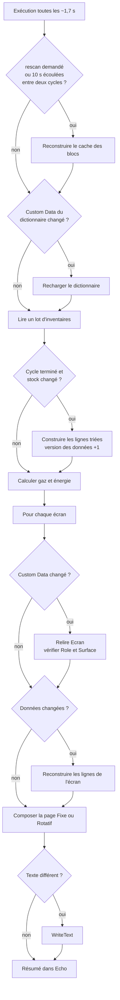

# Affichage Data Center

> [!summary] Résumé
> Script de bloc programmable qui affiche sur vos écrans LCD (et surfaces de cockpit) le stock de la base traduit en français, les réserves de gaz et l'état énergétique. Cette version corrige le conflit avec l'écran du Contrôle des Avaries, la rotation irrégulière des pages et le mauvais classement du grand réservoir d'oxygène. Elle relit aussi beaucoup moins souvent la grille, ce qui la rend nettement moins coûteuse en ressources.

## 1. Prérequis en jeu

| Bloc | Nom exact | Obligatoire | Rôle |
|---|---|---|---|
| Bloc programmable | libre (ex. `PB_DATA_CENTER`) | Oui | Exécute le script |
| Écran LCD / cockpit / PB | libre | Oui (au moins un) | Custom Data avec une section `[Ecran]` |
| N'importe quel bloc | `SERVEUR_DICTIONNAIRE` | Non | Traductions, alias et catégories (voir [[Serveur Dictionnaire]]) |

Tous les blocs doivent être sur la **même construction** que le PB (même grille ou sous-grilles par rotor / piston). Le contenu d'un vaisseau amarré par connecteur n'est pas compté (voir la constante `SEULEMENT_CETTE_CONSTRUCTION`).

### Serveur dictionnaire (extrait)

Le format complet est décrit dans [[Serveur Dictionnaire]]. Pour ce script, les sections utiles sont les suivantes :

```ini
[Categories]
ore=minerai, minerais
ingot=lingot, lingots
component=composant, composants

[Alias]
Stone=pierre, gravier
Iron=fer, fe

[Affichage]
Iron=Fer
Stone=Pierre
Ore_Stone=Pierre
Ingot_Stone=Gravier
```

> [!info] Priorité des noms
> Pour un objet, le script cherche d'abord la clé spécifique `Categorie_SubtypeId` (ex. `Ingot_Stone=Gravier`), puis la clé générique `SubtypeId` (ex. `Stone=Pierre`). S'il ne trouve rien, il affiche le nom du jeu.

### Écran Fixe (chef mineur) — configuration d'origine, toujours valable

```ini
[Ecran]
Mode=Fixe
Page=1
TotalPages=1
Categories=ore, ingot
Exclusions=Stone
AfficherGaz=false
AfficherEnergie=false
```

### Écran Fixe avec alias (nouveau)

```ini
[Ecran]
Role=Stocks
Titre=MINERAIS ET LINGOTS
Mode=Fixe
Page=1
TotalPages=2
Categories=minerai, lingot
Exclusions=pierre
AfficherGaz=false
AfficherEnergie=false
```

> [!tip] Deux écrans côte à côte
> Pour répartir une longue liste sur deux LCD, mettez la même configuration sur les deux avec `TotalPages=2`, puis `Page=1` sur le premier et `Page=2` sur le second.

### Écran Rotatif (tableau de bord général)

```ini
[Ecran]
Mode=Rotatif
Categories=
Exclusions=
AfficherGaz=true
AfficherEnergie=true
LignesParPage=12
SecondesParPage=8
```

### Écran de cockpit (surface n°1)

Dans le Custom Data du **cockpit** :

```ini
[Ecran]
Surface=1
Titre=ENERGIE
Mode=Rotatif
Categories=aucune
AfficherGaz=true
AfficherEnergie=true
LignesParPage=8
```

> [!tip] Afficher uniquement le gaz et l'énergie
> Comme `Categories=` vide signifie « toutes les catégories », mettez un nom qui n'existe pas (ex. `Categories=aucune`) pour masquer les stocks.

> [!warning] Un écran = un script
> Un écran dont le Custom Data contient `Role=Avaries`, `Role=Structure` ou `Role=Carburant` appartient à un autre script et n'est **jamais** modifié par celui-ci. Un même bloc ne peut porter qu'une section `[Ecran]` : pour un cockpit, une seule de ses surfaces peut donc être pilotée par ce script.

## 2. Installation

1. Construisez un bloc programmable (de préférence sur la grille principale de la base).
2. Ouvrez l'éditeur du PB, effacez le contenu, puis collez le code de la section 9 (ou le fichier `AffichageDataCenter.cs`).
3. Cliquez sur **Vérifier le code**, puis **OK**. Le script démarre seul : il s'exécute toutes les ~1,7 s.
4. (Facultatif) Créez le bloc `SERVEUR_DICTIONNAIRE` et remplissez son Custom Data (voir [[Serveur Dictionnaire]]).
5. Ajoutez une section `[Ecran]` dans le Custom Data de chaque écran voulu (exemples en section 1).
6. Un écran nouvellement configuré apparaît dans les 10 s (rescan automatique). Pour aller plus vite, lancez le PB avec l'argument `rescan`.
7. Regardez le terminal du PB (panneau de droite) : il affiche le résumé et les éventuelles erreurs de configuration.

## 3. Configuration

### Constantes (en tête du script)

| Constante | Défaut | Effet |
|---|---|---|
| `NOM_SERVEUR_DICTIONNAIRE` | `SERVEUR_DICTIONNAIRE` | Nom du bloc dictionnaire |
| `SECTION_ECRAN` | `Ecran` | Section INI qui désigne un écran |
| `ROLE_STOCKS` | `Stocks` | Valeur de `Role` acceptée (en plus de `Role` absent) |
| `SEULEMENT_CETTE_CONSTRUCTION` | `true` | Ignore les blocs des vaisseaux amarrés |
| `SECONDES_ENTRE_RESCANS` | `10.0` | Délai entre deux recherches automatiques des blocs |
| `BLOCS_INVENTAIRE_PAR_CYCLE` | `150` | Nombre maximal d'inventaires lus par exécution |
| `FRACTION_MAX_INSTRUCTIONS` | `0.5` | Part maximale du budget d'instructions utilisée pour la collecte |
| `TITRE_PAR_DEFAUT` | `DATA CENTER` | Titre si la clé `Titre` est absente |
| `LIGNES_PAR_PAGE_PAR_DEFAUT` | `10` | Lignes par page en mode Rotatif |
| `SECONDES_PAR_PAGE_PAR_DEFAUT` | `8.0` | Durée d'une page en mode Rotatif |
| `SECONDES_PAR_PAGE_MINIMUM` | `2.0` | Durée minimale acceptée pour une page |
| `AFFICHER_ENTETES_CATEGORIES` | `true` | En-têtes `--- LINGOTS ---` quand plusieurs catégories sont affichées |
| `ORDRE_CATEGORIES` / `TITRES_CATEGORIES` | Ore, Ingot, Component... | Ordre de tri et titres des catégories |
| `TYPES_PRODUCTEURS` / `NOMS_PRODUCTEURS` | Solaire, Éolien, Réacteurs, Moteurs H2, Autres | Classement des sources d'énergie |

### Clés de la section `[Ecran]`

| Clé | Valeurs | Défaut | Effet |
|---|---|---|---|
| `Role` | vide, `Stocks` | vide | Toute autre valeur : écran ignoré (réservé à un autre script) |
| `Surface` | `0`, `1`, ... | `0` | Index de la surface (cockpit, PB) ; `0` pour un LCD |
| `Titre` | texte | `DATA CENTER` | Titre en haut de l'écran |
| `Mode` | `Fixe`, `Rotatif` | `Fixe` | Page figée ou défilement automatique |
| `Page` | 1 à `TotalPages` | `1` | (Fixe) partie affichée ; bornée si elle est hors limites |
| `TotalPages` | ≥ 1 | `1` | (Fixe) nombre de parts de la liste |
| `LignesParPage` | ≥ 1 | `10` | (Rotatif) lignes par page |
| `SecondesParPage` | ≥ 2 | `8` | (Rotatif) durée d'une page, en secondes de jeu |
| `Categories` | liste séparée par des virgules | vide = tout | Catégories du jeu (`ore`, `ingot`...) ou leurs alias (`minerai`, `lingot`) |
| `Exclusions` | liste séparée par des virgules | vide | SubtypeId (`Stone`), alias (`pierre`), nom affiché (`Gravier`) ou clé spécifique (`Ingot_Stone`) |
| `AfficherGaz` | `true` / `false` | `false` | Bloc « Réserves de gaz » en tête |
| `AfficherEnergie` | `true` / `false` | `false` | Bloc « Gestion énergie » en tête |

> [!info] Exclusion par alias ou par nom affiché
> Avec `[Alias] Stone=pierre`, `Exclusions=pierre` masque **tous** les objets `Stone` (minerai et gravier). Si vous voulez ne masquer que le gravier, utilisez son nom affiché (`Exclusions=Gravier`) ou sa clé spécifique (`Exclusions=Ingot_Stone`).

## 4. Commandes

| Argument | Effet |
|---|---|
| *(aucun)* | Fonctionnement normal (exécution automatique toutes les ~1,7 s) |
| `rescan` | Recherche immédiatement les blocs (nouveaux écrans, coffres, réservoirs...) et relance la collecte |

Pour lier la commande à un bouton : posez un **panneau de boutons** (ou utilisez la barre d'outils d'un cockpit), glissez le bloc programmable dans un emplacement, choisissez l'action **Exécuter** et saisissez l'argument `rescan`.

## 5. Fonctionnement

### Algorithme expliqué

1. **Démarrage** : le script se programme pour tourner toutes les 100 ticks (~1,7 s) et met en cache les listes de blocs : blocs à inventaire, réservoirs, batteries, producteurs et écrans candidats (blocs dont le Custom Data contient `[Ecran]`). Seuls les blocs de la même construction que le PB sont gardés.
2. **Temps** : à chaque exécution, le script ajoute `Runtime.TimeSinceLastRun` (le temps de jeu écoulé) à un compteur global. Ce compteur sert à la fois au rescan périodique et à la rotation des pages.
3. **Rescan** : toutes les 10 s (ou sur `rescan`), les listes de blocs sont reconstruites. Pour ne pas interrompre une collecte en cours, le rescan périodique n'a lieu qu'entre deux cycles de collecte. Les objets « écran » existants sont réutilisés afin de conserver leur mémoire (dernier Custom Data, dernier texte).
4. **Dictionnaire** : le Custom Data du `SERVEUR_DICTIONNAIRE` est comparé à la dernière version lue, et il n'est réanalysé que s'il a changé. Le script en tire trois tables : alias de catégories, alias d'objets et noms affichés.
5. **Collecte par lots** : à chaque exécution, le script lit au plus 150 blocs à inventaire (et s'arrête aussi si la moitié du budget d'instructions est consommée). Les quantités sont additionnées par type d'objet. Quand tous les blocs ont été lus, le cycle est terminé : le nouveau total remplace l'ancien, mais seulement s'il est différent. Cette collecte est faite **une seule fois pour tous les écrans**.
6. **Lignes de stock** : quand le stock ou le dictionnaire change, chaque type d'objet devient une ligne traduite et formatée une seule fois (`Fer : 15,000`). Les lignes sont triées par catégorie (minerais, lingots, composants...) puis par nom affiché.
7. **Gaz et énergie** : ces blocs sont peu nombreux, donc ils sont recalculés à chaque exécution. Un réservoir est compté comme hydrogène si son SubtypeId contient « Hydrogen », sinon comme oxygène. Les libellés viennent des clés `Oxygen` et `Hydrogen` de la section `[Affichage]` du serveur (`O2` et `H2` par défaut). L'énergie affiche la charge des batteries, leur entrée et leur sortie, puis la production actuelle sur la production maximale pour chaque source présente, et enfin le total.
8. **Écrans** : pour chaque écran candidat :
   - si son Custom Data a changé, la section `[Ecran]` est relue et validée. L'écran est ignoré si `Role` désigne un autre script ou si la surface n'existe pas ;
   - si les données ont changé, la liste complète des lignes de l'écran est reconstruite : gaz, énergie, puis stocks filtrés, avec des en-têtes de catégorie quand il y en a plusieurs ;
   - la page à montrer est composée. En mode Fixe, la liste est découpée en `TotalPages` parts et c'est la part `Page` qui s'affiche. En mode Rotatif, la page vaut `(temps / SecondesParPage) modulo nombre de pages` ;
   - `WriteText` n'est appelé que si le texte diffère du précédent.
9. **Résumé** : le terminal du PB affiche l'état du dictionnaire, le nombre d'écrans actifs, le nombre de blocs, la progression de la collecte, le temps d'exécution et les erreurs de configuration de chaque écran.



## 6. Optimisations et corrections par rapport à l'original

| Problème d'origine | Conséquence en jeu | Correction |
|---|---|---|
| Tout écran ayant une section `[Ecran]` est pris, y compris `Role=Avaries` | Deux scripts écrivent sur le même écran, dont l'affichage clignote entre les deux contenus | Seuls `Role` absent ou `Role=Stocks` sont pilotés |
| `SpaceEngineers.Game.ModAPI.Ingame.ContentType` | Erreur de compilation (mauvais espace de noms) | `ContentType.TEXT_AND_IMAGE`, appliqué seulement si nécessaire |
| Rotation `DateTime.Now.Second / 8.0` | 7,5 créneaux par minute, donc une page plus courte à chaque minute. L'heure réelle ignore aussi la pause et la vitesse de simulation | Minuterie fondée sur `Runtime.TimeSinceLastRun`, avec `SecondesParPage` réglable |
| `compteurTicksGlobal` / `TICKS_PAR_PAGE` jamais utilisés | Code mort trompeur | Supprimés |
| Gaz : test `SubtypeId.Contains("Oxygen")` | Le grand réservoir d'oxygène vanilla (SubtypeId vide) est compté comme hydrogène | Hydrogène si le SubtypeId contient « Hydrogen », oxygène sinon |
| Énergie : `moteurH2` calculé mais jamais affiché, éoliennes ignorées | Information manquante | Ligne par source présente (solaire, éolien, réacteurs, moteurs H2, autres) avec production actuelle / maximale et total |
| Batteries comptées comme producteurs possibles (`IMyPowerProducer`) | Risque de double comptage | Batteries exclues de la liste des producteurs |
| Mode Fixe : `Page > TotalPages` ou `TotalPages <= 0` | Page vide ou division par zéro | Valeurs validées et bornées, avec un avertissement dans le terminal |
| Gaz / énergie ajoutés comme UNE ligne contenant des retours à la ligne | Pagination fausse (un bloc de 4 lignes compté pour 1) | Une entrée par ligne réelle |
| `GetBlocks` + analyse du Custom Data de tous les écrans + recomptage complet à chaque exécution | Coût élevé en instructions, ralentissement du serveur sur une grosse base | Cache des blocs avec rescan toutes les 10 s ou sur `rescan`, Custom Data réanalysé seulement s'il change, collecte par lots partagée par tous les écrans, `WriteText` seulement si le texte change, `StringBuilder` et listes réutilisés |
| Aucun filtre de construction | Le contenu d'un vaisseau amarré gonfle les stocks, et ses écrans `[Ecran]` sont réécrits | Filtre `IsSameConstructAs(Me)` (constante `SEULEMENT_CETTE_CONSTRUCTION`) |
| Ordre des lignes = ordre interne du dictionnaire | Les lignes changent de place d'un cycle à l'autre | Tri par catégorie, nom affiché puis SubtypeId, avec des en-têtes de catégorie |
| Seuls les `IMyTextPanel` sont gérés | Impossible d'utiliser les écrans d'un cockpit | Prise en charge de `IMyTextSurfaceProvider` + clé `Surface=N` |
| Dictionnaire lu une seule fois au démarrage, section `[Affichage]` seule | Il faut recompiler après chaque modification, et pas d'alias possible | Rechargement automatique, prise en charge de `[Categories]`, `[Alias]`, de l'ancienne `[Dictionnaire]` et des clés spécifiques `Categorie_SubtypeId` |
| `Exclusions` comparé au seul SubtypeId | `Exclusions=pierre` ne fonctionne pas | Exclusion par SubtypeId, alias, nom affiché ou clé spécifique |

## 7. Limites connues

- **Rotation quantifiée** : le script tourne toutes les ~1,7 s, donc un changement de page intervient au premier passage après l'échéance (± 1,7 s). Les écrans qui ont le même `SecondesParPage` tournent en même temps.
- **Délai d'apparition** : un écran ou un coffre ajouté est pris en compte au plus tard au rescan suivant (10 s), ou tout de suite avec `rescan`. Sur une très grosse base, le stock affiché peut avoir plusieurs secondes de retard (collecte par lots).
- **Une surface par bloc** : un bloc ne porte qu'une section `[Ecran]`. Sur un cockpit, une seule surface est donc pilotée par ce script.
- **Tri alphabétique** : la comparaison ignore la casse mais pas les accents (`Éthanol` est classé après `Z`).
- **Format des nombres** : `N0` utilise le séparateur de milliers de la culture du jeu (souvent la virgule : `15,000`).
- **Production maximale** : `MaxOutput` est la puissance disponible **à cet instant**. Pour un panneau solaire ou une éolienne, elle dépend du soleil ou du vent.
- **Classement des producteurs** : il se fait sur le TypeId du bloc (`SolarPanel`, `WindTurbine`, `Reactor`, `HydrogenEngine`). Un producteur moddé d'un autre type apparaît dans « Autres ».
- **API à confirmer** :
  - `IMyEntity.Closed` est utilisé pour ignorer les blocs détruits entre deux rescans ;
  - `IMyTextPanel` est traité comme `IMyTextSurface` (vrai depuis la refonte des LCD).
  
  Ces deux points sont standard dans les scripts publics, mais ils n'ont pas été vérifiés ici par une compilation en jeu.
- Le pré-filtre `[Ecran]` ignore la casse, mais la reconnaissance finale de la section dépend de `MyIni`. Écrivez `[Ecran]` exactement.

## 8. Dépannage

| Symptôme | Cause probable | Solution |
|---|---|---|
| L'écran reste vide ou n'est pas mis à jour | Pas de section `[Ecran]`, ou écran ajouté depuis moins de 10 s | Vérifiez le Custom Data, puis lancez le PB avec `rescan` |
| L'écran des avaries n'est plus modifié par ce script | Comportement voulu : `Role=Avaries` | Aucun changement à faire (correction du conflit) |
| `! NomEcran : Surface=2 n'existe pas` dans le terminal | Index de surface trop grand pour ce bloc | Essayez `Surface=0`, `1`... (le nombre dépend du cockpit) |
| `! NomEcran : Page=3 hors de 1..2` | `Page` supérieure à `TotalPages` | Corrigez `Page` ou `TotalPages` |
| Les noms restent en anglais | `SERVEUR_DICTIONNAIRE` absent ou mal nommé, ou section `[Affichage]` manquante | Vérifiez le nom exact du bloc et le résumé « Dictionnaire » dans le terminal |
| `Custom Data du serveur invalide` | Erreur de syntaxe INI (ligne sans `=`, section mal fermée) | Corrigez la ligne indiquée dans le message |
| `Categories=minerai` n'affiche rien | Alias absent de `[Categories]` | Ajoutez `ore=minerai` dans le dictionnaire ou utilisez `Categories=ore` |
| `Exclusions=pierre` masque aussi le gravier | L'alias `pierre` pointe vers le SubtypeId `Stone`, commun au minerai et au lingot | Utilisez `Exclusions=Ore_Stone` ou le nom affiché exact |
| Les stocks d'un vaisseau amarré n'apparaissent pas | `SEULEMENT_CETTE_CONSTRUCTION = true` | Passez la constante à `false` si vous voulez les compter |
| Erreur « Script too complex » | Base énorme | Baissez `BLOCS_INVENTAIRE_PAR_CYCLE` ou `FRACTION_MAX_INSTRUCTIONS` |

## 9. Code complet

```csharp
// ==============================================================================
// SCRIPT      : AFFICHAGE DATA CENTER (version optimisée)
// ROLE        : Affiche sur des écrans LCD (ou des surfaces de cockpit / PB) :
//               - le stock d'objets de la construction (minerais, lingots,
//                 composants, munitions...), traduit en français et trié ;
//               - les réserves de gaz (oxygène / hydrogène) ;
//               - l'état énergétique (batteries + production par source).
// ------------------------------------------------------------------------------
// NOMENCLATURE DES BLOCS
//   - Écrans : tout LCD (IMyTextPanel) ou bloc à surfaces (cockpit, siège,
//     bloc programmable...) dont le Custom Data contient une section [Ecran]
//     avec la clé Role ABSENTE ou Role=Stocks.
//     Les écrans Role=Avaries / Structure / Carburant appartiennent à d'autres
//     scripts : ils sont IGNORÉS (bug d'origine corrigé).
//   - SERVEUR_DICTIONNAIRE (facultatif) : bloc dont le Custom Data contient les
//     sections [Categories], [Alias], [Affichage] (et l'ancienne [Dictionnaire]).
// ------------------------------------------------------------------------------
// CLÉS DE LA SECTION [Ecran]
//   Existantes : Mode=Fixe|Rotatif, Page, TotalPages, Categories, Exclusions,
//                AfficherGaz, AfficherEnergie
//   Nouvelles (optionnelles) : Titre, LignesParPage, SecondesParPage, Surface, Role
// ------------------------------------------------------------------------------
// COMMANDES (argument du bloc programmable)
//   rescan : relance immédiatement la recherche des blocs et la collecte.
// ------------------------------------------------------------------------------
// DÉPENDANCES
//   SERVEUR_DICTIONNAIRE (facultatif : sans lui, les noms du jeu sont affichés).
// ==============================================================================


// ==============================================================================
// CONSTANTES DE CONFIGURATION (toutes les valeurs réglables sont ici)
// ==============================================================================

/// <summary>Nom exact du bloc qui contient le dictionnaire de traduction.</summary>
const string NOM_SERVEUR_DICTIONNAIRE = "SERVEUR_DICTIONNAIRE";

/// <summary>Nom de la section INI qui désigne un écran à piloter.</summary>
const string SECTION_ECRAN = "Ecran";

/// <summary>Valeur de la clé Role réservée à ce script (Role absent = Stocks aussi).</summary>
const string ROLE_STOCKS = "Stocks";

/// <summary>
/// true : on ne compte / n'affiche que les blocs de CETTE construction
/// (le contenu d'un vaisseau amarré par connecteur est ignoré).
/// false : tout ce qui est accessible sur le réseau de blocs est pris en compte.
/// </summary>
const bool SEULEMENT_CETTE_CONSTRUCTION = true;

/// <summary>Délai (secondes de jeu) entre deux recherches automatiques des blocs.</summary>
const double SECONDES_ENTRE_RESCANS = 10.0;

/// <summary>Nombre maximum de blocs à inventaire lus par exécution (traitement par lots).</summary>
const int BLOCS_INVENTAIRE_PAR_CYCLE = 150;

/// <summary>
/// Fraction du budget d'instructions du PB au-delà de laquelle la collecte des
/// inventaires s'interrompt et reprend à l'exécution suivante (sécurité anti-plantage).
/// </summary>
const double FRACTION_MAX_INSTRUCTIONS = 0.5;

/// <summary>Titre affiché en haut des écrans si la clé Titre est absente.</summary>
const string TITRE_PAR_DEFAUT = "DATA CENTER";

/// <summary>Nombre de lignes par page en mode Rotatif si LignesParPage est absent.</summary>
const int LIGNES_PAR_PAGE_PAR_DEFAUT = 10;

/// <summary>Durée d'affichage d'une page en mode Rotatif si SecondesParPage est absent.</summary>
const double SECONDES_PAR_PAGE_PAR_DEFAUT = 8.0;

/// <summary>
/// Durée minimale d'une page : le script tourne toutes les ~1,7 s (Update100),
/// une valeur plus petite ne serait de toute façon pas respectée.
/// </summary>
const double SECONDES_PAR_PAGE_MINIMUM = 2.0;

/// <summary>true : insère un en-tête "--- LINGOTS ---" quand un écran affiche plusieurs catégories.</summary>
const bool AFFICHER_ENTETES_CATEGORIES = true;

/// <summary>Préfixe technique retiré des TypeId d'objets ("MyObjectBuilder_Ore" -> "Ore").</summary>
const string PREFIXE_TYPE_OBJET = "MyObjectBuilder_";

/// <summary>
/// Ordre d'affichage des catégories d'objets (TypeId sans préfixe).
/// Une catégorie inconnue (mod) est placée après celles-ci, par ordre alphabétique.
/// </summary>
readonly string[] ORDRE_CATEGORIES =
{
    "Ore", "Ingot", "Component", "AmmoMagazine", "PhysicalGunObject",
    "OxygenContainerObject", "GasContainerObject", "ConsumableItem"
};

/// <summary>Titres des en-têtes de catégorie, dans le même ordre que ORDRE_CATEGORIES.</summary>
readonly string[] TITRES_CATEGORIES =
{
    "MINERAIS", "LINGOTS", "COMPOSANTS", "MUNITIONS", "OUTILS ET ARMES",
    "BOUTEILLES D'OXYGÈNE", "BOUTEILLES D'HYDROGÈNE", "CONSOMMABLES"
};

/// <summary>
/// Morceaux de TypeId permettant de classer les producteurs d'énergie
/// (comparaison "contient"). L'index correspond à NOMS_PRODUCTEURS.
/// </summary>
readonly string[] TYPES_PRODUCTEURS = { "SolarPanel", "WindTurbine", "Reactor", "HydrogenEngine" };

/// <summary>Noms affichés des sources d'énergie ; le dernier ("Autres") reçoit tout le reste.</summary>
readonly string[] NOMS_PRODUCTEURS = { "Solaire", "Éolien", "Réacteurs", "Moteurs H2", "Autres" };


// ==============================================================================
// CLASSES DE DONNÉES
// ==============================================================================

/// <summary>
/// Une ligne de stock prête à afficher : un type d'objet (catégorie + SubtypeId)
/// et la quantité totale trouvée dans tous les inventaires.
/// Le texte est formaté UNE fois ici, puis simplement réutilisé par tous les écrans.
/// </summary>
class LigneStock
{
    /// <summary>Catégorie du jeu sans préfixe, ex. "Ore", "Ingot".</summary>
    public string Categorie;
    /// <summary>Rang de tri de la catégorie (index dans ORDRE_CATEGORIES).</summary>
    public int RangCategorie;
    /// <summary>Identifiant interne de l'objet, ex. "Stone".</summary>
    public string SubtypeId;
    /// <summary>Clé spécifique "Categorie_SubtypeId", ex. "Ingot_Stone".</summary>
    public string CleSpecifique;
    /// <summary>Nom lisible issu du dictionnaire, ex. "Gravier".</summary>
    public string NomAffiche;
    /// <summary>Quantité totale (kg pour minerais / lingots, unités sinon).</summary>
    public double Quantite;
    /// <summary>Texte final de la ligne, ex. "Gravier : 12,500".</summary>
    public string Texte;
}

/// <summary>
/// Configuration et état d'UN écran piloté par le script.
/// L'objet est conservé entre les exécutions (et entre les rescans) pour
/// mémoriser le dernier Custom Data lu et le dernier texte écrit, ce qui évite
/// de reparser et de réécrire inutilement.
/// </summary>
class ConfigEcran
{
    /// <summary>Bloc qui porte la configuration (LCD, cockpit, PB...).</summary>
    public IMyTerminalBlock Bloc;
    /// <summary>Surface d'affichage effectivement utilisée (selon la clé Surface).</summary>
    public IMyTextSurface Surface;
    /// <summary>true si l'écran est valide et appartient à ce script (Role absent ou Stocks).</summary>
    public bool EstActif;
    /// <summary>Dernier Custom Data analysé : sert à ne reparser que s'il a changé.</summary>
    public string DernierCustomData;
    /// <summary>Message d'erreur de configuration à montrer dans Echo (null si tout va bien).</summary>
    public string Avertissement;

    // --- Paramètres lus dans [Ecran] ---
    public bool ModeRotatif;
    public int PageFixe = 1;
    public int TotalPages = 1;
    public int LignesParPage = 10;
    public double SecondesParPage = 8.0;
    public string Titre = "";
    public bool AfficherGaz;
    public bool AfficherEnergie;
    /// <summary>Termes bruts de la clé Categories (ex. "minerai", "ingot").</summary>
    public List<string> TermesCategories = new List<string>();
    /// <summary>Termes bruts de la clé Exclusions (ex. "pierre", "Stone").</summary>
    public List<string> TermesExclusions = new List<string>();

    // --- Filtres résolus avec le dictionnaire (recalculés quand les données changent) ---
    public HashSet<string> CategoriesIncluses = new HashSet<string>(StringComparer.OrdinalIgnoreCase);
    public HashSet<string> SubtypesExclus = new HashSet<string>(StringComparer.OrdinalIgnoreCase);
    public HashSet<string> TermesExclus = new HashSet<string>(StringComparer.OrdinalIgnoreCase);

    // --- Résultat ---
    /// <summary>Toutes les lignes de l'écran (toutes pages confondues).</summary>
    public List<string> Lignes = new List<string>();
    /// <summary>Version des données utilisée pour construire Lignes (-1 = à reconstruire).</summary>
    public int VersionDonneesAppliquee = -1;
    /// <summary>Dernier texte écrit : on n'appelle WriteText que si le texte change.</summary>
    public string DernierTexte;
}


// ==============================================================================
// CHAMPS (réutilisés d'une exécution à l'autre pour éviter les allocations)
// ==============================================================================

// --- Lecture INI ---
MyIni lecteurIni = new MyIni();
List<MyIniKey> clesIni = new List<MyIniKey>();

// --- Dictionnaire (toutes les comparaisons ignorent la casse) ---
IMyTerminalBlock serveurDictionnaire;
string dernierCustomDataServeur = null;   // null = jamais lu -> forcera le premier chargement
string erreurDictionnaire = null;
/// <summary>"Iron" -> "Fer" et "Ingot_Stone" -> "Gravier".</summary>
Dictionary<string, string> dicoAffichage = new Dictionary<string, string>(StringComparer.OrdinalIgnoreCase);
/// <summary>"minerai" -> "ore", "ore" -> "ore".</summary>
Dictionary<string, string> dicoCategories = new Dictionary<string, string>(StringComparer.OrdinalIgnoreCase);
/// <summary>"fer" -> "Iron", "Iron" -> "Iron".</summary>
Dictionary<string, string> dicoAlias = new Dictionary<string, string>(StringComparer.OrdinalIgnoreCase);

// --- Blocs mis en cache (rescannés périodiquement) ---
List<IMyTerminalBlock> blocsInventaire = new List<IMyTerminalBlock>();
List<IMyGasTank> reservoirs = new List<IMyGasTank>();
List<IMyBatteryBlock> batteries = new List<IMyBatteryBlock>();
List<IMyPowerProducer> producteurs = new List<IMyPowerProducer>();
List<IMyTerminalBlock> tamponBlocs = new List<IMyTerminalBlock>();
Dictionary<long, ConfigEcran> ecransConnus = new Dictionary<long, ConfigEcran>();
List<ConfigEcran> ecrans = new List<ConfigEcran>();
double secondesDepuisRescan = 0;
bool rescanDemande = false;

// --- Collecte des inventaires par lots ---
Dictionary<MyItemType, double> inventaireEnCours = new Dictionary<MyItemType, double>();
Dictionary<MyItemType, double> inventaireStable = new Dictionary<MyItemType, double>();
List<MyInventoryItem> tamponObjets = new List<MyInventoryItem>();
int indexCollecte = 0;          // prochain bloc à lire dans blocsInventaire
bool inventairePret = false;    // true dès qu'un cycle complet a été collecté

// --- Données préparées pour les écrans ---
List<LigneStock> lignesStock = new List<LigneStock>();
List<LigneStock> tamponLignesFiltrees = new List<LigneStock>();
List<string> lignesGaz = new List<string>();
List<string> lignesEnergie = new List<string>();
List<string> tamponLignes = new List<string>();
double[] productionActuelle = new double[5];
double[] productionMax = new double[5];
int[] nombreProducteurs = new int[5];
/// <summary>Augmente à chaque changement de données : les écrans se reconstruisent alors.</summary>
int versionDonnees = 0;

// --- Temps et texte ---
double tempsTotalSecondes = 0;  // temps de jeu cumulé, sert à la rotation des pages
StringBuilder texteEcran = new StringBuilder();
StringBuilder texteEcho = new StringBuilder();
string messageCommande = null;


// ==============================================================================
// DÉMARRAGE
// ==============================================================================

/// <summary>
/// Constructeur : appelé à la compilation / au chargement du monde.
/// Programme une exécution toutes les 100 ticks (~1,7 s) et remplit le cache des blocs.
/// </summary>
public Program()
{
    Runtime.UpdateFrequency = UpdateFrequency.Update100;
    RescannerBlocs();
}


// ==============================================================================
// BOUCLE PRINCIPALE
// ==============================================================================

/// <summary>
/// Point d'entrée appelé par le jeu (automatiquement ou via un argument).
/// Chaque étape ne fait que le travail nécessaire : rescan seulement si le délai
/// est écoulé, reparse seulement si un Custom Data a changé, écriture seulement
/// si le texte de l'écran change.
/// </summary>
public void Main(string argument, UpdateType updateSource)
{
    // 1. COMMANDE ÉVENTUELLE
    string commande = (argument ?? "").Trim();
    if (commande.Length > 0)
    {
        if (string.Equals(commande, "rescan", StringComparison.OrdinalIgnoreCase))
        {
            rescanDemande = true;
            messageCommande = "Rescan demandé.";
        }
        else
        {
            messageCommande = "Commande inconnue : " + commande + " (attendu : rescan)";
        }
    }

    // 2. TEMPS DE JEU ÉCOULÉ (et non DateTime.Now, qui ignore les pauses / la vitesse de simulation)
    double secondesEcoulees = Runtime.TimeSinceLastRun.TotalSeconds;
    tempsTotalSecondes += secondesEcoulees;
    secondesDepuisRescan += secondesEcoulees;

    // 3. RESCAN DES BLOCS : sur demande, ou périodiquement mais uniquement entre deux
    //    cycles de collecte (sinon une très grosse base ne finirait jamais sa collecte).
    if (rescanDemande || (secondesDepuisRescan >= SECONDES_ENTRE_RESCANS && indexCollecte == 0))
    {
        RescannerBlocs();
    }

    // 4. DICTIONNAIRE : rechargé uniquement si le Custom Data du serveur a changé.
    bool dictionnaireChange = VerifierDictionnaire();

    // 5. INVENTAIRES : lecture d'un lot de blocs ; renvoie true quand un cycle complet
    //    vient de se terminer ET que le stock a changé.
    bool stockChange = CollecterInventairesParLot();
    if (dictionnaireChange || stockChange)
    {
        ConstruireLignesStock();
        versionDonnees++;
    }

    // 6. GAZ ET ÉNERGIE : peu de blocs, recalculés à chaque exécution.
    bool gazChange = MettreAJourGaz();
    bool energieChange = MettreAJourEnergie();
    if (gazChange || energieChange) versionDonnees++;

    // 7. ÉCRANS
    int nombreEcransActifs = 0;
    foreach (ConfigEcran ecran in ecrans)
    {
        if (MettreAJourEcran(ecran)) nombreEcransActifs++;
    }

    // 8. RÉSUMÉ DANS LE TERMINAL DU PB
    AfficherResume(nombreEcransActifs);
}


// ==============================================================================
// CACHE DES BLOCS
// ==============================================================================

/// <summary>
/// Indique si un bloc doit être pris en compte selon SEULEMENT_CETTE_CONSTRUCTION.
/// IsSameConstructAs inclut les sous-grilles (rotors, pistons) mais exclut les
/// vaisseaux simplement amarrés par connecteur.
/// </summary>
bool EstSurCetteConstruction(IMyTerminalBlock bloc)
{
    return !SEULEMENT_CETTE_CONSTRUCTION || bloc.IsSameConstructAs(Me);
}

/// <summary>
/// Remplit (ou rafraîchit) toutes les listes de blocs en cache.
/// Coûteux : appelé seulement au démarrage, toutes les SECONDES_ENTRE_RESCANS
/// secondes, ou avec l'argument "rescan".
/// </summary>
void RescannerBlocs()
{
    rescanDemande = false;
    secondesDepuisRescan = 0;

    // Serveur dictionnaire (peut être absent : le script fonctionne quand même).
    serveurDictionnaire = GridTerminalSystem.GetBlockWithName(NOM_SERVEUR_DICTIONNAIRE);

    // Blocs à inventaire (coffres, raffineries, assembleurs, connecteurs...).
    blocsInventaire.Clear();
    GridTerminalSystem.GetBlocksOfType(blocsInventaire, b => b.HasInventory && EstSurCetteConstruction(b));

    // Réservoirs de gaz, batteries, producteurs (les batteries sont aussi des
    // IMyPowerProducer : on les exclut ici pour ne pas les compter deux fois).
    reservoirs.Clear();
    GridTerminalSystem.GetBlocksOfType(reservoirs, b => EstSurCetteConstruction(b));
    batteries.Clear();
    GridTerminalSystem.GetBlocksOfType(batteries, b => EstSurCetteConstruction(b));
    producteurs.Clear();
    GridTerminalSystem.GetBlocksOfType(producteurs, b => !(b is IMyBatteryBlock) && EstSurCetteConstruction(b));

    // Écrans candidats : LCD ou blocs à surfaces dont le Custom Data mentionne [Ecran].
    // Le test "contient [Ecran]" est un pré-filtre rapide ; l'analyse INI complète
    // (et le contrôle de Role) est faite dans LireConfigEcran.
    tamponBlocs.Clear();
    GridTerminalSystem.GetBlocksOfType(tamponBlocs, b =>
        (b is IMyTextPanel || b is IMyTextSurfaceProvider)
        && EstSurCetteConstruction(b)
        && b.CustomData.IndexOf("[" + SECTION_ECRAN + "]", StringComparison.OrdinalIgnoreCase) >= 0);

    // On réutilise les objets ConfigEcran déjà connus (même EntityId) pour garder
    // leur dernier Custom Data et leur dernier texte ; les écrans disparus sont oubliés.
    ecrans.Clear();
    foreach (IMyTerminalBlock bloc in tamponBlocs)
    {
        ConfigEcran ecran;
        if (!ecransConnus.TryGetValue(bloc.EntityId, out ecran))
        {
            ecran = new ConfigEcran();
            ecran.Bloc = bloc;
        }
        ecrans.Add(ecran);
    }
    ecransConnus.Clear();
    foreach (ConfigEcran ecran in ecrans) ecransConnus[ecran.Bloc.EntityId] = ecran;

    // La liste des blocs à inventaire a pu changer : on recommence le cycle de
    // collecte depuis le début (l'ancien stock reste affiché en attendant).
    indexCollecte = 0;
    inventaireEnCours.Clear();
}


// ==============================================================================
// DICTIONNAIRE (SERVEUR_DICTIONNAIRE)
// ==============================================================================

/// <summary>
/// Compare le Custom Data du serveur avec la dernière version lue et ne recharge
/// le dictionnaire que s'il a changé.
/// </summary>
/// <returns>true si le dictionnaire vient d'être (re)chargé.</returns>
bool VerifierDictionnaire()
{
    if (serveurDictionnaire != null && serveurDictionnaire.Closed) serveurDictionnaire = null;

    string contenu = serveurDictionnaire == null ? "" : serveurDictionnaire.CustomData;
    if (contenu == dernierCustomDataServeur) return false;

    dernierCustomDataServeur = contenu;
    ChargerDictionnaire(contenu);
    return true;
}

/// <summary>
/// Analyse le Custom Data du serveur (format du cahier des charges) :
///   [Categories]   categorie=alias1, alias2
///   [Dictionnaire] alias=SubtypeId          (ancien format, lu pour compatibilité)
///   [Alias]        SubtypeId=alias1, alias2 (nouveau format, prioritaire)
///   [Affichage]    SubtypeId=Nom  ou  Categorie_SubtypeId=Nom
/// </summary>
void ChargerDictionnaire(string contenu)
{
    dicoAffichage.Clear();
    dicoCategories.Clear();
    dicoAlias.Clear();
    erreurDictionnaire = null;

    if (contenu.Length == 0) return;   // pas de serveur ou Custom Data vide

    MyIniParseResult resultat;
    if (!lecteurIni.TryParse(contenu, out resultat))
    {
        erreurDictionnaire = "Custom Data du serveur invalide : " + resultat.ToString();
        return;
    }

    // [Categories] : la catégorie est un alias d'elle-même, puis ses alias.
    clesIni.Clear();
    lecteurIni.GetKeys("Categories", clesIni);
    foreach (MyIniKey cle in clesIni)
    {
        string categorie = cle.Name.Trim();
        dicoCategories[categorie] = categorie;
        AjouterAlias(dicoCategories, lecteurIni.Get(cle.Section, cle.Name).ToString(""), categorie);
    }

    // [Dictionnaire] (ancien format alias=SubtypeId) lu AVANT [Alias] :
    // en cas de doublon, le nouveau format l'emporte.
    clesIni.Clear();
    lecteurIni.GetKeys("Dictionnaire", clesIni);
    foreach (MyIniKey cle in clesIni)
    {
        string subtypeId = lecteurIni.Get(cle.Section, cle.Name).ToString("").Trim();
        if (subtypeId.Length > 0) dicoAlias[cle.Name.Trim()] = subtypeId;
    }

    // [Alias] : le SubtypeId est toujours un alias implicite de lui-même.
    clesIni.Clear();
    lecteurIni.GetKeys("Alias", clesIni);
    foreach (MyIniKey cle in clesIni)
    {
        string subtypeId = cle.Name.Trim();
        dicoAlias[subtypeId] = subtypeId;
        AjouterAlias(dicoAlias, lecteurIni.Get(cle.Section, cle.Name).ToString(""), subtypeId);
    }

    // [Affichage] : noms lisibles (clé générique ou clé spécifique Categorie_SubtypeId).
    clesIni.Clear();
    lecteurIni.GetKeys("Affichage", clesIni);
    foreach (MyIniKey cle in clesIni)
    {
        string nom = lecteurIni.Get(cle.Section, cle.Name).ToString("").Trim();
        if (nom.Length > 0) dicoAffichage[cle.Name.Trim()] = nom;
    }
}

/// <summary>
/// Découpe une liste "alias1, alias2" et associe chaque alias non vide à la cible.
/// </summary>
void AjouterAlias(Dictionary<string, string> dico, string listeAlias, string cible)
{
    foreach (string morceau in listeAlias.Split(','))
    {
        string alias = morceau.Trim();
        if (alias.Length > 0) dico[alias] = cible;
    }
}

/// <summary>
/// Renvoie le nom à afficher pour un objet : clé spécifique "Categorie_SubtypeId"
/// d'abord (ex. Ingot_Stone=Gravier), puis clé générique SubtypeId, sinon le nom du jeu.
/// </summary>
string TrouverNomAffiche(string cleSpecifique, string subtypeId)
{
    string nom;
    if (dicoAffichage.TryGetValue(cleSpecifique, out nom)) return nom;
    if (dicoAffichage.TryGetValue(subtypeId, out nom)) return nom;
    return subtypeId;
}


// ==============================================================================
// COLLECTE DES INVENTAIRES (par lots, une seule fois pour TOUS les écrans)
// ==============================================================================

/// <summary>
/// Lit un lot de blocs à inventaire et cumule les quantités par type d'objet.
/// S'arrête quand BLOCS_INVENTAIRE_PAR_CYCLE blocs ont été lus OU quand le budget
/// d'instructions est à moitié consommé ; reprend à l'exécution suivante.
/// En fin de cycle, le stock "en cours" devient le stock "stable" affiché.
/// </summary>
/// <returns>true si un cycle vient de se terminer et que le stock a changé.</returns>
bool CollecterInventairesParLot()
{
    int limiteInstructions = (int)(Runtime.MaxInstructionCount * FRACTION_MAX_INSTRUCTIONS);
    int blocsLus = 0;

    while (indexCollecte < blocsInventaire.Count)
    {
        // Budget de cette exécution épuisé : on reprendra au même index la prochaine fois.
        if (blocsLus >= BLOCS_INVENTAIRE_PAR_CYCLE || Runtime.CurrentInstructionCount > limiteInstructions)
        {
            return false;
        }

        IMyTerminalBlock bloc = blocsInventaire[indexCollecte];
        indexCollecte++;
        blocsLus++;

        if (bloc.Closed) continue;   // bloc détruit / démonté depuis le dernier rescan

        // Un bloc peut avoir plusieurs inventaires (ex. raffinerie : entrée + sortie).
        for (int i = 0; i < bloc.InventoryCount; i++)
        {
            tamponObjets.Clear();
            bloc.GetInventory(i).GetItems(tamponObjets);
            foreach (MyInventoryItem objet in tamponObjets)
            {
                double quantite;
                inventaireEnCours.TryGetValue(objet.Type, out quantite);   // 0 si absent
                inventaireEnCours[objet.Type] = quantite + (double)objet.Amount;
            }
        }
    }

    // Cycle complet : a-t-il changé par rapport au stock affiché ?
    bool aChange = !inventairePret || !InventairesIdentiques(inventaireEnCours, inventaireStable);

    // Échange des deux dictionnaires (aucune allocation) puis remise à zéro du "en cours".
    Dictionary<MyItemType, double> echange = inventaireStable;
    inventaireStable = inventaireEnCours;
    inventaireEnCours = echange;
    inventaireEnCours.Clear();

    indexCollecte = 0;
    inventairePret = true;
    return aChange;
}

/// <summary>Vrai si les deux inventaires contiennent exactement les mêmes quantités.</summary>
bool InventairesIdentiques(Dictionary<MyItemType, double> a, Dictionary<MyItemType, double> b)
{
    if (a.Count != b.Count) return false;
    foreach (KeyValuePair<MyItemType, double> paire in a)
    {
        double valeur;
        if (!b.TryGetValue(paire.Key, out valeur) || valeur != paire.Value) return false;
    }
    return true;
}

/// <summary>
/// Transforme l'inventaire stable en une liste de LigneStock traduites, formatées
/// et triées (catégorie puis nom affiché). Appelé seulement si le stock ou le
/// dictionnaire a changé.
/// </summary>
void ConstruireLignesStock()
{
    lignesStock.Clear();
    foreach (KeyValuePair<MyItemType, double> paire in inventaireStable)
    {
        LigneStock ligne = new LigneStock();
        ligne.Categorie = RetirerPrefixe(paire.Key.TypeId);
        ligne.RangCategorie = RangCategorie(ligne.Categorie);
        ligne.SubtypeId = paire.Key.SubtypeId;
        ligne.CleSpecifique = ligne.Categorie + "_" + ligne.SubtypeId;
        ligne.NomAffiche = TrouverNomAffiche(ligne.CleSpecifique, ligne.SubtypeId);
        ligne.Quantite = paire.Value;
        ligne.Texte = ligne.NomAffiche + " : " + paire.Value.ToString("N0");
        lignesStock.Add(ligne);
    }
    lignesStock.Sort(ComparerLignesStock);
}

/// <summary>
/// Ordre de tri total (donc stable d'une exécution à l'autre) :
/// rang de catégorie, nom de catégorie, nom affiché, puis SubtypeId.
/// </summary>
int ComparerLignesStock(LigneStock a, LigneStock b)
{
    int resultat = a.RangCategorie.CompareTo(b.RangCategorie);
    if (resultat != 0) return resultat;
    resultat = string.Compare(a.Categorie, b.Categorie, StringComparison.OrdinalIgnoreCase);
    if (resultat != 0) return resultat;
    resultat = string.Compare(a.NomAffiche, b.NomAffiche, StringComparison.OrdinalIgnoreCase);
    if (resultat != 0) return resultat;
    return string.Compare(a.SubtypeId, b.SubtypeId, StringComparison.Ordinal);
}

/// <summary>"MyObjectBuilder_Ore" -> "Ore".</summary>
string RetirerPrefixe(string typeId)
{
    if (typeId.StartsWith(PREFIXE_TYPE_OBJET)) return typeId.Substring(PREFIXE_TYPE_OBJET.Length);
    return typeId;
}

/// <summary>Index de la catégorie dans ORDRE_CATEGORIES, ou après toutes si inconnue.</summary>
int RangCategorie(string categorie)
{
    for (int i = 0; i < ORDRE_CATEGORIES.Length; i++)
    {
        if (string.Equals(ORDRE_CATEGORIES[i], categorie, StringComparison.OrdinalIgnoreCase)) return i;
    }
    return ORDRE_CATEGORIES.Length;
}

/// <summary>Titre d'en-tête d'une catégorie ("Ore" -> "MINERAIS").</summary>
string TitreCategorie(string categorie)
{
    int rang = RangCategorie(categorie);
    if (rang < TITRES_CATEGORIES.Length) return TITRES_CATEGORIES[rang];
    return categorie.ToUpper();
}


// ==============================================================================
// GAZ ET ÉNERGIE
// ==============================================================================

/// <summary>
/// Calcule les lignes "réserves de gaz". Un réservoir est classé HYDROGÈNE si son
/// SubtypeId contient "Hydrogen", sinon OXYGÈNE : le grand réservoir d'oxygène
/// vanilla a un SubtypeId VIDE, l'ancien test "contient Oxygen" le comptait comme H2.
/// </summary>
/// <returns>true si le texte des lignes a changé.</returns>
bool MettreAJourGaz()
{
    double capaciteO2 = 0, volumeO2 = 0, capaciteH2 = 0, volumeH2 = 0;

    foreach (IMyGasTank reservoir in reservoirs)
    {
        if (reservoir.Closed) continue;
        double capacite = reservoir.Capacity;
        double volume = capacite * reservoir.FilledRatio;
        string sousType = reservoir.BlockDefinition.SubtypeId ?? "";

        if (sousType.IndexOf("Hydrogen", StringComparison.OrdinalIgnoreCase) >= 0)
        {
            capaciteH2 += capacite;
            volumeH2 += volume;
        }
        else
        {
            capaciteO2 += capacite;
            volumeO2 += volume;
        }
    }

    tamponLignes.Clear();
    tamponLignes.Add("--- RÉSERVES DE GAZ ---");
    // Libellés pris dans [Affichage] du serveur (Oxygen=..., Hydrogen=...), O2 / H2 sinon.
    string nomO2, nomH2;
    if (!dicoAffichage.TryGetValue("Oxygen", out nomO2)) nomO2 = "O2";
    if (!dicoAffichage.TryGetValue("Hydrogen", out nomH2)) nomH2 = "H2";
    if (capaciteO2 > 0) tamponLignes.Add($"{nomO2} : {100.0 * volumeO2 / capaciteO2:0.0}% ({volumeO2:N0} L)");
    if (capaciteH2 > 0) tamponLignes.Add($"{nomH2} : {100.0 * volumeH2 / capaciteH2:0.0}% ({volumeH2:N0} L)");
    if (capaciteO2 <= 0 && capaciteH2 <= 0) tamponLignes.Add("Aucun réservoir.");
    tamponLignes.Add("");

    return CopierSiDifferent(tamponLignes, lignesGaz);
}

/// <summary>
/// Calcule les lignes "énergie" : charge des batteries, entrée / sortie des
/// batteries, puis production actuelle / maximale par source (solaire, éolien,
/// réacteurs, moteurs H2, autres) et total.
/// </summary>
/// <returns>true si le texte des lignes a changé.</returns>
bool MettreAJourEnergie()
{
    // --- Batteries ---
    double stock = 0, stockMax = 0, entree = 0, sortie = 0;
    foreach (IMyBatteryBlock batterie in batteries)
    {
        if (batterie.Closed) continue;
        stock += batterie.CurrentStoredPower;
        stockMax += batterie.MaxStoredPower;
        entree += batterie.CurrentInput;
        sortie += batterie.CurrentOutput;
    }

    // --- Producteurs (batteries déjà exclues au rescan) ---
    Array.Clear(productionActuelle, 0, productionActuelle.Length);
    Array.Clear(productionMax, 0, productionMax.Length);
    Array.Clear(nombreProducteurs, 0, nombreProducteurs.Length);
    int indexAutres = NOMS_PRODUCTEURS.Length - 1;

    foreach (IMyPowerProducer producteur in producteurs)
    {
        if (producteur.Closed) continue;
        string typeBloc = producteur.BlockDefinition.TypeIdString ?? "";

        // Recherche de la famille du producteur ; "Autres" par défaut.
        int famille = indexAutres;
        for (int i = 0; i < TYPES_PRODUCTEURS.Length; i++)
        {
            if (typeBloc.Contains(TYPES_PRODUCTEURS[i])) { famille = i; break; }
        }

        productionActuelle[famille] += producteur.CurrentOutput;
        productionMax[famille] += producteur.MaxOutput;
        nombreProducteurs[famille]++;
    }

    // --- Mise en forme ---
    tamponLignes.Clear();
    tamponLignes.Add("--- GESTION ÉNERGIE ---");
    if (stockMax > 0)
    {
        tamponLignes.Add($"Batteries : {100.0 * stock / stockMax:0.0}% ({stock:0.00}/{stockMax:0.00} MWh)");
        tamponLignes.Add($"Charge : {entree:0.00} MW | Décharge : {sortie:0.00} MW");
    }
    else
    {
        tamponLignes.Add("Aucune batterie.");
    }

    double totalActuel = 0, totalMax = 0;
    int totalProducteurs = 0;
    for (int i = 0; i < NOMS_PRODUCTEURS.Length; i++)
    {
        if (nombreProducteurs[i] == 0) continue;   // on n'affiche que les sources présentes
        tamponLignes.Add($"{NOMS_PRODUCTEURS[i]} : {productionActuelle[i]:0.00} / {productionMax[i]:0.00} MW");
        totalActuel += productionActuelle[i];
        totalMax += productionMax[i];
        totalProducteurs += nombreProducteurs[i];
    }
    if (totalProducteurs > 0) tamponLignes.Add($"Production : {totalActuel:0.00} / {totalMax:0.00} MW");
    tamponLignes.Add("");

    return CopierSiDifferent(tamponLignes, lignesEnergie);
}

/// <summary>
/// Copie source dans cible seulement si leur contenu diffère.
/// </summary>
/// <returns>true si cible a été modifiée.</returns>
bool CopierSiDifferent(List<string> source, List<string> cible)
{
    if (source.Count == cible.Count)
    {
        bool identiques = true;
        for (int i = 0; i < source.Count; i++)
        {
            if (source[i] != cible[i]) { identiques = false; break; }
        }
        if (identiques) return false;
    }
    cible.Clear();
    cible.AddRange(source);
    return true;
}


// ==============================================================================
// ÉCRANS
// ==============================================================================

/// <summary>
/// Traite un écran : reparse sa configuration si son Custom Data a changé,
/// reconstruit ses lignes si les données ont changé, compose la page à afficher
/// et n'écrit sur la surface que si le texte est différent du précédent.
/// </summary>
/// <returns>true si l'écran est actif (piloté par ce script).</returns>
bool MettreAJourEcran(ConfigEcran ecran)
{
    if (ecran.Bloc.Closed)
    {
        ecran.EstActif = false;
        return false;
    }

    // Reparse uniquement si le joueur a modifié le Custom Data.
    string contenu = ecran.Bloc.CustomData;
    if (contenu != ecran.DernierCustomData)
    {
        ecran.DernierCustomData = contenu;
        LireConfigEcran(ecran, contenu);
        ecran.VersionDonneesAppliquee = -1;   // force la reconstruction des lignes
        ecran.DernierTexte = null;            // force la réécriture
    }
    if (!ecran.EstActif) return false;

    // Reconstruction des lignes seulement si les données ont changé.
    if (ecran.VersionDonneesAppliquee != versionDonnees)
    {
        ConstruireLignesEcran(ecran);
        ecran.VersionDonneesAppliquee = versionDonnees;
    }

    // Composition de la page courante et écriture si nécessaire.
    ComposerPage(ecran);
    string texte = texteEcran.ToString();
    if (texte != ecran.DernierTexte)
    {
        if (ecran.Surface.ContentType != ContentType.TEXT_AND_IMAGE)
        {
            ecran.Surface.ContentType = ContentType.TEXT_AND_IMAGE;
        }
        ecran.Surface.WriteText(texte);
        ecran.DernierTexte = texte;
    }
    return true;
}

/// <summary>
/// Lit la section [Ecran] d'un Custom Data, valide et borne les valeurs.
/// L'écran n'est rendu actif que si Role est absent ou vaut "Stocks" et si la
/// surface demandée existe. Les erreurs sont stockées dans ecran.Avertissement.
/// </summary>
void LireConfigEcran(ConfigEcran ecran, string contenu)
{
    ecran.EstActif = false;
    ecran.Avertissement = null;
    ecran.Surface = null;

    // Pré-filtre rapide : pas de section [Ecran] -> rien à faire.
    if (contenu.IndexOf("[" + SECTION_ECRAN + "]", StringComparison.OrdinalIgnoreCase) < 0) return;

    MyIniParseResult resultat;
    if (!lecteurIni.TryParse(contenu, out resultat))
    {
        ecran.Avertissement = "Custom Data invalide (" + resultat.ToString() + ")";
        return;
    }
    if (!lecteurIni.ContainsSection(SECTION_ECRAN)) return;

    // Role : un écran d'un autre script (Avaries, Structure, Carburant...) n'est pas touché.
    string role = lecteurIni.Get(SECTION_ECRAN, "Role").ToString("").Trim();
    if (role.Length > 0 && !string.Equals(role, ROLE_STOCKS, StringComparison.OrdinalIgnoreCase)) return;

    // Surface : 0 par défaut (LCD) ; pour un cockpit, index de l'écran voulu.
    int indexSurface = lecteurIni.Get(SECTION_ECRAN, "Surface").ToInt32(0);
    ecran.Surface = TrouverSurface(ecran.Bloc, indexSurface);
    if (ecran.Surface == null)
    {
        ecran.Avertissement = "Surface=" + indexSurface + " n'existe pas sur ce bloc";
        return;
    }

    // Mode : Fixe (défaut) ou Rotatif.
    string mode = lecteurIni.Get(SECTION_ECRAN, "Mode").ToString("Fixe").Trim();
    ecran.ModeRotatif = string.Equals(mode, "Rotatif", StringComparison.OrdinalIgnoreCase);
    if (!ecran.ModeRotatif && !string.Equals(mode, "Fixe", StringComparison.OrdinalIgnoreCase))
    {
        Avertir(ecran, "Mode '" + mode + "' inconnu, Fixe utilisé");
    }

    // Pagination du mode Fixe : TotalPages >= 1 et 1 <= Page <= TotalPages.
    int totalPages = lecteurIni.Get(SECTION_ECRAN, "TotalPages").ToInt32(1);
    if (totalPages < 1)
    {
        Avertir(ecran, "TotalPages=" + totalPages + " invalide, 1 utilisé");
        totalPages = 1;
    }
    int page = lecteurIni.Get(SECTION_ECRAN, "Page").ToInt32(1);
    if (page < 1 || page > totalPages)
    {
        int pageBornee = Math.Max(1, Math.Min(page, totalPages));
        Avertir(ecran, "Page=" + page + " hors de 1.." + totalPages + ", " + pageBornee + " utilisée");
        page = pageBornee;
    }
    ecran.TotalPages = totalPages;
    ecran.PageFixe = page;

    // Pagination du mode Rotatif.
    int lignesParPage = lecteurIni.Get(SECTION_ECRAN, "LignesParPage").ToInt32(LIGNES_PAR_PAGE_PAR_DEFAUT);
    if (lignesParPage < 1)
    {
        Avertir(ecran, "LignesParPage=" + lignesParPage + " invalide, " + LIGNES_PAR_PAGE_PAR_DEFAUT + " utilisé");
        lignesParPage = LIGNES_PAR_PAGE_PAR_DEFAUT;
    }
    ecran.LignesParPage = lignesParPage;

    double secondesParPage = lecteurIni.Get(SECTION_ECRAN, "SecondesParPage").ToDouble(SECONDES_PAR_PAGE_PAR_DEFAUT);
    if (secondesParPage < SECONDES_PAR_PAGE_MINIMUM)
    {
        Avertir(ecran, "SecondesParPage trop petit, " + SECONDES_PAR_PAGE_MINIMUM + " utilisé");
        secondesParPage = SECONDES_PAR_PAGE_MINIMUM;
    }
    ecran.SecondesParPage = secondesParPage;

    // Titre et blocs optionnels.
    ecran.Titre = lecteurIni.Get(SECTION_ECRAN, "Titre").ToString(TITRE_PAR_DEFAUT).Trim();
    if (ecran.Titre.Length == 0) ecran.Titre = TITRE_PAR_DEFAUT;
    ecran.AfficherGaz = lecteurIni.Get(SECTION_ECRAN, "AfficherGaz").ToBoolean(false);
    ecran.AfficherEnergie = lecteurIni.Get(SECTION_ECRAN, "AfficherEnergie").ToBoolean(false);

    // Filtres (termes bruts ; ils sont résolus avec le dictionnaire plus tard).
    DecouperListe(lecteurIni.Get(SECTION_ECRAN, "Categories").ToString(""), ecran.TermesCategories);
    DecouperListe(lecteurIni.Get(SECTION_ECRAN, "Exclusions").ToString(""), ecran.TermesExclusions);

    ecran.EstActif = true;
}

/// <summary>Ajoute un message à l'avertissement de l'écran (séparateur " | ").</summary>
void Avertir(ConfigEcran ecran, string message)
{
    ecran.Avertissement = ecran.Avertissement == null ? message : ecran.Avertissement + " | " + message;
}

/// <summary>Découpe "a, b ,c" en termes nettoyés non vides dans la liste fournie (vidée avant).</summary>
void DecouperListe(string texte, List<string> resultat)
{
    resultat.Clear();
    foreach (string morceau in texte.Split(','))
    {
        string terme = morceau.Trim();
        if (terme.Length > 0) resultat.Add(terme);
    }
}

/// <summary>
/// Renvoie la surface d'affichage d'index donné, ou null si elle n'existe pas.
/// Gère les blocs à plusieurs surfaces (cockpit, PB) et les LCD classiques.
/// </summary>
IMyTextSurface TrouverSurface(IMyTerminalBlock bloc, int index)
{
    IMyTextSurfaceProvider fournisseur = bloc as IMyTextSurfaceProvider;
    if (fournisseur != null)
    {
        if (index >= 0 && index < fournisseur.SurfaceCount) return fournisseur.GetSurface(index);
        return null;
    }
    // LCD qui ne serait pas fournisseur de surfaces : il est lui-même sa surface 0.
    if (index == 0) return bloc as IMyTextSurface;
    return null;
}

/// <summary>
/// Traduit les termes Categories / Exclusions de l'écran avec le dictionnaire :
///   - Categories : alias de [Categories] -> catégorie du jeu ("minerai" -> "ore").
///   - Exclusions : alias de [Alias] -> SubtypeId ("pierre" -> "Stone") ; le terme
///     brut est aussi gardé pour comparer au SubtypeId, à la clé Categorie_SubtypeId
///     et au nom affiché ("Gravier").
/// </summary>
void ResoudreFiltres(ConfigEcran ecran)
{
    ecran.CategoriesIncluses.Clear();
    foreach (string terme in ecran.TermesCategories)
    {
        string categorie;
        ecran.CategoriesIncluses.Add(dicoCategories.TryGetValue(terme, out categorie) ? categorie : terme);
    }

    ecran.SubtypesExclus.Clear();
    ecran.TermesExclus.Clear();
    foreach (string terme in ecran.TermesExclusions)
    {
        string subtypeId;
        if (dicoAlias.TryGetValue(terme, out subtypeId)) ecran.SubtypesExclus.Add(subtypeId);
        ecran.SubtypesExclus.Add(terme);   // le terme peut être directement un SubtypeId
        ecran.TermesExclus.Add(terme);
    }
}

/// <summary>Vrai si la ligne de stock passe les filtres de l'écran.</summary>
bool EstAffichee(ConfigEcran ecran, LigneStock ligne)
{
    if (ecran.CategoriesIncluses.Count > 0 && !ecran.CategoriesIncluses.Contains(ligne.Categorie)) return false;
    if (ecran.SubtypesExclus.Contains(ligne.SubtypeId)) return false;
    if (ecran.TermesExclus.Contains(ligne.CleSpecifique)) return false;
    if (ecran.TermesExclus.Contains(ligne.NomAffiche)) return false;
    return true;
}

/// <summary>
/// Construit la liste complète des lignes d'un écran (toutes pages) :
/// gaz, énergie, puis stocks filtrés et triés, avec en-têtes de catégorie
/// si l'écran en affiche plusieurs.
/// </summary>
void ConstruireLignesEcran(ConfigEcran ecran)
{
    ResoudreFiltres(ecran);
    ecran.Lignes.Clear();

    if (ecran.AfficherGaz) ecran.Lignes.AddRange(lignesGaz);
    if (ecran.AfficherEnergie) ecran.Lignes.AddRange(lignesEnergie);

    if (!inventairePret)
    {
        ecran.Lignes.Add("Collecte des inventaires en cours...");
        return;
    }

    // Passe 1 : filtrer et compter les catégories présentes.
    tamponLignesFiltrees.Clear();
    int nombreCategories = 0;
    string derniereCategorie = null;
    foreach (LigneStock ligne in lignesStock)
    {
        if (!EstAffichee(ecran, ligne)) continue;
        tamponLignesFiltrees.Add(ligne);
        if (derniereCategorie == null || !string.Equals(derniereCategorie, ligne.Categorie, StringComparison.OrdinalIgnoreCase))
        {
            nombreCategories++;
            derniereCategorie = ligne.Categorie;
        }
    }

    // Passe 2 : ajouter les lignes, avec un en-tête à chaque changement de catégorie.
    bool avecEntetes = AFFICHER_ENTETES_CATEGORIES && nombreCategories > 1;
    derniereCategorie = null;
    foreach (LigneStock ligne in tamponLignesFiltrees)
    {
        if (avecEntetes && (derniereCategorie == null || !string.Equals(derniereCategorie, ligne.Categorie, StringComparison.OrdinalIgnoreCase)))
        {
            ecran.Lignes.Add("--- " + TitreCategorie(ligne.Categorie) + " ---");
            derniereCategorie = ligne.Categorie;
        }
        ecran.Lignes.Add(ligne.Texte);
    }

    if (ecran.Lignes.Count == 0) ecran.Lignes.Add("Aucun objet correspondant.");
}

/// <summary>
/// Compose dans texteEcran la page à afficher maintenant.
///   - Fixe    : les lignes sont réparties en TotalPages parts égales ; on montre la part "Page".
///   - Rotatif : pages de LignesParPage lignes ; la page change toutes les
///               SecondesParPage secondes de jeu (tous les écrans de même réglage
///               tournent en même temps car ils partagent tempsTotalSecondes).
/// </summary>
void ComposerPage(ConfigEcran ecran)
{
    texteEcran.Clear();
    int nombreLignes = ecran.Lignes.Count;
    int taillePage;
    int pageAffichee;
    int totalPages;

    if (ecran.ModeRotatif)
    {
        taillePage = ecran.LignesParPage;
        totalPages = Math.Max(1, (nombreLignes + taillePage - 1) / taillePage);   // division arrondie au-dessus
        long creneau = (long)(tempsTotalSecondes / ecran.SecondesParPage);
        pageAffichee = (int)(creneau % totalPages) + 1;
        texteEcran.Append("=== ").Append(ecran.Titre)
                  .Append(" (").Append(pageAffichee).Append('/').Append(totalPages).Append(") ===\n");
    }
    else
    {
        totalPages = ecran.TotalPages;
        taillePage = Math.Max(1, (nombreLignes + totalPages - 1) / totalPages);
        pageAffichee = ecran.PageFixe;
        texteEcran.Append("=== ").Append(ecran.Titre)
                  .Append(" (Page ").Append(pageAffichee).Append('/').Append(totalPages).Append(") ===\n");
    }

    int debut = (pageAffichee - 1) * taillePage;
    int fin = Math.Min(nombreLignes, debut + taillePage);
    for (int i = debut; i < fin; i++) texteEcran.Append(ecran.Lignes[i]).Append('\n');

    // Cas Fixe avec plus de pages que de lignes : la page demandée est vide.
    if (debut >= nombreLignes) texteEcran.Append("(rien à afficher sur cette page)\n");
}


// ==============================================================================
// RÉSUMÉ (Echo)
// ==============================================================================

/// <summary>
/// Affiche dans le terminal du PB un résumé court : dictionnaire, écrans,
/// blocs gérés, temps d'exécution et erreurs de configuration des écrans.
/// </summary>
void AfficherResume(int nombreEcransActifs)
{
    texteEcho.Clear();
    texteEcho.Append("=== AFFICHAGE DATA CENTER ===\n");

    if (serveurDictionnaire == null)
        texteEcho.Append("Dictionnaire : absent (noms du jeu)\n");
    else if (erreurDictionnaire != null)
        texteEcho.Append(erreurDictionnaire).Append('\n');
    else
        texteEcho.Append("Dictionnaire : ").Append(dicoAffichage.Count).Append(" noms, ")
                 .Append(dicoAlias.Count).Append(" alias, ")
                 .Append(dicoCategories.Count).Append(" catégories\n");

    texteEcho.Append("Écrans actifs : ").Append(nombreEcransActifs).Append(" / ").Append(ecrans.Count).Append(" candidats\n");
    texteEcho.Append("Blocs à inventaire : ").Append(blocsInventaire.Count);
    if (indexCollecte > 0) texteEcho.Append(" (collecte ").Append(indexCollecte).Append('/').Append(blocsInventaire.Count).Append(')');
    texteEcho.Append('\n');
    texteEcho.Append("Types d'objets : ").Append(inventaireStable.Count).Append('\n');
    texteEcho.Append("Réservoirs : ").Append(reservoirs.Count)
             .Append(" | Batteries : ").Append(batteries.Count)
             .Append(" | Producteurs : ").Append(producteurs.Count).Append('\n');
    texteEcho.Append("Dernière exécution : ").Append(Runtime.LastRunTimeMs.ToString("0.000")).Append(" ms\n");

    if (messageCommande != null) texteEcho.Append(messageCommande).Append('\n');

    foreach (ConfigEcran ecran in ecrans)
    {
        if (ecran.Avertissement != null)
        {
            texteEcho.Append("! ").Append(ecran.Bloc.CustomName).Append(" : ").Append(ecran.Avertissement).Append('\n');
        }
    }

    Echo(texteEcho.ToString());
}
```

## Voir aussi

- [[_old/Scripte/Gestion de l'Affichage et Traductions|Gestion de l'Affichage et Traductions]] — note d'origine
- [[Serveur Dictionnaire]] — format du dictionnaire partagé (catégories, alias, noms affichés)
