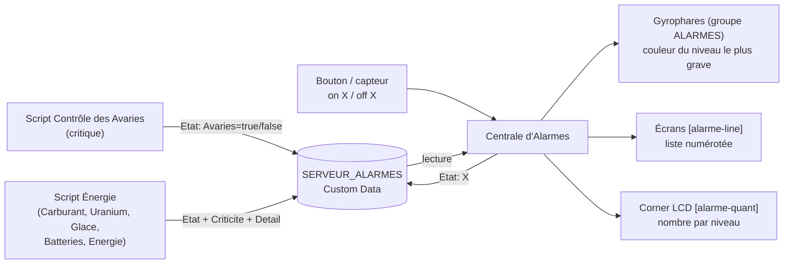

# Bus d'Alarmes (SERVEUR_ALARMES)

> [!summary] Résumé
> `SERVEUR_ALARMES` est un bloc **passif** (un panneau de contrôle, par exemple) : il ne fait rien lui-même. Son **Custom Data** sert de tableau commun. Les scripts d'alarme y écrivent leur état (`true` / `false`) et leur **criticité** ; le joueur y règle la couleur de chaque niveau. Tous les scripts lisent ce même tableau, donc ils calculent la **même** couleur : celle du niveau le plus grave parmi les alarmes actives. C'est la [[Centrale d'Alarmes]] qui s'en sert pour piloter les gyrophares et les écrans.

## 1. Le problème d'origine

La note [[_old/Scripte/Gestionnaire de Carburant|Gestionnaire de Carburant]] le signalait elle-même dans sa « note technique pour le futur » :

> [!warning] Deux scripts, mêmes gyrophares
> Le script de dégâts dit « éteins-toi, il n'y a pas de dégâts » pendant que le script d'uranium dit « allume-toi en vert ». Chaque script écrase la décision de l'autre à chacune de ses exécutions (~1,6 s) : les gyrophares clignotent, changent de couleur au hasard, ou restent éteints alors qu'une alerte est en cours.

Cause : chaque script pilotait les blocs **directement** à partir de son seul point de vue. Aucun ne savait que l'autre existait.

## 2. Le principe



Chaque script d'alarme peut publier **une ou plusieurs** alarmes (le script d'énergie en publie 5). À chaque exécution, il :

1. calcule le besoin (`true` / `false`) et le niveau de chacune de ses alarmes ;
2. l'écrit dans `[Etat]` du Custom Data de `SERVEUR_ALARMES` (`Publier(source, besoin, niveau, détail)`), le Custom Data n'étant réécrit qu'**une fois**, et **seulement si une valeur change** (`Terminer()`) ;
3. écrit sa criticité dans `[Criticite]` (c'est le script qui la décide, elle peut changer : voir l'alarme `Energie` de [[Surveillance Carburant Uranium]]) et, s'il le veut, un court texte dans `[Detail]` ;
4. relit toutes les sources : **alarme globale = au moins une source à `true`**, **couleur = celle du niveau le plus grave** parmi les sources actives.

> [!info] La criticité EST la priorité
> Il y a 4 niveaux : **Critique** > **Majeur** > **Normal** > **Mineur**. Plusieurs alarmes peuvent avoir le même niveau. La couleur des gyrophares est celle du **niveau**, pas de l'alarme : deux alarmes « Majeur » donnent le même rouge. Pour l'affichage en liste, les alarmes d'un même niveau sont rangées par **ordre d'arrivée** (voir [[Centrale d'Alarmes]]).

> [!info] Pas de « course » entre scripts
> Dans Space Engineers, les blocs programmables s'exécutent les uns après les autres (jamais en même temps). Le cycle « lire → modifier → réécrire » du Custom Data ne peut donc pas être interrompu par l'autre script.

| Section | Contenu | Qui l'écrit ? |
|---|---|---|
| `[Couleurs]` | couleur de chaque **niveau** : `Critique=R,G,B`, `Majeur=`, `Normal=`, `Mineur=` | le joueur (sinon couleurs par défaut : cramoisi, rouge, orange, cyan) |
| `[Criticite]` | niveau de chaque source : `Source=critique / majeur / normal / mineur` | **chaque script** (réécrit à chaque changement : modifier la constante du script), ou la Centrale (`on Source niveau`) |
| `[Detail]` | texte court affiché à côté de l'alarme : `Energie=Carburant + Uranium` | **les scripts** (clé supprimée quand il n'y a rien à dire) |
| `[Etat]` | besoin d'alarme de chaque source : `Source=true/false` | **les scripts**, ou la [[Centrale d'Alarmes]] (`on` / `off`) pour une source sans script |

Une source sans ligne `[Criticite]` est `normal`. Les anciens mots `importante`, `normale` et `basse` sont toujours compris. Les anciennes clés `[Config] Priorite` et `[Couleurs] Avaries=…` ne servent plus : elles sont ignorées.

### Acquittement (`ACK`)

`ACK` est envoyé **à un script**, et n'acquitte que **sa** source (elle repasse à `false`). Si une autre source est encore active, l'alarme globale reste allumée, avec la couleur du niveau de cette autre source. Les règles de réarmement sont propres à chaque script (nouveau bloc critique pour les avaries, remontée au-dessus du seuil de réarmement pour le carburant).

### Application aux blocs (scripts sources sans Centrale)

Sans [[Centrale d'Alarmes]], chaque script pilote encore **son** groupe (`ALARMES_CRITIQUES`, `ALARMES_URANIUM`). Pour chaque bloc du groupe, et **uniquement si cela change quelque chose** :

| Type de bloc | Action |
|---|---|
| Tout bloc fonctionnel (`IMyFunctionalBlock`) | `Enabled` = alarme globale |
| Lumière / gyrophare (`IMyLightingBlock`) | `Color` = couleur du niveau le plus grave (quand l'alarme est active) |
| Bloc sonore (`IMySoundBlock`) | `Play()` quand l'alarme s'active, `Stop()` quand elle s'arrête (allumer un bloc sonore ne suffit pas à le faire jouer) |

Un bloc ajouté au groupe en cours de partie est synchronisé une première fois lors du rescan suivant, sans relancer les sons des autres blocs.

## 3. Le bus est optionnel (sauf pour la Centrale)

> [!tip] Sans SERVEUR_ALARMES
> Si aucun bloc ne s'appelle `SERVEUR_ALARMES`, chaque script fonctionne **seul** : état = son besoin propre, couleur = celle du niveau le plus grave de **ses** alarmes (cramoisi pour les avaries ; orange à cramoisi pour l'énergie). Echo affiche alors `Bus : autonome (aucun bloc SERVEUR_ALARMES)`. La [[Centrale d'Alarmes]], elle, ne peut rien faire sans le bus.

Si le Custom Data du serveur n'est pas un INI valide, les scripts repassent en mode autonome et le signalent dans Echo.

## 4. Installation

1. Construire un bloc terminal quelconque sur la construction (ex. un **Panneau de contrôle** / *Control Panel*, peu coûteux). Il ne doit **pas** être un écran configuré avec `[Ecran] Role=...`.
2. Le renommer **exactement** `SERVEUR_ALARMES`.
3. Coller dans son **Custom Data** le contenu de `SERVEUR_ALARMES.ini` (ci-dessous). Si on le laisse vide, les scripts ajoutent eux-mêmes `[Etat]` et `[Criticite]` ; les couleurs par défaut s'appliquent.
4. Installer (ou recompiler) la [[Centrale d'Alarmes]] et les scripts sources ([[Controle des Avaries]], [[Surveillance Carburant Uranium]]). Ils retrouvent le serveur au plus tard 10 s après (ou immédiatement avec l'argument `rescan`).

```ini
[Couleurs]
; Couleur de chaque NIVEAU de criticité (R,G,B entre 0 et 255).
; Les gyrophares prennent la couleur du niveau le plus grave parmi les alarmes actives.
Critique=220,20,60
Majeur=255,0,0
Normal=255,140,0
Mineur=0,255,255

[Criticite]
; Source=critique | majeur | normal | mineur (normal si absente).
; Écrit par les scripts (le niveau d'une alarme peut monter, ex. Energie).
Avaries=critique
Carburant=normal
Uranium=normal
Glace=mineur
Batteries=majeur
Energie=normal

[Etat]
; Écrit automatiquement par les scripts : Source=true/false (ne pas modifier).
; Une source sans script se pilote avec la Centrale : "on Source [niveau]" / "off Source".
Avaries=false
Carburant=false
Uranium=false
Glace=false
Batteries=false
Energie=false
```

> [!warning] Vaisseaux amarrés
> Avec `SEULEMENT_CETTE_CONSTRUCTION = true` (défaut), un script ignore le `SERVEUR_ALARMES` d'un vaisseau amarré par connecteur et ne cherche que celui de sa propre construction.

## 5. Limites connues

- Le Custom Data est réécrit par `MyIni.ToString()` : la mise en forme (espaces, lignes vides) peut être normalisée par le jeu ; les commentaires `;` placés sous un en-tête ou avant une clé sont conservés par `MyIni`.
- Une source qui n'existe plus (script supprimé alors que sa clé valait `true`) maintient l'alarme : passer la clé à `false` à la main ou la supprimer.
- Sans Centrale, si un même **bloc sonore** est dans les deux groupes, chaque script appelle `Play()` au moment où **il** voit l'alarme s'allumer : le son peut redémarrer une fois (décalage de moins de 2 s entre les deux scripts).
- Délai de propagation : jusqu'à une exécution du script source (~1,6 s).

## 6. Dépannage

| Symptôme | Cause probable | Solution |
|---|---|---|
| Echo : `Bus : autonome (aucun bloc SERVEUR_ALARMES)` | nom du bloc différent, ou bloc sur un vaisseau amarré | renommer exactement `SERVEUR_ALARMES`, puis argument `rescan` |
| Echo : `Custom Data de SERVEUR_ALARMES illisible` | erreur de format INI (crochet manquant, ligne sans `=`) | recoller le contenu de `SERVEUR_ALARMES.ini` |
| Les gyrophares restent allumés alors que tout va bien | une clé `[Etat]` est restée à `true` (script supprimé ou arrêté) | mettre la clé à `false` ou la supprimer |
| Mauvaise couleur | criticité de la source absente ou mal écrite (`normal` par défaut) | vérifier `[Criticite] Source=critique` (nom de source exact) |
| Couleur ignorée | valeur `[Couleurs]` mal formée (ex. `255;0;0`) ou clé qui n'est pas un niveau | format `Critique=R,G,B` avec des virgules |

## 7. Code de la classe `BusAlarmes`

> [!important] Copie conforme
> Cette classe est **strictement identique** dans `ControleAvaries.cs` et `GestionnaireCarburant.cs`. Si vous la modifiez, modifiez-la à l'identique dans les deux scripts, sinon ils ne calculeront plus le même état global. Les niveaux et leurs couleurs par défaut sont aussi repris dans `CentraleAlarmes.cs` : gardez-les alignés.

```csharp
// ==============================================================================
// CLASSE PARTAGÉE : BUS D'ALARMES  (COPIE CONFORME DANS CHAQUE SCRIPT QUI ALARME)
// ------------------------------------------------------------------------------
// Ne PAS modifier cette classe dans un seul script : elle doit rester strictement
// identique dans "Contrôle des Avaries" et "Gestionnaire de Carburant", sinon les
// deux scripts ne calculeraient plus le même état global et se battraient de
// nouveau pour les gyrophares. Les niveaux et leurs couleurs sont aussi ceux de
// la "Centrale d'Alarmes".
// ==============================================================================

/// <summary>
/// Bus d'alarmes partagé entre plusieurs blocs programmables.
/// QUOI : à chaque exécution, un script publie UNE OU PLUSIEURS alarmes avec
/// Publier(source, besoin, criticité, détail), puis appelle Terminer(). Chaque
/// alarme est écrite dans le Custom Data d'un bloc nommé SERVEUR_ALARMES :
/// [Etat] Source=true/false, [Criticite] Source=niveau, [Detail] Source=texte.
/// Terminer() relit ensuite toutes les sources pour calculer UN état global (au
/// moins une source active) et UNE couleur : celle du niveau le plus grave parmi
/// les sources actives ([Couleurs] Critique=R,G,B, Majeur=..., Normal=..., Mineur=...).
/// POURQUOI : sans ce bus, le script d'avaries éteignait les gyrophares que le
/// script de carburant venait d'allumer (et inversement). Avec le bus, tous les
/// scripts calculent exactement le même état : plus de conflit.
/// Si le bloc SERVEUR_ALARMES n'existe pas, la classe fonctionne en mode
/// autonome : état global = alarmes de CE script, couleur = leur niveau le plus grave.
/// </summary>
public class BusAlarmes
{
    /// <summary>Nom exact du bloc dont le Custom Data sert de bus.</summary>
    public const string NOM_SERVEUR = "SERVEUR_ALARMES";

    // Noms des sections du Custom Data partagé.
    const string SECTION_COULEURS = "Couleurs";
    const string SECTION_ETAT = "Etat";
    const string SECTION_CRITICITE = "Criticite";
    const string SECTION_DETAIL = "Detail";

    // Niveaux de criticité, du plus grave au moins grave (l'index sert de rang).
    // Plusieurs mots acceptés par niveau (les anciens noms restent valides).
    static readonly string[][] NIVEAUX_CRITICITE =
    {
        new[] { "critique" },
        new[] { "majeur", "majeure", "importante" },
        new[] { "normal", "normale" },
        new[] { "mineur", "mineure", "basse" }
    };
    // Nom de chaque niveau, dans le même ordre : clé de [Couleurs] et texte affiché.
    static readonly string[] LIBELLES_CRITICITE = { "Critique", "Majeur", "Normal", "Mineur" };
    // Couleur de chaque niveau si [Couleurs] ne la redéfinit pas.
    static readonly Color[] COULEURS_PAR_DEFAUT =
    {
        new Color(220, 20, 60),    // Critique : rouge cramoisi
        new Color(255, 0, 0),      // Majeur   : rouge
        new Color(255, 140, 0),    // Normal   : orange
        new Color(0, 255, 255)     // Mineur   : cyan
    };
    const int RANG_CRITICITE_DEFAUT = 2;   // "normal"

    // Objets réutilisés d'une exécution à l'autre (évite les allocations).
    readonly MyIni lecteurIni = new MyIni();
    readonly List<MyIniKey> clesEtat = new List<MyIniKey>();
    readonly List<IMyTerminalBlock> tamponRecherche = new List<IMyTerminalBlock>();
    // Blocs d'alarme déjà synchronisés au moins une fois (par EntityId) :
    // permet de traiter un bloc ajouté au groupe sans relancer les sons des autres.
    readonly HashSet<long> blocsDejaSynchronises = new HashSet<long>();

    // Bloc serveur trouvé lors du dernier scan (null = mode autonome).
    IMyTerminalBlock serveur;
    // Dernier Custom Data lu : on ne reparse que si le texte a changé.
    string dernierCustomDataLu;
    // Résultat du dernier parsing (false = Custom Data illisible).
    bool customDataValide;
    // Dernier état global effectivement appliqué aux blocs d'alarme.
    bool etatApplique;

    // Cycle en cours (entre le premier Publier() et Terminer()).
    bool cycleOuvert;
    bool connecte;          // serveur présent et lisible pendant ce cycle
    bool modifie;           // le Custom Data doit être réécrit
    bool besoinLocal;       // au moins une alarme de CE script est active
    int rangLocal;          // niveau le plus grave parmi les alarmes actives de CE script

    /// <summary>Vrai si un bloc SERVEUR_ALARMES a été trouvé au dernier scan.</summary>
    public bool ServeurPresent { get { return serveur != null; } }

    /// <summary>État global : vrai si au moins une source demande l'alarme.</summary>
    public bool AlarmeGlobale { get; private set; }

    /// <summary>Couleur à appliquer aux lumières quand l'alarme globale est active.</summary>
    public Color CouleurGlobale { get; private set; }

    /// <summary>Niveau le plus grave parmi les sources actives (ex. "Critique" ; vide si aucune alarme).</summary>
    public string NiveauDominant { get; private set; }

    /// <summary>Message court destiné à Echo (état du bus, erreurs de configuration).</summary>
    public string Diagnostic { get; private set; }

    /// <summary>Crée le bus (les alarmes sont déclarées ensuite par Publier).</summary>
    public BusAlarmes()
    {
        CouleurGlobale = COULEURS_PAR_DEFAUT[RANG_CRITICITE_DEFAUT];
        NiveauDominant = "";
        Diagnostic = "pas encore initialisé";
    }

    /// <summary>
    /// Cherche le bloc SERVEUR_ALARMES (à appeler lors du rescan périodique,
    /// pas à chaque exécution). Le filtre de construction évite de lire le
    /// serveur d'un vaisseau amarré par connecteur.
    /// </summary>
    public void RechercherServeur(IMyGridTerminalSystem grille, IMyTerminalBlock moi, bool seulementCetteConstruction)
    {
        // Recherche rapide par nom (renvoie le premier bloc portant ce nom).
        IMyTerminalBlock trouve = grille.GetBlockWithName(NOM_SERVEUR);

        // Si ce premier bloc appartient à un vaisseau amarré, on cherche
        // explicitement celui de notre construction (cas rare, scan complet).
        if (trouve != null && seulementCetteConstruction && !trouve.IsSameConstructAs(moi))
        {
            tamponRecherche.Clear();
            grille.GetBlocksOfType<IMyTerminalBlock>(tamponRecherche,
                b => b.CustomName == NOM_SERVEUR && b.IsSameConstructAs(moi));
            trouve = tamponRecherche.Count > 0 ? tamponRecherche[0] : null;
            tamponRecherche.Clear();
        }

        // Si le serveur a changé (apparu, disparu, remplacé), on force une relecture.
        if (trouve != serveur)
        {
            serveur = trouve;
            dernierCustomDataLu = null;
        }
    }

    /// <summary>
    /// Publie UNE alarme de ce script. Peut être appelée plusieurs fois par
    /// exécution (une fois par alarme), puis Terminer() une seule fois.
    /// Chaque clé n'est réécrite que si sa valeur change.
    /// </summary>
    /// <param name="source">Nom de l'alarme (clé de [Etat], [Criticite], [Detail]).</param>
    /// <param name="besoin">Vrai si l'alarme est active (déjà corrigée de l'ACK).</param>
    /// <param name="criticite">critique, majeur, normal ou mineur (peut changer d'une exécution à l'autre).</param>
    /// <param name="detail">Texte court affiché à côté de l'alarme par la Centrale ("" = aucun).</param>
    public void Publier(string source, bool besoin, string criticite, string detail)
    {
        if (!cycleOuvert) OuvrirCycle();

        int rang = TrouverRang(criticite);
        if (besoin)
        {
            besoinLocal = true;
            if (rang < rangLocal) rangLocal = rang;
        }
        if (!connecte) return;

        // [Etat] Source=true/false
        if (!lecteurIni.ContainsKey(SECTION_ETAT, source)
            || lecteurIni.Get(SECTION_ETAT, source).ToBoolean(false) != besoin)
        {
            lecteurIni.Set(SECTION_ETAT, source, besoin);
            modifie = true;
        }

        // [Criticite] Source=niveau : c'est le script qui décide (le niveau peut monter).
        string niveau = LIBELLES_CRITICITE[rang].ToLower();
        if (lecteurIni.Get(SECTION_CRITICITE, source).ToString("") != niveau)
        {
            lecteurIni.Set(SECTION_CRITICITE, source, niveau);
            modifie = true;
        }

        // [Detail] Source=texte (clé supprimée quand il n'y a rien à dire).
        string texteDetail = detail ?? "";
        if (texteDetail.Length == 0)
        {
            if (lecteurIni.ContainsKey(SECTION_DETAIL, source))
            {
                lecteurIni.Delete(SECTION_DETAIL, source);
                modifie = true;
            }
        }
        else if (lecteurIni.Get(SECTION_DETAIL, source).ToString("") != texteDetail)
        {
            lecteurIni.Set(SECTION_DETAIL, source, texteDetail);
            modifie = true;
        }
    }

    /// <summary>
    /// Termine l'exécution : réécrit le Custom Data si une alarme a changé, puis
    /// calcule l'état global (au moins une clé [Etat] vraie) et la couleur (celle
    /// du niveau le plus grave parmi les sources actives).
    /// </summary>
    public void Terminer()
    {
        if (!cycleOuvert) OuvrirCycle();
        cycleOuvert = false;

        // ---- Mode autonome : seulement les alarmes de ce script ---------------
        if (!connecte)
        {
            int rang = besoinLocal ? rangLocal : RANG_CRITICITE_DEFAUT;
            AlarmeGlobale = besoinLocal;
            CouleurGlobale = COULEURS_PAR_DEFAUT[rang];
            NiveauDominant = besoinLocal ? LIBELLES_CRITICITE[rang] : "";
            return;
        }

        // ---- Écriture (une seule fois pour toutes les alarmes du script) ------
        if (modifie)
        {
            string nouveauTexte = lecteurIni.ToString();
            serveur.CustomData = nouveauTexte;
            // On mémorise notre propre écriture pour ne pas la reparser au prochain cycle.
            dernierCustomDataLu = nouveauTexte;
        }

        // ---- État global et niveau le plus grave ------------------------------
        // Plusieurs sources peuvent avoir le même niveau : elles donnent la même
        // couleur, l'ordre entre elles ne compte donc pas ici.
        AlarmeGlobale = false;
        int meilleurRang = int.MaxValue;
        clesEtat.Clear();
        lecteurIni.GetKeys(SECTION_ETAT, clesEtat);
        foreach (MyIniKey cle in clesEtat)
        {
            if (!lecteurIni.Get(SECTION_ETAT, cle.Name).ToBoolean(false)) continue;
            AlarmeGlobale = true;
            int rang = TrouverRang(lecteurIni.Get(SECTION_CRITICITE, cle.Name).ToString(""));
            if (rang < meilleurRang) meilleurRang = rang;
        }

        if (AlarmeGlobale)
        {
            NiveauDominant = LIBELLES_CRITICITE[meilleurRang];
            CouleurGlobale = LireCouleurNiveau(meilleurRang);
        }
        else
        {
            NiveauDominant = "";
        }

        Diagnostic = "connecté, alarme globale " + (AlarmeGlobale ? "ACTIVE (" + NiveauDominant + ")" : "inactive");
    }

    /// <summary>
    /// Début d'exécution : relit le Custom Data du serveur s'il a changé.
    /// Sans serveur, ou si son Custom Data est illisible : mode autonome.
    /// </summary>
    void OuvrirCycle()
    {
        cycleOuvert = true;
        connecte = false;
        modifie = false;
        besoinLocal = false;
        rangLocal = int.MaxValue;

        if (serveur == null)
        {
            Diagnostic = "autonome (aucun bloc " + NOM_SERVEUR + ")";
            return;
        }

        string texte = serveur.CustomData;
        if (texte != dernierCustomDataLu)
        {
            dernierCustomDataLu = texte;
            customDataValide = lecteurIni.TryParse(texte);
        }
        if (!customDataValide)
        {
            Diagnostic = "Custom Data de " + NOM_SERVEUR + " illisible (format INI)";
            return;
        }
        connecte = true;
    }

    /// <summary>
    /// Applique l'état global au groupe de blocs d'alarme de ce script.
    /// Chaque écriture (Enabled, Color, Play/Stop) n'est faite que si elle
    /// change quelque chose : un bloc sonore n'est relancé qu'au changement
    /// d'état global, ou la première fois qu'on le rencontre.
    /// </summary>
    /// <param name="blocsAlarme">Blocs du groupe d'alarme (lumières, sons, portes...).</param>
    public void AppliquerAuxBlocs(List<IMyFunctionalBlock> blocsAlarme)
    {
        bool changementEtat = AlarmeGlobale != etatApplique;

        foreach (IMyFunctionalBlock bloc in blocsAlarme)
        {
            // HashSet.Add renvoie true si l'identifiant n'y était pas encore.
            bool nouveauBloc = blocsDejaSynchronises.Add(bloc.EntityId);

            // Allumage / extinction (le bloc doit être allumé AVANT Play()).
            if (bloc.Enabled != AlarmeGlobale) bloc.Enabled = AlarmeGlobale;

            // Couleur des lumières (gyrophares...) : utile seulement si allumées.
            IMyLightingBlock lumiere = bloc as IMyLightingBlock;
            if (lumiere != null && AlarmeGlobale && lumiere.Color != CouleurGlobale)
            {
                lumiere.Color = CouleurGlobale;
            }

            // Blocs sonores : allumer ne suffit pas, il faut lancer la lecture.
            IMySoundBlock son = bloc as IMySoundBlock;
            if (son != null && (changementEtat || nouveauBloc))
            {
                if (AlarmeGlobale) son.Play();
                else son.Stop();
            }
        }

        etatApplique = AlarmeGlobale;
    }

    /// <summary>
    /// Rang d'un niveau de criticité écrit en toutes lettres : 0 = critique,
    /// 1 = majeur, 2 = normal, 3 = mineur (anciens noms importante / normale /
    /// basse acceptés). Vide ou inconnu : normal.
    /// </summary>
    public static int TrouverRang(string niveau)
    {
        string mot = (niveau ?? "").Trim();
        for (int rang = 0; rang < NIVEAUX_CRITICITE.Length; rang++)
        {
            foreach (string accepte in NIVEAUX_CRITICITE[rang])
            {
                if (string.Equals(mot, accepte, StringComparison.OrdinalIgnoreCase)) return rang;
            }
        }
        return RANG_CRITICITE_DEFAUT;
    }

    /// <summary>Nom d'un niveau à partir de son rang (0 = "Critique" ... 3 = "Mineur").</summary>
    public static string LibelleNiveau(int rang)
    {
        return LIBELLES_CRITICITE[rang];
    }

    /// <summary>
    /// Lit la couleur "R,G,B" d'un niveau dans [Couleurs] (clé Critique, Majeur,
    /// Normal ou Mineur). Renvoie la couleur par défaut du niveau si la clé est
    /// absente ou mal écrite.
    /// </summary>
    Color LireCouleurNiveau(int rang)
    {
        Color parDefaut = COULEURS_PAR_DEFAUT[rang];
        string texte = lecteurIni.Get(SECTION_COULEURS, LIBELLES_CRITICITE[rang]).ToString("");
        string[] morceaux = texte.Split(',');
        if (morceaux.Length != 3) return parDefaut;

        int rouge, vert, bleu;
        if (!int.TryParse(morceaux[0].Trim(), out rouge)) return parDefaut;
        if (!int.TryParse(morceaux[1].Trim(), out vert)) return parDefaut;
        if (!int.TryParse(morceaux[2].Trim(), out bleu)) return parDefaut;

        return new Color(Borner(rouge), Borner(vert), Borner(bleu));
    }

    /// <summary>Ramène une composante de couleur dans l'intervalle 0..255.</summary>
    static int Borner(int valeur)
    {
        if (valeur < 0) return 0;
        if (valeur > 255) return 255;
        return valeur;
    }
}
```

## Voir aussi

- [[Centrale d'Alarmes]] — pilote unique des gyrophares (groupe `ALARMES`) et écrans d'alarmes
- [[Controle des Avaries]] — source `Avaries`, groupe `ALARMES_CRITIQUES`
- [[Surveillance Carburant Uranium]] — source `Carburant`, groupe `ALARMES_URANIUM`
- [[_old/Scripte/Gestionnaire de Carburant|Gestionnaire de Carburant]] — note d'origine (« note technique pour le futur »)
- [[_old/Scripte/Controle_Avaries_SE|Controle_Avaries_SE]] — note d'origine du contrôle des avaries
