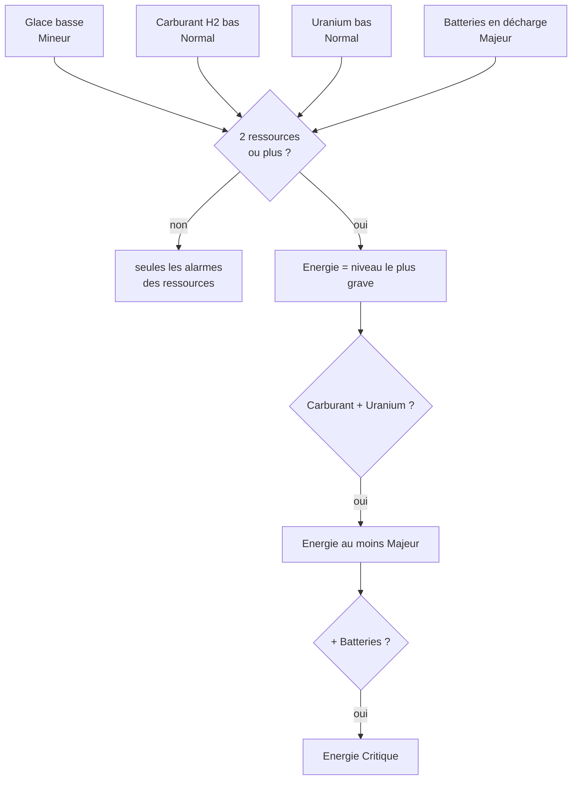
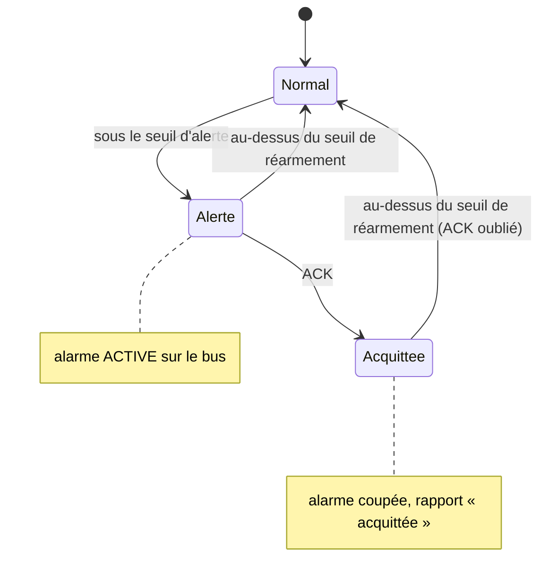

# Surveillance Énergie : Carburant, Uranium, Glace, Batteries (optimisé)

> [!summary] Résumé
> Surveille les 4 ressources d'énergie du vaisseau ou de la base : **hydrogène** (carburant), **uranium**, **glace** et **batteries**. Il publie une alarme par ressource, à son propre niveau, et une alarme **Energie** qui **monte en criticité** quand plusieurs ressources manquent en même temps, jusqu'à **Critique** quand il ne reste plus que le solaire et des batteries qui se vident. Le détail (`Energie : Carburant + Uranium`) s'affiche sur les écrans de la [[Centrale d'Alarmes]]. Le rapport complet va sur les écrans `Role=Carburant` et dans Echo.

## 1. Pourquoi une alarme qui monte en criticité ?

- L'**hydrogène** sert à la fois aux **propulseurs à hydrogène** et aux **moteurs à hydrogène** (production d'électricité). Sans lui, il reste les **propulseurs ioniques**, qui n'utilisent que l'électricité.
- Si l'**uranium** manque aussi, les réacteurs s'arrêtent : le vaisseau ne compte plus que sur ses **panneaux solaires et ses batteries** pour se déplacer. Il devient une **cible facile** en cas d'attaque.
- La **glace** (source de l'H2 et de l'O2) se trouve un peu partout dans l'espace : son manque est **mineur**. L'uranium est plus rare.

### Les alarmes publiées

| Alarme | Condition | Niveau |
|---|---|---|
| `Glace` | moins de 1 000 kg de glace (générateurs O2/H2 + conteneurs) | Mineur |
| `Carburant` | réservoirs d'hydrogène sous 10 % | Normal |
| `Uranium` | autonomie des réacteurs sous 1 h (uranium des réacteurs + stock) | Normal |
| `Batteries` | batteries en décharge nette (sortie > entrée) depuis 10 s | Majeur |
| `Energie` | **au moins 2** des alarmes ci-dessus en même temps | voir ci-dessous |

### Niveau de l'alarme `Energie`

C'est le niveau **le plus grave** des ressources en cause, avec deux **escalades** :

| Ressources en cause | Niveau `Energie` | Pourquoi |
|---|---|---|
| Carburant + Glace | Normal | le plus grave des deux |
| Uranium + Batteries | Majeur | le plus grave des deux |
| **Carburant + Uranium** | **Majeur** | escalade : plus de moteurs H2 ni de réacteurs, l'énergie ne vient plus que du solaire et des batteries |
| **Carburant + Uranium + Batteries** | **Critique** | escalade : et les batteries se vident, le vaisseau est sans défense |



### Exemple

Le vaisseau vide ses réservoirs d'H2 puis son uranium, de nuit (pas de solaire) :

| Moment | Alarmes actives sur la Centrale | Gyrophares |
|---|---|---|
| H2 sous 10 % | `[NORMAL] Carburant` | orange |
| + autonomie uranium sous 1 h | `[MAJEUR] Energie : Carburant + Uranium`, `[NORMAL] Carburant`, `[NORMAL] Uranium` | rouge |
| + batteries en décharge depuis 10 s | `[CRITIQUE] Energie : Carburant + Uranium + Batteries`, `[MAJEUR] Batteries`, `[NORMAL] Carburant`, `[NORMAL] Uranium` | cramoisi |
| plein d'H2 refait (au-dessus de 20 %) | `[MAJEUR] Energie : Uranium + Batteries`, `[MAJEUR] Batteries`, `[NORMAL] Uranium` | rouge |

## 2. Prérequis en jeu

| Bloc | Nom / configuration | Obligatoire ? |
|---|---|---|
| Bloc programmable | n'importe quel nom ; contient ce script | oui |
| Réservoirs d'hydrogène, réacteurs, générateurs O2/H2, batteries | aucun nom imposé (détection automatique) | non : une ressource **sans équipement** n'est pas surveillée (pas d'alarme permanente) |
| Conteneurs de cargaison | aucun nom imposé ; leur uranium et leur glace comptent comme stock | non |
| Serveur d'alarmes | bloc nommé `SERVEUR_ALARMES`, voir [[Bus d'Alarmes]] | non, mais nécessaire pour la [[Centrale d'Alarmes]] |
| Groupe d'alarme | groupe nommé **exactement** `ALARMES_URANIUM` | non ; inutile avec la [[Centrale d'Alarmes]], qui pilote le groupe `ALARMES` |
| Écran(s) | Custom Data `[Ecran] Role=Carburant` | non (le rapport est toujours dans Echo) |
| Bouton d'acquittement | panneau de boutons, action « Exécuter avec l'argument » → `ACK` | non |

Custom Data d'un écran LCD (ou d'un cockpit, avec `Surface=N`) :

```ini
[Ecran]
Role=Carburant
```

## 3. Installation

1. Facultatif mais recommandé : bloc `SERVEUR_ALARMES` et [[Centrale d'Alarmes]].
2. Facultatif : écrans avec `[Ecran] Role=Carburant`.
3. Coller le code de la section 10 dans un bloc programmable, **Vérifier**, puis **OK**.
4. Panneau de boutons : glisser le bloc programmable dans la barre d'action → **« Exécuter avec l'argument »** → `ACK`.
5. Vérifier le rapport dans la fenêtre Echo du bloc programmable.

## 4. Configuration

| Constante | Défaut | Effet |
|---|---|---|
| `SEULEMENT_CETTE_CONSTRUCTION` | `true` | ignore les blocs des vaisseaux amarrés par connecteur |
| `NOM_GROUPE_ALARMES` | `"ALARMES_URANIUM"` | groupe piloté par ce script (sans Centrale) |
| `ROLE_ECRAN` | `"Carburant"` | valeur de `Role` des écrans de ce script |
| `SOURCE_H2`, `SOURCE_URANIUM`, `SOURCE_GLACE`, `SOURCE_BATTERIES`, `SOURCE_ENERGIE` | `"Carburant"`, `"Uranium"`, `"Glace"`, `"Batteries"`, `"Energie"` | noms des alarmes sur le bus |
| `CRITICITE_H2`, `CRITICITE_URANIUM`, `CRITICITE_GLACE`, `CRITICITE_BATTERIES` | `"normal"`, `"normal"`, `"mineur"`, `"majeur"` | niveau de chaque alarme de ressource |
| `CRITICITE_H2_URANIUM` | `"majeur"` | escalade de `Energie` quand Carburant **et** Uranium manquent |
| `CRITICITE_H2_URANIUM_BATTERIES` | `"critique"` | escalade quand les batteries se déchargent en plus |
| `SEUIL_H2_POURCENT` / `REARMEMENT_H2_POURCENT` | `10` / `20` | alerte sous 10 % d'H2, fin au-dessus de 20 % |
| `SEUIL_URANIUM_HEURES` / `REARMEMENT_URANIUM_HEURES` | `1.0` / `1.5` | alerte à 1 h d'autonomie, fin au-dessus de 1,5 h |
| `SEUIL_GLACE_KG` / `REARMEMENT_GLACE_KG` | `1000` / `2000` | alerte sous 1 000 kg, fin au-dessus de 2 000 kg |
| `DELAI_BATTERIES_SECONDES` | `10` | durée de décharge nette avant l'alerte, et durée sans décharge avant la fin |
| `TOLERANCE_DECHARGE_MW` | `0.001` | écart sortie − entrée en dessous duquel on ne parle pas de décharge |
| `MWH_PAR_KG_URANIUM` | `1.0` | énergie d'un kg de lingot d'uranium (MWh), valeur citée par la note d'origine |
| `COMPTER_STOCK_CONTENEURS` | `true` | compte l'uranium et la glace des conteneurs de cargaison |
| `INTERVALLE_RESCAN_SECONDES` | `10` | délai entre deux relectures automatiques de la grille |
| `MAX_REACTEURS_SIGNALES` | `8` | réacteurs « à vérifier » listés avant « ... et N autres » |

Les niveaux sont écrits par le script dans `[Criticite]` du bus à chaque changement : pour changer le niveau d'une alarme, modifiez la constante (une modification à la main dans le bus serait réécrite).

## 5. Commandes

| Argument | Effet |
|---|---|
| *(vide)* | exécution automatique normale |
| `ACK` | acquitte toutes les alarmes en cours de ce script. Chacune se réarme quand sa ressource repasse au-dessus de son seuil de réarmement. L'alarme `Energie` se réarme aussi **si son niveau monte** (ex. Majeur → Critique). Sans alerte en cours : aucun effet. |
| `rescan` | relit immédiatement les blocs, les écrans, le groupe et le serveur |

## 6. Fonctionnement

### Mesures

| Ressource | Mesure |
|---|---|
| Carburant | remplissage total des réservoirs dont le SubtypeId contient « Hydrogen » (litres et %) |
| Uranium | uranium des réacteurs + stock des conteneurs ; `Autonomie (h) = uranium (kg) × MWH_PAR_KG_URANIUM / puissance fournie (MW)`. **Plus d'uranium du tout = autonomie 0.** Uranium présent mais aucune consommation = autonomie infinie. |
| Glace | minerai `Ice` dans les générateurs O2/H2 et les conteneurs |
| Batteries | somme des entrées et sorties ; décharge nette = sortie − entrée > `TOLERANCE_DECHARGE_MW`, chronométrée en temps de jeu |

### Hystérésis et acquittement

Chaque alarme de ressource suit la même machine à états :



> [!info] Pourquoi l'hystérésis ?
> Les mesures varient sans cesse (consommation, remplissage). Avec un seul seuil, l'alarme clignoterait autour de la limite, et chaque passage au-dessus annulerait l'`ACK`. Avec un écart entre le seuil d'alerte et le seuil de réarmement, il faut un vrai réapprovisionnement pour réarmer.

L'alarme `Energie` est active tant qu'**au moins 2** ressources sont en alerte (acquittées ou non) : acquitter une ressource ne fait pas baisser le niveau de `Energie`.

### Déroulement d'une exécution (~1,6 s)

1. Commande éventuelle (`ACK`, `rescan`).
2. Rescan si demandé ou si 10 s se sont écoulées.
3. Mesures : H2, uranium (et réacteurs à vérifier : **ENDOMMAGÉ**, **ÉTEINT**, **SANS URANIUM**), glace, batteries.
4. Mise à jour des 4 alarmes de ressource, puis de l'alarme `Energie` (niveau, escalades, détail).
5. Bus d'alarmes : publication des 5 alarmes (`[Etat]`, `[Criticite]`, `[Detail]`), écriture du Custom Data **une seule fois** et seulement si quelque chose a changé.
6. Rapport : écrans `Role=Carburant` (seulement si le texte change) et Echo.

Exemple de rapport :

```
=== ÉNERGIE ===

Carburant H2 : 8.0 % (32 000 L, 2 réservoir(s)) [ALERTE NORMAL]
Uranium : 0.4 kg en réacteur + 0.0 kg en stock [ALERTE NORMAL]
  Réacteurs : 1, 1.20 MW
  Autonomie : 0 h 20 min (réacteurs seuls : 0 h 20 min)
Glace : 12 400 kg
Batteries : 64 % (entrée 0.00 / sortie 1.80 MW), décharge depuis 25 s [ALERTE MAJEUR]

/!\ ÉNERGIE CRITIQUE /!\
Carburant + Uranium + Batteries
```

## 7. Optimisations et corrections par rapport à l'original

| Problème d'origine | Conséquence en jeu | Correction |
|---|---|---|
| Seul l'uranium était surveillé | plus d'H2 ou batteries vides sans aucune alerte | 4 ressources surveillées + alarme `Energie` qui monte en criticité |
| Réacteurs à sec : plus de puissance fournie, autonomie « INFINIE » | l'alarme s'éteignait **au moment** où l'uranium était épuisé | plus d'uranium = autonomie 0 |
| La note demande le groupe `ALARMES_URANIUM`, le code cherche la balise `[giro-alarme]` | le groupe créé par le joueur ne s'allumait **jamais** | groupe `ALARMES_URANIUM` (sans Centrale) ou groupe `ALARMES` de la [[Centrale d'Alarmes]] |
| Conflit avec le script d'avaries sur les mêmes gyrophares (« note technique pour le futur ») | gyrophares qui clignotent / changent de couleur / s'éteignent pendant une alerte | [[Bus d'Alarmes]] : état global commun |
| Un seul seuil pour déclencher et réarmer | clignotement et ré-armement intempestif de l'ACK | hystérésis sur chaque ressource, délai de 10 s sur les batteries |
| Seul l'uranium des réacteurs était compté | fausse alerte alors que les conteneurs sont pleins d'uranium | stock des conteneurs compté et affiché séparément |
| `1 kg = 1 MWh` codé implicitement dans la division | valeur cachée, impossible à adapter (mods) | constante nommée et commentée `MWH_PAR_KG_URANIUM` |
| Rapport uniquement dans Echo | il fallait ouvrir le terminal du PB | écrans `Role=Carburant` (LCD et cockpits `Surface=N`), écriture seulement si changement |
| `new List` + `GetBlocksOfType` à chaque exécution | allocations et scans répétés | caches rescannés toutes les 10 s ou sur `rescan` ; listes et `StringBuilder` réutilisés |
| Pas de filtre de construction | un vaisseau amarré faussait les mesures | filtre `IsSameConstructAs(Me)` |

## 8. Limites connues

- **`MWH_PAR_KG_URANIUM = 1.0`** est la valeur citée par la note d'origine ; elle peut être différente avec des mods ou après une mise à jour du jeu.
- L'autonomie uranium est **instantanée** (puissance fournie à l'instant de la mesure).
- **Batteries** : la décharge nette est normale la nuit sur une base solaire. Avec le niveau Majeur par défaut, l'alarme `Batteries` partira chaque nuit si rien d'autre ne recharge les batteries. Baissez `CRITICITE_BATTERIES` ou augmentez `DELAI_BATTERIES_SECONDES` si c'est trop fréquent.
- Une ressource **sans équipement** n'est pas surveillée et ne compte pas dans les escalades (un vaisseau sans réacteur n'aura jamais l'escalade Carburant + Uranium).
- Seuls les **conteneurs de cargaison** comptent comme stock (pas les connecteurs, cockpits, raffineries).
- Réservoirs : un réservoir d'hydrogène **moddé** dont le SubtypeId ne contient pas « Hydrogen » n'est pas compté.
- L'état d'alerte et d'acquittement n'est pas sauvegardé : après un rechargement, il est recalculé depuis zéro.

## 9. Dépannage

| Symptôme | Cause probable | Solution |
|---|---|---|
| Une ressource affiche « aucun réservoir / réacteur / générateur / batterie » | pas d'équipement sur la construction (ou sur un vaisseau amarré) | normal : cette ressource n'est pas surveillée |
| Alarme `Batteries` la nuit | décharge nette normale sans soleil | voir les limites ; ajuster `DELAI_BATTERIES_SECONDES` ou `CRITICITE_BATTERIES` |
| L'alarme ne se réarme pas après le plein | mesure entre le seuil d'alerte et le seuil de réarmement | normal (hystérésis) |
| `ACK` sans effet | aucune alerte en cours | normal (Echo : « aucune alerte en cours ») |
| `Energie` revient après un `ACK` | une ressource de plus manque : le niveau a monté | normal : une aggravation réarme l'alarme |
| Le niveau changé à la main dans `[Criticite]` revient | le script réécrit ses niveaux | modifier la constante `CRITICITE_...` du script |
| Uranium ou glace en stock = 0 alors qu'il y en a | stock hors conteneurs de cargaison, ou sur un vaisseau amarré | déplacer dans un conteneur de la construction |
| Echo : `Surface=N invalide` | numéro de surface trop grand | utiliser un numéro entre 0 et (nombre de surfaces − 1) |

## 10. Code complet

> [!info] Classes partagées
> La classe `BusAlarmes` est une **copie conforme** de celle de [[Controle des Avaries]] (voir [[Bus d'Alarmes]]). La classe `EcransRole` est aussi identique dans les deux scripts.

```csharp
// Copyright (c) 2026 Zerma1 - https://github.com/Zerma1/Space-Engineers-scripte
// Licence : PolyForm Noncommercial 1.0.0 - https://polyformproject.org/licenses/noncommercial/1.0.0
// Usage et partage gratuits autorisés, vente interdite. / Free use and sharing allowed, selling prohibited.
// ==============================================================================
// SCRIPT : SURVEILLANCE ÉNERGIE (H2, URANIUM, GLACE, BATTERIES)  (version optimisée)
// ------------------------------------------------------------------------------
// Rôle :
//   Surveille les ressources d'énergie et publie sur le bus SERVEUR_ALARMES
//   une alarme par ressource, à son propre niveau :
//     - Carburant : réservoirs d'hydrogène sous 10 %       -> Normal
//     - Uranium   : autonomie des réacteurs sous 1 h        -> Normal
//     - Glace     : stock de glace sous 1 000 kg            -> Mineur
//     - Batteries : en décharge nette depuis 10 s           -> Majeur
//   et une alarme "Energie" dès que 2 ressources ou plus manquent. Son niveau
//   est le plus grave des ressources en cause, avec deux escalades :
//     Carburant + Uranium              -> Majeur
//     Carburant + Uranium + Batteries  -> Critique
//   Pourquoi : l'H2 alimente les propulseurs ET les moteurs à hydrogène ; sans
//   lui il reste les propulseurs ioniques (électriques). Sans uranium non plus,
//   le vaisseau ne compte plus que sur ses panneaux solaires et ses batteries :
//   il devient une cible facile. La glace (source d'H2 et d'O2) se trouve
//   partout, l'uranium est plus rare : d'où les niveaux différents.
//
// Nomenclature des blocs :
//   - Alarmes : groupe ALARMES_URANIUM (utile seulement SANS Centrale d'Alarmes).
//   - Écrans  : Custom Data   [Ecran]
//                             Role=Carburant
//                             Surface=0      (optionnel : n° de surface d'un
//                                             cockpit / bloc programmable)
//   - Réservoirs, réacteurs, générateurs O2/H2, batteries et conteneurs :
//     détectés automatiquement (aucun nom imposé). Une ressource sans
//     équipement (ex. aucun réacteur) n'est pas surveillée.
//
// Commandes (argument du bloc programmable, majuscules/minuscules indifférentes) :
//   - ACK    : acquitte les alarmes en cours. Chacune se réarme quand sa
//              ressource est revenue au-dessus de son seuil de réarmement ;
//              l'alarme Energie se réarme aussi si son niveau monte.
//   - rescan : relit immédiatement les blocs, les écrans et le serveur.
//
// Dépendances :
//   - SERVEUR_ALARMES (OPTIONNEL) : bus d'alarmes lu par la Centrale d'Alarmes.
//     Sans lui, le script fonctionne seul avec son groupe ALARMES_URANIUM.
// ==============================================================================

// ------------------------------------------------------------------------------
// CONSTANTES DE CONFIGURATION (toutes les valeurs réglables sont ici)
// ------------------------------------------------------------------------------

// true = ignore les vaisseaux amarrés par connecteur (on ne compte que le nôtre).
const bool SEULEMENT_CETTE_CONSTRUCTION = true;

// Nom exact du groupe de blocs d'alarme piloté par ce script (sans Centrale).
const string NOM_GROUPE_ALARMES = "ALARMES_URANIUM";

// Valeur de la clé Role des écrans de ce script ([Ecran] Role=Carburant).
const string ROLE_ECRAN = "Carburant";

// Nom des alarmes publiées sur le bus et leur niveau (critique, majeur, normal, mineur).
const string SOURCE_H2 = "Carburant";
const string CRITICITE_H2 = "normal";
const string SOURCE_URANIUM = "Uranium";
const string CRITICITE_URANIUM = "normal";
const string SOURCE_GLACE = "Glace";
const string CRITICITE_GLACE = "mineur";
const string SOURCE_BATTERIES = "Batteries";
const string CRITICITE_BATTERIES = "majeur";
const string SOURCE_ENERGIE = "Energie";

// Escalades de l'alarme Energie (sinon : le niveau le plus grave des ressources en cause).
const string CRITICITE_H2_URANIUM = "majeur";
const string CRITICITE_H2_URANIUM_BATTERIES = "critique";

// Carburant : alerte sous ce remplissage des réservoirs d'H2 (%), fin au-dessus du réarmement.
const double SEUIL_H2_POURCENT = 10.0;
const double REARMEMENT_H2_POURCENT = 20.0;

// Uranium : alerte quand l'autonomie descend à ce nombre d'heures, fin au-dessus du réarmement.
const double SEUIL_URANIUM_HEURES = 1.0;
const double REARMEMENT_URANIUM_HEURES = 1.5;

// Glace : alerte sous ce stock (kg), fin au-dessus du réarmement.
const double SEUIL_GLACE_KG = 1000.0;
const double REARMEMENT_GLACE_KG = 2000.0;

// Batteries : alerte après ce temps de décharge nette ininterrompue (secondes de
// jeu), fin après le même temps sans décharge. Évite les alertes sur un pic.
const double DELAI_BATTERIES_SECONDES = 10.0;
// Écart minimal sortie - entrée (MW) pour parler de décharge.
const double TOLERANCE_DECHARGE_MW = 0.001;

// Énergie fournie par 1 kg de lingot d'uranium, en MWh. Valeur citée par la
// note d'origine (« 1 kg = 1 MWh ») : elle dépend des définitions du jeu et
// peut être différente avec des mods. Seul endroit à modifier si besoin.
const double MWH_PAR_KG_URANIUM = 1.0;

// true = compte aussi l'uranium et la glace stockés dans les conteneurs de cargaison.
const bool COMPTER_STOCK_CONTENEURS = true;

// Intervalle entre deux relectures automatiques de la grille (secondes de jeu).
const double INTERVALLE_RESCAN_SECONDES = 10.0;

// Nombre maximal de réacteurs "à problème" listés sur l'écran.
const int MAX_REACTEURS_SIGNALES = 8;

// ------------------------------------------------------------------------------
// ÉTAT DU SCRIPT (champs réutilisés d'une exécution à l'autre)
// ------------------------------------------------------------------------------

// Types d'objets (créés une seule fois).
readonly MyItemType TYPE_URANIUM = MyItemType.MakeIngot("Uranium");
readonly MyItemType TYPE_GLACE = MyItemType.MakeOre("Ice");

// Caches remplis au rescan.
readonly List<IMyReactor> reacteurs = new List<IMyReactor>();
readonly List<IMyCargoContainer> conteneurs = new List<IMyCargoContainer>();
readonly List<IMyGasTank> reservoirsH2 = new List<IMyGasTank>();
readonly List<IMyGasGenerator> generateurs = new List<IMyGasGenerator>();
readonly List<IMyBatteryBlock> batteries = new List<IMyBatteryBlock>();
readonly List<IMyFunctionalBlock> blocsAlarme = new List<IMyFunctionalBlock>();
readonly List<IMyGasTank> tamponReservoirs = new List<IMyGasTank>();

// Constructeurs de texte réutilisés.
readonly StringBuilder constructeurRapport = new StringBuilder();
readonly StringBuilder lignesReacteursAProbleme = new StringBuilder();
readonly StringBuilder constructeurDetail = new StringBuilder();

// Objets partagés (voir les classes en fin de script).
readonly BusAlarmes busAlarmes;
readonly EcransRole ecransCarburant;

// Les 4 alarmes de ressource et l'alarme combinée.
readonly AlarmeRessource alarmeH2 = new AlarmeRessource(SOURCE_H2, CRITICITE_H2);
readonly AlarmeRessource alarmeUranium = new AlarmeRessource(SOURCE_URANIUM, CRITICITE_URANIUM);
readonly AlarmeRessource alarmeGlace = new AlarmeRessource(SOURCE_GLACE, CRITICITE_GLACE);
readonly AlarmeRessource alarmeBatteries = new AlarmeRessource(SOURCE_BATTERIES, CRITICITE_BATTERIES);
readonly AlarmeRessource alarmeEnergie = new AlarmeRessource(SOURCE_ENERGIE, CRITICITE_H2);
readonly AlarmeRessource[] alarmesRessources;
// Rang de l'alarme Energie au moment de l'ACK (elle se réarme si le niveau monte).
int rangEnergieAcquitte = int.MaxValue;

// Mesures du cycle courant.
double h2Litres = 0;
double h2CapaciteLitres = 0;
double h2Pourcent = 0;
double uraniumReacteursKg = 0;
double uraniumStockKg = 0;
double consommationMW = 0;
double autonomieReacteursHeures = double.PositiveInfinity;
double autonomieTotaleHeures = double.PositiveInfinity;
int nombreReacteursAProbleme = 0;
double glaceKg = 0;
double chargeBatteriesMWh = 0;
double chargeMaxBatteriesMWh = 0;
double entreeBatteriesMW = 0;
double sortieBatteriesMW = 0;
double secondesEnDecharge = 0;      // décharge nette ininterrompue depuis...
double secondesSansDecharge = 0;    // ... ou pas de décharge depuis...

double secondesDepuisRescan = 0;    // temps de jeu écoulé depuis le dernier rescan
bool rescanDemande = true;          // true au démarrage : premier remplissage des caches
bool groupeAlarmeTrouve = false;    // le groupe ALARMES_URANIUM existe-t-il ?
string rapportCourant = "";         // texte publié (écrans + Echo)
string messageCommande = "";        // retour de la dernière commande, pour Echo

/// <summary>
/// Constructeur : appelé une seule fois à la compilation / au chargement.
/// Update100 = une exécution tous les 100 ticks (~1,6 s), comme l'original.
/// </summary>
public Program()
{
    busAlarmes = new BusAlarmes();
    ecransCarburant = new EcransRole(ROLE_ECRAN);
    alarmesRessources = new[] { alarmeH2, alarmeUranium, alarmeGlace, alarmeBatteries };
    Runtime.UpdateFrequency = UpdateFrequency.Update100;
}

/// <summary>
/// Boucle principale. À chaque exécution :
/// 1. traiter la commande éventuelle (ACK / rescan) ;
/// 2. rescanner la grille si nécessaire (toutes les ~10 s) ;
/// 3. mesurer H2, uranium, glace et batteries ;
/// 4. mettre à jour chaque alarme (hystérésis, ACK) puis l'alarme Energie ;
/// 5. publier les 5 alarmes sur le bus et appliquer l'état global au groupe ;
/// 6. afficher le rapport (écrans si changement, et Echo).
/// </summary>
public void Main(string argument, UpdateType updateSource)
{
    TraiterCommande(argument);

    double secondes = Runtime.TimeSinceLastRun.TotalSeconds;
    secondesDepuisRescan += secondes;
    if (rescanDemande || secondesDepuisRescan >= INTERVALLE_RESCAN_SECONDES)
    {
        Rescanner();
    }

    MesurerH2();
    MesurerUranium();
    MesurerGlace();
    MesurerBatteries(secondes);
    MettreAJourAlarmes();

    foreach (AlarmeRessource alarme in alarmesRessources)
    {
        busAlarmes.Publier(alarme.Source, alarme.Besoin, alarme.Criticite, "");
    }
    busAlarmes.Publier(alarmeEnergie.Source, alarmeEnergie.Besoin, alarmeEnergie.Criticite, alarmeEnergie.Detail);
    busAlarmes.Terminer();
    busAlarmes.AppliquerAuxBlocs(blocsAlarme);

    ConstruireRapport();
    ecransCarburant.Ecrire(rapportCourant);
    AfficherEcho();
}

// ------------------------------------------------------------------------------
// COMMANDES
// ------------------------------------------------------------------------------

/// <summary>Interprète l'argument du bloc programmable (vide lors des exécutions automatiques).</summary>
void TraiterCommande(string argument)
{
    string commande = (argument ?? "").Trim().ToLower();
    if (commande.Length == 0) return;

    if (commande == "ack")
    {
        int nombre = 0;
        foreach (AlarmeRessource alarme in alarmesRessources)
        {
            if (alarme.EnAlerte && !alarme.Acquittee) { alarme.Acquittee = true; nombre++; }
        }
        if (alarmeEnergie.EnAlerte && !alarmeEnergie.Acquittee)
        {
            alarmeEnergie.Acquittee = true;
            rangEnergieAcquitte = BusAlarmes.TrouverRang(alarmeEnergie.Criticite);
            nombre++;
        }
        // Comme l'original : un ACK hors alerte n'a aucun effet durable.
        messageCommande = nombre > 0 ? "ACK : " + nombre + " alarme(s) acquittée(s)." : "ACK : aucune alerte en cours.";
    }
    else if (commande == "rescan")
    {
        rescanDemande = true;
        messageCommande = "Rescan effectué.";
    }
    else
    {
        messageCommande = "Commande inconnue : '" + argument + "' (attendu : ACK ou rescan)";
    }
}

// ------------------------------------------------------------------------------
// RESCAN (réservoirs, réacteurs, générateurs, batteries, conteneurs, écrans...)
// ------------------------------------------------------------------------------

/// <summary>Reconstruit tous les caches de blocs (pas à chaque exécution : coûteux).</summary>
void Rescanner()
{
    reacteurs.Clear();
    GridTerminalSystem.GetBlocksOfType<IMyReactor>(reacteurs, EstDeCetteConstruction);

    // Réservoirs d'hydrogène : SubtypeId contenant "Hydrogen" (même règle que
    // l'Affichage Data Center ; le grand réservoir d'O2 vanilla a un SubtypeId vide).
    reservoirsH2.Clear();
    tamponReservoirs.Clear();
    GridTerminalSystem.GetBlocksOfType<IMyGasTank>(tamponReservoirs, EstDeCetteConstruction);
    foreach (IMyGasTank reservoir in tamponReservoirs)
    {
        string sousType = reservoir.BlockDefinition.SubtypeId ?? "";
        if (sousType.IndexOf("Hydrogen", StringComparison.OrdinalIgnoreCase) >= 0) reservoirsH2.Add(reservoir);
    }
    tamponReservoirs.Clear();

    generateurs.Clear();
    GridTerminalSystem.GetBlocksOfType<IMyGasGenerator>(generateurs, EstDeCetteConstruction);

    batteries.Clear();
    GridTerminalSystem.GetBlocksOfType<IMyBatteryBlock>(batteries, EstDeCetteConstruction);

    conteneurs.Clear();
    if (COMPTER_STOCK_CONTENEURS)
    {
        GridTerminalSystem.GetBlocksOfType<IMyCargoContainer>(conteneurs, EstDeCetteConstruction);
    }

    blocsAlarme.Clear();
    IMyBlockGroup groupe = GridTerminalSystem.GetBlockGroupWithName(NOM_GROUPE_ALARMES);
    groupeAlarmeTrouve = groupe != null;
    if (groupe != null) groupe.GetBlocksOfType<IMyFunctionalBlock>(blocsAlarme, EstDeCetteConstruction);

    ecransCarburant.Rechercher(GridTerminalSystem, Me, SEULEMENT_CETTE_CONSTRUCTION);
    busAlarmes.RechercherServeur(GridTerminalSystem, Me, SEULEMENT_CETTE_CONSTRUCTION);

    // Une ressource sans équipement n'est pas surveillée (pas d'alarme permanente).
    alarmeH2.Surveillee = reservoirsH2.Count > 0;
    alarmeUranium.Surveillee = reacteurs.Count > 0;
    alarmeGlace.Surveillee = generateurs.Count > 0;
    alarmeBatteries.Surveillee = batteries.Count > 0;

    secondesDepuisRescan = 0;
    rescanDemande = false;
}

/// <summary>Filtre de construction : écarte les vaisseaux amarrés par connecteur.</summary>
bool EstDeCetteConstruction(IMyTerminalBlock bloc)
{
    return !SEULEMENT_CETTE_CONSTRUCTION || bloc.IsSameConstructAs(Me);
}

// ------------------------------------------------------------------------------
// MESURES
// ------------------------------------------------------------------------------

/// <summary>Remplissage total des réservoirs d'hydrogène (litres et %).</summary>
void MesurerH2()
{
    h2Litres = 0;
    h2CapaciteLitres = 0;
    foreach (IMyGasTank reservoir in reservoirsH2)
    {
        if (reservoir.Closed) continue;
        h2CapaciteLitres += reservoir.Capacity;
        h2Litres += reservoir.Capacity * reservoir.FilledRatio;
    }
    h2Pourcent = h2CapaciteLitres > 0 ? 100.0 * h2Litres / h2CapaciteLitres : 0;
}

/// <summary>
/// Additionne l'uranium (réacteurs / conteneurs séparément) et la puissance
/// fournie par les réacteurs, repère les réacteurs à problème, puis calcule
/// les deux autonomies.
/// </summary>
void MesurerUranium()
{
    uraniumReacteursKg = 0;
    uraniumStockKg = 0;
    consommationMW = 0;
    nombreReacteursAProbleme = 0;
    lignesReacteursAProbleme.Clear();

    foreach (IMyReactor reacteur in reacteurs)
    {
        // GetItemAmount renvoie un MyFixedPoint : conversion explicite en nombre.
        double uraniumKg = (float)reacteur.GetInventory().GetItemAmount(TYPE_URANIUM);
        uraniumReacteursKg += uraniumKg;

        // CurrentOutput = puissance fournie en ce moment, en MW.
        consommationMW += reacteur.CurrentOutput;

        SignalerReacteurSiProbleme(reacteur, uraniumKg);
    }

    foreach (IMyCargoContainer conteneur in conteneurs)
    {
        uraniumStockKg += (float)conteneur.GetInventory().GetItemAmount(TYPE_URANIUM);
    }

    autonomieReacteursHeures = CalculerAutonomieHeures(uraniumReacteursKg);
    autonomieTotaleHeures = CalculerAutonomieHeures(uraniumReacteursKg + uraniumStockKg);
}

/// <summary>
/// Ajoute une ligne pour un réacteur endommagé, éteint ou vide.
/// Un réacteur éteint ne consomme rien : il fausserait l'autonomie sans le dire.
/// </summary>
void SignalerReacteurSiProbleme(IMyReactor reacteur, double uraniumKg)
{
    string probleme = null;
    if (!reacteur.IsFunctional) probleme = "ENDOMMAGÉ";
    else if (!reacteur.Enabled) probleme = "ÉTEINT";
    else if (uraniumKg <= 0.0) probleme = "SANS URANIUM";
    if (probleme == null) return;

    nombreReacteursAProbleme++;
    if (nombreReacteursAProbleme <= MAX_REACTEURS_SIGNALES)
    {
        lignesReacteursAProbleme.Append(" - ").Append(reacteur.CustomName)
                                .Append(" : ").Append(probleme).Append('\n');
    }
}

/// <summary>
/// Autonomie (heures) = énergie disponible (MWh) / puissance consommée (MW).
/// Énergie disponible = kg d'uranium × MWH_PAR_KG_URANIUM.
/// CORRECTION : plus d'uranium du tout = autonomie 0 (avant, des réacteurs à
/// sec ne fournissaient plus rien, l'autonomie devenait INFINIE et l'alarme
/// s'éteignait). Uranium présent mais aucune consommation = autonomie infinie.
/// </summary>
double CalculerAutonomieHeures(double uraniumKg)
{
    if (uraniumKg <= 0.0) return 0.0;
    if (consommationMW <= 0.0) return double.PositiveInfinity;
    return uraniumKg * MWH_PAR_KG_URANIUM / consommationMW;
}

/// <summary>Glace dans les générateurs O2/H2 et (option) dans les conteneurs.</summary>
void MesurerGlace()
{
    glaceKg = 0;
    foreach (IMyGasGenerator generateur in generateurs)
    {
        glaceKg += (float)generateur.GetInventory().GetItemAmount(TYPE_GLACE);
    }
    foreach (IMyCargoContainer conteneur in conteneurs)
    {
        glaceKg += (float)conteneur.GetInventory().GetItemAmount(TYPE_GLACE);
    }
}

/// <summary>
/// Charge, entrée et sortie des batteries ; mesure depuis combien de temps
/// elles sont (ou ne sont plus) en décharge nette (sortie &gt; entrée).
/// </summary>
void MesurerBatteries(double secondes)
{
    chargeBatteriesMWh = 0;
    chargeMaxBatteriesMWh = 0;
    entreeBatteriesMW = 0;
    sortieBatteriesMW = 0;
    foreach (IMyBatteryBlock batterie in batteries)
    {
        if (batterie.Closed) continue;
        chargeBatteriesMWh += batterie.CurrentStoredPower;
        chargeMaxBatteriesMWh += batterie.MaxStoredPower;
        entreeBatteriesMW += batterie.CurrentInput;
        sortieBatteriesMW += batterie.CurrentOutput;
    }

    if (sortieBatteriesMW - entreeBatteriesMW > TOLERANCE_DECHARGE_MW)
    {
        secondesEnDecharge += secondes;
        secondesSansDecharge = 0;
    }
    else
    {
        secondesSansDecharge += secondes;
        secondesEnDecharge = 0;
    }
}

// ------------------------------------------------------------------------------
// ÉTAT DES ALARMES (hystérésis + acquittement + escalade)
// ------------------------------------------------------------------------------

/// <summary>
/// Met à jour les 4 alarmes de ressource (chacune avec son hystérésis), puis
/// l'alarme Energie : active dès que 2 ressources ou plus sont en alerte
/// (acquittées ou non), au niveau le plus grave des ressources en cause, avec
/// les escalades Carburant + Uranium et Carburant + Uranium + Batteries.
/// </summary>
void MettreAJourAlarmes()
{
    alarmeH2.Evaluer(h2Pourcent < SEUIL_H2_POURCENT, h2Pourcent > REARMEMENT_H2_POURCENT);
    alarmeUranium.Evaluer(autonomieTotaleHeures <= SEUIL_URANIUM_HEURES,
                          autonomieTotaleHeures > REARMEMENT_URANIUM_HEURES);
    alarmeGlace.Evaluer(glaceKg < SEUIL_GLACE_KG, glaceKg > REARMEMENT_GLACE_KG);
    alarmeBatteries.Evaluer(secondesEnDecharge >= DELAI_BATTERIES_SECONDES,
                            secondesSansDecharge >= DELAI_BATTERIES_SECONDES);

    // ---- Ressources en cause et niveau de base --------------------------------
    int nombre = 0;
    int rang = int.MaxValue;
    StringBuilder detail = constructeurDetail;
    detail.Clear();
    foreach (AlarmeRessource alarme in alarmesRessources)
    {
        if (!alarme.Surveillee || !alarme.EnAlerte) continue;
        nombre++;
        rang = Math.Min(rang, BusAlarmes.TrouverRang(alarme.Criticite));
        if (detail.Length > 0) detail.Append(" + ");
        detail.Append(alarme.Source);
    }

    // ---- Escalades -------------------------------------------------------------
    bool manqueH2 = alarmeH2.Surveillee && alarmeH2.EnAlerte;
    bool manqueUranium = alarmeUranium.Surveillee && alarmeUranium.EnAlerte;
    bool decharge = alarmeBatteries.Surveillee && alarmeBatteries.EnAlerte;
    if (manqueH2 && manqueUranium) rang = Math.Min(rang, BusAlarmes.TrouverRang(CRITICITE_H2_URANIUM));
    if (manqueH2 && manqueUranium && decharge) rang = Math.Min(rang, BusAlarmes.TrouverRang(CRITICITE_H2_URANIUM_BATTERIES));

    // ---- Alarme Energie --------------------------------------------------------
    bool combinee = nombre >= 2;
    alarmeEnergie.Surveillee = true;
    alarmeEnergie.Evaluer(combinee, !combinee);
    if (combinee)
    {
        alarmeEnergie.Criticite = BusAlarmes.LibelleNiveau(rang).ToLower();
        alarmeEnergie.Detail = detail.ToString();
        // Un ACK ne tient pas si la situation s'aggrave : nouveau niveau = nouvelle alarme.
        if (alarmeEnergie.Acquittee && rang < rangEnergieAcquitte) alarmeEnergie.Acquittee = false;
    }
    else
    {
        alarmeEnergie.Detail = "";
        rangEnergieAcquitte = int.MaxValue;
    }
}

// ------------------------------------------------------------------------------
// AFFICHAGE
// ------------------------------------------------------------------------------

/// <summary>Construit le rapport (le même texte va sur les écrans et dans Echo).</summary>
void ConstruireRapport()
{
    StringBuilder texte = constructeurRapport;
    texte.Clear();
    texte.Append("=== ÉNERGIE ===\n\n");

    // ---- Carburant (H2) -------------------------------------------------------
    texte.Append("Carburant H2 : ");
    if (!alarmeH2.Surveillee) texte.Append("aucun réservoir\n");
    else
    {
        texte.Append(h2Pourcent.ToString("0.0")).Append(" % (").Append(h2Litres.ToString("N0"))
             .Append(" L, ").Append(reservoirsH2.Count).Append(" réservoir(s))").Append(Etat(alarmeH2)).Append('\n');
    }

    // ---- Uranium ----------------------------------------------------------------
    texte.Append("Uranium : ");
    if (!alarmeUranium.Surveillee) texte.Append("aucun réacteur\n");
    else
    {
        texte.Append(uraniumReacteursKg.ToString("0.0")).Append(" kg en réacteur");
        if (COMPTER_STOCK_CONTENEURS) texte.Append(" + ").Append(uraniumStockKg.ToString("0.0")).Append(" kg en stock");
        texte.Append(Etat(alarmeUranium)).Append('\n');
        texte.Append("  Réacteurs : ").Append(reacteurs.Count).Append(", ").Append(consommationMW.ToString("0.00")).Append(" MW\n");
        texte.Append("  Autonomie : ").Append(FormaterDuree(autonomieTotaleHeures));
        if (COMPTER_STOCK_CONTENEURS) texte.Append(" (réacteurs seuls : ").Append(FormaterDuree(autonomieReacteursHeures)).Append(')');
        texte.Append('\n');
        if (nombreReacteursAProbleme > 0)
        {
            texte.Append("  Réacteurs à vérifier (").Append(nombreReacteursAProbleme).Append(") :\n");
            texte.Append(lignesReacteursAProbleme);
            if (nombreReacteursAProbleme > MAX_REACTEURS_SIGNALES)
            {
                texte.Append(" ... et ").Append(nombreReacteursAProbleme - MAX_REACTEURS_SIGNALES).Append(" autres\n");
            }
        }
    }

    // ---- Glace ------------------------------------------------------------------
    texte.Append("Glace : ");
    if (!alarmeGlace.Surveillee) texte.Append("aucun générateur O2/H2\n");
    else texte.Append(glaceKg.ToString("N0")).Append(" kg").Append(Etat(alarmeGlace)).Append('\n');

    // ---- Batteries --------------------------------------------------------------
    texte.Append("Batteries : ");
    if (!alarmeBatteries.Surveillee) texte.Append("aucune batterie\n");
    else
    {
        double pourcent = chargeMaxBatteriesMWh > 0 ? 100.0 * chargeBatteriesMWh / chargeMaxBatteriesMWh : 0;
        texte.Append(pourcent.ToString("0")).Append(" % (entrée ").Append(entreeBatteriesMW.ToString("0.00"))
             .Append(" / sortie ").Append(sortieBatteriesMW.ToString("0.00")).Append(" MW)");
        if (secondesEnDecharge > 0) texte.Append(", décharge depuis ").Append(secondesEnDecharge.ToString("0")).Append(" s");
        texte.Append(Etat(alarmeBatteries)).Append('\n');
    }

    // ---- Alarme combinée --------------------------------------------------------
    if (alarmeEnergie.EnAlerte)
    {
        texte.Append("\n/!\\ ÉNERGIE ").Append(alarmeEnergie.Criticite.ToUpper()).Append(" /!\\\n");
        texte.Append(alarmeEnergie.Detail).Append('\n');
        if (alarmeEnergie.Acquittee) texte.Append("(Acquittée)\n");
    }

    rapportCourant = texte.ToString();
}

/// <summary>Suffixe d'état d'une ressource : "" si tout va bien, sinon " [ALERTE NIVEAU]".</summary>
static string Etat(AlarmeRessource alarme)
{
    if (!alarme.EnAlerte) return "";
    return " [ALERTE " + alarme.Criticite.ToUpper() + (alarme.Acquittee ? ", acquittée]" : "]");
}

/// <summary>Transforme un nombre d'heures en texte lisible ("2 h 05 min", "INFINIE").</summary>
static string FormaterDuree(double heures)
{
    if (double.IsInfinity(heures)) return "INFINIE (aucune consommation)";
    if (heures > 999.0) return "> 999 h";

    int heuresEntieres = (int)Math.Floor(heures);
    int minutes = (int)Math.Floor((heures - heuresEntieres) * 60.0);
    return heuresEntieres + " h " + minutes.ToString("00") + " min";
}

/// <summary>Echo = rapport + diagnostic court (blocs gérés, bus, temps d'exécution).</summary>
void AfficherEcho()
{
    StringBuilder texte = constructeurRapport;
    texte.Clear();
    texte.Append(rapportCourant);
    texte.Append("\n--- Diagnostic ---\n");
    texte.Append("Générateurs O2/H2 : ").Append(generateurs.Count)
         .Append(" | conteneurs comptés : ").Append(conteneurs.Count).Append('\n');
    texte.Append("Écrans Role=").Append(ROLE_ECRAN).Append(" : ").Append(ecransCarburant.Nombre);
    if (ecransCarburant.ErreursConfiguration > 0)
    {
        texte.Append(" (").Append(ecransCarburant.ErreursConfiguration).Append(" Surface=N invalide)");
    }
    texte.Append('\n');
    if (groupeAlarmeTrouve)
    {
        texte.Append("Groupe ").Append(NOM_GROUPE_ALARMES).Append(" : ").Append(blocsAlarme.Count).Append(" blocs\n");
    }
    else
    {
        texte.Append("Groupe ").Append(NOM_GROUPE_ALARMES).Append(" : absent (normal avec la Centrale)\n");
    }
    texte.Append("Bus : ").Append(busAlarmes.Diagnostic).Append('\n');
    texte.Append("Dernière exécution : ").Append(Runtime.LastRunTimeMs.ToString("0.000")).Append(" ms\n");
    if (messageCommande.Length > 0) texte.Append(messageCommande).Append('\n');
    Echo(texte.ToString());
}

// ------------------------------------------------------------------------------
// STRUCTURE DE DONNÉES
// ------------------------------------------------------------------------------

/// <summary>
/// Une alarme publiée par ce script (une ressource, ou l'alarme combinée).
/// Machine à deux états avec hystérésis : on entre en alerte quand la
/// condition d'alerte est vraie, on en sort quand la condition de fin est
/// vraie (et l'ACK est alors oublié). Entre les deux, l'état est conservé :
/// pas de clignotement quand une mesure oscille autour du seuil.
/// </summary>
public class AlarmeRessource
{
    public readonly string Source;  // nom de l'alarme sur le bus
    public string Criticite;        // niveau publié (fixe, sauf pour Energie)
    public string Detail = "";      // texte publié dans [Detail] (Energie seulement)
    public bool Surveillee;         // l'équipement correspondant existe-t-il ?
    public bool EnAlerte;           // seuil d'alerte franchi, pas encore réarmé
    public bool Acquittee;          // ACK reçu pendant l'alerte en cours

    public AlarmeRessource(string source, string criticite)
    {
        Source = source;
        Criticite = criticite;
    }

    /// <summary>Besoin publié sur le bus : en alerte, surveillée, et non acquittée.</summary>
    public bool Besoin { get { return Surveillee && EnAlerte && !Acquittee; } }

    /// <summary>Applique l'hystérésis (ressource non surveillée : jamais en alerte).</summary>
    public void Evaluer(bool alerte, bool fin)
    {
        if (!Surveillee)
        {
            EnAlerte = false;
            Acquittee = false;
        }
        else if (!EnAlerte && alerte)
        {
            EnAlerte = true;
        }
        else if (EnAlerte && fin)
        {
            EnAlerte = false;
            Acquittee = false;
        }
    }
}

// ==============================================================================
// CLASSE PARTAGÉE : BUS D'ALARMES  (COPIE CONFORME DANS CHAQUE SCRIPT QUI ALARME)
// ------------------------------------------------------------------------------
// Ne PAS modifier cette classe dans un seul script : elle doit rester strictement
// identique dans "Contrôle des Avaries" et "Gestionnaire de Carburant", sinon les
// deux scripts ne calculeraient plus le même état global et se battraient de
// nouveau pour les gyrophares. Les niveaux et leurs couleurs sont aussi ceux de
// la "Centrale d'Alarmes".
// ==============================================================================

/// <summary>
/// Bus d'alarmes partagé entre plusieurs blocs programmables.
/// QUOI : à chaque exécution, un script publie UNE OU PLUSIEURS alarmes avec
/// Publier(source, besoin, criticité, détail), puis appelle Terminer(). Chaque
/// alarme est écrite dans le Custom Data d'un bloc nommé SERVEUR_ALARMES :
/// [Etat] Source=true/false, [Criticite] Source=niveau, [Detail] Source=texte.
/// Terminer() relit ensuite toutes les sources pour calculer UN état global (au
/// moins une source active) et UNE couleur : celle du niveau le plus grave parmi
/// les sources actives ([Couleurs] Critique=R,G,B, Majeur=..., Normal=..., Mineur=...).
/// POURQUOI : sans ce bus, le script d'avaries éteignait les gyrophares que le
/// script de carburant venait d'allumer (et inversement). Avec le bus, tous les
/// scripts calculent exactement le même état : plus de conflit.
/// Si le bloc SERVEUR_ALARMES n'existe pas, la classe fonctionne en mode
/// autonome : état global = alarmes de CE script, couleur = leur niveau le plus grave.
/// </summary>
public class BusAlarmes
{
    /// <summary>Nom exact du bloc dont le Custom Data sert de bus.</summary>
    public const string NOM_SERVEUR = "SERVEUR_ALARMES";

    // Noms des sections du Custom Data partagé.
    const string SECTION_COULEURS = "Couleurs";
    const string SECTION_ETAT = "Etat";
    const string SECTION_CRITICITE = "Criticite";
    const string SECTION_DETAIL = "Detail";

    // Niveaux de criticité, du plus grave au moins grave (l'index sert de rang).
    // Plusieurs mots acceptés par niveau (les anciens noms restent valides).
    static readonly string[][] NIVEAUX_CRITICITE =
    {
        new[] { "critique" },
        new[] { "majeur", "majeure", "importante" },
        new[] { "normal", "normale" },
        new[] { "mineur", "mineure", "basse" }
    };
    // Nom de chaque niveau, dans le même ordre : clé de [Couleurs] et texte affiché.
    static readonly string[] LIBELLES_CRITICITE = { "Critique", "Majeur", "Normal", "Mineur" };
    // Couleur de chaque niveau si [Couleurs] ne la redéfinit pas.
    static readonly Color[] COULEURS_PAR_DEFAUT =
    {
        new Color(220, 20, 60),    // Critique : rouge cramoisi
        new Color(255, 0, 0),      // Majeur   : rouge
        new Color(255, 140, 0),    // Normal   : orange
        new Color(0, 255, 255)     // Mineur   : cyan
    };
    const int RANG_CRITICITE_DEFAUT = 2;   // "normal"

    // Objets réutilisés d'une exécution à l'autre (évite les allocations).
    readonly MyIni lecteurIni = new MyIni();
    readonly List<MyIniKey> clesEtat = new List<MyIniKey>();
    readonly List<IMyTerminalBlock> tamponRecherche = new List<IMyTerminalBlock>();
    // Blocs d'alarme déjà synchronisés au moins une fois (par EntityId) :
    // permet de traiter un bloc ajouté au groupe sans relancer les sons des autres.
    readonly HashSet<long> blocsDejaSynchronises = new HashSet<long>();

    // Bloc serveur trouvé lors du dernier scan (null = mode autonome).
    IMyTerminalBlock serveur;
    // Dernier Custom Data lu : on ne reparse que si le texte a changé.
    string dernierCustomDataLu;
    // Résultat du dernier parsing (false = Custom Data illisible).
    bool customDataValide;
    // Dernier état global effectivement appliqué aux blocs d'alarme.
    bool etatApplique;

    // Cycle en cours (entre le premier Publier() et Terminer()).
    bool cycleOuvert;
    bool connecte;          // serveur présent et lisible pendant ce cycle
    bool modifie;           // le Custom Data doit être réécrit
    bool besoinLocal;       // au moins une alarme de CE script est active
    int rangLocal;          // niveau le plus grave parmi les alarmes actives de CE script

    /// <summary>Vrai si un bloc SERVEUR_ALARMES a été trouvé au dernier scan.</summary>
    public bool ServeurPresent { get { return serveur != null; } }

    /// <summary>État global : vrai si au moins une source demande l'alarme.</summary>
    public bool AlarmeGlobale { get; private set; }

    /// <summary>Couleur à appliquer aux lumières quand l'alarme globale est active.</summary>
    public Color CouleurGlobale { get; private set; }

    /// <summary>Niveau le plus grave parmi les sources actives (ex. "Critique" ; vide si aucune alarme).</summary>
    public string NiveauDominant { get; private set; }

    /// <summary>Message court destiné à Echo (état du bus, erreurs de configuration).</summary>
    public string Diagnostic { get; private set; }

    /// <summary>Crée le bus (les alarmes sont déclarées ensuite par Publier).</summary>
    public BusAlarmes()
    {
        CouleurGlobale = COULEURS_PAR_DEFAUT[RANG_CRITICITE_DEFAUT];
        NiveauDominant = "";
        Diagnostic = "pas encore initialisé";
    }

    /// <summary>
    /// Cherche le bloc SERVEUR_ALARMES (à appeler lors du rescan périodique,
    /// pas à chaque exécution). Le filtre de construction évite de lire le
    /// serveur d'un vaisseau amarré par connecteur.
    /// </summary>
    public void RechercherServeur(IMyGridTerminalSystem grille, IMyTerminalBlock moi, bool seulementCetteConstruction)
    {
        // Recherche rapide par nom (renvoie le premier bloc portant ce nom).
        IMyTerminalBlock trouve = grille.GetBlockWithName(NOM_SERVEUR);

        // Si ce premier bloc appartient à un vaisseau amarré, on cherche
        // explicitement celui de notre construction (cas rare, scan complet).
        if (trouve != null && seulementCetteConstruction && !trouve.IsSameConstructAs(moi))
        {
            tamponRecherche.Clear();
            grille.GetBlocksOfType<IMyTerminalBlock>(tamponRecherche,
                b => b.CustomName == NOM_SERVEUR && b.IsSameConstructAs(moi));
            trouve = tamponRecherche.Count > 0 ? tamponRecherche[0] : null;
            tamponRecherche.Clear();
        }

        // Si le serveur a changé (apparu, disparu, remplacé), on force une relecture.
        if (trouve != serveur)
        {
            serveur = trouve;
            dernierCustomDataLu = null;
        }
    }

    /// <summary>
    /// Publie UNE alarme de ce script. Peut être appelée plusieurs fois par
    /// exécution (une fois par alarme), puis Terminer() une seule fois.
    /// Chaque clé n'est réécrite que si sa valeur change.
    /// </summary>
    /// <param name="source">Nom de l'alarme (clé de [Etat], [Criticite], [Detail]).</param>
    /// <param name="besoin">Vrai si l'alarme est active (déjà corrigée de l'ACK).</param>
    /// <param name="criticite">critique, majeur, normal ou mineur (peut changer d'une exécution à l'autre).</param>
    /// <param name="detail">Texte court affiché à côté de l'alarme par la Centrale ("" = aucun).</param>
    public void Publier(string source, bool besoin, string criticite, string detail)
    {
        if (!cycleOuvert) OuvrirCycle();

        int rang = TrouverRang(criticite);
        if (besoin)
        {
            besoinLocal = true;
            if (rang < rangLocal) rangLocal = rang;
        }
        if (!connecte) return;

        // [Etat] Source=true/false
        if (!lecteurIni.ContainsKey(SECTION_ETAT, source)
            || lecteurIni.Get(SECTION_ETAT, source).ToBoolean(false) != besoin)
        {
            lecteurIni.Set(SECTION_ETAT, source, besoin);
            modifie = true;
        }

        // [Criticite] Source=niveau : c'est le script qui décide (le niveau peut monter).
        string niveau = LIBELLES_CRITICITE[rang].ToLower();
        if (lecteurIni.Get(SECTION_CRITICITE, source).ToString("") != niveau)
        {
            lecteurIni.Set(SECTION_CRITICITE, source, niveau);
            modifie = true;
        }

        // [Detail] Source=texte (clé supprimée quand il n'y a rien à dire).
        string texteDetail = detail ?? "";
        if (texteDetail.Length == 0)
        {
            if (lecteurIni.ContainsKey(SECTION_DETAIL, source))
            {
                lecteurIni.Delete(SECTION_DETAIL, source);
                modifie = true;
            }
        }
        else if (lecteurIni.Get(SECTION_DETAIL, source).ToString("") != texteDetail)
        {
            lecteurIni.Set(SECTION_DETAIL, source, texteDetail);
            modifie = true;
        }
    }

    /// <summary>
    /// Termine l'exécution : réécrit le Custom Data si une alarme a changé, puis
    /// calcule l'état global (au moins une clé [Etat] vraie) et la couleur (celle
    /// du niveau le plus grave parmi les sources actives).
    /// </summary>
    public void Terminer()
    {
        if (!cycleOuvert) OuvrirCycle();
        cycleOuvert = false;

        // ---- Mode autonome : seulement les alarmes de ce script ---------------
        if (!connecte)
        {
            int rang = besoinLocal ? rangLocal : RANG_CRITICITE_DEFAUT;
            AlarmeGlobale = besoinLocal;
            CouleurGlobale = COULEURS_PAR_DEFAUT[rang];
            NiveauDominant = besoinLocal ? LIBELLES_CRITICITE[rang] : "";
            return;
        }

        // ---- Écriture (une seule fois pour toutes les alarmes du script) ------
        if (modifie)
        {
            string nouveauTexte = lecteurIni.ToString();
            serveur.CustomData = nouveauTexte;
            // On mémorise notre propre écriture pour ne pas la reparser au prochain cycle.
            dernierCustomDataLu = nouveauTexte;
        }

        // ---- État global et niveau le plus grave ------------------------------
        // Plusieurs sources peuvent avoir le même niveau : elles donnent la même
        // couleur, l'ordre entre elles ne compte donc pas ici.
        AlarmeGlobale = false;
        int meilleurRang = int.MaxValue;
        clesEtat.Clear();
        lecteurIni.GetKeys(SECTION_ETAT, clesEtat);
        foreach (MyIniKey cle in clesEtat)
        {
            if (!lecteurIni.Get(SECTION_ETAT, cle.Name).ToBoolean(false)) continue;
            AlarmeGlobale = true;
            int rang = TrouverRang(lecteurIni.Get(SECTION_CRITICITE, cle.Name).ToString(""));
            if (rang < meilleurRang) meilleurRang = rang;
        }

        if (AlarmeGlobale)
        {
            NiveauDominant = LIBELLES_CRITICITE[meilleurRang];
            CouleurGlobale = LireCouleurNiveau(meilleurRang);
        }
        else
        {
            NiveauDominant = "";
        }

        Diagnostic = "connecté, alarme globale " + (AlarmeGlobale ? "ACTIVE (" + NiveauDominant + ")" : "inactive");
    }

    /// <summary>
    /// Début d'exécution : relit le Custom Data du serveur s'il a changé.
    /// Sans serveur, ou si son Custom Data est illisible : mode autonome.
    /// </summary>
    void OuvrirCycle()
    {
        cycleOuvert = true;
        connecte = false;
        modifie = false;
        besoinLocal = false;
        rangLocal = int.MaxValue;

        if (serveur == null)
        {
            Diagnostic = "autonome (aucun bloc " + NOM_SERVEUR + ")";
            return;
        }

        string texte = serveur.CustomData;
        if (texte != dernierCustomDataLu)
        {
            dernierCustomDataLu = texte;
            customDataValide = lecteurIni.TryParse(texte);
        }
        if (!customDataValide)
        {
            Diagnostic = "Custom Data de " + NOM_SERVEUR + " illisible (format INI)";
            return;
        }
        connecte = true;
    }

    /// <summary>
    /// Applique l'état global au groupe de blocs d'alarme de ce script.
    /// Chaque écriture (Enabled, Color, Play/Stop) n'est faite que si elle
    /// change quelque chose : un bloc sonore n'est relancé qu'au changement
    /// d'état global, ou la première fois qu'on le rencontre.
    /// </summary>
    /// <param name="blocsAlarme">Blocs du groupe d'alarme (lumières, sons, portes...).</param>
    public void AppliquerAuxBlocs(List<IMyFunctionalBlock> blocsAlarme)
    {
        bool changementEtat = AlarmeGlobale != etatApplique;

        foreach (IMyFunctionalBlock bloc in blocsAlarme)
        {
            // HashSet.Add renvoie true si l'identifiant n'y était pas encore.
            bool nouveauBloc = blocsDejaSynchronises.Add(bloc.EntityId);

            // Allumage / extinction (le bloc doit être allumé AVANT Play()).
            if (bloc.Enabled != AlarmeGlobale) bloc.Enabled = AlarmeGlobale;

            // Couleur des lumières (gyrophares...) : utile seulement si allumées.
            IMyLightingBlock lumiere = bloc as IMyLightingBlock;
            if (lumiere != null && AlarmeGlobale && lumiere.Color != CouleurGlobale)
            {
                lumiere.Color = CouleurGlobale;
            }

            // Blocs sonores : allumer ne suffit pas, il faut lancer la lecture.
            IMySoundBlock son = bloc as IMySoundBlock;
            if (son != null && (changementEtat || nouveauBloc))
            {
                if (AlarmeGlobale) son.Play();
                else son.Stop();
            }
        }

        etatApplique = AlarmeGlobale;
    }

    /// <summary>
    /// Rang d'un niveau de criticité écrit en toutes lettres : 0 = critique,
    /// 1 = majeur, 2 = normal, 3 = mineur (anciens noms importante / normale /
    /// basse acceptés). Vide ou inconnu : normal.
    /// </summary>
    public static int TrouverRang(string niveau)
    {
        string mot = (niveau ?? "").Trim();
        for (int rang = 0; rang < NIVEAUX_CRITICITE.Length; rang++)
        {
            foreach (string accepte in NIVEAUX_CRITICITE[rang])
            {
                if (string.Equals(mot, accepte, StringComparison.OrdinalIgnoreCase)) return rang;
            }
        }
        return RANG_CRITICITE_DEFAUT;
    }

    /// <summary>Nom d'un niveau à partir de son rang (0 = "Critique" ... 3 = "Mineur").</summary>
    public static string LibelleNiveau(int rang)
    {
        return LIBELLES_CRITICITE[rang];
    }

    /// <summary>
    /// Lit la couleur "R,G,B" d'un niveau dans [Couleurs] (clé Critique, Majeur,
    /// Normal ou Mineur). Renvoie la couleur par défaut du niveau si la clé est
    /// absente ou mal écrite.
    /// </summary>
    Color LireCouleurNiveau(int rang)
    {
        Color parDefaut = COULEURS_PAR_DEFAUT[rang];
        string texte = lecteurIni.Get(SECTION_COULEURS, LIBELLES_CRITICITE[rang]).ToString("");
        string[] morceaux = texte.Split(',');
        if (morceaux.Length != 3) return parDefaut;

        int rouge, vert, bleu;
        if (!int.TryParse(morceaux[0].Trim(), out rouge)) return parDefaut;
        if (!int.TryParse(morceaux[1].Trim(), out vert)) return parDefaut;
        if (!int.TryParse(morceaux[2].Trim(), out bleu)) return parDefaut;

        return new Color(Borner(rouge), Borner(vert), Borner(bleu));
    }

    /// <summary>Ramène une composante de couleur dans l'intervalle 0..255.</summary>
    static int Borner(int valeur)
    {
        if (valeur < 0) return 0;
        if (valeur > 255) return 255;
        return valeur;
    }
}

// ==============================================================================
// CLASSE UTILITAIRE : ÉCRANS CONFIGURÉS PAR CUSTOM DATA ([Ecran] Role=...)
// (même code dans "Contrôle des Avaries" et "Gestionnaire de Carburant")
// ==============================================================================

/// <summary>
/// Trouve et alimente les écrans dont le Custom Data contient
/// [Ecran] Role=&lt;role&gt; (et optionnellement Surface=N).
/// Gère les écrans LCD (IMyTextPanel) ET les blocs à plusieurs surfaces
/// (cockpits, bloc programmable... via IMyTextSurfaceProvider).
/// N'écrit sur un écran que si le texte a changé depuis la dernière écriture.
/// </summary>
public class EcransRole
{
    const string SECTION_ECRAN = "Ecran";
    const string CLE_ROLE = "Role";
    const string CLE_SURFACE = "Surface";

    // Rôle recherché (comparaison insensible à la casse, comme l'original).
    readonly string role;
    readonly MyIni lecteurIni = new MyIni();
    readonly List<IMyTerminalBlock> tamponRecherche = new List<IMyTerminalBlock>();
    readonly List<IMyTextSurface> surfaces = new List<IMyTextSurface>();

    // Dernier texte écrit sur chaque surface. Conservé d'un rescan à l'autre
    // pour ne pas réécrire inutilement tous les écrans après chaque rescan.
    Dictionary<IMyTextSurface, string> textesEcrits = new Dictionary<IMyTextSurface, string>();
    Dictionary<IMyTextSurface, string> tamponTextes = new Dictionary<IMyTextSurface, string>();

    /// <summary>Nombre de surfaces trouvées au dernier scan.</summary>
    public int Nombre { get { return surfaces.Count; } }

    /// <summary>Nombre de blocs Role=... dont la surface demandée n'existe pas.</summary>
    public int ErreursConfiguration { get; private set; }

    /// <summary>Crée le gestionnaire pour un rôle donné (ex. "Avaries").</summary>
    public EcransRole(string role)
    {
        this.role = role;
    }

    /// <summary>
    /// Rescanne la grille pour retrouver les écrans de ce rôle.
    /// À appeler lors du rescan périodique uniquement (lecture de Custom Data).
    /// </summary>
    public void Rechercher(IMyGridTerminalSystem grille, IMyTerminalBlock moi, bool seulementCetteConstruction)
    {
        surfaces.Clear();
        tamponTextes.Clear();
        ErreursConfiguration = 0;

        // Pré-filtre bon marché : on ne parse que les Custom Data contenant "Role".
        tamponRecherche.Clear();
        grille.GetBlocksOfType<IMyTerminalBlock>(tamponRecherche,
            b => (!seulementCetteConstruction || b.IsSameConstructAs(moi)) && b.CustomData.Contains(CLE_ROLE));

        foreach (IMyTerminalBlock bloc in tamponRecherche)
        {
            if (!lecteurIni.TryParse(bloc.CustomData)) continue;

            string roleLu = lecteurIni.Get(SECTION_ECRAN, CLE_ROLE).ToString("").Trim();
            if (!string.Equals(roleLu, role, StringComparison.OrdinalIgnoreCase)) continue;

            IMyTextSurface surface = null;
            IMyTextPanel panneau = bloc as IMyTextPanel;
            if (panneau != null)
            {
                // Un écran LCD classique EST lui-même une surface de texte.
                surface = panneau;
            }
            else
            {
                // Cockpit, bloc programmable... : on prend la surface demandée.
                IMyTextSurfaceProvider fournisseur = bloc as IMyTextSurfaceProvider;
                int index = lecteurIni.Get(SECTION_ECRAN, CLE_SURFACE).ToInt32(0);
                if (fournisseur != null && index >= 0 && index < fournisseur.SurfaceCount)
                {
                    surface = fournisseur.GetSurface(index);
                }
            }

            if (surface == null)
            {
                ErreursConfiguration++;
                continue;
            }

            surfaces.Add(surface);
            // On récupère le dernier texte connu de cette surface (s'il existe).
            string ancienTexte;
            if (textesEcrits.TryGetValue(surface, out ancienTexte)) tamponTextes[surface] = ancienTexte;
        }
        tamponRecherche.Clear();

        // Échange des deux dictionnaires : les surfaces disparues sont oubliées.
        Dictionary<IMyTextSurface, string> echange = textesEcrits;
        textesEcrits = tamponTextes;
        tamponTextes = echange;
    }

    /// <summary>
    /// Écrit le texte sur toutes les surfaces, seulement là où il a changé.
    /// Force aussi le mode texte (ContentType.TEXT_AND_IMAGE) si nécessaire.
    /// </summary>
    public void Ecrire(string texte)
    {
        foreach (IMyTextSurface surface in surfaces)
        {
            if (surface.ContentType != ContentType.TEXT_AND_IMAGE)
            {
                surface.ContentType = ContentType.TEXT_AND_IMAGE;
            }

            string dernier;
            if (textesEcrits.TryGetValue(surface, out dernier) && dernier == texte) continue;

            surface.WriteText(texte);
            textesEcrits[surface] = texte;
        }
    }
}
```

## Voir aussi

- [[_old/Scripte/Gestionnaire de Carburant|Gestionnaire de Carburant]] — note d'origine
- [[Bus d'Alarmes]] — partage des gyrophares entre scripts
- [[Centrale d'Alarmes]] — affiche les 5 alarmes et le détail de `Energie`
- [[Controle des Avaries]] — l'autre source d'alarme
