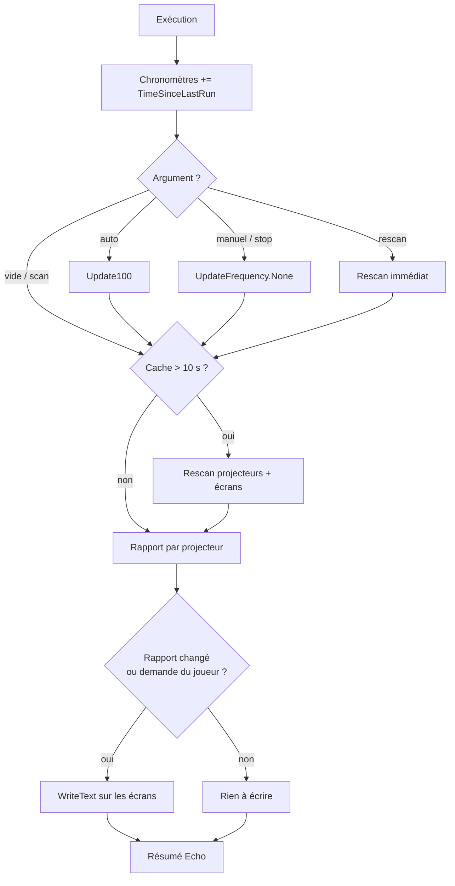

# Diagnostic Structurel par Projecteur

> [!summary] Résumé
> Un Bloc Programmable lit les compteurs d'un ou plusieurs **projecteurs** contenant le plan (Blueprint) du vaisseau intact pour savoir combien de blocs ont été **totalement détruits**. Il affiche un pourcentage d'intégrité, une barre de progression et des conseils de dépannage, en exécution manuelle (comme l'original) ou en surveillance automatique légère.
> Fusion optimisée de [[_old/Scripte/Le Scanner de Brèches|Le Scanner de Brèches]] (version pédagogique) et de [[_old/Scripte/Script Space Engineers Diagnostic Structurel|Script Space Engineers Diagnostic Structurel]] (version condensée).

## Pourquoi un projecteur ?

Un script ne peut « voir » que ce qui existe. Quand un bloc d'armure est **pulvérisé** par un missile, il disparaît purement et simplement du jeu : il n'est pas « cassé », il **n'existe plus**. Aucune boucle sur les blocs de la grille ne pourra donc jamais le trouver pour vous dire qu'il manque.

**La solution : le projecteur.** En chargeant le plan du vaisseau *intact* dans un projecteur superposé au vaisseau réel, le jeu calcule lui-même la différence entre « ce qui devrait être là » et « ce qui est vraiment là ». Le script se contente de **lire ce calcul** à travers trois compteurs :

| Compteur du projecteur | Signification |
|---|---|
| `TotalBlocks` | Nombre total de blocs du plan idéal |
| `RemainingBlocks` | Blocs du plan qui n'existent pas (ou plus) dans la réalité |
| `BuildableBlocks` | Parmi eux, ceux qu'on peut souder tout de suite (ils touchent un bloc existant) |

> [!info] Complémentaire du Contrôle des Avaries
> Ce script ne voit que les blocs **disparus**. Un bloc présent mais endommagé n'est pas compté ici : c'est le rôle du script de contrôle des avaries (`Role=Avaries`), qui lit l'intégrité des blocs existants.

## 1. Prérequis en jeu

1. Sauvegarder le plan du vaisseau **lorsqu'il est intact** (`Ctrl+B`).
2. Construire un **Projecteur** sur le vaisseau et le nommer exactement `PROJECTEUR_REPARATION`
   *ou* mettre la balise `[DIAG]` dans son nom (ex. `Projecteur Coque [DIAG]`). Plusieurs projecteurs balisés sont acceptés : un rapport par projecteur.
3. Charger le plan dans le projecteur et **l'aligner parfaitement** sur les blocs réels (décalage et rotation).
4. Cocher **« Garder la projection »** (*Keep Projection*) dans le terminal du projecteur.
5. (Optionnel) Un ou plusieurs écrans :
   - un LCD nommé exactement `LCD_SCANNER` (compatibilité avec l'original) ;
   - et/ou n'importe quel LCD, cockpit, siège ou Bloc Programmable dont le Custom Data contient :

```ini
[Ecran]
Role=Structure
; Optionnel, pour un bloc à plusieurs écrans (cockpit...) : index de la surface
Surface=0
```

> [!warning] Orthographe
> La section doit s'écrire exactement `[Ecran]` (sans accent). Les autres rôles (`Stocks`, `Avaries`, `Carburant`) sont ignorés par ce script : un même vaisseau peut avoir un écran par script sans conflit.

## 2. Installation

1. Construire un **Bloc Programmable** sur la même construction que le projecteur.
2. Ouvrir l'éditeur de code, tout effacer et coller le code de la section [[#9. Code complet]].
3. Cliquer sur **« Vérifier le code »** puis **« OK »** : le script recherche les blocs et affiche immédiatement un premier diagnostic.
4. Lier l'argument voulu à un bouton ou à la barre d'outils (voir [[#4. Commandes]]).
5. (Optionnel) Lancer l'argument `auto` pour une surveillance permanente.

> [!tip] Lisibilité de la barre
> La barre `[####....]` est plus régulière avec la police **Monospace** de l'écran (le `#` et le `.` n'ont pas la même largeur dans la police par défaut).

## 3. Configuration

### Constantes (en tête du script)

| Constante | Défaut | Effet |
|---|---|---|
| `NOM_PROJECTEUR` | `PROJECTEUR_REPARATION` | Nom exact du projecteur historique |
| `BALISE_PROJECTEUR` | `[DIAG]` | Tout projecteur dont le nom contient ce texte est aussi diagnostiqué |
| `NOM_ECRAN` | `LCD_SCANNER` | Nom exact de l'écran LCD historique |
| `SECTION_ECRAN` | `Ecran` | Section INI lue dans le Custom Data des écrans |
| `ROLE_ECRAN` | `Structure` | Valeur de `Role` qui désigne un écran de ce script |
| `SEULEMENT_CETTE_CONSTRUCTION` | `true` | Ignore les projecteurs et écrans des vaisseaux amarrés par connecteur |
| `INTERVALLE_RESCAN_SECONDES` | `10` | Ancienneté maximale du cache des blocs (secondes de jeu) |
| `LARGEUR_BARRE` | `20` | Nombre de caractères de la barre d'intégrité |

### Clés Custom Data des écrans

| Section | Clé | Valeurs | Effet |
|---|---|---|---|
| `[Ecran]` | `Role` | `Structure` (casse indifférente) | L'écran reçoit le rapport de ce script |
| `[Ecran]` | `Surface` | `0`, `1`, `2`... (défaut `0`) | Index de la surface pour un bloc à plusieurs écrans ; ignoré pour un LCD simple |

## 4. Commandes

| Argument | Effet |
|---|---|
| *(vide)* ou `scan` | Diagnostic immédiat ; les écrans sont toujours réécrits |
| `auto` | Surveillance automatique (`Update100`, ~1,7 s) ; les écrans ne sont réécrits que si le rapport change |
| `manuel` ou `stop` | Retour au mode manuel (`UpdateFrequency.None`), comme l'original |
| `rescan` | Recherche immédiate des projecteurs et écrans (après en avoir ajouté ou renommé) |

Le mode (`auto` / `manuel`) est enregistré dans la mémoire du Bloc Programmable (`Storage`) à chaque sauvegarde : il est conservé après un rechargement de la partie.

> [!tip] Lier à un bouton
> Panneau de boutons → *Configurer les actions* → glisser le Bloc Programmable → **Exécuter** → saisir l'argument (`scan`, `auto`...). Idéal : un bouton « Scan » sur la passerelle à presser après un combat.

## 5. Fonctionnement

### Algorithme en français

1. **Au démarrage** (compilation ou chargement de la partie) : le script relit le mode mémorisé dans `Storage`, règle la fréquence d'exécution (aucune en manuel, `Update100` en auto), recherche les blocs une première fois et affiche un premier diagnostic.
2. **À chaque exécution** :
   1. Il ajoute le temps de jeu écoulé (`Runtime.TimeSinceLastRun`) à trois chronomètres : depuis le dernier rescan, depuis le diagnostic précédent, depuis le dernier changement du rapport.
   2. Il interprète l'argument (`auto`, `manuel`, `stop`, `rescan`, `scan`).
   3. Si le cache des blocs a plus de 10 s, il recherche à nouveau projecteurs et écrans (sinon il réutilise les listes en mémoire).
   4. Il construit le rapport dans un `StringBuilder` : un en-tête, puis pour chaque projecteur (triés par nom) :
      - projection inactive → message d'aide (allumer, charger le plan, garder la projection) ;
      - plan vide (`TotalBlocks == 0`) → message d'aide (recharger le Blueprint) ;
      - sinon intégrité = `(Total − Restants) / Total`, barre de progression, puis « INTÈGRE » ou « BRÈCHES DÉTECTÉES » avec le nombre de blocs volatilisés ;
      - si des blocs manquent mais qu'**aucun** n'est soudable (`BuildableBlocks == 0`), ou si **tous** les blocs du plan sont manquants, il conseille de vérifier l'alignement.
   5. Il écrit le rapport sur les écrans **seulement s'il a changé** — sauf si l'exécution vient du joueur (terminal, bouton), auquel cas il réécrit toujours.
   6. Il affiche dans la console un résumé : mode, nombre de projecteurs et d'écrans, « scan précédent il y a X s », « rapport inchangé depuis X s », temps d'exécution, erreurs de configuration, puis le rapport.



### Exemple d'affichage

```text
=== DIAGNOSTIC STRUCTUREL ===

--- PROJECTEUR_REPARATION ---
Intégrité : [###################.] 97.6 %
ÉTAT : BRÈCHES DÉTECTÉES
Blocs volatilisés : 12 sur 503
9 bloc(s) prêt(s) à être soudé(s).
```

> [!info] Pourquoi l'horodatage n'est-il que dans la console ?
> Afficher « dernier scan il y a X s » sur l'écran changerait le texte à chaque exécution et obligerait à le réécrire en permanence, ce qui annulerait l'optimisation « écrire seulement si ça change ». L'ancienneté est donc affichée dans la console du Bloc Programmable (`Echo`), qui est de toute façon réécrite à chaque exécution.

## 6. Optimisations et corrections par rapport à l'original

| Problème d'origine | Conséquence en jeu | Correction |
|---|---|---|
| `SpaceEngineers.Game.ModAPI.Ingame.ContentType.TEXT_AND_IMAGE` | Erreur de compilation : cet espace de noms ne contient pas `ContentType` | `ContentType.TEXT_AND_IMAGE` (espace de noms `VRage.Game.GUI.TextPanel`, importé par défaut), appliqué une seule fois par écran et seulement si nécessaire |
| Deux versions du même script (pédagogique / condensée) | Confusion, corrections à faire en double | Un seul script fusionné, commenté pour un débutant |
| Un seul projecteur (nom exact) | Impossible de surveiller un gros vaisseau découpé en plusieurs plans | Nom exact conservé **et** balise `[DIAG]` : un rapport par projecteur, triés par nom |
| Un seul écran `LCD_SCANNER`, LCD uniquement | Pas d'affichage sur un cockpit ni sur plusieurs écrans | Nom exact conservé **et** Custom Data `[Ecran] Role=Structure` (+ `Surface=N` pour cockpits), convention commune à tous les scripts |
| `GetBlockWithName` sans filtre de construction | Un vaisseau amarré portant les mêmes noms pouvait être diagnostiqué à la place | Filtre `IsSameConstructAs(Me)` (constante `SEULEMENT_CETTE_CONSTRUCTION`) |
| Recherche des blocs à chaque exécution | Coût inutile, surtout si on veut une surveillance continue | Cache des blocs, rafraîchi toutes les 10 s ou sur `rescan` |
| Concaténation de `string` avec `+=` | Allocations à chaque ligne | `StringBuilder` réutilisé |
| Exécution uniquement manuelle | Il faut penser à appuyer sur le bouton après chaque combat | Mode `auto` optionnel (`Update100`) avec écriture seulement si le rapport change ; le mode manuel reste le défaut |
| Aucun état mémorisé | — | Mode sauvegardé dans `Storage` via `Save()`, restauré au chargement |
| Seulement « X sur Y » | Difficile d'évaluer la gravité d'un coup d'œil | Pourcentage d'intégrité + barre de progression |
| Si le projecteur est éteint, message seulement dans la console | L'écran affiche un vieux rapport trompeur | Le message d'aide (« projection inactive », « plan vide », « aucun projecteur ») est aussi écrit sur les écrans |
| `TotalBlocks == 0` non traité | Rapport incohérent (et division par zéro si on calculait un pourcentage) | Cas « PLAN VIDE » explicite |
| `BuildableBlocks == 0` : conseil d'alignement seulement dans la version condensée | Le joueur de la version pédagogique ne savait pas quoi faire | Conseil d'alignement systématique, plus un avertissement si **tous** les blocs du plan sont manquants |
| Argument ignoré | Une faute de frappe passait inaperçue | Argument inconnu signalé dans la console avec la liste des commandes |

## 7. Limites connues

- **Blocs endommagés non détectés** : un bloc présent mais abîmé (même à 1 %) compte comme « présent » pour le projecteur. Utiliser le script de contrôle des avaries pour l'intégrité des blocs existants.
- **Pas de détail par type de bloc** : l'API du projecteur expose peut-être un détail des blocs restants par type (`RemainingBlocksPerType`), mais son existence et sa forme exacte dans l'API Ingame n'ont pas pu être vérifiées ; par prudence (règle anti-hallucination), le script se limite à `IsProjecting`, `TotalBlocks`, `RemainingBlocks` et `BuildableBlocks`.
- **Pas de localisation des brèches** : le script ne dit pas *où* manquent les blocs ; regarder la projection en jeu (les blocs fantômes) reste nécessaire.
- **Le plan doit être à jour** : si le vaisseau a été modifié après la sauvegarde du Blueprint, les blocs ajoutés/supprimés faussent le compte. Re-sauvegarder le plan après chaque modification volontaire.
- **Alignement** : le conseil « vérifier l'alignement » est une heuristique (`BuildableBlocks == 0` ou `RemainingBlocks == TotalBlocks`) ; le jeu ne fournit pas directement d'indicateur d'alignement via les membres utilisés ici.
- **Projecteur détruit** : entre deux rescans (10 s maximum), un projecteur détruit peut encore figurer dans le cache avec ses dernières valeurs ; `rescan` force la mise à jour.
- **Format du pourcentage** : `ToString("0.0")` suit la culture du jeu (point ou virgule décimale selon la langue).
- **Un seul rapport commun** : tous les écrans `Role=Structure` reçoivent le rapport complet (tous les projecteurs) ; il n'y a pas d'écran dédié à un projecteur précis.

## 8. Dépannage

| Symptôme | Cause probable | Solution |
|---|---|---|
| « AUCUN PROJECTEUR TROUVÉ » | Nom différent de `PROJECTEUR_REPARATION` et pas de balise `[DIAG]`, ou projecteur sur un vaisseau amarré | Renommer le projecteur, puis argument `rescan` |
| « PROJECTION INACTIVE » | Projecteur éteint, sans plan, ou projection perdue | Allumer, charger le Blueprint, cocher « Garder la projection » |
| « PLAN VIDE » | Plan chargé sans bloc ou chargement raté | Recharger le Blueprint du vaisseau |
| « aucun bloc manquant n'est rattaché à la coque » | Projection décalée ou tournée | Ajuster décalage / rotation jusqu'à ce que la projection coïncide |
| 0 % d'intégrité alors que le vaisseau est entier | Projection complètement désalignée | Réaligner la projection |
| L'écran reste vide | Nom ou Custom Data incorrect, ou écran sur un autre vaisseau | Vérifier `LCD_SCANNER` ou `[Ecran]` / `Role=Structure`, puis `rescan` |
| « Surface=N inexistante » dans la console | Index de surface trop grand pour ce bloc | Mettre un index entre 0 et le nombre d'écrans du bloc moins 1 |
| « Custom Data INI invalide » | Ligne mal formée dans le Custom Data de l'écran | Corriger le Custom Data (une clé=valeur par ligne) |
| Le mode auto est perdu après rechargement | Partie rechargée sans avoir été sauvegardée après `auto` | Sauvegarder la partie après avoir activé `auto` |
| L'écran ne se met plus à jour en mode auto | Le rapport n'a pas changé (comportement normal) | Lancer `scan` pour forcer une réécriture |

## 9. Code complet

```csharp
// ==============================================================================
// DIAGNOSTIC STRUCTUREL PAR PROJECTEUR (version optimisée)
// ------------------------------------------------------------------------------
// Rôle :
//   Compare le vaisseau réel au plan (Blueprint) chargé dans un ou plusieurs
//   projecteurs afin de détecter les blocs TOTALEMENT DÉTRUITS (volatilisés).
//   Un bloc pulvérisé n'existe plus dans le jeu : aucun script ne peut le
//   « voir ». Le projecteur, lui, sait ce qui DEVRAIT être là, et calcule
//   tout seul la différence avec ce qui est VRAIMENT là. On lit ce calcul.
//
// Nomenclature des blocs :
//   - Projecteur nommé exactement "PROJECTEUR_REPARATION" (compatibilité)
//     et/ou tout projecteur dont le nom contient la balise "[DIAG]"
//     (un rapport par projecteur).
//   - Écran LCD nommé exactement "LCD_SCANNER" (compatibilité) et/ou tout
//     écran / cockpit / bloc à surfaces dont le Custom Data contient :
//         [Ecran]
//         Role=Structure
//         Surface=0        (optionnel : index de la surface, défaut 0)
//
// Commandes (argument du Bloc Programmable) :
//   (vide) ou scan : lance un diagnostic immédiat et l'affiche.
//   auto           : surveillance automatique (environ toutes les 1,7 s).
//   manuel / stop  : retour au mode manuel (aucune exécution automatique).
//   rescan         : recherche à nouveau les projecteurs et les écrans.
//   Le mode (auto / manuel) est mémorisé et survit au rechargement de la partie.
//
// Dépendances (serveurs) : aucune.
// ==============================================================================


// ==============================================================================
// CONSTANTES DE CONFIGURATION (toutes les valeurs réglables sont ici)
// ==============================================================================

/// <summary>Nom exact du projecteur historique (compatibilité avec l'original).</summary>
const string NOM_PROJECTEUR = "PROJECTEUR_REPARATION";

/// <summary>Balise : tout projecteur dont le nom la contient est aussi diagnostiqué.</summary>
const string BALISE_PROJECTEUR = "[DIAG]";

/// <summary>Nom exact de l'écran LCD historique (compatibilité avec l'original).</summary>
const string NOM_ECRAN = "LCD_SCANNER";

/// <summary>Section INI du Custom Data des écrans (convention commune aux scripts).</summary>
const string SECTION_ECRAN = "Ecran";

/// <summary>Valeur de la clé Role qui désigne un écran de ce script.</summary>
const string ROLE_ECRAN = "Structure";

/// <summary>true = ignorer les blocs des vaisseaux amarrés par connecteur.</summary>
const bool SEULEMENT_CETTE_CONSTRUCTION = true;

/// <summary>Délai (secondes de jeu) au-delà duquel on recherche à nouveau les blocs.</summary>
const double INTERVALLE_RESCAN_SECONDES = 10.0;

/// <summary>Nombre de caractères de la barre de progression d'intégrité.</summary>
const int LARGEUR_BARRE = 20;

/// <summary>Valeurs écrites dans Storage pour mémoriser le mode.</summary>
const string MEMOIRE_MODE_AUTO = "auto";
const string MEMOIRE_MODE_MANUEL = "manuel";


// ==============================================================================
// ÉTAT DU SCRIPT (champs réutilisés d'une exécution à l'autre)
// ==============================================================================

/// <summary>Cache des projecteurs à diagnostiquer (rempli par RescannerBlocs).</summary>
readonly List<IMyProjector> projecteurs = new List<IMyProjector>();

/// <summary>Cache des surfaces d'affichage (LCD, cockpits...) qui reçoivent le rapport.</summary>
readonly List<IMyTextSurface> surfacesEcrans = new List<IMyTextSurface>();

/// <summary>Copie de travail des surfaces avant un rescan (pour détecter un changement d'écrans).</summary>
readonly List<IMyTextSurface> surfacesPrecedentes = new List<IMyTextSurface>();

/// <summary>Liste de travail réutilisée pendant la recherche des écrans.</summary>
readonly List<IMyTerminalBlock> blocsTemporaires = new List<IMyTerminalBlock>();

/// <summary>Erreurs de configuration détectées au dernier rescan (affichées dans Echo).</summary>
readonly List<string> erreursConfiguration = new List<string>();

/// <summary>Texte du rapport, reconstruit à chaque diagnostic sans allocation de chaînes intermédiaires.</summary>
readonly StringBuilder rapport = new StringBuilder();

/// <summary>Texte du résumé affiché dans la console du Bloc Programmable.</summary>
readonly StringBuilder resumeEcho = new StringBuilder();

/// <summary>Analyseur INI réutilisé pour lire le Custom Data des écrans.</summary>
readonly MyIni lecteurIni = new MyIni();

/// <summary>true = surveillance périodique (Update100) ; false = exécution manuelle.</summary>
bool modeAuto = false;

/// <summary>Dernier texte écrit sur les écrans (null = forcer la prochaine écriture).</summary>
string dernierRapportEcrit = null;

/// <summary>Temps de jeu écoulé depuis la dernière recherche de blocs.</summary>
double secondesDepuisRescan = 0;

/// <summary>Temps de jeu écoulé depuis le diagnostic précédent (-1 = aucun).</summary>
double secondesDepuisDiagnostic = -1;

/// <summary>Temps de jeu écoulé depuis le dernier changement du rapport (-1 = aucun).</summary>
double secondesDepuisChangement = -1;


// ==============================================================================
// POINTS D'ENTRÉE DU JEU
// ==============================================================================

/// <summary>
/// Constructeur : exécuté une seule fois à la compilation ou au chargement de la partie.
/// Il relit le mode mémorisé, choisit la fréquence d'exécution, remplit le cache
/// des blocs et affiche un premier diagnostic.
/// </summary>
public Program()
{
    // Storage est une chaîne conservée dans la sauvegarde : on y retrouve le mode
    // choisi par le joueur avant le rechargement de la partie.
    modeAuto = (Storage == MEMOIRE_MODE_AUTO);
    AppliquerFrequence();

    // Première recherche des blocs puis premier diagnostic (écriture forcée).
    RescannerBlocs();
    ExecuterDiagnostic(true, null);
}

/// <summary>
/// Appelée par le jeu lors de la sauvegarde : mémorise le mode courant
/// pour qu'il survive à un rechargement de la partie.
/// </summary>
public void Save()
{
    Storage = modeAuto ? MEMOIRE_MODE_AUTO : MEMOIRE_MODE_MANUEL;
}

/// <summary>
/// Point d'entrée principal : appelé à chaque clic sur « Exécuter », à chaque
/// bouton / minuterie, et automatiquement toutes les 100 ticks en mode auto.
/// </summary>
/// <param name="argument">Commande éventuelle (scan, auto, manuel, stop, rescan).</param>
/// <param name="updateSource">Origine de l'exécution (terminal, bouton, Update100...).</param>
public void Main(string argument, UpdateType updateSource)
{
    // --- 1. Faire avancer les chronomètres avec le temps de JEU écoulé ---
    // TimeSinceLastRun mesure le temps de jeu depuis la dernière exécution :
    // contrairement à DateTime.Now, il suit la vitesse réelle de la simulation.
    double ecoule = Runtime.TimeSinceLastRun.TotalSeconds;
    secondesDepuisRescan += ecoule;
    if (secondesDepuisDiagnostic >= 0) secondesDepuisDiagnostic += ecoule;
    if (secondesDepuisChangement >= 0) secondesDepuisChangement += ecoule;

    // --- 2. Interpréter la commande éventuelle ---
    string messageCommande = TraiterCommande(argument ?? "");

    // --- 3. Rafraîchir le cache des blocs si trop ancien ---
    // (un projecteur a pu être renommé, construit ou détruit entre-temps)
    if (secondesDepuisRescan >= INTERVALLE_RESCAN_SECONDES)
    {
        RescannerBlocs();
    }

    // --- 4. Diagnostic ---
    // Une exécution périodique n'écrit que si le rapport a changé ; une exécution
    // demandée par le joueur (terminal, bouton) réécrit toujours les écrans.
    bool executionPeriodique = (updateSource & UpdateType.Update100) != 0;
    ExecuterDiagnostic(!executionPeriodique, messageCommande);
}


// ==============================================================================
// COMMANDES ET MODES
// ==============================================================================

/// <summary>
/// Interprète l'argument passé au Bloc Programmable.
/// </summary>
/// <param name="argument">Texte brut de l'argument (jamais null).</param>
/// <returns>Un message d'erreur si l'argument est inconnu, sinon null.</returns>
string TraiterCommande(string argument)
{
    // On ignore les espaces et la casse : "AUTO", " auto " et "Auto" sont équivalents.
    string commande = argument.Trim().ToLower();

    switch (commande)
    {
        case "":
        case "scan":
            // Rien de spécial : le diagnostic est lancé juste après par Main.
            return null;

        case "auto":
            modeAuto = true;
            AppliquerFrequence();
            return null;

        case "manuel":
        case "stop":
            modeAuto = false;
            AppliquerFrequence();
            return null;

        case "rescan":
            RescannerBlocs();
            return null;

        default:
            return "Argument inconnu : '" + argument + "'.\nUtilisez : scan, auto, manuel, stop, rescan.";
    }
}

/// <summary>
/// Règle la fréquence d'exécution automatique selon le mode.
/// Update100 (~1,7 s) suffit : lire quelques compteurs du projecteur est peu coûteux.
/// </summary>
void AppliquerFrequence()
{
    Runtime.UpdateFrequency = modeAuto ? UpdateFrequency.Update100 : UpdateFrequency.None;
}


// ==============================================================================
// RECHERCHE DES BLOCS (CACHE)
// ==============================================================================

/// <summary>
/// Remplit le cache des projecteurs et des surfaces d'affichage.
/// Appelée au démarrage, sur l'argument "rescan" et toutes les
/// INTERVALLE_RESCAN_SECONDES : on évite ainsi de parcourir toute la grille
/// à chaque exécution.
/// </summary>
void RescannerBlocs()
{
    secondesDepuisRescan = 0;
    erreursConfiguration.Clear();

    // On garde une copie des écrans actuels pour savoir, à la fin, si la liste
    // a changé (nouvel écran → il faudra lui écrire le rapport).
    surfacesPrecedentes.Clear();
    surfacesPrecedentes.AddRange(surfacesEcrans);

    // --- Projecteurs : nom exact historique OU balise dans le nom ---
    projecteurs.Clear();
    GridTerminalSystem.GetBlocksOfType<IMyProjector>(projecteurs, projecteur =>
        EstSurCetteConstruction(projecteur)
        && (projecteur.CustomName == NOM_PROJECTEUR
            || projecteur.CustomName.Contains(BALISE_PROJECTEUR)));

    // Tri par nom : l'ordre des rapports reste stable d'une exécution à l'autre
    // (sinon le texte « changerait » sans raison et serait réécrit).
    projecteurs.Sort((a, b) => string.Compare(a.CustomName, b.CustomName, StringComparison.Ordinal));

    // --- Écrans : tout bloc capable d'afficher du texte ---
    surfacesEcrans.Clear();
    blocsTemporaires.Clear();
    GridTerminalSystem.GetBlocksOfType<IMyTerminalBlock>(blocsTemporaires, bloc =>
        EstSurCetteConstruction(bloc)
        && (bloc is IMyTextPanel || bloc is IMyTextSurfaceProvider));

    foreach (IMyTerminalBlock bloc in blocsTemporaires)
    {
        IMyTextSurface surface = TrouverSurfaceStructure(bloc);
        if (surface != null)
        {
            PreparerSurface(surface);
            surfacesEcrans.Add(surface);
        }
    }

    // On vide les listes de travail pour ne pas garder de références inutiles.
    blocsTemporaires.Clear();

    // Si les écrans ont changé, on force la prochaine écriture ; sinon on garde
    // la règle « écrire seulement si le rapport change ».
    if (!MemesSurfaces(surfacesPrecedentes, surfacesEcrans))
    {
        dernierRapportEcrit = null;
    }
    surfacesPrecedentes.Clear();
}

/// <summary>
/// Compare deux listes de surfaces élément par élément (même objet, même ordre).
/// </summary>
/// <returns>true si les deux listes désignent exactement les mêmes surfaces.</returns>
bool MemesSurfaces(List<IMyTextSurface> listeA, List<IMyTextSurface> listeB)
{
    if (listeA.Count != listeB.Count) return false;
    for (int i = 0; i < listeA.Count; i++)
    {
        if (listeA[i] != listeB[i]) return false;
    }
    return true;
}

/// <summary>
/// Indique si un bloc appartient à la même construction que ce Bloc Programmable
/// (ou si le filtre est désactivé). Évite d'afficher le diagnostic d'un vaisseau
/// simplement amarré par connecteur.
/// </summary>
bool EstSurCetteConstruction(IMyTerminalBlock bloc)
{
    return !SEULEMENT_CETTE_CONSTRUCTION || bloc.IsSameConstructAs(Me);
}

/// <summary>
/// Détermine si un bloc doit afficher le rapport et, si oui, sur quelle surface.
/// Règles :
///   1. LCD nommé exactement NOM_ECRAN → oui (compatibilité avec l'original).
///   2. Custom Data avec [Ecran] Role=Structure → oui ; pour un bloc à plusieurs
///      surfaces (cockpit...), la clé Surface donne l'index (défaut 0).
/// </summary>
/// <param name="bloc">Bloc candidat (LCD ou fournisseur de surfaces).</param>
/// <returns>La surface à utiliser, ou null si le bloc n'est pas concerné.</returns>
IMyTextSurface TrouverSurfaceStructure(IMyTerminalBlock bloc)
{
    IMyTextPanel panneau = bloc as IMyTextPanel;

    // Règle 1 : le nom historique suffit.
    if (panneau != null && bloc.CustomName == NOM_ECRAN)
    {
        return panneau;
    }

    // Règle 2 : filtre rapide par simple recherche de texte AVANT l'analyse INI,
    // pour ne pas analyser le Custom Data de tous les blocs à chaque rescan.
    string donnees = bloc.CustomData;
    if (string.IsNullOrEmpty(donnees) || !donnees.Contains("[" + SECTION_ECRAN + "]"))
    {
        return null;
    }

    MyIniParseResult resultat;
    if (!lecteurIni.TryParse(donnees, out resultat))
    {
        erreursConfiguration.Add("Custom Data INI invalide : " + bloc.CustomName);
        return null;
    }

    // Role absent → écran d'un autre script (convention commune) : on l'ignore.
    string role = lecteurIni.Get(SECTION_ECRAN, "Role").ToString("").Trim();
    if (!string.Equals(role, ROLE_ECRAN, StringComparison.OrdinalIgnoreCase))
    {
        return null;
    }

    // Un LCD classique n'a qu'une surface : lui-même.
    if (panneau != null)
    {
        return panneau;
    }

    // Cockpit, Bloc Programmable, etc. : on choisit la surface demandée.
    IMyTextSurfaceProvider fournisseur = bloc as IMyTextSurfaceProvider;
    if (fournisseur == null)
    {
        return null;
    }

    int index = lecteurIni.Get(SECTION_ECRAN, "Surface").ToInt32(0);
    if (index < 0 || index >= fournisseur.SurfaceCount)
    {
        erreursConfiguration.Add("Surface=" + index + " inexistante sur " + bloc.CustomName
            + " (0 à " + (fournisseur.SurfaceCount - 1) + ")");
        return null;
    }

    return fournisseur.GetSurface(index);
}

/// <summary>
/// Passe la surface en mode « texte et image » (sinon le texte ne s'affiche pas),
/// uniquement si ce n'est pas déjà le cas.
/// </summary>
void PreparerSurface(IMyTextSurface surface)
{
    if (surface.ContentType != ContentType.TEXT_AND_IMAGE)
    {
        surface.ContentType = ContentType.TEXT_AND_IMAGE;
    }
}


// ==============================================================================
// DIAGNOSTIC ET RAPPORT
// ==============================================================================

/// <summary>
/// Construit le rapport, l'écrit sur les écrans si nécessaire et met à jour la console.
/// </summary>
/// <param name="forcerEcriture">true = réécrire les écrans même si le texte n'a pas changé.</param>
/// <param name="messageCommande">Erreur liée à l'argument, ou null.</param>
void ExecuterDiagnostic(bool forcerEcriture, string messageCommande)
{
    // On retient l'ancienneté du diagnostic précédent AVANT de la remettre à zéro,
    // pour pouvoir l'afficher (« scan précédent il y a X s »).
    double ancienneteDiagnosticPrecedent = secondesDepuisDiagnostic;

    ConstruireRapport();
    string texte = rapport.ToString();

    // Écriture seulement si le texte change (ou si le joueur l'a demandé).
    bool rapportChange = (texte != dernierRapportEcrit);
    if (rapportChange || forcerEcriture)
    {
        foreach (IMyTextSurface surface in surfacesEcrans)
        {
            surface.WriteText(texte);
        }
        dernierRapportEcrit = texte;
    }

    if (rapportChange || secondesDepuisChangement < 0)
    {
        secondesDepuisChangement = 0;
    }
    secondesDepuisDiagnostic = 0;

    AfficherResume(texte, ancienneteDiagnosticPrecedent, messageCommande);
}

/// <summary>
/// Remplit le StringBuilder "rapport" : un en-tête puis une section par projecteur.
/// </summary>
void ConstruireRapport()
{
    rapport.Clear();
    rapport.Append("=== DIAGNOSTIC STRUCTUREL ===\n");

    if (projecteurs.Count == 0)
    {
        rapport.Append("\nAUCUN PROJECTEUR TROUVÉ\n");
        rapport.Append("> Nommez un projecteur '").Append(NOM_PROJECTEUR).Append("'\n");
        rapport.Append("  ou ajoutez '").Append(BALISE_PROJECTEUR).Append("' à son nom,\n");
        rapport.Append("  puis lancez l'argument 'rescan'.\n");
        return;
    }

    foreach (IMyProjector projecteur in projecteurs)
    {
        AjouterRapportProjecteur(projecteur);
    }
}

/// <summary>
/// Ajoute au rapport la section d'un projecteur : état, barre d'intégrité,
/// nombre de blocs détruits et conseils de dépannage.
/// </summary>
/// <param name="projecteur">Projecteur à analyser.</param>
void AjouterRapportProjecteur(IMyProjector projecteur)
{
    rapport.Append("\n--- ").Append(projecteur.CustomName).Append(" ---\n");

    // Cas 1 : rien n'est projeté (projecteur éteint ou sans plan).
    if (!projecteur.IsProjecting)
    {
        rapport.Append("ÉTAT : PROJECTION INACTIVE\n");
        rapport.Append("> Allumez le projecteur, chargez le plan\n");
        rapport.Append("  et cochez « Garder la projection ».\n");
        return;
    }

    // Les trois compteurs calculés par le jeu.
    int totalBlocs = projecteur.TotalBlocks;            // blocs du plan idéal
    int blocsRestants = projecteur.RemainingBlocks;     // blocs du plan absents de la réalité
    int blocsConstructibles = projecteur.BuildableBlocks; // absents MAIS soudables tout de suite

    // Cas 2 : plan vide → le pourcentage n'aurait pas de sens (division par zéro).
    if (totalBlocs <= 0)
    {
        rapport.Append("ÉTAT : PLAN VIDE\n");
        rapport.Append("> Le plan chargé ne contient aucun bloc :\n");
        rapport.Append("  rechargez le Blueprint du vaisseau.\n");
        return;
    }

    // Intégrité structurelle = part des blocs du plan réellement présents.
    double integrite = CalculerIntegrite(totalBlocs, blocsRestants);
    rapport.Append("Intégrité : ");
    AjouterBarre(integrite);
    rapport.Append(' ').Append((integrite * 100.0).ToString("0.0")).Append(" %\n");

    // Cas 3 : rien ne manque.
    if (blocsRestants == 0)
    {
        rapport.Append("ÉTAT : INTÈGRE\n");
        rapport.Append("Aucun bloc manquant : conforme au plan.\n");
        return;
    }

    // Cas 4 : des blocs ont disparu.
    rapport.Append("ÉTAT : BRÈCHES DÉTECTÉES\n");
    rapport.Append("Blocs volatilisés : ").Append(blocsRestants)
           .Append(" sur ").Append(totalBlocs).Append('\n');

    if (blocsRestants >= totalBlocs)
    {
        // Aucun bloc du plan ne coïncide avec un bloc réel : c'est presque
        // toujours une projection décalée, pas un vaisseau entièrement détruit.
        rapport.Append("> Aucun bloc du plan ne correspond au\n");
        rapport.Append("  vaisseau : projection désalignée ?\n");
    }

    if (blocsConstructibles > 0)
    {
        // En jeu, on ne peut souder un bloc que s'il touche un bloc existant.
        rapport.Append(blocsConstructibles).Append(" bloc(s) prêt(s) à être soudé(s).\n");
    }
    else
    {
        rapport.Append("ATTENTION : aucun bloc manquant n'est\n");
        rapport.Append("rattaché à la coque.\n");
        rapport.Append("> Vérifiez l'alignement du projecteur\n");
        rapport.Append("  (décalage / rotation).\n");
    }
}

/// <summary>
/// Calcule l'intégrité structurelle : (Total - Restants) / Total, bornée entre 0 et 1.
/// </summary>
/// <param name="totalBlocs">Nombre de blocs du plan (strictement positif).</param>
/// <param name="blocsRestants">Nombre de blocs du plan absents de la réalité.</param>
/// <returns>Une fraction entre 0 (tout détruit) et 1 (intact).</returns>
double CalculerIntegrite(int totalBlocs, int blocsRestants)
{
    double fraction = (double)(totalBlocs - blocsRestants) / totalBlocs;
    if (fraction < 0) fraction = 0;
    if (fraction > 1) fraction = 1;
    return fraction;
}

/// <summary>
/// Ajoute une barre de progression texte, ex. [################....].
/// On arrondit à l'inférieur : la barre n'est pleine qu'à 100 % exactement,
/// pour qu'un seul bloc manquant reste visible.
/// </summary>
/// <param name="fraction">Valeur entre 0 et 1.</param>
void AjouterBarre(double fraction)
{
    int pleins = (int)Math.Floor(fraction * LARGEUR_BARRE);
    if (pleins < 0) pleins = 0;
    if (pleins > LARGEUR_BARRE) pleins = LARGEUR_BARRE;

    rapport.Append('[')
           .Append('#', pleins)
           .Append('.', LARGEUR_BARRE - pleins)
           .Append(']');
}


// ==============================================================================
// CONSOLE DU BLOC PROGRAMMABLE (Echo)
// ==============================================================================

/// <summary>
/// Affiche dans la console un résumé court (mode, blocs gérés, temps d'exécution,
/// erreurs de configuration) suivi du rapport complet.
/// </summary>
/// <param name="texte">Rapport complet déjà construit.</param>
/// <param name="ancienneteDiagnosticPrecedent">Secondes depuis le diagnostic précédent (-1 = aucun).</param>
/// <param name="messageCommande">Erreur liée à l'argument, ou null.</param>
void AfficherResume(string texte, double ancienneteDiagnosticPrecedent, string messageCommande)
{
    resumeEcho.Clear();
    resumeEcho.Append("Diagnostic Structurel - mode ")
              .Append(modeAuto ? "AUTO" : "MANUEL").Append('\n');
    resumeEcho.Append("Projecteurs : ").Append(projecteurs.Count)
              .Append(" | Écrans : ").Append(surfacesEcrans.Count).Append('\n');

    resumeEcho.Append("Scan précédent : ");
    if (ancienneteDiagnosticPrecedent < 0)
    {
        resumeEcho.Append("aucun\n");
    }
    else
    {
        resumeEcho.Append("il y a ").Append(FormaterDuree(ancienneteDiagnosticPrecedent)).Append('\n');
    }

    resumeEcho.Append("Rapport inchangé depuis : ")
              .Append(FormaterDuree(secondesDepuisChangement)).Append('\n');
    resumeEcho.Append("Dernière exécution : ")
              .Append(Runtime.LastRunTimeMs.ToString("0.000")).Append(" ms\n");

    if (messageCommande != null)
    {
        resumeEcho.Append("\n").Append(messageCommande).Append('\n');
    }

    foreach (string erreur in erreursConfiguration)
    {
        resumeEcho.Append("ERREUR : ").Append(erreur).Append('\n');
    }

    resumeEcho.Append('\n').Append(texte);
    Echo(resumeEcho.ToString());
}

/// <summary>
/// Convertit une durée en texte lisible : "42 s", "3 min 05 s" ou "2 h 10 min".
/// </summary>
/// <param name="secondes">Durée en secondes (positive).</param>
string FormaterDuree(double secondes)
{
    if (secondes < 0) secondes = 0;
    int total = (int)secondes;

    if (total < 60)
    {
        return total + " s";
    }
    if (total < 3600)
    {
        return (total / 60) + " min " + (total % 60).ToString("00") + " s";
    }
    return (total / 3600) + " h " + ((total % 3600) / 60).ToString("00") + " min";
}
```

## Voir aussi

- [[_old/Scripte/Le Scanner de Brèches|Le Scanner de Brèches]] — note d'origine (version pédagogique)
- [[_old/Scripte/Script Space Engineers Diagnostic Structurel|Script Space Engineers Diagnostic Structurel]] — note d'origine (version condensée)
