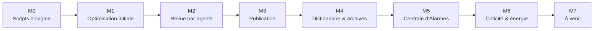

# Jalons du projet

> [!summary] Résumé
> Historique du projet découpé en jalons, reconstitué à partir de l'historique git et de [[Suivi IA]]. Chaque jalon terminé porte un **tag git** (`v0.x.0`) et correspond à un **milestone GitHub** du même nom.

Retour au [[00 - Sommaire]].

---

## Frise

## Vue d'ensemble

| Jalon | Date | Tag | Commits | État |
|---|---|---|---|---|
| M0 – Scripts d'origine | avant le 14/10/2026 | `v0.1.0` | `2b8cf9f` (archivés dans `_old/`) | ✅ |
| M1 – Optimisation initiale | 14/10/2026 | `v0.1.0` | `2b8cf9f` | ✅ |
| M2 – Revue par agents | 14/10/2026 | `v0.1.0` | `2b8cf9f` | ✅ |
| M3 – Publication | 14/10/2026 | `v0.2.0` | `fadaeaf`, `e20929c`, `2058d66`, `8923d8d` | ✅ |
| M4 – Dictionnaire & archives | 15/10/2026 | `v0.3.0` | `74a0983` | ✅ |
| M5 – Centrale d'Alarmes | 15/10/2026 | `v0.4.0` | `6add61a`, `1c14c01` | ✅ |
| M6 – Criticité & énergie | 15/10/2026 | `v0.5.0` (après commit) | *pas encore commité* | ✅ code et notes, non testé en jeu |
| M7 – À venir | — | — | — | ⏸ |

M0, M1 et M2 sont arrivés dans le même premier commit : ils partagent le tag `v0.1.0`.

## Détail des jalons

### M0 – Scripts d'origine

Les scripts et notes écrits avant l'optimisation, conservés sans modification dans `_old/Scripte` et `_old/*.cs` :
[[_old/Scripte/guide_du_tri_automatique_et_data_center_se|Tri automatique et Data Center]], [[_old/Scripte/Gestion de l'Affichage et Traductions|Affichage et traductions]], [[_old/Scripte/Controle_Avaries_SE|Contrôle des avaries]], [[_old/Scripte/Gestionnaire de Carburant|Gestionnaire de carburant]], [[_old/Scripte/Le Scanner de Brèches|Scanner de brèches]], [[_old/Scripte/Script Space Engineers Diagnostic Structurel|Diagnostic structurel]], [[_old/Scripte/Gestionnaire de Sas (Airlock) Intelligent|Gestionnaire de sas]], [[_old/Scripte/fermeture des porte|Fermeture des portes]].

### M1 – Optimisation initiale

- [[Conventions du projet]], [[Playbook IA]] et [[00 - Sommaire]] (à l'origine une seule note « Conventions et Playbook IA »).
- [[Serveur Dictionnaire]] (nouveau format `[Categories]` / `[Alias]` / `[Affichage]`).
- [[Tri Automatique des Inventaires]], [[Affichage Data Center]].
- [[Bus d'Alarmes]] : fin du conflit des gyrophares entre les deux scripts d'alarme.
- [[Controle des Avaries]], [[Surveillance Carburant Uranium]], [[Diagnostic Structurel par Projecteur]].
- [[Sas Automatique (Airlock)]], [[Fermeture Automatique des Portes]].

### M2 – Revue par agents

- [[Revue - reviewer A]] (Tri, Affichage, Dictionnaire) et [[Revue - reviewer B]] (Avaries, Carburant, Bus, Diagnostic, Sas, Portes).
- [[Scenarios de test]] : 174 scénarios.
- [[Coherence documentation]] : notes ↔ code.
- Liste consolidée des corrections dans [[Suivi IA]].

### M3 – Publication

- Licence PolyForm Noncommercial 1.0.0, en-tête dans chaque script.
- README français et anglais, liens de documentation, noms de fichiers harmonisés.

### M4 – Dictionnaire & archives

- Gaz `Oxygen` / `Hydrogen` dans le [[Serveur Dictionnaire]] ; l'[[Affichage Data Center]] affiche `O2` / `H2`.
- `.old` renommé `_old` (Obsidian n'indexe pas les dossiers commençant par un point) et liens vers les notes d'origine réparés.

### M5 – Centrale d'Alarmes

- [[Centrale d'Alarmes]] : pilote unique des gyrophares (groupe `ALARMES`), filtre `[Alarme] Sources=`, commandes `on` / `off`.
- Écrans `[alarme-line]` (liste) et `[alarme-quant]` (cases colorées, adaptées aux corner LCD).
- Niveaux de criticité dans le bus : Critique, Majeur, Normal, Mineur.

### M6 – Criticité & énergie

- **La criticité est la priorité** : la couleur des gyrophares est celle du niveau le plus grave ; la liste est triée par niveau puis par ordre d'arrivée (sauvegardé), et numérotée. `Priorite` supprimée.
- Chaque script déclare et publie sa criticité ; `BusAlarmes` publie plusieurs alarmes par script, avec un `[Detail]`.
- [[Surveillance Carburant Uranium]] devient la **surveillance énergie** : alarmes `Carburant` (H2), `Uranium`, `Glace`, `Batteries`, et `Energie` qui monte en criticité (Carburant + Uranium = Majeur, + Batteries = Critique).
- Correction n° 1 de la revue : des réacteurs à sec ne donnent plus une autonomie « INFINIE ».

### M7 – À venir

- Un écran par niveau : `[alarme-line-Critique]`, `[alarme-line-Majeur]`, `[alarme-line-Normal]`, `[alarme-line-Mineur]`.
- Défilement de la liste `[alarme-line]` quand elle dépasse l'écran.
- Corrections restantes de la revue (voir [[Suivi IA]]) :
  - 08 Sas : un sas devenu incomplet laisse une porte verrouillée à vie ;
  - 02 Tri : dictionnaire en erreur → coffres à alias vidés ;
  - 05 Avaries : rescan et tri final hors budget d'instructions ;
  - 03 Affichage : écrans reconstruits à chaque exécution, `SERVEUR_DICTIONNAIRE` non filtré par construction ;
  - corrections mineures et documentation.
- Tests en jeu des jalons M4 à M6.

## Voir aussi

- [[00 - Sommaire]]
- [[Suivi IA]] — état détaillé pour la reprise par une IA
