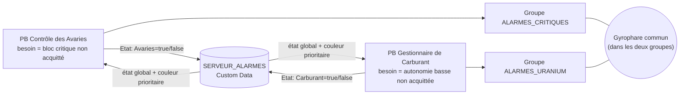

# Bus d'Alarmes (SERVEUR_ALARMES)

> [!summary] Résumé
> Un simple bloc nommé `SERVEUR_ALARMES` sert de « tableau d'affichage » commun : chaque script y écrit s'il a besoin de l'alarme, puis tous calculent le **même** état global et la **même** couleur. Les scripts [[Controle des Avaries]] et [[Surveillance Carburant Uranium]] ne se battent plus pour les gyrophares. Le bus est **optionnel**, sauf pour la [[Centrale d'Alarmes]] qui en a besoin.

> [!tip] Recommandé : la Centrale d'Alarmes
> Avec la [[Centrale d'Alarmes]], un seul bloc programmable pilote **tous** les gyrophares (groupe `ALARMES`) et affiche la liste des alarmes sur des écrans `[alarme-line]` / `[alarme-quant]`. Ajouter une alarme se résume alors à une ligne dans `[Couleurs]` et `[Criticite]`.

## 1. Le problème d'origine

La note [[_old/Scripte/Gestionnaire de Carburant|Gestionnaire de Carburant]] le signalait elle-même dans sa « note technique pour le futur » :

> [!warning] Deux scripts, mêmes gyrophares
> Le script de dégâts dit « éteins-toi, il n'y a pas de dégâts » pendant que le script d'uranium dit « allume-toi en vert ». Chaque script écrase la décision de l'autre à chacune de ses exécutions (~1,6 s) : les gyrophares clignotent, changent de couleur au hasard, ou restent éteints alors qu'une alerte est en cours.

Cause : chaque script pilotait les blocs **directement** à partir de son seul point de vue. Aucun ne savait que l'autre existait.

## 2. Le principe

Au lieu de piloter les blocs « à l'aveugle », chaque script :

1. calcule **son propre besoin** d'alarme (`true`/`false`) et connaît **sa source** (`Avaries` ou `Carburant`) ;
2. publie ce besoin dans la section `[Etat]` du Custom Data de `SERVEUR_ALARMES` (écriture **seulement si la valeur change**) ;
3. relit toutes les sources : **alarme globale = au moins une source à `true`** ;
4. choisit la **couleur** : celle de la source active la plus **critique** (`[Criticite]`) ; à criticité égale, la première dans `[Config] Priorite` ; à égalité encore, la première de `[Etat]` ;
5. applique cet état global à **son** groupe (`ALARMES_CRITIQUES` ou `ALARMES_URANIUM`).

Comme les deux scripts lisent le même Custom Data, ils calculent exactement la même chose : un gyrophare présent dans les deux groupes reçoit deux fois **le même ordre**, il n'y a plus de conflit.

> [!info] Pas de « course » entre scripts
> Dans Space Engineers, les blocs programmables s'exécutent les uns après les autres (jamais en même temps). Le cycle « lire → modifier → réécrire » du Custom Data ne peut donc pas être interrompu par l'autre script.

| Élément | Rôle | Qui l'écrit ? |
|---|---|---|
| `[Config] Priorite` | ordre des sources pour choisir la couleur, à criticité égale | le joueur |
| `[Criticite] Source=niveau` | `critique`, `majeur`, `normal` (défaut) ou `mineur` (anciens mots `importante`, `normale`, `basse` acceptés) : la plus grave impose sa couleur | le joueur |
| `[Couleurs] Source=R,G,B` | couleur de chaque source | le joueur (sinon chaque script ajoute automatiquement **sa** couleur si elle manque) |
| `[Etat] Source=true/false` | besoin d'alarme de chaque source | **les scripts**, ou la [[Centrale d'Alarmes]] (`on` / `off`) pour une source sans script |

### Acquittement (`ACK`)

`ACK` est envoyé **à un script**, et n'acquitte que **sa** source (elle repasse à `false`). Si l'autre source est encore active, l'alarme globale reste allumée, avec la couleur de cette autre source. Les règles de réarmement sont propres à chaque script (nouveau bloc critique pour les avaries, remontée au-dessus du seuil de réarmement pour le carburant).



### Application aux blocs

Pour chaque bloc du groupe, et **uniquement si cela change quelque chose** :

| Type de bloc | Action |
|---|---|
| Tout bloc fonctionnel (`IMyFunctionalBlock`) | `Enabled` = alarme globale |
| Lumière / gyrophare (`IMyLightingBlock`) | `Color` = couleur globale (quand l'alarme est active) |
| Bloc sonore (`IMySoundBlock`) | `Play()` quand l'alarme s'active, `Stop()` quand elle s'arrête (allumer un bloc sonore ne suffit pas à le faire jouer) |

Un bloc ajouté au groupe en cours de partie est synchronisé une première fois lors du rescan suivant, sans relancer les sons des autres blocs.

## 3. Le bus est optionnel

> [!tip] Sans SERVEUR_ALARMES
> Si aucun bloc ne s'appelle `SERVEUR_ALARMES`, chaque script fonctionne **seul** : état = son besoin propre, couleur = sa couleur propre (rouge pour les avaries, vert pour le carburant). C'est parfait tant que les deux groupes ne partagent **aucun** bloc. Echo affiche alors `Bus : autonome (aucun bloc SERVEUR_ALARMES)`.

Si le Custom Data du serveur n'est pas un INI valide, les scripts repassent en mode autonome et le signalent dans Echo.

## 4. Installation

1. Construire un bloc terminal quelconque sur la construction (ex. un **Panneau de contrôle** / *Control Panel*, peu coûteux). Il ne doit **pas** être un écran configuré avec `[Ecran] Role=...`.
2. Le renommer **exactement** `SERVEUR_ALARMES`.
3. Coller dans son **Custom Data** le contenu de `SERVEUR_ALARMES.ini` (ci-dessous). Si on le laisse vide, les scripts ajoutent eux-mêmes `[Etat]` et `[Couleurs]`, mais **pas** `[Config] Priorite`.
4. Installer (ou recompiler) les scripts [[Controle des Avaries]] et [[Surveillance Carburant Uranium]]. Ils retrouvent le serveur au plus tard 10 s après (ou immédiatement avec l'argument `rescan`).
5. Facultatif : mettre les gyrophares communs dans **les deux** groupes `ALARMES_CRITIQUES` et `ALARMES_URANIUM`.

```ini
[Config]
; Ordre de priorité des sources, utilisé à criticité égale
Priorite=Avaries,Carburant

[Couleurs]
; Source=R,G,B (composantes entre 0 et 255)
Avaries=255,0,0
Carburant=0,255,0

[Criticite]
; Source=critique | majeur | normal | mineur (normal si absente)
; La source active la plus critique impose sa couleur.
Avaries=critique
Carburant=majeur

[Etat]
; Écrit automatiquement par les scripts : Source=true/false (ne pas modifier)
; Une source sans script se pilote avec la Centrale : "on Source" / "off Source"
Avaries=false
Carburant=false
```

> [!warning] Vaisseaux amarrés
> Avec `SEULEMENT_CETTE_CONSTRUCTION = true` (défaut), un script ignore le `SERVEUR_ALARMES` d'un vaisseau amarré par connecteur et ne cherche que celui de sa propre construction.

## 5. Limites connues

- Le Custom Data est réécrit par `MyIni.ToString()` : la mise en forme (espaces, lignes vides) peut être normalisée par le jeu ; les commentaires `;` placés sous un en-tête ou avant une clé sont conservés par `MyIni`.
- Une source qui n'existe plus (script supprimé alors que sa clé valait `true`) maintient l'alarme : passer la clé à `false` à la main ou la supprimer.
- Si un même **bloc sonore** est dans les deux groupes, chaque script appelle `Play()` au moment où **il** voit l'alarme s'allumer : le son peut redémarrer une fois (décalage de moins de 2 s entre les deux scripts).
- Délai de propagation : jusqu'à une exécution de l'autre script (~1,6 s).

## 6. Dépannage

| Symptôme | Cause probable | Solution |
|---|---|---|
| Echo : `Bus : autonome (aucun bloc SERVEUR_ALARMES)` | nom du bloc différent, ou bloc sur un vaisseau amarré | renommer exactement `SERVEUR_ALARMES`, puis argument `rescan` |
| Echo : `Custom Data de SERVEUR_ALARMES illisible` | erreur de format INI (crochet manquant, ligne sans `=`) | recoller le contenu de `SERVEUR_ALARMES.ini` |
| Les gyrophares restent allumés alors que tout va bien | une clé `[Etat]` est restée à `true` (script supprimé ou arrêté) | mettre la clé à `false` ou la supprimer |
| Mauvaise couleur | `[Criticite]` ou `Priorite` absente, ou nom de source mal orthographié | vérifier `[Criticite]` puis `Priorite=Avaries,Carburant` (noms exacts) |
| Couleur ignorée | valeur `[Couleurs]` mal formée (ex. `255;0;0`) | format `R,G,B` avec des virgules |

## 7. Code de la classe `BusAlarmes`

> [!important] Copie conforme
> Cette classe est **strictement identique** dans `ControleAvaries.cs` et `GestionnaireCarburant.cs`. Si vous la modifiez, modifiez-la à l'identique dans les deux scripts, sinon ils ne calculeront plus le même état global. La règle de choix de la couleur (criticité, puis `Priorite`, puis `[Etat]`) est aussi reprise dans `CentraleAlarmes.cs` : gardez-les alignées.

```csharp
// ==============================================================================
// CLASSE PARTAGÉE : BUS D'ALARMES  (COPIE CONFORME DANS CHAQUE SCRIPT QUI ALARME)
// ------------------------------------------------------------------------------
// Ne PAS modifier cette classe dans un seul script : elle doit rester strictement
// identique dans "Contrôle des Avaries" et "Gestionnaire de Carburant", sinon les
// deux scripts ne calculeraient plus le même état global et se battraient de
// nouveau pour les gyrophares.
// ==============================================================================

/// <summary>
/// Bus d'alarmes partagé entre plusieurs blocs programmables.
/// QUOI : chaque script publie son propre besoin d'alarme (Source=true/false)
/// dans la section [Etat] du Custom Data d'un bloc nommé SERVEUR_ALARMES, puis
/// relit toutes les sources pour calculer UN état global (au moins une source
/// active) et UNE couleur (source active la plus critique, puis [Config] Priorite).
/// POURQUOI : sans ce bus, le script d'avaries éteignait les gyrophares que le
/// script de carburant venait d'allumer (et inversement). Avec le bus, tous les
/// scripts calculent exactement le même état : plus de conflit.
/// Si le bloc SERVEUR_ALARMES n'existe pas, la classe fonctionne en mode
/// autonome : état global = besoin propre du script, couleur = couleur propre.
/// </summary>
public class BusAlarmes
{
    /// <summary>Nom exact du bloc dont le Custom Data sert de bus.</summary>
    public const string NOM_SERVEUR = "SERVEUR_ALARMES";

    // Noms des sections et des clés du Custom Data partagé.
    const string SECTION_CONFIG = "Config";
    const string SECTION_COULEURS = "Couleurs";
    const string SECTION_ETAT = "Etat";
    const string CLE_PRIORITE = "Priorite";
    const string SECTION_CRITICITE = "Criticite";

    // Niveaux de criticité, du plus grave au moins grave (l'index sert de rang).
    // Plusieurs mots acceptés par niveau (les anciens noms restent valides).
    static readonly string[][] NIVEAUX_CRITICITE =
    {
        new[] { "critique" },
        new[] { "majeur", "majeure", "importante" },
        new[] { "normal", "normale" },
        new[] { "mineur", "mineure", "basse" }
    };
    const int RANG_CRITICITE_DEFAUT = 2;   // "normal"

    // Identité du script qui utilise ce bus (ex. "Avaries", "Carburant").
    readonly string source;
    // Couleur utilisée en mode autonome ou si la couleur du serveur est illisible.
    readonly Color couleurPropre;

    // Objets réutilisés d'une exécution à l'autre (évite les allocations).
    readonly MyIni lecteurIni = new MyIni();
    readonly List<MyIniKey> clesEtat = new List<MyIniKey>();
    readonly List<IMyTerminalBlock> tamponRecherche = new List<IMyTerminalBlock>();
    // Blocs d'alarme déjà synchronisés au moins une fois (par EntityId) :
    // permet de traiter un bloc ajouté au groupe sans relancer les sons des autres.
    readonly HashSet<long> blocsDejaSynchronises = new HashSet<long>();

    // Bloc serveur trouvé lors du dernier scan (null = mode autonome).
    IMyTerminalBlock serveur;
    // Dernier Custom Data lu : on ne reparse que si le texte a changé.
    string dernierCustomDataLu;
    // Résultat du dernier parsing (false = Custom Data illisible).
    bool customDataValide;
    // Dernier état global effectivement appliqué aux blocs d'alarme.
    bool etatApplique;

    /// <summary>Vrai si un bloc SERVEUR_ALARMES a été trouvé au dernier scan.</summary>
    public bool ServeurPresent { get { return serveur != null; } }

    /// <summary>État global : vrai si au moins une source demande l'alarme.</summary>
    public bool AlarmeGlobale { get; private set; }

    /// <summary>Couleur à appliquer aux lumières quand l'alarme globale est active.</summary>
    public Color CouleurGlobale { get; private set; }

    /// <summary>Nom de la source qui impose sa couleur (vide si aucune alarme).</summary>
    public string SourceDominante { get; private set; }

    /// <summary>Message court destiné à Echo (état du bus, erreurs de configuration).</summary>
    public string Diagnostic { get; private set; }

    /// <summary>
    /// Crée le bus pour une source donnée.
    /// </summary>
    /// <param name="source">Nom de la source (clé utilisée dans [Etat] et [Couleurs]).</param>
    /// <param name="couleurPropre">Couleur par défaut de cette source.</param>
    public BusAlarmes(string source, Color couleurPropre)
    {
        this.source = source;
        this.couleurPropre = couleurPropre;
        CouleurGlobale = couleurPropre;
        SourceDominante = "";
        Diagnostic = "pas encore initialisé";
    }

    /// <summary>
    /// Cherche le bloc SERVEUR_ALARMES (à appeler lors du rescan périodique,
    /// pas à chaque exécution). Le filtre de construction évite de lire le
    /// serveur d'un vaisseau amarré par connecteur.
    /// </summary>
    public void RechercherServeur(IMyGridTerminalSystem grille, IMyTerminalBlock moi, bool seulementCetteConstruction)
    {
        // Recherche rapide par nom (renvoie le premier bloc portant ce nom).
        IMyTerminalBlock trouve = grille.GetBlockWithName(NOM_SERVEUR);

        // Si ce premier bloc appartient à un vaisseau amarré, on cherche
        // explicitement celui de notre construction (cas rare, scan complet).
        if (trouve != null && seulementCetteConstruction && !trouve.IsSameConstructAs(moi))
        {
            tamponRecherche.Clear();
            grille.GetBlocksOfType<IMyTerminalBlock>(tamponRecherche,
                b => b.CustomName == NOM_SERVEUR && b.IsSameConstructAs(moi));
            trouve = tamponRecherche.Count > 0 ? tamponRecherche[0] : null;
            tamponRecherche.Clear();
        }

        // Si le serveur a changé (apparu, disparu, remplacé), on force une relecture.
        if (trouve != serveur)
        {
            serveur = trouve;
            dernierCustomDataLu = null;
        }
    }

    /// <summary>
    /// Publie le besoin d'alarme de CE script puis calcule l'état global.
    /// Étapes : (1) relire le Custom Data s'il a changé, (2) écrire
    /// [Etat] Source=besoin seulement si la valeur change, (3) état global =
    /// au moins une clé [Etat] vraie, (4) couleur = source active de plus haute
    /// [Criticite], puis la première dans [Config] Priorite, puis dans [Etat].
    /// </summary>
    /// <param name="besoinPropre">Vrai si ce script demande l'alarme (déjà corrigé de l'ACK).</param>
    public void Publier(bool besoinPropre)
    {
        // ---- Mode autonome : pas de serveur -----------------------------------
        if (serveur == null)
        {
            PasserEnModeAutonome(besoinPropre, "autonome (aucun bloc " + NOM_SERVEUR + ")");
            return;
        }

        // ---- (1) Relecture seulement si le texte a changé ---------------------
        string texte = serveur.CustomData;
        if (texte != dernierCustomDataLu)
        {
            dernierCustomDataLu = texte;
            customDataValide = lecteurIni.TryParse(texte);
        }
        if (!customDataValide)
        {
            PasserEnModeAutonome(besoinPropre, "Custom Data de " + NOM_SERVEUR + " illisible (format INI)");
            return;
        }

        // ---- (2) Publication de notre état (écriture seulement si changement) -
        bool modifie = false;
        if (!lecteurIni.ContainsKey(SECTION_ETAT, source)
            || lecteurIni.Get(SECTION_ETAT, source).ToBoolean(false) != besoinPropre)
        {
            lecteurIni.Set(SECTION_ETAT, source, besoinPropre);
            modifie = true;
        }
        // Auto-enregistrement de notre couleur si le joueur ne l'a pas définie :
        // ainsi les autres scripts connaissent notre couleur.
        if (!lecteurIni.ContainsKey(SECTION_COULEURS, source))
        {
            lecteurIni.Set(SECTION_COULEURS, source, couleurPropre.R + "," + couleurPropre.G + "," + couleurPropre.B);
            modifie = true;
        }
        if (modifie)
        {
            string nouveauTexte = lecteurIni.ToString();
            serveur.CustomData = nouveauTexte;
            // On mémorise notre propre écriture pour ne pas la reparser au prochain cycle.
            dernierCustomDataLu = nouveauTexte;
        }

        // ---- (3) État global : au moins une source active ---------------------
        AlarmeGlobale = false;
        SourceDominante = "";
        CouleurGlobale = couleurPropre;
        clesEtat.Clear();
        lecteurIni.GetKeys(SECTION_ETAT, clesEtat);
        foreach (MyIniKey cle in clesEtat)
        {
            if (lecteurIni.Get(SECTION_ETAT, cle.Name).ToBoolean(false))
            {
                AlarmeGlobale = true;
                break;
            }
        }

        // ---- (4) Source dominante : criticité, puis priorité ------------------
        // Règle commune avec la Centrale d'Alarmes : la criticité la plus haute
        // l'emporte ([Criticite], "normal" si absente) ; à égalité, l'ordre de
        // [Config] Priorite ; à égalité encore, l'ordre des clés de [Etat].
        if (AlarmeGlobale)
        {
            string[] ordrePriorite = lecteurIni.Get(SECTION_CONFIG, CLE_PRIORITE).ToString("").Split(',');
            int meilleurRang = int.MaxValue;
            int meilleurOrdre = int.MaxValue;
            foreach (MyIniKey cle in clesEtat)
            {
                if (!lecteurIni.Get(SECTION_ETAT, cle.Name).ToBoolean(false)) continue;
                int rang = RangCriticite(cle.Name);
                int ordre = PositionDansPriorite(ordrePriorite, cle.Name);
                // Comparaison stricte : à égalité complète, la première clé de [Etat] reste.
                if (rang < meilleurRang || (rang == meilleurRang && ordre < meilleurOrdre))
                {
                    meilleurRang = rang;
                    meilleurOrdre = ordre;
                    SourceDominante = cle.Name;
                }
            }
            CouleurGlobale = LireCouleur(SourceDominante);
        }

        Diagnostic = "connecté, alarme globale " + (AlarmeGlobale ? "ACTIVE (" + SourceDominante + ")" : "inactive");
    }

    /// <summary>
    /// Applique l'état global au groupe de blocs d'alarme de ce script.
    /// Chaque écriture (Enabled, Color, Play/Stop) n'est faite que si elle
    /// change quelque chose : un bloc sonore n'est relancé qu'au changement
    /// d'état global, ou la première fois qu'on le rencontre.
    /// </summary>
    /// <param name="blocsAlarme">Blocs du groupe d'alarme (lumières, sons, portes...).</param>
    public void AppliquerAuxBlocs(List<IMyFunctionalBlock> blocsAlarme)
    {
        bool changementEtat = AlarmeGlobale != etatApplique;

        foreach (IMyFunctionalBlock bloc in blocsAlarme)
        {
            // HashSet.Add renvoie true si l'identifiant n'y était pas encore.
            bool nouveauBloc = blocsDejaSynchronises.Add(bloc.EntityId);

            // Allumage / extinction (le bloc doit être allumé AVANT Play()).
            if (bloc.Enabled != AlarmeGlobale) bloc.Enabled = AlarmeGlobale;

            // Couleur des lumières (gyrophares...) : utile seulement si allumées.
            IMyLightingBlock lumiere = bloc as IMyLightingBlock;
            if (lumiere != null && AlarmeGlobale && lumiere.Color != CouleurGlobale)
            {
                lumiere.Color = CouleurGlobale;
            }

            // Blocs sonores : allumer ne suffit pas, il faut lancer la lecture.
            IMySoundBlock son = bloc as IMySoundBlock;
            if (son != null && (changementEtat || nouveauBloc))
            {
                if (AlarmeGlobale) son.Play();
                else son.Stop();
            }
        }

        etatApplique = AlarmeGlobale;
    }

    /// <summary>Mode sans serveur : l'état global est simplement notre besoin propre.</summary>
    void PasserEnModeAutonome(bool besoinPropre, string message)
    {
        AlarmeGlobale = besoinPropre;
        CouleurGlobale = couleurPropre;
        SourceDominante = besoinPropre ? source : "";
        Diagnostic = message;
    }

    /// <summary>
    /// Lit la couleur "R,G,B" d'une source dans [Couleurs].
    /// Renvoie la couleur propre du script si la clé est absente ou mal écrite.
    /// </summary>
    Color LireCouleur(string nomSource)
    {
        string texte = lecteurIni.Get(SECTION_COULEURS, nomSource).ToString("");
        string[] morceaux = texte.Split(',');
        if (morceaux.Length != 3) return couleurPropre;

        int rouge, vert, bleu;
        if (!int.TryParse(morceaux[0].Trim(), out rouge)) return couleurPropre;
        if (!int.TryParse(morceaux[1].Trim(), out vert)) return couleurPropre;
        if (!int.TryParse(morceaux[2].Trim(), out bleu)) return couleurPropre;

        return new Color(Borner(rouge), Borner(vert), Borner(bleu));
    }

    /// <summary>
    /// Rang de criticité d'une source lu dans [Criticite] : 0 = critique,
    /// 1 = majeur, 2 = normal, 3 = mineur (anciens noms importante / normale /
    /// basse acceptés). Absente ou inconnue : normal.
    /// </summary>
    int RangCriticite(string nomSource)
    {
        string niveau = lecteurIni.Get(SECTION_CRITICITE, nomSource).ToString("").Trim();
        for (int rang = 0; rang < NIVEAUX_CRITICITE.Length; rang++)
        {
            foreach (string mot in NIVEAUX_CRITICITE[rang])
            {
                if (string.Equals(niveau, mot, StringComparison.OrdinalIgnoreCase)) return rang;
            }
        }
        return RANG_CRITICITE_DEFAUT;
    }

    /// <summary>Position d'une source dans [Config] Priorite (int.MaxValue si absente).</summary>
    static int PositionDansPriorite(string[] ordrePriorite, string nomSource)
    {
        for (int i = 0; i < ordrePriorite.Length; i++)
        {
            if (string.Equals(ordrePriorite[i].Trim(), nomSource, StringComparison.OrdinalIgnoreCase)) return i;
        }
        return int.MaxValue;
    }

    /// <summary>Ramène une composante de couleur dans l'intervalle 0..255.</summary>
    static int Borner(int valeur)
    {
        if (valeur < 0) return 0;
        if (valeur > 255) return 255;
        return valeur;
    }
}
```

## Voir aussi

- [[Centrale d'Alarmes]] — pilote unique des gyrophares (groupe `ALARMES`) et écrans d'alarmes
- [[Controle des Avaries]] — source `Avaries`, groupe `ALARMES_CRITIQUES`
- [[Surveillance Carburant Uranium]] — source `Carburant`, groupe `ALARMES_URANIUM`
- [[_old/Scripte/Gestionnaire de Carburant|Gestionnaire de Carburant]] — note d'origine (« note technique pour le futur »)
- [[_old/Scripte/Controle_Avaries_SE|Controle_Avaries_SE]] — note d'origine du contrôle des avaries
