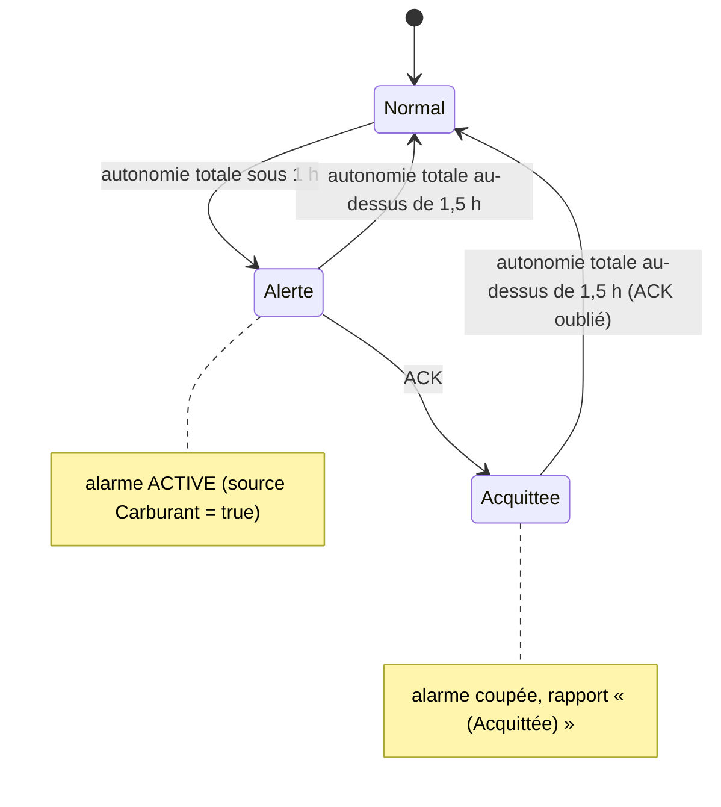

# Surveillance Carburant Uranium (optimisé)

> [!summary] Résumé
> Calcule l'autonomie des réacteurs à partir de l'uranium **dans les réacteurs** et **en stock** dans les conteneurs, l'affiche dans Echo et sur les écrans `Role=Carburant`, et déclenche le groupe `ALARMES_URANIUM` (vert) sous 1 h d'autonomie, avec hystérésis et acquittement `ACK`. Les gyrophares peuvent être partagés avec [[Controle des Avaries]] grâce au [[Bus d'Alarmes]].

## 1. Prérequis en jeu

| Bloc | Nom / configuration | Obligatoire ? |
|---|---|---|
| Bloc programmable | n'importe quel nom ; contient ce script | oui |
| Réacteur(s) | aucun nom imposé (détection automatique) | oui (sinon « Aucun réacteur détecté ») |
| Conteneurs de cargaison | aucun nom imposé ; leur uranium compte comme stock | non |
| Groupe d'alarme | groupe nommé **exactement** `ALARMES_URANIUM` (gyrophares, lumières, blocs sonores) | non (Echo le signale) ; inutile avec la [[Centrale d'Alarmes]], qui pilote le groupe `ALARMES` |
| Écran(s) | Custom Data `[Ecran] Role=Carburant` | non (le rapport est toujours dans Echo) |
| Bouton d'acquittement | panneau de boutons, action « Exécuter avec l'argument » → `ACK` | non |
| Serveur d'alarmes | bloc nommé `SERVEUR_ALARMES` — voir [[Bus d'Alarmes]] | non |

Custom Data d'un écran LCD :

```ini
[Ecran]
Role=Carburant
```

Custom Data d'un cockpit (surface n° 2 par exemple) :

```ini
[Ecran]
Role=Carburant
Surface=2
```

> [!warning] Migration depuis l'original : `[giro-alarme]` → `ALARMES_URANIUM`
> La note d'origine demandait un **groupe** `ALARMES_URANIUM`, mais son code cherchait en réalité les lumières dont le **nom** contenait `[giro-alarme]` : le groupe était donc ignoré. Cette version utilise le groupe, comme la note l'annonçait.
> **À faire** : sélectionner toutes les lumières `[giro-alarme]` (le filtre du terminal permet de les retrouver) et les ajouter au groupe `ALARMES_URANIUM`. La balise dans le nom peut rester, elle n'a plus d'effet.

## 2. Installation

1. Créer le groupe `ALARMES_URANIUM` avec les gyrophares / blocs sonores (voir la migration ci-dessus).
2. Facultatif : écrans avec `[Ecran] Role=Carburant`.
3. Facultatif : [[Bus d'Alarmes]] (bloc `SERVEUR_ALARMES`) si des gyrophares sont aussi dans `ALARMES_CRITIQUES`.
4. Coller le code de la section 9 dans un bloc programmable, **Vérifier**, puis **OK**.
5. Panneau de boutons : glisser le bloc programmable dans la barre d'action → **« Exécuter avec l'argument »** → `ACK` (inchangé).
6. Vérifier le résumé dans la fenêtre Echo du bloc programmable.

## 3. Configuration

| Constante | Défaut | Effet |
|---|---|---|
| `SEULEMENT_CETTE_CONSTRUCTION` | `true` | ignore réacteurs et conteneurs des vaisseaux amarrés par connecteur |
| `NOM_GROUPE_ALARMES` | `"ALARMES_URANIUM"` | groupe des blocs d'alarme |
| `ROLE_ECRAN` | `"Carburant"` | valeur de `Role` des écrans de ce script |
| `SOURCE_ALARME` | `"Carburant"` | nom de la source dans `SERVEUR_ALARMES` |
| `COULEUR_ALARME` | `0, 255, 0` (vert) | couleur sans serveur, ou si `[Couleurs]` est absent |
| `SEUIL_ALERTE_HEURES` | `1.0` | l'alerte se déclenche à 1 h d'autonomie (totale) ou moins |
| `SEUIL_REARMEMENT_HEURES` | `1.5` | l'alerte (et l'ACK) ne se réarme qu'au-dessus de 1,5 h |
| `MWH_PAR_KG_URANIUM` | `1.0` | énergie d'un kg de lingot d'uranium (MWh), valeur citée par la note d'origine |
| `COMPTER_STOCK_CONTENEURS` | `true` | compte l'uranium des conteneurs de cargaison |
| `INTERVALLE_RESCAN_SECONDES` | `10` | délai entre deux relectures automatiques de la grille |
| `MAX_REACTEURS_SIGNALES` | `8` | réacteurs « à vérifier » listés avant « ... et N autres » |

Clés de Custom Data lues :

| Bloc | Section | Clé | Valeurs |
|---|---|---|---|
| écran / cockpit | `[Ecran]` | `Role` | `Carburant` (insensible à la casse) |
| écran / cockpit | `[Ecran]` | `Surface` | entier ≥ 0, défaut `0` (ignoré pour un LCD simple) |
| `SERVEUR_ALARMES` | voir [[Bus d'Alarmes]] | | |

## 4. Commandes

| Argument | Effet |
|---|---|
| *(vide)* | exécution automatique normale |
| `ACK` | acquitte l'alerte en cours : l'alarme s'éteint et ne se réarmera qu'après une remontée au-dessus de `SEUIL_REARMEMENT_HEURES`. Sans alerte en cours : aucun effet (comme l'original). |
| `rescan` | relit immédiatement réacteurs, conteneurs, écrans, groupe et serveur |

> [!tip] Bouton
> Le bouton « Exécuter avec l'argument » → `ACK` de l'original fonctionne tel quel (majuscules/minuscules indifférentes).

## 5. Fonctionnement

### Calcul de l'autonomie

D'après la note d'origine, **1 kg de lingot d'uranium fournit 1 MWh** (constante `MWH_PAR_KG_URANIUM`). Un réacteur qui fournit `P` MW consomme donc `P / 1` kg par heure :

`Autonomie (h) = uranium (kg) × MWH_PAR_KG_URANIUM / puissance fournie (MW)`

Deux autonomies sont affichées :

| Ligne | Uranium pris en compte | Sert à |
|---|---|---|
| Autonomie (réacteurs) | uranium **dans les réacteurs** | savoir combien de temps tiennent les réacteurs sans réapprovisionnement |
| Autonomie (totale) | réacteurs **+ stock** des conteneurs | **déclencher l'alarme** |

Sans consommation (0 MW), l'autonomie est « INFINIE » (pas de division par zéro).

### Hystérésis et acquittement (en français)

L'état d'alerte n'a que deux valeurs :

1. **Pas en alerte** → passe **en alerte** si l'autonomie totale ≤ `SEUIL_ALERTE_HEURES` (1 h).
2. **En alerte** → repasse **pas en alerte** seulement si l'autonomie totale > `SEUIL_REARMEMENT_HEURES` (1,5 h) ; l'acquittement est alors oublié, pour la prochaine fois.
3. Entre 1 h et 1,5 h, l'état ne change pas.
4. Besoin d'alarme = en alerte **et** non acquittée. Ce besoin est publié sur le [[Bus d'Alarmes]] (source `Carburant`), qui allume / colore / fait sonner le groupe `ALARMES_URANIUM`.

> [!info] Pourquoi l'hystérésis ?
> La puissance consommée varie sans cesse (propulseurs, foreuses...). Avec un seul seuil, l'autonomie oscille autour de 1 h : l'alarme clignote, et chaque passage à 1 h 01 annulait l'`ACK`, qui se réarmait aussitôt. Avec 30 min d'écart entre les deux seuils, il faut un vrai réapprovisionnement pour réarmer.



### Déroulement d'une exécution (~1,6 s)

1. Commande éventuelle (`ACK`, `rescan`).
2. Rescan si demandé ou si 10 s se sont écoulées (réacteurs, conteneurs, groupe, écrans, serveur).
3. Mesures : uranium (réacteurs / stock), puissance fournie, réacteurs à vérifier (**ENDOMMAGÉ**, **ÉTEINT**, **SANS URANIUM**).
4. Mise à jour de l'état d'alerte (hystérésis + ACK).
5. Bus d'alarmes : publication du besoin, application de l'état global au groupe.
6. Rapport : écrans `Role=Carburant` (seulement si le texte change) et Echo (rapport + diagnostic).

## 6. Optimisations et corrections par rapport à l'original

| Problème d'origine | Conséquence en jeu | Correction |
|---|---|---|
| La note demande le groupe `ALARMES_URANIUM`, le code cherche la balise `[giro-alarme]` | le groupe créé par le joueur ne s'allumait **jamais** | groupe `ALARMES_URANIUM` (via le bus, source `Carburant`, vert) ; migration documentée |
| Conflit avec le script d'avaries sur les mêmes gyrophares (« note technique pour le futur ») | gyrophares qui clignotent / changent de couleur / s'éteignent pendant une alerte | [[Bus d'Alarmes]] : état global commun |
| Un seul seuil (1 h) pour déclencher et réarmer | clignotement et ré-armement intempestif de l'ACK quand la consommation fluctue | hystérésis : alerte à 1 h, réarmement au-dessus de 1,5 h |
| Seul l'uranium des réacteurs était compté | fausse alerte alors que les conteneurs sont pleins d'uranium | stock des conteneurs compté et affiché séparément ; alarme sur l'autonomie totale |
| `1 kg = 1 MWh` codé implicitement dans la division | valeur cachée, impossible à adapter (mods) | constante nommée et commentée `MWH_PAR_KG_URANIUM` |
| Rapport uniquement dans Echo | il fallait ouvrir le terminal du PB pour voir l'autonomie | écrans `Role=Carburant` (LCD et cockpits `Surface=N`), écriture seulement si changement |
| Réacteurs éteints / vides / endommagés non signalés | autonomie trompeuse (un réacteur éteint ne consomme rien) | section « Réacteurs à vérifier » |
| Identifiant `sirènesAllumées` avec accents | contraire aux conventions (identifiants sans accents) | `besoinAlarme`, `enAlerte`, `alarmeAcquittee` (sans accents) |
| `new List` + `GetBlocksOfType` à chaque exécution, et recherche des gyrophares à chaque changement | allocations et scans répétés | caches (réacteurs, conteneurs, groupe, écrans) rescannés toutes les 10 s ou sur `rescan` ; listes et `StringBuilder` réutilisés |
| Pas de filtre de construction | l'uranium et la puissance d'un vaisseau amarré faussaient le calcul | filtre `IsSameConstructAs(Me)` |
| Gyrophares seulement allumés ; blocs sonores jamais lancés | pas de son | `Play()` / `Stop()` sur les blocs sonores (via le bus) |
| `ReglerAlarmes` écrivait `Color`/`Enabled` sans vérifier | écritures inutiles | écriture seulement si la valeur change |

## 7. Limites connues

- **`MWH_PAR_KG_URANIUM = 1.0`** est la valeur citée par la note d'origine ; elle dépend des définitions du jeu (fichiers de définition des réacteurs) et peut être différente avec des mods ou après une mise à jour. Si l'autonomie affichée diverge de la réalité, ajuster cette constante.
- L'autonomie est **instantanée** : elle est calculée avec la puissance fournie à l'instant de la mesure. Une forte variation de consommation la fait varier d'autant (l'hystérésis ne protège que l'alarme).
- L'**alarme utilise l'autonomie totale** : si l'uranium des conteneurs n'est pas relié aux réacteurs par convoyeurs (ou si le tri automatique ne les recharge pas), les réacteurs peuvent s'arrêter avant l'alarme. Surveiller la ligne « Autonomie (réacteurs) » et la mention « SANS URANIUM », ou passer `COMPTER_STOCK_CONTENEURS` à `false`.
- Seuls les **conteneurs de cargaison** (`IMyCargoContainer`) sont comptés comme stock : l'uranium dans un connecteur, un cockpit ou une raffinerie n'est pas compté.
- La consommation prise en compte est uniquement celle des **réacteurs** (`CurrentOutput`), comme l'original.
- L'état d'alerte / d'acquittement n'est pas sauvegardé : après un rechargement, il est recalculé depuis zéro.
- Le texte change souvent (puissance à 0,01 MW près) : les écrans sont donc réécrits fréquemment, mais jamais avec un texte identique.

## 8. Dépannage

| Symptôme | Cause probable | Solution |
|---|---|---|
| Les gyrophares `[giro-alarme]` ne s'allument plus | migration : le script utilise maintenant le groupe | les ajouter au groupe `ALARMES_URANIUM` |
| Echo : `groupe ALARMES_URANIUM introuvable` | nom du groupe différent | renommer exactement, puis `rescan` |
| Autonomie « INFINIE » | réacteurs éteints ou consommation nulle | normal à l'arrêt ; vérifier « Réacteurs à vérifier » |
| L'alarme ne se réarme pas après le plein | autonomie entre 1 h et 1,5 h | normal (hystérésis) ; elle se réarme au-dessus de 1,5 h |
| `ACK` sans effet | aucune alerte en cours | normal (Echo : « aucune alerte en cours ») |
| Les gyrophares sont rouges pendant l'alerte carburant | les avaries sont aussi actives, et plus critiques | normal : voir `[Criticite]` dans [[Bus d'Alarmes]] ; la liste complète s'affiche sur un écran `[alarme-line]` de la [[Centrale d'Alarmes]] |
| Uranium en stock = 0 alors qu'il y en a | stock hors conteneurs de cargaison, ou sur un vaisseau amarré | déplacer dans un conteneur de la construction |
| Echo : `Surface=N invalide` | numéro de surface trop grand | utiliser un numéro entre 0 et (nombre de surfaces − 1) |

## 9. Code complet

> [!info] Classes partagées
> La classe `BusAlarmes` est une **copie conforme** de celle de [[Controle des Avaries]] (voir [[Bus d'Alarmes]]). La classe `EcransRole` est aussi identique dans les deux scripts.

```csharp
// ==============================================================================
// SCRIPT : SURVEILLANCE CARBURANT (URANIUM)  (version optimisée)
// ------------------------------------------------------------------------------
// Rôle :
//   Mesure l'uranium disponible (dans les réacteurs ET en stock dans les
//   conteneurs) et la consommation électrique des réacteurs, calcule
//   l'autonomie restante et déclenche le groupe ALARMES_URANIUM (vert par
//   défaut) quand l'autonomie passe sous le seuil d'alerte.
//
// Nomenclature des blocs :
//   - Alarmes : groupe nommé exactement ALARMES_URANIUM (gyrophares, lumières,
//               blocs sonores...). Remplace l'ancienne balise [giro-alarme].
//   - Écrans  : Custom Data   [Ecran]
//                             Role=Carburant
//                             Surface=0      (optionnel : n° de surface d'un
//                                             cockpit / bloc programmable)
//   - Réacteurs et conteneurs : détectés automatiquement (aucun nom imposé).
//
// Commandes (argument du bloc programmable, majuscules/minuscules indifférentes) :
//   - ACK    : acquitte l'alarme (bouton "Exécuter avec l'argument" -> ACK).
//              Elle ne se réarme qu'après être remontée au-dessus du seuil
//              de réarmement (hystérésis).
//   - rescan : relit immédiatement réacteurs / conteneurs / écrans / alarmes.
//
// Dépendances :
//   - SERVEUR_ALARMES (OPTIONNEL) : bus d'alarmes partagé avec le script
//     "Contrôle des Avaries" (source "Carburant"). Sans lui, le script
//     fonctionne seul.
// ==============================================================================

// ------------------------------------------------------------------------------
// CONSTANTES DE CONFIGURATION (toutes les valeurs réglables sont ici)
// ------------------------------------------------------------------------------

// true = ignore les vaisseaux amarrés par connecteur (on ne compte que le nôtre).
const bool SEULEMENT_CETTE_CONSTRUCTION = true;

// Nom exact du groupe de blocs d'alarme (celui demandé par la note d'origine).
const string NOM_GROUPE_ALARMES = "ALARMES_URANIUM";

// Valeur de la clé Role des écrans de ce script ([Ecran] Role=Carburant).
const string ROLE_ECRAN = "Carburant";

// Nom de la source dans le bus d'alarmes SERVEUR_ALARMES.
const string SOURCE_ALARME = "Carburant";

// Couleur propre de l'alarme : VERT (R=0, G=255, B=0) comme dans l'original.
readonly Color COULEUR_ALARME = new Color(0, 255, 0);

// L'alarme se déclenche quand l'autonomie totale descend à ce nombre d'heures ou moins.
const double SEUIL_ALERTE_HEURES = 1.0;

// L'alarme (et l'acquittement ACK) ne se réarme que si l'autonomie remonte
// AU-DESSUS de ce seuil. Doit être > SEUIL_ALERTE_HEURES (hystérésis).
const double SEUIL_REARMEMENT_HEURES = 1.5;

// Énergie fournie par 1 kg de lingot d'uranium, en MWh. Valeur citée par la
// note d'origine (« 1 kg = 1 MWh ») : elle dépend des définitions du jeu et
// peut être différente avec des mods. Seul endroit à modifier si besoin.
const double MWH_PAR_KG_URANIUM = 1.0;

// true = compte aussi l'uranium stocké dans les conteneurs de cargaison.
const bool COMPTER_STOCK_CONTENEURS = true;

// Intervalle entre deux relectures automatiques de la grille (secondes de jeu).
const double INTERVALLE_RESCAN_SECONDES = 10.0;

// Nombre maximal de réacteurs "à problème" listés sur l'écran.
const int MAX_REACTEURS_SIGNALES = 8;

// ------------------------------------------------------------------------------
// ÉTAT DU SCRIPT (champs réutilisés d'une exécution à l'autre)
// ------------------------------------------------------------------------------

// Type d'objet "lingot d'uranium" (créé une seule fois).
readonly MyItemType TYPE_URANIUM = MyItemType.MakeIngot("Uranium");

// Caches remplis au rescan.
readonly List<IMyReactor> reacteurs = new List<IMyReactor>();
readonly List<IMyCargoContainer> conteneurs = new List<IMyCargoContainer>();
readonly List<IMyFunctionalBlock> blocsAlarme = new List<IMyFunctionalBlock>();

// Constructeurs de texte réutilisés.
readonly StringBuilder constructeurRapport = new StringBuilder();
readonly StringBuilder lignesReacteursAProbleme = new StringBuilder();

// Objets partagés (voir les classes en fin de script).
readonly BusAlarmes busAlarmes;
readonly EcransRole ecransCarburant;

// Mesures du cycle courant.
double uraniumReacteursKg = 0;
double uraniumStockKg = 0;
double consommationMW = 0;
double autonomieReacteursHeures = double.PositiveInfinity;
double autonomieTotaleHeures = double.PositiveInfinity;
int nombreReacteursAProbleme = 0;

// Machine à états de l'alarme (noms SANS accents : sireneAllumee, pas sirèneAllumée).
bool enAlerte = false;              // autonomie passée sous le seuil, pas encore remontée au-dessus du réarmement
bool alarmeAcquittee = false;       // ACK reçu pendant l'alerte en cours
bool besoinAlarme = false;          // = enAlerte ET non acquittée (publié sur le bus)

double secondesDepuisRescan = 0;    // temps de jeu écoulé depuis le dernier rescan
bool rescanDemande = true;          // true au démarrage : premier remplissage des caches
bool groupeAlarmeTrouve = false;    // le groupe ALARMES_URANIUM existe-t-il ?
string rapportCourant = "";         // texte publié (écrans + Echo)
string messageCommande = "";        // retour de la dernière commande, pour Echo

/// <summary>
/// Constructeur : appelé une seule fois à la compilation / au chargement.
/// Update100 = une exécution tous les 100 ticks (~1,6 s), comme l'original.
/// </summary>
public Program()
{
    busAlarmes = new BusAlarmes(SOURCE_ALARME, COULEUR_ALARME);
    ecransCarburant = new EcransRole(ROLE_ECRAN);
    Runtime.UpdateFrequency = UpdateFrequency.Update100;
}

/// <summary>
/// Boucle principale. À chaque exécution :
/// 1. traiter la commande éventuelle (ACK / rescan) ;
/// 2. rescanner la grille si nécessaire (toutes les ~10 s) ;
/// 3. mesurer uranium et consommation, calculer les autonomies ;
/// 4. mettre à jour l'état d'alerte (avec hystérésis et ACK) ;
/// 5. publier sur le bus et appliquer l'état global au groupe d'alarme ;
/// 6. afficher le rapport (écrans si changement, et Echo).
/// </summary>
public void Main(string argument, UpdateType updateSource)
{
    TraiterCommande(argument);

    secondesDepuisRescan += Runtime.TimeSinceLastRun.TotalSeconds;
    if (rescanDemande || secondesDepuisRescan >= INTERVALLE_RESCAN_SECONDES)
    {
        Rescanner();
    }

    MesurerCarburant();
    MettreAJourEtatAlerte();

    busAlarmes.Publier(besoinAlarme);
    busAlarmes.AppliquerAuxBlocs(blocsAlarme);

    ConstruireRapport();
    ecransCarburant.Ecrire(rapportCourant);
    AfficherEcho();
}

// ------------------------------------------------------------------------------
// COMMANDES
// ------------------------------------------------------------------------------

/// <summary>Interprète l'argument du bloc programmable (vide lors des exécutions automatiques).</summary>
void TraiterCommande(string argument)
{
    string commande = (argument ?? "").Trim().ToLower();
    if (commande.Length == 0) return;

    if (commande == "ack")
    {
        if (enAlerte)
        {
            alarmeAcquittee = true;
            messageCommande = "ACK : alarme acquittée.";
        }
        else
        {
            // Comme l'original : un ACK hors alerte n'a aucun effet durable.
            messageCommande = "ACK : aucune alerte en cours.";
        }
    }
    else if (commande == "rescan")
    {
        rescanDemande = true;
        messageCommande = "Rescan effectué.";
    }
    else
    {
        messageCommande = "Commande inconnue : '" + argument + "' (attendu : ACK ou rescan)";
    }
}

// ------------------------------------------------------------------------------
// RESCAN (réacteurs, conteneurs, écrans, groupe d'alarme, serveur)
// ------------------------------------------------------------------------------

/// <summary>Reconstruit tous les caches de blocs (pas à chaque exécution : coûteux).</summary>
void Rescanner()
{
    reacteurs.Clear();
    GridTerminalSystem.GetBlocksOfType<IMyReactor>(reacteurs, EstDeCetteConstruction);

    conteneurs.Clear();
    if (COMPTER_STOCK_CONTENEURS)
    {
        GridTerminalSystem.GetBlocksOfType<IMyCargoContainer>(conteneurs, EstDeCetteConstruction);
    }

    blocsAlarme.Clear();
    IMyBlockGroup groupe = GridTerminalSystem.GetBlockGroupWithName(NOM_GROUPE_ALARMES);
    groupeAlarmeTrouve = groupe != null;
    if (groupe != null) groupe.GetBlocksOfType<IMyFunctionalBlock>(blocsAlarme, EstDeCetteConstruction);

    ecransCarburant.Rechercher(GridTerminalSystem, Me, SEULEMENT_CETTE_CONSTRUCTION);
    busAlarmes.RechercherServeur(GridTerminalSystem, Me, SEULEMENT_CETTE_CONSTRUCTION);

    secondesDepuisRescan = 0;
    rescanDemande = false;
}

/// <summary>Filtre de construction : écarte les vaisseaux amarrés par connecteur.</summary>
bool EstDeCetteConstruction(IMyTerminalBlock bloc)
{
    return !SEULEMENT_CETTE_CONSTRUCTION || bloc.IsSameConstructAs(Me);
}

// ------------------------------------------------------------------------------
// MESURES
// ------------------------------------------------------------------------------

/// <summary>
/// Additionne l'uranium (réacteurs / conteneurs séparément) et la puissance
/// fournie par les réacteurs, repère les réacteurs à problème, puis calcule
/// les deux autonomies.
/// </summary>
void MesurerCarburant()
{
    uraniumReacteursKg = 0;
    uraniumStockKg = 0;
    consommationMW = 0;
    nombreReacteursAProbleme = 0;
    lignesReacteursAProbleme.Clear();

    foreach (IMyReactor reacteur in reacteurs)
    {
        // GetItemAmount renvoie un MyFixedPoint : conversion explicite en nombre.
        double uraniumKg = (float)reacteur.GetInventory().GetItemAmount(TYPE_URANIUM);
        uraniumReacteursKg += uraniumKg;

        // CurrentOutput = puissance fournie en ce moment, en MW.
        consommationMW += reacteur.CurrentOutput;

        SignalerReacteurSiProbleme(reacteur, uraniumKg);
    }

    foreach (IMyCargoContainer conteneur in conteneurs)
    {
        uraniumStockKg += (float)conteneur.GetInventory().GetItemAmount(TYPE_URANIUM);
    }

    autonomieReacteursHeures = CalculerAutonomieHeures(uraniumReacteursKg);
    autonomieTotaleHeures = CalculerAutonomieHeures(uraniumReacteursKg + uraniumStockKg);
}

/// <summary>
/// Ajoute une ligne pour un réacteur endommagé, éteint ou vide.
/// Un réacteur éteint ne consomme rien : il fausserait l'autonomie sans le dire.
/// </summary>
void SignalerReacteurSiProbleme(IMyReactor reacteur, double uraniumKg)
{
    string probleme = null;
    if (!reacteur.IsFunctional) probleme = "ENDOMMAGÉ";
    else if (!reacteur.Enabled) probleme = "ÉTEINT";
    else if (uraniumKg <= 0.0) probleme = "SANS URANIUM";
    if (probleme == null) return;

    nombreReacteursAProbleme++;
    if (nombreReacteursAProbleme <= MAX_REACTEURS_SIGNALES)
    {
        lignesReacteursAProbleme.Append(" - ").Append(reacteur.CustomName)
                                .Append(" : ").Append(probleme).Append('\n');
    }
}

/// <summary>
/// Autonomie (heures) = énergie disponible (MWh) / puissance consommée (MW).
/// Énergie disponible = kg d'uranium × MWH_PAR_KG_URANIUM.
/// Sans consommation, l'autonomie est infinie (division protégée).
/// </summary>
double CalculerAutonomieHeures(double uraniumKg)
{
    if (consommationMW <= 0.0) return double.PositiveInfinity;
    return uraniumKg * MWH_PAR_KG_URANIUM / consommationMW;
}

// ------------------------------------------------------------------------------
// ÉTAT D'ALERTE (hystérésis + acquittement)
// ------------------------------------------------------------------------------

/// <summary>
/// Machine à deux états avec hystérésis :
///   - pas en alerte -> en alerte   si autonomie &lt;= SEUIL_ALERTE_HEURES ;
///   - en alerte -> pas en alerte   si autonomie &gt;  SEUIL_REARMEMENT_HEURES
///     (et l'ACK est alors oublié, pour la prochaine alerte).
/// Entre les deux seuils, on garde l'état précédent : pas de clignotement
/// ni de ré-armement intempestif quand la consommation fluctue.
/// </summary>
void MettreAJourEtatAlerte()
{
    if (!enAlerte && autonomieTotaleHeures <= SEUIL_ALERTE_HEURES)
    {
        enAlerte = true;
    }
    else if (enAlerte && autonomieTotaleHeures > SEUIL_REARMEMENT_HEURES)
    {
        enAlerte = false;
        alarmeAcquittee = false;
    }

    besoinAlarme = enAlerte && !alarmeAcquittee;
}

// ------------------------------------------------------------------------------
// AFFICHAGE
// ------------------------------------------------------------------------------

/// <summary>Construit le rapport (le même texte va sur les écrans et dans Echo).</summary>
void ConstruireRapport()
{
    StringBuilder texte = constructeurRapport;
    texte.Clear();
    texte.Append("=== CONTRÔLE RÉACTEURS ===\n\n");

    if (reacteurs.Count == 0)
    {
        texte.Append("Aucun réacteur détecté.\n");
    }
    else
    {
        texte.Append("Réacteurs : ").Append(reacteurs.Count).Append('\n');
        texte.Append("Consommation : ").Append(consommationMW.ToString("0.00")).Append(" MW\n");
        texte.Append("Uranium dans les réacteurs : ").Append(uraniumReacteursKg.ToString("0.0")).Append(" kg\n");
        if (COMPTER_STOCK_CONTENEURS)
        {
            texte.Append("Uranium en stock : ").Append(uraniumStockKg.ToString("0.0")).Append(" kg\n");
        }
        texte.Append("Autonomie (réacteurs) : ").Append(FormaterDuree(autonomieReacteursHeures)).Append('\n');
        if (COMPTER_STOCK_CONTENEURS)
        {
            texte.Append("Autonomie (totale) : ").Append(FormaterDuree(autonomieTotaleHeures)).Append('\n');
        }

        if (nombreReacteursAProbleme > 0)
        {
            texte.Append("\nRéacteurs à vérifier (").Append(nombreReacteursAProbleme).Append(") :\n");
            texte.Append(lignesReacteursAProbleme);
            if (nombreReacteursAProbleme > MAX_REACTEURS_SIGNALES)
            {
                texte.Append(" ... et ").Append(nombreReacteursAProbleme - MAX_REACTEURS_SIGNALES).Append(" autres\n");
            }
        }
    }

    if (enAlerte)
    {
        texte.Append("\n/!\\ ALERTE CARBURANT /!\\\n");
        if (alarmeAcquittee) texte.Append("(Acquittée)\n");
    }

    rapportCourant = texte.ToString();
}

/// <summary>Transforme un nombre d'heures en texte lisible ("2 h 05 min", "INFINIE").</summary>
static string FormaterDuree(double heures)
{
    if (double.IsInfinity(heures)) return "INFINIE (aucune consommation)";
    if (heures > 999.0) return "> 999 h";

    int heuresEntieres = (int)Math.Floor(heures);
    int minutes = (int)Math.Floor((heures - heuresEntieres) * 60.0);
    return heuresEntieres + " h " + minutes.ToString("00") + " min";
}

/// <summary>Echo = rapport + diagnostic court (blocs gérés, bus, temps d'exécution).</summary>
void AfficherEcho()
{
    StringBuilder texte = constructeurRapport;
    texte.Clear();
    texte.Append(rapportCourant);
    texte.Append("\n--- Diagnostic ---\n");
    texte.Append("Conteneurs comptés : ").Append(conteneurs.Count).Append('\n');
    texte.Append("Écrans Role=").Append(ROLE_ECRAN).Append(" : ").Append(ecransCarburant.Nombre);
    if (ecransCarburant.ErreursConfiguration > 0)
    {
        texte.Append(" (").Append(ecransCarburant.ErreursConfiguration).Append(" Surface=N invalide)");
    }
    texte.Append('\n');
    if (groupeAlarmeTrouve)
    {
        texte.Append("Groupe ").Append(NOM_GROUPE_ALARMES).Append(" : ").Append(blocsAlarme.Count).Append(" blocs\n");
    }
    else
    {
        texte.Append("ATTENTION : groupe ").Append(NOM_GROUPE_ALARMES).Append(" introuvable\n");
    }
    texte.Append("Alarme (Carburant) : ")
         .Append(besoinAlarme ? "ACTIVE" : (enAlerte ? "acquittée" : "inactive")).Append('\n');
    texte.Append("Bus : ").Append(busAlarmes.Diagnostic).Append('\n');
    texte.Append("Dernière exécution : ").Append(Runtime.LastRunTimeMs.ToString("0.000")).Append(" ms\n");
    if (messageCommande.Length > 0) texte.Append(messageCommande).Append('\n');
    Echo(texte.ToString());
}

// ==============================================================================
// CLASSE PARTAGÉE : BUS D'ALARMES  (COPIE CONFORME DANS CHAQUE SCRIPT QUI ALARME)
// ------------------------------------------------------------------------------
// Ne PAS modifier cette classe dans un seul script : elle doit rester strictement
// identique dans "Contrôle des Avaries" et "Gestionnaire de Carburant", sinon les
// deux scripts ne calculeraient plus le même état global et se battraient de
// nouveau pour les gyrophares.
// ==============================================================================

/// <summary>
/// Bus d'alarmes partagé entre plusieurs blocs programmables.
/// QUOI : chaque script publie son propre besoin d'alarme (Source=true/false)
/// dans la section [Etat] du Custom Data d'un bloc nommé SERVEUR_ALARMES, puis
/// relit toutes les sources pour calculer UN état global (au moins une source
/// active) et UNE couleur (source active la plus critique, puis [Config] Priorite).
/// POURQUOI : sans ce bus, le script d'avaries éteignait les gyrophares que le
/// script de carburant venait d'allumer (et inversement). Avec le bus, tous les
/// scripts calculent exactement le même état : plus de conflit.
/// Si le bloc SERVEUR_ALARMES n'existe pas, la classe fonctionne en mode
/// autonome : état global = besoin propre du script, couleur = couleur propre.
/// </summary>
public class BusAlarmes
{
    /// <summary>Nom exact du bloc dont le Custom Data sert de bus.</summary>
    public const string NOM_SERVEUR = "SERVEUR_ALARMES";

    // Noms des sections et des clés du Custom Data partagé.
    const string SECTION_CONFIG = "Config";
    const string SECTION_COULEURS = "Couleurs";
    const string SECTION_ETAT = "Etat";
    const string CLE_PRIORITE = "Priorite";
    const string SECTION_CRITICITE = "Criticite";

    // Niveaux de criticité, du plus grave au moins grave (l'index sert de rang).
    // Plusieurs mots acceptés par niveau (les anciens noms restent valides).
    static readonly string[][] NIVEAUX_CRITICITE =
    {
        new[] { "critique" },
        new[] { "majeur", "majeure", "importante" },
        new[] { "normal", "normale" },
        new[] { "mineur", "mineure", "basse" }
    };
    const int RANG_CRITICITE_DEFAUT = 2;   // "normal"

    // Identité du script qui utilise ce bus (ex. "Avaries", "Carburant").
    readonly string source;
    // Couleur utilisée en mode autonome ou si la couleur du serveur est illisible.
    readonly Color couleurPropre;

    // Objets réutilisés d'une exécution à l'autre (évite les allocations).
    readonly MyIni lecteurIni = new MyIni();
    readonly List<MyIniKey> clesEtat = new List<MyIniKey>();
    readonly List<IMyTerminalBlock> tamponRecherche = new List<IMyTerminalBlock>();
    // Blocs d'alarme déjà synchronisés au moins une fois (par EntityId) :
    // permet de traiter un bloc ajouté au groupe sans relancer les sons des autres.
    readonly HashSet<long> blocsDejaSynchronises = new HashSet<long>();

    // Bloc serveur trouvé lors du dernier scan (null = mode autonome).
    IMyTerminalBlock serveur;
    // Dernier Custom Data lu : on ne reparse que si le texte a changé.
    string dernierCustomDataLu;
    // Résultat du dernier parsing (false = Custom Data illisible).
    bool customDataValide;
    // Dernier état global effectivement appliqué aux blocs d'alarme.
    bool etatApplique;

    /// <summary>Vrai si un bloc SERVEUR_ALARMES a été trouvé au dernier scan.</summary>
    public bool ServeurPresent { get { return serveur != null; } }

    /// <summary>État global : vrai si au moins une source demande l'alarme.</summary>
    public bool AlarmeGlobale { get; private set; }

    /// <summary>Couleur à appliquer aux lumières quand l'alarme globale est active.</summary>
    public Color CouleurGlobale { get; private set; }

    /// <summary>Nom de la source qui impose sa couleur (vide si aucune alarme).</summary>
    public string SourceDominante { get; private set; }

    /// <summary>Message court destiné à Echo (état du bus, erreurs de configuration).</summary>
    public string Diagnostic { get; private set; }

    /// <summary>
    /// Crée le bus pour une source donnée.
    /// </summary>
    /// <param name="source">Nom de la source (clé utilisée dans [Etat] et [Couleurs]).</param>
    /// <param name="couleurPropre">Couleur par défaut de cette source.</param>
    public BusAlarmes(string source, Color couleurPropre)
    {
        this.source = source;
        this.couleurPropre = couleurPropre;
        CouleurGlobale = couleurPropre;
        SourceDominante = "";
        Diagnostic = "pas encore initialisé";
    }

    /// <summary>
    /// Cherche le bloc SERVEUR_ALARMES (à appeler lors du rescan périodique,
    /// pas à chaque exécution). Le filtre de construction évite de lire le
    /// serveur d'un vaisseau amarré par connecteur.
    /// </summary>
    public void RechercherServeur(IMyGridTerminalSystem grille, IMyTerminalBlock moi, bool seulementCetteConstruction)
    {
        // Recherche rapide par nom (renvoie le premier bloc portant ce nom).
        IMyTerminalBlock trouve = grille.GetBlockWithName(NOM_SERVEUR);

        // Si ce premier bloc appartient à un vaisseau amarré, on cherche
        // explicitement celui de notre construction (cas rare, scan complet).
        if (trouve != null && seulementCetteConstruction && !trouve.IsSameConstructAs(moi))
        {
            tamponRecherche.Clear();
            grille.GetBlocksOfType<IMyTerminalBlock>(tamponRecherche,
                b => b.CustomName == NOM_SERVEUR && b.IsSameConstructAs(moi));
            trouve = tamponRecherche.Count > 0 ? tamponRecherche[0] : null;
            tamponRecherche.Clear();
        }

        // Si le serveur a changé (apparu, disparu, remplacé), on force une relecture.
        if (trouve != serveur)
        {
            serveur = trouve;
            dernierCustomDataLu = null;
        }
    }

    /// <summary>
    /// Publie le besoin d'alarme de CE script puis calcule l'état global.
    /// Étapes : (1) relire le Custom Data s'il a changé, (2) écrire
    /// [Etat] Source=besoin seulement si la valeur change, (3) état global =
    /// au moins une clé [Etat] vraie, (4) couleur = source active de plus haute
    /// [Criticite], puis la première dans [Config] Priorite, puis dans [Etat].
    /// </summary>
    /// <param name="besoinPropre">Vrai si ce script demande l'alarme (déjà corrigé de l'ACK).</param>
    public void Publier(bool besoinPropre)
    {
        // ---- Mode autonome : pas de serveur -----------------------------------
        if (serveur == null)
        {
            PasserEnModeAutonome(besoinPropre, "autonome (aucun bloc " + NOM_SERVEUR + ")");
            return;
        }

        // ---- (1) Relecture seulement si le texte a changé ---------------------
        string texte = serveur.CustomData;
        if (texte != dernierCustomDataLu)
        {
            dernierCustomDataLu = texte;
            customDataValide = lecteurIni.TryParse(texte);
        }
        if (!customDataValide)
        {
            PasserEnModeAutonome(besoinPropre, "Custom Data de " + NOM_SERVEUR + " illisible (format INI)");
            return;
        }

        // ---- (2) Publication de notre état (écriture seulement si changement) -
        bool modifie = false;
        if (!lecteurIni.ContainsKey(SECTION_ETAT, source)
            || lecteurIni.Get(SECTION_ETAT, source).ToBoolean(false) != besoinPropre)
        {
            lecteurIni.Set(SECTION_ETAT, source, besoinPropre);
            modifie = true;
        }
        // Auto-enregistrement de notre couleur si le joueur ne l'a pas définie :
        // ainsi les autres scripts connaissent notre couleur.
        if (!lecteurIni.ContainsKey(SECTION_COULEURS, source))
        {
            lecteurIni.Set(SECTION_COULEURS, source, couleurPropre.R + "," + couleurPropre.G + "," + couleurPropre.B);
            modifie = true;
        }
        if (modifie)
        {
            string nouveauTexte = lecteurIni.ToString();
            serveur.CustomData = nouveauTexte;
            // On mémorise notre propre écriture pour ne pas la reparser au prochain cycle.
            dernierCustomDataLu = nouveauTexte;
        }

        // ---- (3) État global : au moins une source active ---------------------
        AlarmeGlobale = false;
        SourceDominante = "";
        CouleurGlobale = couleurPropre;
        clesEtat.Clear();
        lecteurIni.GetKeys(SECTION_ETAT, clesEtat);
        foreach (MyIniKey cle in clesEtat)
        {
            if (lecteurIni.Get(SECTION_ETAT, cle.Name).ToBoolean(false))
            {
                AlarmeGlobale = true;
                break;
            }
        }

        // ---- (4) Source dominante : criticité, puis priorité ------------------
        // Règle commune avec la Centrale d'Alarmes : la criticité la plus haute
        // l'emporte ([Criticite], "normal" si absente) ; à égalité, l'ordre de
        // [Config] Priorite ; à égalité encore, l'ordre des clés de [Etat].
        if (AlarmeGlobale)
        {
            string[] ordrePriorite = lecteurIni.Get(SECTION_CONFIG, CLE_PRIORITE).ToString("").Split(',');
            int meilleurRang = int.MaxValue;
            int meilleurOrdre = int.MaxValue;
            foreach (MyIniKey cle in clesEtat)
            {
                if (!lecteurIni.Get(SECTION_ETAT, cle.Name).ToBoolean(false)) continue;
                int rang = RangCriticite(cle.Name);
                int ordre = PositionDansPriorite(ordrePriorite, cle.Name);
                // Comparaison stricte : à égalité complète, la première clé de [Etat] reste.
                if (rang < meilleurRang || (rang == meilleurRang && ordre < meilleurOrdre))
                {
                    meilleurRang = rang;
                    meilleurOrdre = ordre;
                    SourceDominante = cle.Name;
                }
            }
            CouleurGlobale = LireCouleur(SourceDominante);
        }

        Diagnostic = "connecté, alarme globale " + (AlarmeGlobale ? "ACTIVE (" + SourceDominante + ")" : "inactive");
    }

    /// <summary>
    /// Applique l'état global au groupe de blocs d'alarme de ce script.
    /// Chaque écriture (Enabled, Color, Play/Stop) n'est faite que si elle
    /// change quelque chose : un bloc sonore n'est relancé qu'au changement
    /// d'état global, ou la première fois qu'on le rencontre.
    /// </summary>
    /// <param name="blocsAlarme">Blocs du groupe d'alarme (lumières, sons, portes...).</param>
    public void AppliquerAuxBlocs(List<IMyFunctionalBlock> blocsAlarme)
    {
        bool changementEtat = AlarmeGlobale != etatApplique;

        foreach (IMyFunctionalBlock bloc in blocsAlarme)
        {
            // HashSet.Add renvoie true si l'identifiant n'y était pas encore.
            bool nouveauBloc = blocsDejaSynchronises.Add(bloc.EntityId);

            // Allumage / extinction (le bloc doit être allumé AVANT Play()).
            if (bloc.Enabled != AlarmeGlobale) bloc.Enabled = AlarmeGlobale;

            // Couleur des lumières (gyrophares...) : utile seulement si allumées.
            IMyLightingBlock lumiere = bloc as IMyLightingBlock;
            if (lumiere != null && AlarmeGlobale && lumiere.Color != CouleurGlobale)
            {
                lumiere.Color = CouleurGlobale;
            }

            // Blocs sonores : allumer ne suffit pas, il faut lancer la lecture.
            IMySoundBlock son = bloc as IMySoundBlock;
            if (son != null && (changementEtat || nouveauBloc))
            {
                if (AlarmeGlobale) son.Play();
                else son.Stop();
            }
        }

        etatApplique = AlarmeGlobale;
    }

    /// <summary>Mode sans serveur : l'état global est simplement notre besoin propre.</summary>
    void PasserEnModeAutonome(bool besoinPropre, string message)
    {
        AlarmeGlobale = besoinPropre;
        CouleurGlobale = couleurPropre;
        SourceDominante = besoinPropre ? source : "";
        Diagnostic = message;
    }

    /// <summary>
    /// Lit la couleur "R,G,B" d'une source dans [Couleurs].
    /// Renvoie la couleur propre du script si la clé est absente ou mal écrite.
    /// </summary>
    Color LireCouleur(string nomSource)
    {
        string texte = lecteurIni.Get(SECTION_COULEURS, nomSource).ToString("");
        string[] morceaux = texte.Split(',');
        if (morceaux.Length != 3) return couleurPropre;

        int rouge, vert, bleu;
        if (!int.TryParse(morceaux[0].Trim(), out rouge)) return couleurPropre;
        if (!int.TryParse(morceaux[1].Trim(), out vert)) return couleurPropre;
        if (!int.TryParse(morceaux[2].Trim(), out bleu)) return couleurPropre;

        return new Color(Borner(rouge), Borner(vert), Borner(bleu));
    }

    /// <summary>
    /// Rang de criticité d'une source lu dans [Criticite] : 0 = critique,
    /// 1 = majeur, 2 = normal, 3 = mineur (anciens noms importante / normale /
    /// basse acceptés). Absente ou inconnue : normal.
    /// </summary>
    int RangCriticite(string nomSource)
    {
        string niveau = lecteurIni.Get(SECTION_CRITICITE, nomSource).ToString("").Trim();
        for (int rang = 0; rang < NIVEAUX_CRITICITE.Length; rang++)
        {
            foreach (string mot in NIVEAUX_CRITICITE[rang])
            {
                if (string.Equals(niveau, mot, StringComparison.OrdinalIgnoreCase)) return rang;
            }
        }
        return RANG_CRITICITE_DEFAUT;
    }

    /// <summary>Position d'une source dans [Config] Priorite (int.MaxValue si absente).</summary>
    static int PositionDansPriorite(string[] ordrePriorite, string nomSource)
    {
        for (int i = 0; i < ordrePriorite.Length; i++)
        {
            if (string.Equals(ordrePriorite[i].Trim(), nomSource, StringComparison.OrdinalIgnoreCase)) return i;
        }
        return int.MaxValue;
    }

    /// <summary>Ramène une composante de couleur dans l'intervalle 0..255.</summary>
    static int Borner(int valeur)
    {
        if (valeur < 0) return 0;
        if (valeur > 255) return 255;
        return valeur;
    }
}

// ==============================================================================
// CLASSE UTILITAIRE : ÉCRANS CONFIGURÉS PAR CUSTOM DATA ([Ecran] Role=...)
// (même code dans "Contrôle des Avaries" et "Gestionnaire de Carburant")
// ==============================================================================

/// <summary>
/// Trouve et alimente les écrans dont le Custom Data contient
/// [Ecran] Role=&lt;role&gt; (et optionnellement Surface=N).
/// Gère les écrans LCD (IMyTextPanel) ET les blocs à plusieurs surfaces
/// (cockpits, bloc programmable... via IMyTextSurfaceProvider).
/// N'écrit sur un écran que si le texte a changé depuis la dernière écriture.
/// </summary>
public class EcransRole
{
    const string SECTION_ECRAN = "Ecran";
    const string CLE_ROLE = "Role";
    const string CLE_SURFACE = "Surface";

    // Rôle recherché (comparaison insensible à la casse, comme l'original).
    readonly string role;
    readonly MyIni lecteurIni = new MyIni();
    readonly List<IMyTerminalBlock> tamponRecherche = new List<IMyTerminalBlock>();
    readonly List<IMyTextSurface> surfaces = new List<IMyTextSurface>();

    // Dernier texte écrit sur chaque surface. Conservé d'un rescan à l'autre
    // pour ne pas réécrire inutilement tous les écrans après chaque rescan.
    Dictionary<IMyTextSurface, string> textesEcrits = new Dictionary<IMyTextSurface, string>();
    Dictionary<IMyTextSurface, string> tamponTextes = new Dictionary<IMyTextSurface, string>();

    /// <summary>Nombre de surfaces trouvées au dernier scan.</summary>
    public int Nombre { get { return surfaces.Count; } }

    /// <summary>Nombre de blocs Role=... dont la surface demandée n'existe pas.</summary>
    public int ErreursConfiguration { get; private set; }

    /// <summary>Crée le gestionnaire pour un rôle donné (ex. "Avaries").</summary>
    public EcransRole(string role)
    {
        this.role = role;
    }

    /// <summary>
    /// Rescanne la grille pour retrouver les écrans de ce rôle.
    /// À appeler lors du rescan périodique uniquement (lecture de Custom Data).
    /// </summary>
    public void Rechercher(IMyGridTerminalSystem grille, IMyTerminalBlock moi, bool seulementCetteConstruction)
    {
        surfaces.Clear();
        tamponTextes.Clear();
        ErreursConfiguration = 0;

        // Pré-filtre bon marché : on ne parse que les Custom Data contenant "Role".
        tamponRecherche.Clear();
        grille.GetBlocksOfType<IMyTerminalBlock>(tamponRecherche,
            b => (!seulementCetteConstruction || b.IsSameConstructAs(moi)) && b.CustomData.Contains(CLE_ROLE));

        foreach (IMyTerminalBlock bloc in tamponRecherche)
        {
            if (!lecteurIni.TryParse(bloc.CustomData)) continue;

            string roleLu = lecteurIni.Get(SECTION_ECRAN, CLE_ROLE).ToString("").Trim();
            if (!string.Equals(roleLu, role, StringComparison.OrdinalIgnoreCase)) continue;

            IMyTextSurface surface = null;
            IMyTextPanel panneau = bloc as IMyTextPanel;
            if (panneau != null)
            {
                // Un écran LCD classique EST lui-même une surface de texte.
                surface = panneau;
            }
            else
            {
                // Cockpit, bloc programmable... : on prend la surface demandée.
                IMyTextSurfaceProvider fournisseur = bloc as IMyTextSurfaceProvider;
                int index = lecteurIni.Get(SECTION_ECRAN, CLE_SURFACE).ToInt32(0);
                if (fournisseur != null && index >= 0 && index < fournisseur.SurfaceCount)
                {
                    surface = fournisseur.GetSurface(index);
                }
            }

            if (surface == null)
            {
                ErreursConfiguration++;
                continue;
            }

            surfaces.Add(surface);
            // On récupère le dernier texte connu de cette surface (s'il existe).
            string ancienTexte;
            if (textesEcrits.TryGetValue(surface, out ancienTexte)) tamponTextes[surface] = ancienTexte;
        }
        tamponRecherche.Clear();

        // Échange des deux dictionnaires : les surfaces disparues sont oubliées.
        Dictionary<IMyTextSurface, string> echange = textesEcrits;
        textesEcrits = tamponTextes;
        tamponTextes = echange;
    }

    /// <summary>
    /// Écrit le texte sur toutes les surfaces, seulement là où il a changé.
    /// Force aussi le mode texte (ContentType.TEXT_AND_IMAGE) si nécessaire.
    /// </summary>
    public void Ecrire(string texte)
    {
        foreach (IMyTextSurface surface in surfaces)
        {
            if (surface.ContentType != ContentType.TEXT_AND_IMAGE)
            {
                surface.ContentType = ContentType.TEXT_AND_IMAGE;
            }

            string dernier;
            if (textesEcrits.TryGetValue(surface, out dernier) && dernier == texte) continue;

            surface.WriteText(texte);
            textesEcrits[surface] = texte;
        }
    }
}
```

## Voir aussi

- [[_old/Scripte/Gestionnaire de Carburant|Gestionnaire de Carburant]] — note d'origine
- [[Bus d'Alarmes]] — partage des gyrophares entre scripts
- [[Controle des Avaries]] — l'autre source d'alarme
