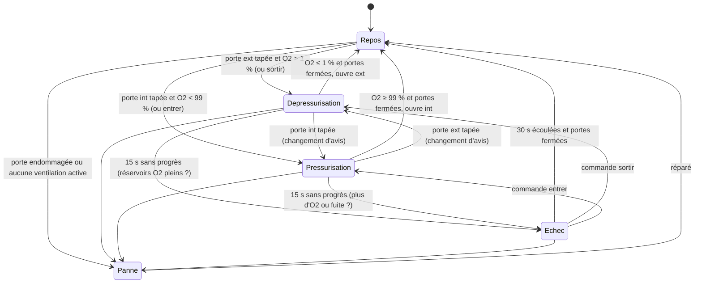

# Sas Automatique (Airlock)

> [!summary] Résumé
> Gère automatiquement un ou plusieurs sas de décompression par « door bump » : vous tapez une porte, le script la referme, vide ou remplit le sas, puis l'ouvre pour vous. Cette version ajoute un délai de sécurité (plus jamais de joueur bloqué quand les réservoirs d'O2 sont pleins), des commandes pour panneau de boutons, une barre d'O2 sur les écrans et corrige plusieurs bugs de verrouillage.

## 1. Prérequis en jeu

Pour chaque sas, construisez et **nommez** les blocs suivants (la balise peut être n'importe où dans le nom) :

| Bloc | Balise dans le nom | Nombre | Rôle |
|---|---|---|---|
| Porte (ou porte de hangar) côté base | `[SAS-NomDuSas-int]` | 1 (obligatoire) | Porte intérieure |
| Porte côté espace | `[SAS-NomDuSas-ext]` | 1 (obligatoire) | Porte extérieure |
| Ventilation (Air Vent) **à l'intérieur** du sas | `[SAS-NomDuSas-vent]` | 1 ou plus (obligatoire) | Vide / remplit le sas |
| Écran LCD, ou cockpit / bloc à écrans (surface 0) | `[SAS-NomDuSas-lcd]` | 0 ou plus | Suivi du sas |

Exemple pour un sas nommé `Hangar Nord` :

```text
Porte Blindée [SAS-Hangar Nord-int]
Porte Spatiale [SAS-Hangar Nord-ext]
Ventilation 1 [SAS-Hangar Nord-vent]
Ventilation 2 [SAS-Hangar Nord-vent]
Écran Sas [SAS-Hangar Nord-lcd]
```

> [!info] Nom du sas
> C'est le **dernier tiret** qui sépare le nom du sas de son rôle : le nom peut donc contenir des tirets et des espaces (`[SAS-Pont-B-ext]` → sas `Pont-B`). Dans les commandes, la casse n'a pas d'importance.

> [!warning] Il faut de la place pour l'air
> La dépressurisation stocke l'air du sas dans vos **réservoirs d'oxygène** (ou générateurs). S'ils sont pleins, le sas ne peut pas se vider : le script abandonne alors le cycle au bout de 15 s et affiche « ÉCHEC : réservoirs O2 pleins ? ». Prévoyez un réservoir d'O2 non plein relié au réseau.

Aucun Custom Data n'est nécessaire.

## 2. Installation

1. Construisez un **Bloc Programmable** sur la même construction que les sas.
2. Nommez les blocs de chaque sas comme ci-dessus.
3. Ouvrez le Bloc Programmable → **Modifier**, collez le code de la section 9 (ou du fichier `GestionnaireSas.cs`).
4. Cliquez sur **Vérifier le code**, puis **OK**. Le script démarre seul (aucun minuteur nécessaire).
5. Regardez la console du Bloc Programmable : elle liste les sas gérés et les sas **incomplets** (porte ou ventilation manquante / mal nommée).
6. Si vous utilisez aussi [[Fermeture Automatique des Portes]], rien à faire : les portes `[SAS-` y sont ignorées.

## 3. Configuration

Constantes en tête du script :

| Constante | Défaut | Effet |
|---|---|---|
| `PREFIXE_BALISE` | `"[SAS-"` | Début de la balise reconnue dans les noms de blocs. |
| `SEUIL_VIDE` | `0.01` | Sous ce niveau d'O2 (1 %), le sas est considéré vide. |
| `SEUIL_PLEIN` | `0.99` | Au-dessus (99 %), le sas est considéré plein. |
| `SEULEMENT_CETTE_CONSTRUCTION` | `true` | Ignore les sas d'un vaisseau amarré par connecteur. |
| `DELAI_MAX_SANS_PROGRES_S` | `15.0` | Secondes de jeu sans progrès de l'O2 avant abandon du cycle (ÉCHEC). |
| `PROGRES_MINIMAL` | `0.02` | Variation d'O2 (2 points de %) qui compte comme un progrès et remet le délai à zéro. |
| `DUREE_MODE_MANUEL_S` | `30.0` | Durée du mode manuel après un ÉCHEC avant retour au repos. |
| `INTERVALLE_RESCAN_S` | `10.0` | Rescan automatique des blocs balisés (sas construit / renommé). |
| `LARGEUR_BARRE_O2` | `10` | Nombre de caractères de la barre `[#####-----]`. |

> [!tip] Grand sas
> Le délai porte sur l'absence de **progrès**, pas sur la durée totale : un grand sas qui se vide lentement mais régulièrement n'est jamais abandonné. Si vos ventilations sont très lentes (moins de 2 % en 15 s), augmentez `DELAI_MAX_SANS_PROGRES_S` ou baissez `PROGRES_MINIMAL`.

Custom Data : aucun.

## 4. Commandes

Arguments du Bloc Programmable (majuscules indifférentes) :

| Argument | Effet |
|---|---|
| `rescan` | Relit immédiatement tous les blocs balisés. |
| `sortir <NomDuSas>` | Ferme les portes, dépressurise, puis ouvre la porte **extérieure**. |
| `entrer <NomDuSas>` | Ferme les portes, pressurise, puis ouvre la porte **intérieure**. |
| `cycle <NomDuSas>` | Inverse un cycle en cours ; au repos : sas plutôt plein (≥ 50 %) → `sortir`, sinon → `entrer`. |

Le nom du sas peut être omis (`cycle`) **s'il n'existe qu'un seul sas**. Un `cycle`/`entrer`/`sortir` est aussi le moyen de **relancer** un sas après un ÉCHEC.

> [!tip] Lier une commande à un panneau de boutons
> 1. Construisez un **Panneau de boutons** (Button Panel) dans le sas ou à côté.
> 2. Terminal → panneau de boutons → **Configurer les actions**.
> 3. Choisissez un bouton, glissez le **Bloc Programmable** dans la barre, puis choisissez l'action **Exécuter** (Run).
> 4. Le jeu demande l'**argument** : tapez par exemple `sortir Hangar Nord`, puis validez.
> 5. Répétez pour un second bouton avec `entrer Hangar Nord`. Même principe pour une barre d'outils de cockpit ou un capteur.

## 5. Fonctionnement

### Algorithme (en français)

À chaque exécution (~6 fois par seconde), pour chaque sas complet :

1. **Lecture** du statut des deux portes. Le script compare au statut précédent pour détecter le **moment précis** où une porte commence à s'ouvrir (« door bump »).
2. **Diagnostic** : si une porte est endommagée (`IsFunctional` faux) ou si aucune ventilation n'est opérationnelle (`IsWorking` : construite, allumée, alimentée), le sas passe en **PANNE** : plus de cycle, seulement le verrouillage croisé, et l'écran affiche la cause. Il revient seul au repos une fois réparé.
3. **Lecture de l'air** sur la première ventilation opérationnelle (niveau d'O2 et étanchéité).
4. **Machine à états** :
   - **REPOS** : porte extérieure tapée et sas non vide → **DÉPRESSURISATION** ; porte intérieure tapée et sas non plein → **PRESSURISATION**. Sinon la porte s'ouvre normalement et l'autre est fermée puis verrouillée (verrouillage croisé).
   - **CYCLE** (dépressurisation / pressurisation) : les deux portes sont fermées ; la porte cible est verrouillée ; la porte de départ reste utilisable (la taper inverse le cycle : « changement d'avis ») ; les ventilations sont réglées. Quand l'objectif est atteint et les deux portes fermées, le script ouvre la porte cible et revient au REPOS.
   - **Surveillance** : chaque baisse (ou hausse) d'au moins 2 % remet un chronomètre à zéro. Sans progrès pendant 15 s, le cycle passe en **ÉCHEC** avec la cause probable : réservoirs O2 pleins (dépressurisation), sas non étanche ou plus d'O2 (pressurisation).
   - **ÉCHEC** : portes déverrouillées, plus d'interception (mode manuel, le verrouillage croisé reste actif) pendant 30 s, puis retour au REPOS dès que les deux portes sont fermées.
5. **Affichage** : le texte des écrans est reconstruit puis écrit **uniquement s'il a changé**.

En parallèle, le programme rescanne les blocs toutes les 10 s, ou immédiatement si un bloc d'un sas a disparu. Les sas déjà connus sont **réutilisés** (même nom) : un rescan n'interrompt jamais un cycle en cours.

### Machine à états



### Exemple d'écran

```text
=== SAS : HANGAR NORD ===

ÉTAT : DÉPRESSURISATION
O2   : [#####-----] 48.7 %
Sans progrès : 0 / 15 s

--- PORTES ---
Intérieure (base)   : FERMÉE
Extérieure (espace) : VERROUILLÉE
```

## 6. Optimisations et corrections par rapport à l'original

Colonne « Déjà dans `../../.old` » : **Oui** = correction reprise de la première optimisation ; **Non** = nouveauté de cette version.

| Problème d'origine | Conséquence en jeu | Correction | Déjà dans `../../.old` |
|---|---|---|---|
| `GetBlocks` de **toute** la grille au scan | Scan lent sur une grosse base | `GetBlocksOfType` avec filtre (balise + construction) à la source | Oui |
| Pas de filtre de construction | Pilote les sas d'un vaisseau amarré | `SEULEMENT_CETTE_CONSTRUCTION` / `IsSameConstructAs(Me)` | Oui |
| Deux booléens d'attente indépendants | Combinaisons d'états incohérentes | Machine à états (`enum EtatSas`) | Oui (3 états) ; étendue à 5 états (Échec, Panne) |
| `SpaceEngineers.Game.ModAPI.Ingame.ContentType` | Erreur de compilation | `ContentType.TEXT_AND_IMAGE` | Oui |
| Écrans réécrits à chaque exécution, chaînes `+=` | Charge inutile | `StringBuilder` réutilisé, écriture seulement si le texte change | Oui ; en plus `ContentType` n'est écrit que s'il diffère |
| `Enabled`, `Depressurize`, `CloseDoor` réécrits en permanence | Appels inutiles | Écriture seulement si la valeur change | Oui |
| Bloc détruit / démonté jamais détecté | Erreurs, sas fantôme | Vérification `GetBlockWithId` + rescan automatique | Oui |
| Pas de diagnostic des sas mal nommés | Sas « muet » sans explication | Liste des sas incomplets dans la console | Oui |
| Aucun délai maximal de cycle | Réservoirs O2 pleins (ou vides) : **joueur bloqué indéfiniment** dans le sas | Délai sans progrès (15 s, `Runtime.TimeSinceLastRun`) → ÉCHEC, portes déverrouillées, cause affichée | **Non** |
| Rescan seulement sur disparition d'un bloc | Un nouveau sas n'est vu qu'après `rescan` | Rescan léger toutes les 10 s, **en conservant l'état** des sas existants | **Non** (l'optimisation recréait tous les sas et perdait le cycle en cours) |
| Aucune commande de pilotage | Impossible d'utiliser un panneau de boutons | `cycle` / `entrer` / `sortir <NomDuSas>` | **Non** |
| Affichage du seul pourcentage | Peu lisible de loin | Barre `[#####-----]`, délai écoulé, alerte explicite | **Non** |
| Porte éteinte (`Enabled = false`) dans la même exécution que `CloseDoor` | La porte peut s'arrêter entrouverte ; si les deux portes étaient ouvertes au démarrage, **les deux restaient bloquées** (le déverrouillage exigeait deux portes fermées) | Verrouillage **seulement une fois la porte fermée** ; une porte éteinte est rallumée pour pouvoir la fermer ; si les deux sont ouvertes, la porte intérieure est fermée en priorité | **Non** |
| Porte tapée alors que **l'autre est ouverte** | La ventilation aspirait l'air **de la base** par la porte restée ouverte, sans jamais finir le cycle | Démarrer un cycle ferme **les deux** portes | **Non** |
| Ouverture jugée tant que la porte est « En ouverture » | Base à moins de 99 % d'O2 : le script reclaquait la porte intérieure qu'il venait d'ouvrir (le niveau retombe en se mélangeant) | Détection du **front montant** de l'ouverture, et ouverture par le script marquée comme telle | **Non** |
| Porte intérieure ouverte sans pressurisation si sas non étanche | **L'air de la base** s'échappait par le sas qui fuit | Pressurisation tentée quand même → ÉCHEC « sas non étanche » au bout du délai, puis ouverture manuelle en connaissance de cause | **Non** (rupture de comportement volontaire) |
| Ventilation non fonctionnelle / non alimentée lue quand même | Niveau d'O2 faux possible → ouverture extérieure avec de l'air dedans | Lecture uniquement des ventilations `IsWorking` ; aucune → état PANNE | **Non** |
| Porte endommagée non gérée | Cycles impossibles, état incompréhensible | État PANNE avec message, verrouillage croisé conservé | **Non** |
| Porte cible déverrouillée pendant le cycle | Le joueur pouvait l'ouvrir trop tôt (perte d'air) | Porte cible verrouillée pendant le cycle, porte de départ libre (changement d'avis) | **Non** |
| Écrans limités aux `IMyTextPanel` | Impossible d'afficher sur un cockpit | Surface 0 de tout bloc à écrans balisé `-lcd` | **Non** |
| `argument.ToLower()` sans `Trim()` | `rescan ` (espace) ignoré | `Trim()` + analyse « verbe nom » | Oui (`Trim`) ; analyse nouvelle |

## 7. Limites connues

- **Comportement d'une porte éteinte en mouvement** : par prudence le script ne verrouille une porte qu'une fois fermée et rallume une porte éteinte avant de la fermer. Le comportement exact du jeu (arrêt de l'animation ou non) n'a pas été vérifié ici.
- **Ventilation hors service** : on suppose qu'une ventilation non `IsWorking` peut donner un niveau d'O2 non fiable ; elle est donc ignorée (non vérifié en jeu).
- **Cause de l'ÉCHEC** : c'est une cause *probable*, déduite de l'absence de progrès (le jeu n'expose pas directement « réservoirs pleins » à la ventilation).
- Les ventilations sont **laissées dans leur dernier mode** après un ÉCHEC ou une PANNE.
- L'état des cycles n'est pas sauvegardé : après rechargement de la partie, chaque sas repart au REPOS.
- Si plusieurs portes portent la même balise `-int` (ou `-ext`), seule la dernière trouvée est utilisée.
- Précision temporelle : environ 1/6 s (exécution `Update10`).
- La commande `cycle` sans état en cours choisit le sens selon le niveau d'O2 (seuil 50 %), pas selon la position du joueur (inconnue du script).

## 8. Dépannage

| Symptôme | Cause probable | Solution |
|---|---|---|
| Console : « Sas incomplets : X » | Porte `-int`/`-ext` ou ventilation `-vent` manquante, mal nommée, ou d'un autre type de bloc | Vérifier les balises et le type des blocs, puis `rescan` |
| Le sas n'apparaît pas du tout | Blocs sur un vaisseau amarré, ou crochet `]` manquant | Vérifier le nom ; mettre `SEULEMENT_CETTE_CONSTRUCTION = false` si voulu |
| « ÉCHEC : réservoirs O2 pleins ? » | Plus de place pour stocker l'air aspiré | Ajouter / vider un réservoir d'O2, puis `sortir <Nom>` |
| « ÉCHEC : plus d'O2 (réservoirs vides ?) » | Pas d'oxygène disponible pour remplir | Remplir les réservoirs / générateur O2, puis `entrer <Nom>` |
| « ÉCHEC : sas non étanche (fuite) ? » | Bloc manquant, porte endommagée, trou dans la coque | Réparer, vérifier l'étanchéité (info de la ventilation) |
| « PANNE : aucune ventilation opérationnelle » | Ventilation éteinte, non alimentée ou endommagée | Rallumer / alimenter / réparer la ventilation |
| Les deux portes restent verrouillées | Ancien script d'origine qui avait éteint les portes en mouvement | Avec cette version, les portes sont rallumées et refermées automatiquement ; sinon rallumer à la main |
| L'écran ne s'affiche pas | Écran mal balisé, ou bloc à écrans dont la surface 0 n'est pas la bonne | Vérifier `[SAS-Nom-lcd]` ; utiliser un écran LCD simple |
| Une porte de sas se referme toute seule au bout de 2 s | Ancien script de fermeture automatique sans exclusion | Utiliser [[Fermeture Automatique des Portes]] (exclut `[SAS-`) |
| Commande « Sas introuvable » | Nom mal orthographié ou omis alors qu'il y a plusieurs sas | Copier le nom exact listé dans la console |

## 9. Code complet

```csharp
// ==============================================================================
// SAS AUTOMATIQUE (AIRLOCK) INTELLIGENT - VERSION OPTIMISÉE (GestionnaireSas.cs)
// ------------------------------------------------------------------------------
// Rôle :
//   Gère automatiquement un ou plusieurs sas de décompression selon le principe
//   du « door bump » : le joueur tente d'ouvrir une porte, le script la referme
//   aussitôt si l'air n'est pas au bon niveau, vide ou remplit le sas, puis ouvre
//   la porte lui-même. Les deux portes d'un même sas ne sont jamais ouvertes en
//   même temps (verrouillage croisé).
//
// Nomenclature des blocs (dans le NOM du bloc, n'importe où) :
//   [SAS-NomDuSas-int]  : porte intérieure (vers la base)            - obligatoire
//   [SAS-NomDuSas-ext]  : porte extérieure (vers l'espace)           - obligatoire
//   [SAS-NomDuSas-vent] : ventilation(s) DANS le sas (une ou plus)   - obligatoire
//   [SAS-NomDuSas-lcd]  : écran(s) de suivi (LCD, ou surface 0 d'un
//                         cockpit / bloc à écrans)                    - optionnel
//   Le nom du sas peut contenir des tirets et des espaces : c'est le DERNIER
//   tiret qui sépare le nom du rôle. Ex. « Porte [SAS-Hangar Nord-ext] ».
//
// Commandes (argument du Bloc Programmable, majuscules indifférentes) :
//   rescan          : relit tous les blocs balisés immédiatement
//   cycle  <NomSas> : inverse le sas (plein -> sortie, vide -> entrée)
//   entrer <NomSas> : pressurise puis ouvre la porte intérieure
//   sortir <NomSas> : dépressurise puis ouvre la porte extérieure
//   (Le nom peut être omis s'il n'existe qu'un seul sas.)
//
// Dépendances : aucune (pas de serveur dictionnaire ni de serveur d'alarmes).
// Script compagnon : « Fermeture Automatique des Portes » ignore les portes [SAS-.
// ==============================================================================

// ------------------------------------------------------------------------------
// CONSTANTES DE CONFIGURATION
// Toutes les valeurs réglables sont ici : inutile de fouiller dans la logique.
// ------------------------------------------------------------------------------

// Balise qui identifie un bloc comme faisant partie d'un sas.
const string PREFIXE_BALISE = "[SAS-";

// En dessous de ce niveau d'oxygène (0 à 1), le sas est considéré comme vide.
const float SEUIL_VIDE = 0.01f;

// Au dessus de ce niveau d'oxygène (0 à 1), le sas est considéré comme plein.
const float SEUIL_PLEIN = 0.99f;

// true : ne gère que les blocs de CETTE construction (évite de piloter les sas
// d'un vaisseau amarré par connecteur). false : comportement d'origine.
const bool SEULEMENT_CETTE_CONSTRUCTION = true;

// Délai maximal (en secondes de jeu) pendant lequel le niveau d'O2 peut rester
// sans progresser pendant un cycle. Au-delà, le cycle est abandonné (ÉCHEC),
// les portes sont déverrouillées et l'écran affiche la cause probable.
const double DELAI_MAX_SANS_PROGRES_S = 15.0;

// Variation minimale du niveau d'O2 (0.02 = 2 points de %) considérée comme
// un « progrès » : chaque progrès remet le chronomètre du délai à zéro. Ainsi un
// grand sas qui se vide lentement mais sûrement n'est jamais abandonné à tort.
const float PROGRES_MINIMAL = 0.02f;

// Durée (en secondes) du mode manuel après un ÉCHEC : les portes ne sont plus
// interceptées (seul le verrouillage croisé reste actif), puis retour au repos.
const double DUREE_MODE_MANUEL_S = 30.0;

// Intervalle (en secondes) du rescan automatique léger des blocs balisés :
// prend en compte les sas construits ou renommés sans taper « rescan ».
const double INTERVALLE_RESCAN_S = 10.0;

// Nombre de caractères de la barre de progression O2 sur les écrans.
const int LARGEUR_BARRE_O2 = 10;

// ------------------------------------------------------------------------------
// ÉTATS D'UN SAS
// Un sas est dans UN SEUL état à la fois (machine à états) : cela supprime les
// combinaisons impossibles des deux booléens de la version d'origine.
// ------------------------------------------------------------------------------
enum EtatSas
{
    Repos,             // Aucun cycle en cours : les ouvertures sont surveillées
    Depressurisation,  // On vide le sas avant d'ouvrir la porte extérieure
    Pressurisation,    // On remplit le sas avant d'ouvrir la porte intérieure
    Echec,             // Cycle abandonné (délai dépassé) : mode manuel temporaire
    Panne              // Porte endommagée ou aucune ventilation opérationnelle
}

/// <summary>
/// Gère UN sas : ses blocs, sa machine à états et son affichage.
/// Une instance est conservée d'un rescan à l'autre (repérée par le nom du sas)
/// pour ne pas perdre un cycle en cours quand la liste des blocs est relue.
/// </summary>
class GestionnaireSas
{
    // --- Blocs du sas (réaffectés à chaque scan) ---
    public string NomDuSas;
    public IMyDoor PorteInterieure;
    public IMyDoor PorteExterieure;
    public List<IMyAirVent> Ventilations = new List<IMyAirVent>();

    // Blocs d'écran (pour vérifier qu'ils existent toujours) et surfaces
    // d'affichage correspondantes (là où l'on écrit vraiment le texte).
    public List<IMyTerminalBlock> BlocsEcrans = new List<IMyTerminalBlock>();
    public List<IMyTextSurface> Surfaces = new List<IMyTextSurface>();

    // --- État de la machine à états ---
    public EtatSas Etat = EtatSas.Repos;

    // Message d'alerte affiché à l'écran (vide = pas d'alerte).
    public string MessageAlerte = "";

    // Dernier niveau d'O2 lu (-1 = inconnu) : utilisé par les commandes.
    float dernierNiveauO2 = -1f;

    // Temps écoulé sans progrès significatif du niveau d'O2 pendant un cycle.
    double chronoSansProgres = 0;

    // Niveau d'O2 au dernier progrès constaté (référence de comparaison).
    float niveauReference = 0f;

    // Temps écoulé depuis l'entrée en mode manuel (état Echec).
    double chronoModeManuel = 0;

    // Statuts des portes lors de l'exécution précédente : servent à détecter le
    // « front montant » d'une ouverture (Fermée -> En ouverture), c'est-à-dire
    // le moment précis où un joueur tape la porte.
    DoorStatus statutPrecedentInt = DoorStatus.Closed;
    DoorStatus statutPrecedentExt = DoorStatus.Closed;

    // Liste réutilisée des ventilations réellement opérationnelles ce cycle-ci.
    List<IMyAirVent> ventilationsActives = new List<IMyAirVent>();

    // Dernier texte envoyé aux écrans : on ne réécrit que s'il a changé.
    string dernierTexteAffiche = "";

    // StringBuilder réutilisé : évite d'allouer des chaînes à chaque exécution.
    StringBuilder constructeurDeTexte = new StringBuilder();

    /// <summary>
    /// Oublie tous les blocs (appelé au début d'un rescan) SANS toucher à l'état
    /// du cycle : le sas garde sa mémoire, seuls ses blocs sont relus.
    /// </summary>
    public void ViderBlocs()
    {
        PorteInterieure = null;
        PorteExterieure = null;
        Ventilations.Clear();
        BlocsEcrans.Clear();
        Surfaces.Clear();
        // Le texte sera réécrit sur les (éventuels nouveaux) écrans.
        dernierTexteAffiche = "";
    }

    /// <summary>
    /// Un sas est exploitable s'il possède ses deux portes ET au moins une ventilation.
    /// </summary>
    public bool EstComplet()
    {
        return PorteInterieure != null && PorteExterieure != null && Ventilations.Count > 0;
    }

    /// <summary>
    /// Vérifie que tous les blocs du sas existent toujours (non détruits / démontés).
    /// GetBlockWithId renvoie null si le bloc a quitté le système terminal.
    /// </summary>
    public bool TousLesBlocsExistent(IMyGridTerminalSystem systemeDeGrille)
    {
        if (!BlocExiste(systemeDeGrille, PorteInterieure)) return false;
        if (!BlocExiste(systemeDeGrille, PorteExterieure)) return false;
        foreach (IMyAirVent ventilation in Ventilations)
        {
            if (!BlocExiste(systemeDeGrille, ventilation)) return false;
        }
        foreach (IMyTerminalBlock ecran in BlocsEcrans)
        {
            if (!BlocExiste(systemeDeGrille, ecran)) return false;
        }
        return true;
    }

    static bool BlocExiste(IMyGridTerminalSystem systemeDeGrille, IMyTerminalBlock bloc)
    {
        return bloc != null && systemeDeGrille.GetBlockWithId(bloc.EntityId) != null;
    }

    // ==========================================================================
    // BOUCLE PRINCIPALE DU SAS
    // ==========================================================================

    /// <summary>
    /// Cœur de la logique, appelé à chaque exécution du Bloc Programmable.
    /// Précondition : EstComplet() est vrai (garanti par le scanner).
    /// </summary>
    /// <param name="secondesEcoulees">Temps de jeu écoulé depuis l'exécution précédente.</param>
    public void MettreAJour(double secondesEcoulees)
    {
        // --- 1. Lecture des statuts des portes (une seule fois par exécution) ---
        DoorStatus statutInt = PorteInterieure.Status;
        DoorStatus statutExt = PorteExterieure.Status;

        // Un joueur vient-il de taper une porte ? (front montant de l'ouverture)
        bool ouvertureDemandeeInt = EstNouvelleOuverture(statutInt, statutPrecedentInt);
        bool ouvertureDemandeeExt = EstNouvelleOuverture(statutExt, statutPrecedentExt);

        // On mémorise les statuts pour la prochaine exécution. (OuvrirPorteCible
        // peut ensuite les surcharger quand c'est le script qui ouvre la porte.)
        statutPrecedentInt = statutInt;
        statutPrecedentExt = statutExt;

        // --- 2. Diagnostic de santé : portes et ventilations utilisables ? ---
        ventilationsActives.Clear();
        foreach (IMyAirVent ventilation in Ventilations)
        {
            // IsWorking = construite, allumée ET alimentée. Une ventilation hors
            // service peut renvoyer un niveau d'O2 faux : on ne la lit pas.
            if (ventilation.IsWorking) ventilationsActives.Add(ventilation);
        }

        string diagnosticPanne = DiagnostiquerPanne();
        if (diagnosticPanne != "")
        {
            // En panne : on abandonne tout cycle, on garde seulement la sécurité
            // (jamais deux portes ouvertes) et on affiche la cause.
            Etat = EtatSas.Panne;
            MessageAlerte = diagnosticPanne;
            dernierNiveauO2 = -1f;
            AppliquerVerrouillageCroise(statutInt, statutExt);
            AfficherStatut(-1f, true, statutInt, statutExt);
            return;
        }
        if (Etat == EtatSas.Panne)
        {
            // La panne est réparée : retour au fonctionnement normal.
            Etat = EtatSas.Repos;
            MessageAlerte = "";
        }

        // --- 3. Lecture de l'air (identique dans toute la pièce : 1ère ventilation active) ---
        float niveauO2 = ventilationsActives[0].GetOxygenLevel();
        bool estEtanche = ventilationsActives[0].CanPressurize;
        dernierNiveauO2 = niveauO2;

        // --- 4. Machine à états ---
        switch (Etat)
        {
            case EtatSas.Repos:
                TraiterRepos(niveauO2, statutInt, statutExt, ouvertureDemandeeInt, ouvertureDemandeeExt);
                break;
            case EtatSas.Depressurisation:
            case EtatSas.Pressurisation:
                TraiterCycle(niveauO2, estEtanche, statutInt, statutExt, ouvertureDemandeeInt, ouvertureDemandeeExt, secondesEcoulees);
                break;
            case EtatSas.Echec:
                TraiterModeManuel(statutInt, statutExt, secondesEcoulees);
                break;
        }

        // --- 5. Affichage (n'écrit que si le texte a changé) ---
        AfficherStatut(niveauO2, estEtanche, statutInt, statutExt);
    }

    /// <summary>
    /// Vrai si la porte vient de COMMENCER à s'ouvrir depuis l'exécution précédente.
    /// Pourquoi un front montant : la version d'origine re-testait la porte tant
    /// qu'elle était « En ouverture » ; or dès que la porte intérieure s'entrouvre,
    /// l'air du sas se mélange à celui de la base. Si la base n'est pas à 99 %,
    /// le niveau lu retombait sous le seuil et le script reclaquait la porte qu'il
    /// venait lui-même d'ouvrir. On ne juge donc une ouverture qu'une seule fois.
    /// </summary>
    static bool EstNouvelleOuverture(DoorStatus statutActuel, DoorStatus statutPrecedent)
    {
        return statutActuel == DoorStatus.Opening
            && statutPrecedent != DoorStatus.Opening
            && statutPrecedent != DoorStatus.Open;
    }

    /// <summary>
    /// Renvoie une description de la panne, ou "" si le sas est utilisable.
    /// IsFunctional = le bloc est assez construit / pas trop endommagé pour marcher.
    /// </summary>
    string DiagnostiquerPanne()
    {
        if (!PorteInterieure.IsFunctional) return "PANNE : porte intérieure endommagée";
        if (!PorteExterieure.IsFunctional) return "PANNE : porte extérieure endommagée";
        if (ventilationsActives.Count == 0) return "PANNE : aucune ventilation opérationnelle (énergie ? dégâts ? éteinte ?)";
        return "";
    }

    // ==========================================================================
    // TRAITEMENT DE CHAQUE ÉTAT
    // ==========================================================================

    /// <summary>
    /// État REPOS : on surveille les « door bumps ».
    /// - Porte extérieure tapée alors qu'il reste de l'air -> dépressurisation.
    /// - Porte intérieure tapée alors que le sas n'est pas plein -> pressurisation.
    /// - Sinon la porte s'ouvre normalement et le verrouillage croisé bloque l'autre.
    /// </summary>
    void TraiterRepos(float niveauO2, DoorStatus statutInt, DoorStatus statutExt,
                      bool ouvertureDemandeeInt, bool ouvertureDemandeeExt)
    {
        if (ouvertureDemandeeExt && niveauO2 > SEUIL_VIDE)
        {
            DemarrerCycle(EtatSas.Depressurisation, niveauO2);
            return;
        }
        if (ouvertureDemandeeInt && niveauO2 < SEUIL_PLEIN)
        {
            // Changement par rapport à l'original : on pressurise MÊME si le sas
            // n'est pas étanche. L'original ouvrait directement la porte intérieure,
            // ce qui vidait l'air de la BASE dans un sas qui fuit. Désormais le cycle
            // échoue proprement au bout du délai (« sas non étanche ») et le joueur
            // peut alors ouvrir la porte en connaissance de cause.
            DemarrerCycle(EtatSas.Pressurisation, niveauO2);
            return;
        }
        AppliquerVerrouillageCroise(statutInt, statutExt);
    }

    /// <summary>
    /// États DÉPRESSURISATION / PRESSURISATION : les deux portes restent fermées,
    /// les ventilations travaillent, puis la porte cible est ouverte par le script.
    /// Un délai sans progrès fait passer le sas en ÉCHEC.
    /// </summary>
    void TraiterCycle(float niveauO2, bool estEtanche, DoorStatus statutInt, DoorStatus statutExt,
                      bool ouvertureDemandeeInt, bool ouvertureDemandeeExt, double secondesEcoulees)
    {
        bool depressuriser = (Etat == EtatSas.Depressurisation);

        // a) Changement d'avis : le joueur tape la porte « de départ » -> on inverse.
        if (depressuriser && ouvertureDemandeeInt)
        {
            DemarrerCycle(EtatSas.Pressurisation, niveauO2);
            return;
        }
        if (!depressuriser && ouvertureDemandeeExt)
        {
            DemarrerCycle(EtatSas.Depressurisation, niveauO2);
            return;
        }

        // b) Porte cible (celle qu'on ouvrira à la fin) : fermée puis verrouillée,
        //    pour qu'on ne puisse pas l'ouvrir trop tôt. Porte d'origine : fermée,
        //    mais laissée déverrouillée pour permettre le changement d'avis.
        IMyDoor porteCible = depressuriser ? PorteExterieure : PorteInterieure;
        IMyDoor porteOrigine = depressuriser ? PorteInterieure : PorteExterieure;
        Verrouiller(porteCible);
        if (porteOrigine.Status == DoorStatus.Closed) Deverrouiller(porteOrigine);
        else Fermer(porteOrigine);

        // c) Réglage des ventilations (réappliqué à chaque fois : corrige un joueur
        //    qui aurait modifié le réglage à la main ; n'écrit que si nécessaire).
        ReglerVentilations(depressuriser);

        // d) Objectif atteint et sas bien fermé -> ouverture de la porte cible.
        bool deuxPortesFermees = statutInt == DoorStatus.Closed && statutExt == DoorStatus.Closed;
        bool objectifAtteint = depressuriser ? niveauO2 <= SEUIL_VIDE : niveauO2 >= SEUIL_PLEIN;
        if (deuxPortesFermees && objectifAtteint)
        {
            OuvrirPorteCible(depressuriser);
            Etat = EtatSas.Repos;
            return;
        }

        // e) Surveillance de la progression : tout progrès remet le chrono à zéro.
        bool progres = depressuriser
            ? niveauO2 <= niveauReference - PROGRES_MINIMAL
            : niveauO2 >= niveauReference + PROGRES_MINIMAL;
        if (progres)
        {
            niveauReference = niveauO2;
            chronoSansProgres = 0;
        }
        else
        {
            chronoSansProgres += secondesEcoulees;
        }

        // f) Délai dépassé -> abandon avec la cause la plus probable.
        if (chronoSansProgres >= DELAI_MAX_SANS_PROGRES_S)
        {
            string cause;
            if (depressuriser) cause = "ÉCHEC : réservoirs O2 pleins ?";
            else if (!estEtanche) cause = "ÉCHEC : sas non étanche (fuite) ?";
            else cause = "ÉCHEC : plus d'O2 (réservoirs vides ?)";
            PasserEnEchec(cause);
        }
    }

    /// <summary>
    /// État ÉCHEC (mode manuel temporaire) : les portes ne sont plus interceptées,
    /// seul le verrouillage croisé protège la base. Après DUREE_MODE_MANUEL_S et
    /// une fois les deux portes fermées, le sas revient au repos.
    /// </summary>
    void TraiterModeManuel(DoorStatus statutInt, DoorStatus statutExt, double secondesEcoulees)
    {
        chronoModeManuel += secondesEcoulees;
        AppliquerVerrouillageCroise(statutInt, statutExt);

        if (chronoModeManuel >= DUREE_MODE_MANUEL_S
            && statutInt == DoorStatus.Closed && statutExt == DoorStatus.Closed)
        {
            Etat = EtatSas.Repos;
            MessageAlerte = "";
        }
    }

    // ==========================================================================
    // ACTIONS
    // ==========================================================================

    /// <summary>
    /// Lance un cycle : ferme les deux portes, règle les ventilations et remet
    /// à zéro la surveillance du délai.
    /// </summary>
    void DemarrerCycle(EtatSas nouvelEtat, float niveauO2)
    {
        Etat = nouvelEtat;
        MessageAlerte = "";
        chronoSansProgres = 0;
        niveauReference = niveauO2;
        Fermer(PorteInterieure);
        Fermer(PorteExterieure);
        ReglerVentilations(nouvelEtat == EtatSas.Depressurisation);
    }

    /// <summary>
    /// Abandonne le cycle en cours : déverrouille les portes (le joueur n'est plus
    /// bloqué) et affiche la cause. Les ventilations sont laissées telles quelles.
    /// </summary>
    void PasserEnEchec(string cause)
    {
        Etat = EtatSas.Echec;
        MessageAlerte = cause;
        chronoModeManuel = 0;
        // Déverrouiller uniquement les portes fermées ; le verrouillage croisé
        // s'occupera des autres dès la prochaine exécution.
        if (PorteInterieure.Status == DoorStatus.Closed) Deverrouiller(PorteInterieure);
        if (PorteExterieure.Status == DoorStatus.Closed) Deverrouiller(PorteExterieure);
    }

    /// <summary>
    /// Ouvre la porte cible en fin de cycle (extérieure après dépressurisation,
    /// intérieure après pressurisation). Le statut précédent est forcé à
    /// « En ouverture » pour que cette ouverture, voulue par le script, ne soit
    /// pas prise pour un « door bump » du joueur à l'exécution suivante.
    /// </summary>
    void OuvrirPorteCible(bool exterieure)
    {
        IMyDoor porte = exterieure ? PorteExterieure : PorteInterieure;
        if (!porte.Enabled) porte.Enabled = true;
        porte.OpenDoor();
        if (exterieure) statutPrecedentExt = DoorStatus.Opening;
        else statutPrecedentInt = DoorStatus.Opening;
    }

    /// <summary>
    /// Verrouillage croisé : tant qu'une porte n'est pas complètement fermée,
    /// l'autre est fermée puis verrouillée. Si les DEUX sont ouvertes (démarrage du
    /// script, ouverture depuis le terminal...), la porte intérieure est fermée en
    /// priorité pour protéger l'air de la base. Deux portes fermées = déverrouillées.
    /// </summary>
    void AppliquerVerrouillageCroise(DoorStatus statutInt, DoorStatus statutExt)
    {
        if (statutExt != DoorStatus.Closed)
        {
            Verrouiller(PorteInterieure);
        }
        else if (statutInt != DoorStatus.Closed)
        {
            Verrouiller(PorteExterieure);
        }
        else
        {
            Deverrouiller(PorteInterieure);
            Deverrouiller(PorteExterieure);
        }
    }

    /// <summary>
    /// Ordonne la fermeture d'une porte si elle n'est ni fermée ni en fermeture.
    /// Une porte éteinte (Enabled = false) n'obéit pas : on la rallume d'abord.
    /// </summary>
    static void Fermer(IMyDoor porte)
    {
        DoorStatus statut = porte.Status;
        if (statut == DoorStatus.Closed || statut == DoorStatus.Closing) return;
        if (!porte.Enabled) porte.Enabled = true;
        porte.CloseDoor();
    }

    /// <summary>
    /// Ferme la porte, puis la verrouille (Enabled = false) SEULEMENT une fois
    /// complètement fermée. Correction : l'original éteignait la porte dans la même
    /// exécution que l'ordre de fermeture ; une porte éteinte en plein mouvement
    /// risque de rester bloquée entrouverte (et le sas avec).
    /// </summary>
    static void Verrouiller(IMyDoor porte)
    {
        if (porte.Status != DoorStatus.Closed)
        {
            Fermer(porte);
            return;
        }
        if (porte.Enabled) porte.Enabled = false;
    }

    /// <summary>
    /// Déverrouille une porte (Enabled = true), uniquement si nécessaire.
    /// </summary>
    static void Deverrouiller(IMyDoor porte)
    {
        if (!porte.Enabled) porte.Enabled = true;
    }

    /// <summary>
    /// Règle TOUTES les ventilations du sas (aspiration ou remplissage).
    /// La propriété n'est écrite que si sa valeur doit changer.
    /// </summary>
    void ReglerVentilations(bool depressuriser)
    {
        foreach (IMyAirVent ventilation in Ventilations)
        {
            if (ventilation.Depressurize != depressuriser) ventilation.Depressurize = depressuriser;
        }
    }

    // ==========================================================================
    // COMMANDES (bouton, barre d'outils...)
    // ==========================================================================

    /// <summary>
    /// Exécute une commande sur ce sas et renvoie un message pour la console.
    /// </summary>
    /// <param name="action">"cycle", "entrer" ou "sortir" (déjà en minuscules).</param>
    public string Commander(string action)
    {
        if (Etat == EtatSas.Panne) return "Sas " + NomDuSas + " en panne : commande refusée.";
        if (dernierNiveauO2 < 0f) return "Sas " + NomDuSas + " pas encore lu : réessayez.";

        // « cycle » : inverse un cycle en cours, sinon choisit selon le niveau d'air.
        if (action == "cycle")
        {
            if (Etat == EtatSas.Depressurisation) action = "entrer";
            else if (Etat == EtatSas.Pressurisation) action = "sortir";
            else action = dernierNiveauO2 >= 0.5f ? "sortir" : "entrer";
        }

        if (action == "sortir")
        {
            if (PorteExterieure.Status == DoorStatus.Open) return "Sas " + NomDuSas + " : porte extérieure déjà ouverte.";
            DemarrerCycle(EtatSas.Depressurisation, dernierNiveauO2);
            return "Sas " + NomDuSas + " : sortie (dépressurisation).";
        }
        if (PorteInterieure.Status == DoorStatus.Open) return "Sas " + NomDuSas + " : porte intérieure déjà ouverte.";
        DemarrerCycle(EtatSas.Pressurisation, dernierNiveauO2);
        return "Sas " + NomDuSas + " : entrée (pressurisation).";
    }

    // ==========================================================================
    // AFFICHAGE
    // ==========================================================================

    /// <summary>
    /// Ligne de résumé pour la console (Echo) du Bloc Programmable.
    /// </summary>
    public string Resume()
    {
        string resume = NomDuSas + " : " + LibelleEtat();
        if (MessageAlerte != "") resume += " (" + MessageAlerte + ")";
        return resume;
    }

    string LibelleEtat()
    {
        switch (Etat)
        {
            case EtatSas.Depressurisation: return "DÉPRESSURISATION";
            case EtatSas.Pressurisation: return "PRESSURISATION";
            case EtatSas.Echec: return "ÉCHEC - MODE MANUEL";
            case EtatSas.Panne: return "PANNE";
            default: return "PRÊT";
        }
    }

    /// <summary>
    /// Met à jour les écrans, SEULEMENT si le texte a changé (le cas le plus
    /// fréquent, sas au repos, ne coûte donc presque rien).
    /// </summary>
    /// <param name="niveauO2">Niveau d'O2 de 0 à 1, ou -1 si inconnu.</param>
    void AfficherStatut(float niveauO2, bool estEtanche, DoorStatus statutInt, DoorStatus statutExt)
    {
        if (Surfaces.Count == 0) return;

        StringBuilder texte = constructeurDeTexte;
        texte.Clear();
        texte.Append("=== SAS : ").Append(NomDuSas.ToUpper()).Append(" ===\n\n");
        texte.Append("ÉTAT : ").Append(LibelleEtat()).Append("\n");

        // Barre de progression texte, ex. « O2 : [#####-----] 50.0 % ».
        texte.Append("O2   : ");
        if (niveauO2 < 0f)
        {
            texte.Append("inconnu\n");
        }
        else
        {
            AjouterBarre(texte, niveauO2);
            texte.Append(" ").Append((niveauO2 * 100f).ToString("0.0")).Append(" %\n");
        }

        // Pendant un cycle : temps écoulé sans progrès (arrondi à la seconde pour
        // ne pas réécrire l'écran à chaque exécution).
        if (Etat == EtatSas.Depressurisation || Etat == EtatSas.Pressurisation)
        {
            texte.Append("Sans progrès : ").Append(((int)chronoSansProgres).ToString())
                 .Append(" / ").Append(((int)DELAI_MAX_SANS_PROGRES_S).ToString()).Append(" s\n");
        }

        // Alerte : message explicite, sinon fuite constatée au repos (portes fermées).
        if (MessageAlerte != "")
        {
            texte.Append("\n/!\\ ").Append(MessageAlerte).Append("\n");
            if (Etat == EtatSas.Echec) texte.Append("Portes déverrouillées (mode manuel).\n");
        }
        else if (Etat == EtatSas.Repos && !estEtanche
                 && statutInt == DoorStatus.Closed && statutExt == DoorStatus.Closed)
        {
            texte.Append("\n/!\\ ALERTE : FUITE (sas non étanche)\n");
        }

        texte.Append("\n--- PORTES ---\n");
        texte.Append("Intérieure (base)   : ").Append(LibellePorte(PorteInterieure, statutInt)).Append("\n");
        texte.Append("Extérieure (espace) : ").Append(LibellePorte(PorteExterieure, statutExt)).Append("\n");

        string nouveauTexte = texte.ToString();
        if (nouveauTexte == dernierTexteAffiche) return;
        dernierTexteAffiche = nouveauTexte;

        foreach (IMyTextSurface surface in Surfaces)
        {
            // Le mode texte n'est imposé que s'il n'est pas déjà actif.
            if (surface.ContentType != ContentType.TEXT_AND_IMAGE) surface.ContentType = ContentType.TEXT_AND_IMAGE;
            surface.WriteText(nouveauTexte);
        }
    }

    /// <summary>
    /// Ajoute une barre « [#####-----] » proportionnelle au ratio (0 à 1).
    /// </summary>
    static void AjouterBarre(StringBuilder texte, float ratio)
    {
        int pleins = (int)Math.Round(ratio * LARGEUR_BARRE_O2);
        if (pleins < 0) pleins = 0;
        if (pleins > LARGEUR_BARRE_O2) pleins = LARGEUR_BARRE_O2;
        texte.Append('[').Append('#', pleins).Append('-', LARGEUR_BARRE_O2 - pleins).Append(']');
    }

    static string LibellePorte(IMyDoor porte, DoorStatus statut)
    {
        if (!porte.IsFunctional) return "ENDOMMAGÉE";
        if (statut == DoorStatus.Open) return "OUVERTE";
        if (statut == DoorStatus.Opening) return "EN OUVERTURE";
        if (statut == DoorStatus.Closing) return "EN FERMETURE";
        if (!porte.Enabled) return "VERROUILLÉE";
        return "FERMÉE";
    }
}

// ------------------------------------------------------------------------------
// LE CŒUR DU PROGRAMME
// ------------------------------------------------------------------------------

// Tous les sas connus, complets ou non, indexés par leur nom. Conservés d'un
// rescan à l'autre pour ne pas perdre un cycle en cours.
Dictionary<string, GestionnaireSas> sasParNom = new Dictionary<string, GestionnaireSas>();

// Sas complets (gérés) et noms des sas incomplets (signalés dans la console).
List<GestionnaireSas> ListeDesSas = new List<GestionnaireSas>();
List<string> NomsDesSasIncomplets = new List<string>();

// Collections réutilisées par le scanner (pas d'allocation à chaque scan).
List<IMyTerminalBlock> blocsBalises = new List<IMyTerminalBlock>();
Dictionary<string, GestionnaireSas> sasTrouves = new Dictionary<string, GestionnaireSas>();

// Temps écoulé depuis le dernier scan (pour le rescan périodique).
double chronoRescan = 0;

// Dernier message lié à une commande (affiché dans la console).
string messageCommande = "";

// Construction du texte de la console, réutilisée.
StringBuilder texteConsole = new StringBuilder();

/// <summary>
/// Constructeur : appelé à la compilation et au chargement de la partie.
/// </summary>
public Program()
{
    // Update10 = une exécution toutes les 10 ticks (~6 fois par seconde) :
    // suffisant pour réagir à un joueur qui tape une porte.
    Runtime.UpdateFrequency = UpdateFrequency.Update10;
    ScannerLesSas();
}

/// <summary>
/// Point d'entrée : exécuté automatiquement (Update10) ou par un bouton (argument).
/// </summary>
public void Main(string argument, UpdateType updateSource)
{
    // Temps de JEU écoulé depuis la dernière exécution (suit la vitesse de simulation).
    double secondesEcoulees = Runtime.TimeSinceLastRun.TotalSeconds;

    // 1. Rescan : périodique, ou immédiat si un bloc d'un sas a disparu.
    chronoRescan += secondesEcoulees;
    bool besoinRescan = chronoRescan >= INTERVALLE_RESCAN_S;
    if (!besoinRescan)
    {
        foreach (GestionnaireSas sas in ListeDesSas)
        {
            if (!sas.TousLesBlocsExistent(GridTerminalSystem))
            {
                besoinRescan = true;
                break;
            }
        }
    }
    if (besoinRescan) ScannerLesSas();

    // 2. Commande éventuelle (bouton, barre d'outils, terminal).
    if (!string.IsNullOrWhiteSpace(argument)) TraiterCommande(argument);

    // 3. Mise à jour de chaque sas.
    foreach (GestionnaireSas sas in ListeDesSas)
    {
        sas.MettreAJour(secondesEcoulees);
    }

    AfficherConsole();
}

/// <summary>
/// Interprète l'argument : « verbe [nom du sas] ».
/// Le nom peut contenir des espaces ; il est comparé sans tenir compte de la casse.
/// </summary>
void TraiterCommande(string argument)
{
    string brut = argument.Trim();
    int indexEspace = brut.IndexOf(' ');
    string verbe = (indexEspace < 0 ? brut : brut.Substring(0, indexEspace)).ToLower();
    string nomDemande = indexEspace < 0 ? "" : brut.Substring(indexEspace + 1).Trim();

    if (verbe == "rescan")
    {
        ScannerLesSas();
        messageCommande = "Scan forcé terminé.";
        return;
    }

    if (verbe != "cycle" && verbe != "entrer" && verbe != "sortir")
    {
        messageCommande = "Commande inconnue : « " + brut + " » (rescan, cycle, entrer, sortir).";
        return;
    }

    GestionnaireSas cible = TrouverSas(nomDemande);
    if (cible == null)
    {
        messageCommande = "Sas introuvable : « " + nomDemande + " ». Sas gérés : " + ListerNomsDesSas();
        return;
    }
    messageCommande = cible.Commander(verbe);
}

/// <summary>
/// Cherche un sas complet par son nom (casse ignorée). Nom vide : accepté
/// seulement s'il n'existe qu'un seul sas (sinon ambigu -> null).
/// </summary>
GestionnaireSas TrouverSas(string nomDemande)
{
    if (nomDemande == "") return ListeDesSas.Count == 1 ? ListeDesSas[0] : null;
    foreach (GestionnaireSas sas in ListeDesSas)
    {
        if (string.Equals(sas.NomDuSas, nomDemande, StringComparison.OrdinalIgnoreCase)) return sas;
    }
    return null;
}

string ListerNomsDesSas()
{
    if (ListeDesSas.Count == 0) return "(aucun)";
    StringBuilder noms = new StringBuilder();
    foreach (GestionnaireSas sas in ListeDesSas)
    {
        if (noms.Length > 0) noms.Append(", ");
        noms.Append(sas.NomDuSas);
    }
    return noms.ToString();
}

/// <summary>
/// Résumé court dans la console du Bloc Programmable.
/// </summary>
void AfficherConsole()
{
    texteConsole.Clear();
    texteConsole.Append("Sas automatique actif\n");
    texteConsole.Append("Sas gérés : ").Append(ListeDesSas.Count)
                .Append(" | Exécution : ").Append(Runtime.LastRunTimeMs.ToString("0.000")).Append(" ms\n");
    foreach (GestionnaireSas sas in ListeDesSas)
    {
        texteConsole.Append("- ").Append(sas.Resume()).Append("\n");
    }
    if (NomsDesSasIncomplets.Count > 0)
    {
        texteConsole.Append("Sas incomplets (porte int/ext ou ventilation manquante) : ")
                    .Append(string.Join(", ", NomsDesSasIncomplets)).Append("\n");
    }
    if (messageCommande != "") texteConsole.Append("Dernière commande : ").Append(messageCommande).Append("\n");
    Echo(texteConsole.ToString());
}

// ------------------------------------------------------------------------------
// LE SCANNER
// ------------------------------------------------------------------------------

/// <summary>
/// Filtre appliqué par le système de grille : ne ramène que les blocs balisés
/// (et, si demandé, ceux de la même construction que ce Bloc Programmable).
/// </summary>
bool ConserverCeBloc(IMyTerminalBlock bloc)
{
    if (!bloc.CustomName.Contains(PREFIXE_BALISE)) return false;
    if (SEULEMENT_CETTE_CONSTRUCTION && !bloc.IsSameConstructAs(Me)) return false;
    return true;
}

/// <summary>
/// Relit tous les blocs balisés et les répartit par sas et par rôle.
/// Les instances de sas déjà connues sont RÉUTILISÉES (même nom) : un cycle en
/// cours n'est donc pas interrompu par un rescan périodique.
/// </summary>
void ScannerLesSas()
{
    blocsBalises.Clear();
    sasTrouves.Clear();
    GridTerminalSystem.GetBlocksOfType<IMyTerminalBlock>(blocsBalises, ConserverCeBloc);

    foreach (IMyTerminalBlock bloc in blocsBalises)
    {
        string nomDuBloc = bloc.CustomName;

        // Extraction du contenu des crochets : "[SAS-Hangar-int]" -> "Hangar-int"
        int indexDebut = nomDuBloc.IndexOf(PREFIXE_BALISE) + PREFIXE_BALISE.Length;
        int indexFin = nomDuBloc.IndexOf("]", indexDebut);
        if (indexFin == -1) continue;
        string contenuCrochets = nomDuBloc.Substring(indexDebut, indexFin - indexDebut);

        // Le DERNIER tiret sépare le nom du sas de son rôle.
        int indexTiret = contenuCrochets.LastIndexOf('-');
        if (indexTiret <= 0) continue;
        string nomDuSas = contenuCrochets.Substring(0, indexTiret);
        string roleDuBloc = contenuCrochets.Substring(indexTiret + 1).ToLower();

        // Première rencontre de ce sas pendant ce scan : on réutilise l'instance
        // existante (état conservé) ou on en crée une, puis on vide ses blocs.
        GestionnaireSas sas;
        if (!sasTrouves.TryGetValue(nomDuSas, out sas))
        {
            if (!sasParNom.TryGetValue(nomDuSas, out sas))
            {
                sas = new GestionnaireSas();
                sas.NomDuSas = nomDuSas;
            }
            sas.ViderBlocs();
            sasTrouves[nomDuSas] = sas;
        }

        // Affectation du bloc à son rôle (le type est vérifié pour éviter les erreurs
        // de nommage, ex. un écran nommé [SAS-X-int] est ignoré).
        if (roleDuBloc == "int" && bloc is IMyDoor)
        {
            sas.PorteInterieure = (IMyDoor)bloc;
        }
        else if (roleDuBloc == "ext" && bloc is IMyDoor)
        {
            sas.PorteExterieure = (IMyDoor)bloc;
        }
        else if (roleDuBloc == "vent" && bloc is IMyAirVent)
        {
            sas.Ventilations.Add((IMyAirVent)bloc);
        }
        else if (roleDuBloc == "lcd")
        {
            // Écran LCD classique, ou première surface d'un bloc à écrans (cockpit...).
            if (bloc is IMyTextPanel)
            {
                sas.BlocsEcrans.Add(bloc);
                sas.Surfaces.Add((IMyTextSurface)bloc);
            }
            else if (bloc is IMyTextSurfaceProvider && ((IMyTextSurfaceProvider)bloc).SurfaceCount > 0)
            {
                sas.BlocsEcrans.Add(bloc);
                sas.Surfaces.Add(((IMyTextSurfaceProvider)bloc).GetSurface(0));
            }
        }
    }

    // Les sas non retrouvés sont oubliés ; les autres remplacent la liste connue.
    sasParNom.Clear();
    ListeDesSas.Clear();
    NomsDesSasIncomplets.Clear();
    foreach (KeyValuePair<string, GestionnaireSas> paire in sasTrouves)
    {
        sasParNom[paire.Key] = paire.Value;
        if (paire.Value.EstComplet()) ListeDesSas.Add(paire.Value);
        else NomsDesSasIncomplets.Add(paire.Key);
    }

    chronoRescan = 0;
}
```

## Voir aussi

- [[Gestionnaire de Sas (Airlock) Intelligent]] — note d'origine
- [[Fermeture Automatique des Portes]] — fermeture automatique des autres portes (ignore les portes `[SAS-`)
