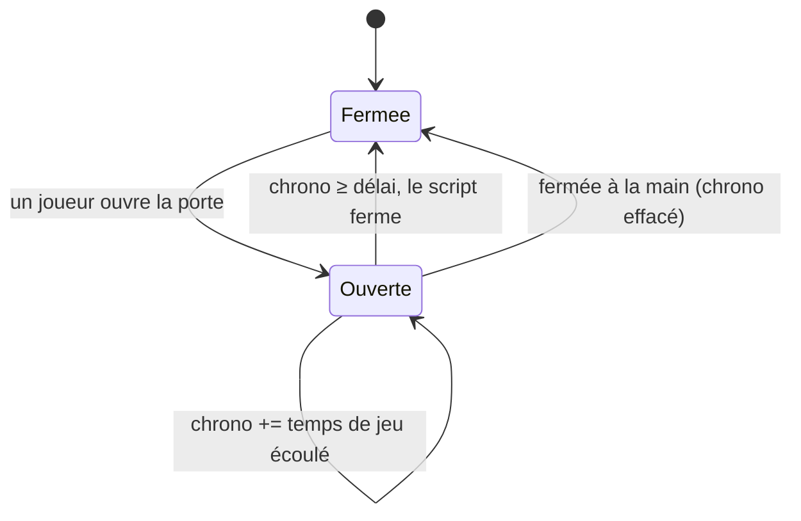

# Fermeture Automatique des Portes

> [!summary] Résumé
> Referme automatiquement les portes restées ouvertes plus de 2 secondes (délai réglable par porte avec `[Auto:5]`). Cette version ne referme plus les portes de hangar, ne rescanne plus la grille à chaque exécution, chronomètre en temps de jeu et ignore les vaisseaux amarrés, les portes `[NoAuto]` et les portes de sas.

## 1. Prérequis en jeu

- Un **Bloc Programmable** sur la construction dont les portes doivent être gérées.
- Aucune balise n'est obligatoire : toutes les portes (portes simples, coulissantes, portails...) de la construction sont gérées par défaut.

Balises optionnelles, à placer **dans le nom** de la porte (majuscules indifférentes) :

| Balise | Effet | Exemple |
|---|---|---|
| *(aucune)* | Refermée après le délai par défaut (2 s) | `Porte Cuisine` |
| `[NoAuto]` | Jamais refermée par ce script | `Porte Atelier [NoAuto]` |
| `[Auto:x]` | Refermée après `x` secondes (`2.5` ou `2,5` acceptés, de 0,5 à 3600 s) | `Porte Hangar [Auto:30]` |
| `[SAS-...]` | Ignorée : gérée par [[Sas Automatique (Airlock)]] | `Porte [SAS-Hangar-int]` |

> [!info] Portes de hangar
> Les portes de hangar sont **ignorées par défaut** (sinon elles se refermeraient sur un vaisseau en pleine manœuvre). Pour en gérer une seule, donnez-lui une balise `[Auto:x]` (ex. `[Auto:30]`). Pour toutes les gérer, passez `INCLURE_PORTES_HANGAR` à `true`.

Aucun Custom Data n'est nécessaire.

## 2. Installation

1. Construisez un **Bloc Programmable**.
2. Ouvrez-le → **Modifier**, collez le code de la section 9 (ou du fichier `FermeturePortes.cs`).
3. Cliquez sur **Vérifier le code**, puis **OK**. Le script démarre seul.
4. Lisez la console : nombre de portes gérées / ignorées et éventuels avertissements (balise `[Auto:` illisible).
5. Ajoutez `[NoAuto]` ou `[Auto:x]` aux portes qui le nécessitent ; le script les prend en compte en 10 s au plus (ou tout de suite avec `rescan`).

## 3. Configuration

| Constante | Défaut | Effet |
|---|---|---|
| `DELAI_PAR_DEFAUT_S` | `2.0` | Délai (secondes de jeu) avant fermeture d'une porte sans balise `[Auto:x]`. |
| `DELAI_MINIMUM_S` | `0.5` | Délai `[Auto:x]` minimal accepté. |
| `DELAI_MAXIMUM_S` | `3600.0` | Délai `[Auto:x]` maximal accepté. |
| `INCLURE_PORTES_HANGAR` | `false` | `true` : les portes de hangar sont gérées comme les autres. |
| `SEULEMENT_CETTE_CONSTRUCTION` | `true` | Ignore les portes d'un vaisseau amarré par connecteur. |
| `INTERVALLE_RESCAN_S` | `10.0` | Fréquence du rescan automatique de la liste des portes. |
| `BALISE_SAS` | `"[SAS-"` | Balise des portes de sas, toujours ignorées. |
| `BALISE_EXCLUSION` | `"[NoAuto]"` | Balise d'exclusion. |
| `PREFIXE_BALISE_DELAI` | `"[Auto:"` | Début de la balise de délai personnalisé. |

Custom Data : aucun. Le **Storage** du Bloc Programmable mémorise uniquement l'état « pause ».

## 4. Commandes

| Argument | Effet |
|---|---|
| `rescan` | Relit immédiatement la liste des portes et leurs balises. |
| `pause` ou `off` | Suspend la fermeture automatique. Le script ne tourne plus du tout (coût nul). L'état est conservé à la sauvegarde de la partie. |
| `reprise` ou `on` | Relance la fermeture automatique (et rescanne les portes). |

> [!tip] Lier une commande à un bouton
> Panneau de boutons → **Configurer les actions** → glissez le Bloc Programmable sur un bouton → action **Exécuter** (Run) → tapez l'argument (`pause`, `reprise`...). Exemple : un bouton « Chargement » qui met en `pause` pendant que vous déchargez, puis `reprise`.

## 5. Fonctionnement

### Algorithme (en français)

1. **Scan** (au démarrage, toutes les 10 s, sur `rescan`, ou dès qu'une porte disparue est détectée) : le script récupère les portes de la construction et les met en cache, en écartant les portes `[SAS-`, `[NoAuto]` et les portes de hangar (sauf `[Auto:x]` ou `INCLURE_PORTES_HANGAR`). Le délai de chaque porte est lu **une seule fois** à ce moment. Les chronomètres des portes qui ne sont plus gérées sont supprimés.
2. **Surveillance** (~6 fois par seconde) : pour chaque porte en cache :
   - ouverte ou en ouverture → son chronomètre (indexé par `EntityId`) augmente du **temps de jeu** écoulé (`Runtime.TimeSinceLastRun`) ;
   - chronomètre ≥ délai → on vérifie que la porte existe encore, puis on la referme et on efface le chronomètre ;
   - fermée ou en fermeture → le chronomètre est effacé.
3. **Pause** : le script passe en `UpdateFrequency.None` ; seul un argument (bouton) le réveille.



## 6. Optimisations et corrections par rapport à l'original

| Problème d'origine | Conséquence en jeu | Correction |
|---|---|---|
| `IMyAirtightHangarDoor` hérite de `IMyDoor` | Les **portes de hangar** se refermaient au bout de 2 s, sur un vaisseau en manœuvre | Exclues par défaut ; `INCLURE_PORTES_HANGAR` ou `[Auto:x]` pour les inclure |
| `GetBlocksOfType<IMyDoor>` + nouvelle liste à **chaque** exécution | Coût permanent proportionnel à la taille de la grille, 6 fois par seconde | Cache + rescan toutes les 10 s + commande `rescan` ; listes réutilisées |
| `DateTime.Now` (horloge réelle) | Délai faux si le serveur ralentit ; une partie en pause « consomme » le délai | Temps de jeu cumulé via `Runtime.TimeSinceLastRun` |
| Dictionnaire indexé par l'**objet** porte, jamais nettoyé | Entrées fantômes de portes détruites | Indexé par `EntityId` (long) ; nettoyage au rescan ; vérification `GetBlockWithId` avant d'agir |
| Aucun filtre de construction | Fermait les portes d'un **vaisseau amarré** (y compris d'un autre joueur) | `IsSameConstructAs(Me)` (`SEULEMENT_CETTE_CONSTRUCTION`) |
| Aucun moyen d'exclure une porte | Impossible de garder une porte ouverte | Balise `[NoAuto]` |
| Délai unique de 2 s codé en dur | Trop court pour certaines portes (soute, hangar) | Constante `DELAI_PAR_DEFAUT_S` + balise `[Auto:x]` par porte, parsing tolérant (virgule / point, casse, bornes, avertissement si illisible) |
| Balise `[SAS-` | (déjà correct) | Conservée : compatibilité avec [[Sas Automatique (Airlock)]] |
| Aucune commande | Impossible de suspendre le script | `pause`/`off`, `reprise`/`on`, `rescan` ; pause mémorisée dans `Storage` |
| Aucune information en console | Diagnostic impossible | Echo : état, portes gérées / ignorées / suivies, temps d'exécution, avertissements |

## 7. Limites connues

- Précision : le délai démarre à la première exécution où la porte est vue ouverte, soit une erreur d'environ 1/6 s (exécution `Update10`).
- Une porte éteinte (`Enabled = false`) ne peut pas être refermée : le script réessaie à chaque délai sans effet.
- Les balises sont lues au scan : un renommage est pris en compte au plus 10 s plus tard (ou avec `rescan`).
- Les portes de sas sont reconnues uniquement par la balise `[SAS-` (sensible à la casse, comme dans [[Sas Automatique (Airlock)]]).
- La lecture des décimales utilise `System.Globalization.CultureInfo.InvariantCulture` ; c'est un usage courant dans les scripts de Bloc Programmable, mais il n'est pas listé dans les API sûres du cahier des charges. Si la compilation le refusait, remplacer par `double.TryParse(texteDelai, out delai)` (le point décimal dépendrait alors de la langue du serveur).

## 8. Dépannage

| Symptôme | Cause probable | Solution |
|---|---|---|
| Une porte ne se referme pas | Balise `[NoAuto]` ou `[SAS-`, porte de hangar, autre construction, ou script en pause | Vérifier le nom et la console ; `reprise` ; `rescan` |
| Une porte de hangar ne se referme pas | Exclue par défaut | Ajouter `[Auto:30]` à son nom, ou `INCLURE_PORTES_HANGAR = true` |
| « Attention : ... délai illisible » | Balise du type `[Auto:abc]` | Écrire un nombre : `[Auto:5]`, `[Auto:2.5]` |
| « Attention : ... délai hors bornes » | Délai inférieur à 0,5 s ou supérieur à 3600 s | Corriger la valeur ou les constantes `DELAI_MINIMUM_S` / `DELAI_MAXIMUM_S` |
| Une nouvelle porte n'est pas gérée tout de suite | Rescan périodique (10 s) | Attendre ou lancer `rescan` |
| Le script ne fait plus rien après rechargement | Il était en pause (mémorisée) | Lancer `reprise` |
| Une porte de sas se referme toute seule | Balise différente de `[SAS-` | Respecter la nomenclature de [[Sas Automatique (Airlock)]] |

## 9. Code complet

```csharp
// ==============================================================================
// FERMETURE AUTOMATIQUE DES PORTES - VERSION OPTIMISÉE (FermeturePortes.cs)
// ------------------------------------------------------------------------------
// Rôle :
//   Referme automatiquement toute porte restée ouverte plus de N secondes
//   (2 s par défaut), pour limiter les pertes d'air et les oublis.
//
// Nomenclature (balises dans le NOM de la porte, majuscules indifférentes) :
//   (aucune balise)  : porte gérée, délai par défaut (DELAI_PAR_DEFAUT_S)
//   [NoAuto]         : porte jamais refermée par ce script
//   [Auto:5]         : délai personnalisé en secondes (décimales acceptées :
//                      [Auto:2.5] ou [Auto:2,5]). Force aussi la gestion d'une
//                      porte de hangar.
//   [SAS-...]        : porte de sas, toujours ignorée (gérée par le script
//                      « Sas Automatique (Airlock) »)
//   Portes de hangar : ignorées par défaut (voir INCLURE_PORTES_HANGAR).
//
// Commandes (argument du Bloc Programmable) :
//   rescan          : relit immédiatement la liste des portes
//   pause  ou off   : suspend la fermeture automatique (mémorisé à la sauvegarde)
//   reprise ou on   : relance la fermeture automatique
//
// Dépendances : aucune.
// ==============================================================================

// ------------------------------------------------------------------------------
// CONSTANTES DE CONFIGURATION
// ------------------------------------------------------------------------------

// Délai (en secondes de jeu) avant fermeture d'une porte sans balise [Auto:x].
const double DELAI_PAR_DEFAUT_S = 2.0;

// Bornes acceptées pour un délai personnalisé [Auto:x] (hors bornes = délai par défaut).
const double DELAI_MINIMUM_S = 0.5;
const double DELAI_MAXIMUM_S = 3600.0;

// false : les portes de hangar (IMyAirtightHangarDoor) sont ignorées, sauf si
// elles portent une balise [Auto:x]. true : elles sont gérées comme les autres.
const bool INCLURE_PORTES_HANGAR = false;

// true : ne gère que les portes de CETTE construction (pas celles d'un vaisseau
// amarré par connecteur).
const bool SEULEMENT_CETTE_CONSTRUCTION = true;

// Intervalle (en secondes) du rescan automatique de la liste des portes.
const double INTERVALLE_RESCAN_S = 10.0;

// Balises reconnues dans le nom des portes.
const string BALISE_SAS = "[SAS-";
const string BALISE_EXCLUSION = "[NoAuto]";
const string PREFIXE_BALISE_DELAI = "[Auto:";

// ------------------------------------------------------------------------------
// DONNÉES
// ------------------------------------------------------------------------------

/// <summary>
/// Une porte gérée et son délai de fermeture (lu une fois au scan, pas à chaque
/// exécution : le nom n'est pas réanalysé en permanence).
/// </summary>
class PorteSuivie
{
    public IMyDoor Porte;
    public double DelaiSecondes;
}

// Cache des portes gérées (rempli par le scan, pas à chaque exécution).
List<PorteSuivie> portesGerees = new List<PorteSuivie>();

// Temps d'ouverture accumulé (secondes de jeu), indexé par l'EntityId de la porte.
// Un identifiant (long) est une clé stable et légère, contrairement à l'objet porte.
Dictionary<long, double> tempsOuverture = new Dictionary<long, double>();

// Collections réutilisées (pas d'allocation à chaque exécution).
List<IMyDoor> portesBrutes = new List<IMyDoor>();
HashSet<long> identifiantsPresents = new HashSet<long>();
List<long> identifiantsASupprimer = new List<long>();
StringBuilder texteConsole = new StringBuilder();

// Statistiques du dernier scan (pour la console).
int nombreExclues = 0;
List<string> avertissements = new List<string>();

// État général.
bool enPause = false;
double chronoRescan = 0;
string messageCommande = "";

/// <summary>
/// Constructeur : relit l'état « pause » sauvegardé, puis scanne les portes.
/// </summary>
public Program()
{
    enPause = (Storage == "pause");
    AppliquerFrequence();
    ScannerLesPortes();
}

/// <summary>
/// Sauvegarde : mémorise la pause pour qu'elle survive au rechargement de la partie.
/// </summary>
public void Save()
{
    Storage = enPause ? "pause" : "";
}

/// <summary>
/// En pause, le script ne tourne plus du tout (UpdateFrequency.None) : coût nul.
/// Il reste exécutable par un bouton (argument « reprise »).
/// </summary>
void AppliquerFrequence()
{
    Runtime.UpdateFrequency = enPause ? UpdateFrequency.None : UpdateFrequency.Update10;
}

/// <summary>
/// Point d'entrée : exécuté ~6 fois par seconde (Update10) ou par un bouton.
/// </summary>
public void Main(string argument, UpdateType updateSource)
{
    // Temps de JEU écoulé depuis la dernière exécution. Contrairement à
    // DateTime.Now (horloge réelle), il suit les ralentissements du serveur.
    double secondesEcoulees = Runtime.TimeSinceLastRun.TotalSeconds;

    if (!string.IsNullOrWhiteSpace(argument)) TraiterCommande(argument);

    if (!enPause)
    {
        chronoRescan += secondesEcoulees;
        if (chronoRescan >= INTERVALLE_RESCAN_S) ScannerLesPortes();
        SurveillerLesPortes(secondesEcoulees);
    }

    AfficherConsole();
}

/// <summary>
/// Pour chaque porte en cache : cumule son temps d'ouverture et la referme
/// une fois son délai atteint. Une porte refermée perd son chronomètre.
/// </summary>
void SurveillerLesPortes(double secondesEcoulees)
{
    bool porteDisparue = false;

    foreach (PorteSuivie suivie in portesGerees)
    {
        IMyDoor porte = suivie.Porte;
        long identifiant = porte.EntityId;
        DoorStatus statut = porte.Status;

        if (statut == DoorStatus.Opening || statut == DoorStatus.Open)
        {
            double temps;
            if (!tempsOuverture.TryGetValue(identifiant, out temps))
            {
                // Première exécution où la porte est vue ouverte : chrono à zéro.
                tempsOuverture[identifiant] = 0;
                continue;
            }

            temps += secondesEcoulees;
            if (temps < suivie.DelaiSecondes)
            {
                tempsOuverture[identifiant] = temps;
                continue;
            }

            // Délai atteint. On vérifie que la porte existe encore avant d'agir
            // (détruite / démontée depuis le dernier scan ?). Ce contrôle n'est fait
            // qu'ici, au moment d'agir, pour rester léger.
            if (GridTerminalSystem.GetBlockWithId(identifiant) == null)
            {
                porteDisparue = true;
            }
            else
            {
                porte.CloseDoor();
            }
            tempsOuverture.Remove(identifiant);
        }
        else if (tempsOuverture.ContainsKey(identifiant))
        {
            // Fermée ou en fermeture (par le joueur ou par nous) : fin du suivi.
            tempsOuverture.Remove(identifiant);
        }
    }

    // Une porte a disparu : on rescanne tout de suite (hors de la boucle,
    // car le scan modifie la liste parcourue).
    if (porteDisparue) ScannerLesPortes();
}

// ------------------------------------------------------------------------------
// SCAN DES PORTES
// ------------------------------------------------------------------------------

/// <summary>
/// Filtre du système de grille : même construction uniquement (si demandé).
/// </summary>
bool ConserverCettePorte(IMyDoor porte)
{
    return !SEULEMENT_CETTE_CONSTRUCTION || porte.IsSameConstructAs(Me);
}

/// <summary>
/// Reconstruit le cache des portes gérées, lit leurs balises, puis nettoie les
/// chronomètres des portes qui ne sont plus gérées (disparues ou exclues).
/// </summary>
void ScannerLesPortes()
{
    portesBrutes.Clear();
    portesGerees.Clear();
    identifiantsPresents.Clear();
    avertissements.Clear();
    nombreExclues = 0;

    GridTerminalSystem.GetBlocksOfType<IMyDoor>(portesBrutes, ConserverCettePorte);

    foreach (IMyDoor porte in portesBrutes)
    {
        string nom = porte.CustomName;

        // 1. Exclusions explicites : portes de sas et balise [NoAuto].
        if (nom.Contains(BALISE_SAS)
            || nom.IndexOf(BALISE_EXCLUSION, StringComparison.OrdinalIgnoreCase) >= 0)
        {
            nombreExclues++;
            continue;
        }

        // 2. Délai : balise [Auto:x] ou délai par défaut.
        bool baliseDelaiPresente;
        double delai = LireDelai(nom, out baliseDelaiPresente);

        // 3. Portes de hangar : ignorées par défaut, sauf balise [Auto:x] explicite.
        //    Pourquoi : IMyAirtightHangarDoor hérite de IMyDoor, l'original les
        //    refermait donc au bout de 2 s (vaisseau coincé en plein passage).
        if (porte is IMyAirtightHangarDoor && !INCLURE_PORTES_HANGAR && !baliseDelaiPresente)
        {
            nombreExclues++;
            continue;
        }

        PorteSuivie suivie = new PorteSuivie();
        suivie.Porte = porte;
        suivie.DelaiSecondes = delai;
        portesGerees.Add(suivie);
        identifiantsPresents.Add(porte.EntityId);
    }

    // Nettoyage : chronomètres des portes qui ne sont plus gérées.
    identifiantsASupprimer.Clear();
    foreach (long identifiant in tempsOuverture.Keys)
    {
        if (!identifiantsPresents.Contains(identifiant)) identifiantsASupprimer.Add(identifiant);
    }
    foreach (long identifiant in identifiantsASupprimer)
    {
        tempsOuverture.Remove(identifiant);
    }

    chronoRescan = 0;
}

/// <summary>
/// Lit la balise [Auto:x] dans le nom de la porte et renvoie le délai en secondes.
/// Parsing robuste : casse ignorée, virgule ou point décimal, espaces tolérés.
/// Valeur absente, illisible ou hors bornes -> délai par défaut (+ avertissement).
/// </summary>
/// <param name="baliseTrouvee">Vrai si une balise [Auto:...] VALIDE est présente.</param>
double LireDelai(string nom, out bool baliseTrouvee)
{
    baliseTrouvee = false;

    int indexDebut = nom.IndexOf(PREFIXE_BALISE_DELAI, StringComparison.OrdinalIgnoreCase);
    if (indexDebut < 0) return DELAI_PAR_DEFAUT_S;
    indexDebut += PREFIXE_BALISE_DELAI.Length;

    int indexFin = nom.IndexOf(']', indexDebut);
    if (indexFin < 0)
    {
        avertissements.Add(nom + " : balise [Auto: non fermée");
        return DELAI_PAR_DEFAUT_S;
    }

    // "2,5" et "2.5" sont acceptés : on normalise sur le point, puis on lit avec
    // la culture invariante (indépendante de la langue du jeu / du serveur).
    string texteDelai = nom.Substring(indexDebut, indexFin - indexDebut).Trim().Replace(',', '.');
    double delai;
    if (!double.TryParse(texteDelai, System.Globalization.NumberStyles.Float,
                         System.Globalization.CultureInfo.InvariantCulture, out delai))
    {
        avertissements.Add(nom + " : délai illisible");
        return DELAI_PAR_DEFAUT_S;
    }
    if (delai < DELAI_MINIMUM_S || delai > DELAI_MAXIMUM_S)
    {
        avertissements.Add(nom + " : délai hors bornes (" + DELAI_MINIMUM_S + " à " + DELAI_MAXIMUM_S + " s)");
        return DELAI_PAR_DEFAUT_S;
    }

    baliseTrouvee = true;
    return delai;
}

// ------------------------------------------------------------------------------
// COMMANDES ET CONSOLE
// ------------------------------------------------------------------------------

/// <summary>
/// Interprète l'argument reçu (bouton, barre d'outils, terminal).
/// </summary>
void TraiterCommande(string argument)
{
    string commande = argument.Trim().ToLower();

    if (commande == "rescan")
    {
        ScannerLesPortes();
        messageCommande = "Scan forcé terminé.";
    }
    else if (commande == "pause" || commande == "off")
    {
        enPause = true;
        tempsOuverture.Clear(); // On repartira de zéro à la reprise.
        AppliquerFrequence();
        messageCommande = "Fermeture automatique en PAUSE.";
    }
    else if (commande == "reprise" || commande == "on")
    {
        enPause = false;
        AppliquerFrequence();
        ScannerLesPortes(); // Des portes ont pu changer pendant la pause.
        messageCommande = "Fermeture automatique RELANCÉE.";
    }
    else
    {
        messageCommande = "Commande inconnue : « " + argument.Trim() + " » (rescan, pause/off, reprise/on).";
    }
}

/// <summary>
/// Résumé court dans la console du Bloc Programmable.
/// </summary>
void AfficherConsole()
{
    texteConsole.Clear();
    texteConsole.Append("Fermeture auto des portes : ").Append(enPause ? "EN PAUSE" : "ACTIVE").Append("\n");
    texteConsole.Append("Portes gérées : ").Append(portesGerees.Count)
                .Append(" | ignorées : ").Append(nombreExclues)
                .Append(" | ouvertes suivies : ").Append(tempsOuverture.Count).Append("\n");
    texteConsole.Append("Exécution : ").Append(Runtime.LastRunTimeMs.ToString("0.000")).Append(" ms\n");
    foreach (string avertissement in avertissements)
    {
        texteConsole.Append("Attention : ").Append(avertissement).Append("\n");
    }
    if (messageCommande != "") texteConsole.Append("Dernière commande : ").Append(messageCommande).Append("\n");
    Echo(texteConsole.ToString());
}
```

## Voir aussi

- [[fermeture des porte]] — note d'origine
- [[Sas Automatique (Airlock)]] — gestion des sas (ses portes `[SAS-` sont ignorées ici)
- [[Gestionnaire de Sas (Airlock) Intelligent]] — version d'origine du gestionnaire de sas
