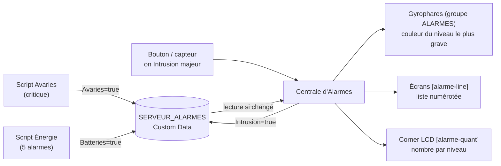
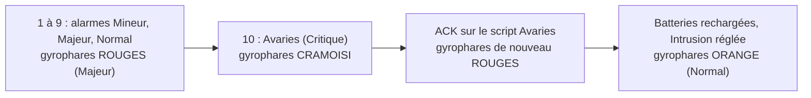

# Centrale d'Alarmes

> [!summary] Résumé
> Un bloc programmable unique pilote **tous** les gyrophares de la base (groupe `ALARMES`) à partir du [[Bus d'Alarmes]]. Les gyrophares prennent la couleur du **niveau le plus grave** parmi les alarmes actives : Critique (cramoisi) > Majeur (rouge) > Normal (orange) > Mineur (cyan). Les écrans `[alarme-line]` affichent la liste numérotée des alarmes, et les écrans `[alarme-quant]` (corner LCD compris) leur nombre par niveau, en cases colorées. Pour ajouter une alarme, il suffit d'un script qui publie dans le bus, ou d'un bouton qui lance `on <Source> <niveau>` : ce script n'est pas modifié.

Retour au [[00 - Sommaire]].

---

## 1. Comment ça marche, en bref

Trois rôles bien séparés :

| Qui | Rôle |
|---|---|
| **Scripts d'alarme** ([[Controle des Avaries]], [[Surveillance Carburant Uranium]], futurs scripts) | détectent un problème et écrivent `true` / `false` dans le bus, avec leur criticité. Ils ne touchent plus aux gyrophares. |
| **`SERVEUR_ALARMES`** | bloc **passif** : son Custom Data sert de tableau commun (états, criticités, couleurs des niveaux). Voir [[Bus d'Alarmes]]. |
| **Centrale d'Alarmes** (ce script) | lit le tableau ~6 fois par seconde et pilote tout : gyrophares, écrans de liste, corner LCD. |



### La criticité est la priorité

- **4 niveaux**, du plus grave au moins grave : **Critique**, **Majeur**, **Normal**, **Mineur**. Plusieurs alarmes peuvent avoir le même niveau.
- **La couleur des gyrophares est celle du niveau le plus grave** parmi les alarmes actives. Deux alarmes « Majeur » donnent le même rouge.
- **Dans la liste**, les alarmes sont rangées par niveau, puis, à niveau égal, par **ordre d'arrivée** (la plus ancienne d'abord). Le numéro affiché devant chaque alarme est sa priorité.
- Une alarme qui s'éteint puis se rallume repasse **derrière** les alarmes déjà présentes de son niveau.
- Un script peut joindre un **détail** à son alarme (`[Detail]` du bus) : il s'affiche après le nom, par exemple `1. [MAJEUR] Energie : Carburant + Uranium` (voir [[Surveillance Carburant Uranium]], dont l'alarme `Energie` monte en criticité quand plusieurs ressources manquent).

## 2. Exemple de scénario

Dix alarmes arrivent l'une après l'autre (les noms sont des exemples : `Avaries` et `Batteries` viennent des scripts, les autres de boutons, capteurs ou futurs scripts) :

| Ordre d'arrivée | Alarme | Criticité | Priorité affichée |
|---|---|---|---|
| 1 | O2 bas | Mineur | 6 |
| 2 | Batteries | Majeur | 2 |
| 3 | Sas ouvert | Mineur | 7 |
| 4 | Porte hangar | Normal | 4 |
| 5 | Plaques d'acier | Normal | 5 |
| 6 | Intrusion | Majeur | 3 |
| 7 | Antenne coupée | Mineur | 8 |
| 8 | Fer bas | Mineur | 9 |
| 9 | Soute pleine | Mineur | 10 |
| 10 | Avaries | Critique | 1 |



**Après la 10ᵉ alarme**, les gyrophares sont **cramoisi**, et les écrans affichent :

Écran `[alarme-line]` :

```
=== ALARMES ===
Actives : 10 / 10

1. [CRITIQUE] Avaries
2. [MAJEUR] Batteries
3. [MAJEUR] Intrusion
4. [NORMAL] Porte hangar
5. [NORMAL] Plaques d'acier
6. [MINEUR] O2 bas
7. [MINEUR] Sas ouvert
8. [MINEUR] Antenne coupée
9. [MINEUR] Fer bas
10. [MINEUR] Soute pleine
```

Corner LCD `[alarme-quant]` (une case par niveau, dans sa couleur) :

```
[   1    ] [   2    ] [   2    ] [   5    ]
 Critique    Majeur     Normal     Mineur
```

**Ensuite** :
- `ACK` sur le script d'avaries : `Avaries` repasse à `false`. Le niveau le plus grave devient Majeur : les gyrophares passent au **rouge**, et `Batteries` prend la priorité 1.
- Les batteries se rechargent et l'intrusion est réglée (`off Intrusion`) : il ne reste que des alarmes Normal et Mineur, les gyrophares passent à l'**orange**.
- `O2 bas` s'éteint puis se rallume : elle repasse **derrière** `Soute pleine`, en dernière position des Mineur.

## 3. Prérequis en jeu

| Élément | Nom / configuration | Obligatoire ? |
|---|---|---|
| Bloc programmable | n'importe quel nom ; contient ce script | oui |
| Serveur d'alarmes | bloc nommé `SERVEUR_ALARMES`, voir [[Bus d'Alarmes]] | **oui** (sans lui, aucune alarme n'est connue) |
| Groupe d'alarme | groupe nommé **exactement** `ALARMES` (gyrophares, lumières, blocs sonores...) | non (Echo le signale) |
| Écran liste | nom du bloc contenant `[alarme-line]` | non |
| Écran compteurs | nom du bloc contenant `[alarme-quant]` (idéal pour un corner LCD) | non |
| Scripts sources | [[Controle des Avaries]], [[Surveillance Carburant Uranium]], ou tout script qui publie dans le bus | non (les commandes `on` / `off` suffisent pour une alarme sans script) |

## 4. Installation

1. Créer le bloc `SERVEUR_ALARMES` et coller le contenu de `SERVEUR_ALARMES.ini` dans son Custom Data (voir [[Bus d'Alarmes]]).
2. Construire un **Bloc Programmable**, coller le code de la section [[#11. Code complet]], cliquer sur **« Vérifier le code »** puis **« OK »**.
3. Sélectionner tous les gyrophares, lumières et blocs sonores d'alarme et créer le groupe `ALARMES`.
4. **Retirer ces blocs des groupes `ALARMES_CRITIQUES` et `ALARMES_URANIUM`** (ou supprimer ces groupes) : les scripts sources ne doivent plus les piloter (voir la section 9).
5. Facultatif : ajouter `[alarme-line]` ou `[alarme-quant]` au nom d'un écran (ex. `LCD Pont [alarme-line]`, `Corner Sas [alarme-quant]`).

## 5. Configuration

### 5.1 Constantes (en tête du script)

| Constante | Défaut | Rôle |
|---|---|---|
| `SEULEMENT_CETTE_CONSTRUCTION` | `true` | ignore le serveur, les blocs et les écrans des vaisseaux amarrés |
| `NOM_GROUPE_ALARMES` | `"ALARMES"` | groupe piloté |
| `BALISE_LISTE` / `BALISE_QUANTITE` | `"[alarme-line"` / `"[alarme-quant"` | balises des noms d'écrans (sans le `]` final) |
| `INTERVALLE_RESCAN_SECONDES` | `10` | relecture automatique du groupe et des écrans |
| `MAX_LIGNES_LISTE` | `15` | alarmes listées au maximum (« ... et N autres » ensuite) |
| `COLORER_TEXTE_ECRANS` | `true` | le texte des écrans `[alarme-line]` prend la couleur du niveau le plus grave (blanc au repos) |
| `COULEURS_CRITICITE` | cramoisi `220,20,60`, rouge `255,0,0`, orange `255,140,0`, cyan `0,255,255` | couleurs par défaut des niveaux, si `[Couleurs]` du bus ne les redéfinit pas |
| `ATTENUATION_CASE_VIDE` | `0.18` | luminosité d'une case `[alarme-quant]` à 0 alarme (0 = noire) |

Les couleurs se changent de préférence **dans le bus** (`[Couleurs] Critique=R,G,B`...) : la Centrale et les scripts sources les lisent tous.

### 5.2 Ajouter une alarme

- **Avec un script** : il copie la classe `BusAlarmes` telle quelle, appelle `Publier(source, besoin, niveau, détail)` pour chacune de ses alarmes, puis `Terminer()`. `[Etat]`, `[Criticite]` et `[Detail]` sont écrits automatiquement. Voir [[Bus d'Alarmes]].
- **Sans script** : un bouton, un capteur ou une minuterie lance la Centrale avec l'argument `on Intrusion majeur`, puis `off Intrusion`. Le niveau est facultatif : sans lui, la ligne `[Criticite]` existante est gardée (ou `normal` si elle n'existe pas).

Pour changer le niveau d'une alarme, modifiez sa ligne dans `[Criticite]` : `critique`, `majeur`, `normal` ou `mineur` (les anciens mots `importante`, `normale` et `basse` sont toujours compris).

### 5.3 Filtre par gyrophare (optionnel)

Un bloc du groupe `ALARMES` peut ne réagir qu'à certaines alarmes. Dans **son** Custom Data :

```ini
[Alarme]
Sources=Carburant
```

Exemple : les lumières de la salle des réacteurs ne s'allument que pour le carburant, dans la couleur du niveau du carburant, même si une avarie est en cours. Sans section `[Alarme]`, le bloc réagit à toutes les alarmes.

### 5.4 Écrans

| Balise dans le nom | Affichage |
|---|---|
| `[alarme-line]` | nombre d'alarmes actives, puis la liste numérotée par priorité, avec le détail éventuel : `1. [CRITIQUE] Avaries`, `2. [MAJEUR] Energie : Carburant + Uranium` |
| `[alarme-quant]` | 4 cases colorées avec le nombre d'alarmes par niveau : Critique (cramoisi), Majeur (rouge), Normal (orange), Mineur (cyan) |
| `[alarme-line:1]`, `[alarme-quant:2]`... | même chose sur la surface n° 1, 2... d'un cockpit ou d'un bloc programmable |

Un même bloc à plusieurs surfaces peut porter les deux balises (ex. `Cockpit [alarme-line:0] [alarme-quant:1]`).

> [!warning] Un écran = un seul script
> Ces écrans sont repérés par leur **nom**. Ne leur mettez pas de section `[Ecran]` dans le Custom Data, sinon [[Affichage Data Center]] les capturerait aussi (voir [[00 - Conventions et Playbook IA]]).

Les cases de `[alarme-quant]` sont dessinées en sprites, et leur disposition suit la forme de l'écran :

| Forme de la surface | Disposition | Exemple |
|---|---|---|
| très large (largeur ≥ 2,5 × hauteur) | 4 cases en ligne | **corner LCD**, écran large |
| à peu près carrée | 2 × 2 | LCD standard, écran de cockpit |
| très haute | 4 cases en colonne | surface étroite |

Chaque case affiche le nombre en grand et le niveau en dessous, à la plus grande taille qui tient. Une case à 0 alarme est assombrie : seuls les niveaux actifs ressortent. Si le bus est indisponible, les cases affichent `-`.

## 6. Commandes

| Argument | Effet |
|---|---|
| `on <Source>` | met `[Etat] <Source>=true` dans le bus (alarme sans script : bouton, capteur, minuterie) |
| `on <Source> <niveau>` | idem, et écrit `[Criticite] <Source>=<niveau>` (`critique`, `majeur`, `normal`, `mineur`) |
| `off <Source>` | met `[Etat] <Source>=false` |
| `rescan` | relit immédiatement le serveur, le groupe `ALARMES` et les écrans |

Le nom de la source n'est pas sensible aux majuscules : `on intrusion` réutilise la clé `Intrusion` si elle existe déjà.

> [!warning] `on` / `off` sur une source qui a un script
> Si un script publie déjà cette source (ex. `Avaries`), il réécrira sa propre valeur à sa prochaine exécution (~1,6 s). Pour acquitter une alarme de script, utilisez `ACK` **sur ce script**.

## 7. Fonctionnement

### Algorithme en français

1. **Fréquence** : le script tourne en `Update10` (~6 fois par seconde). Une alarme publiée ou une commande `on` / `off` est donc visible presque immédiatement.
2. **Rescan** (au démarrage, toutes les 10 s, ou avec `rescan`) : recherche du serveur, du groupe `ALARMES` (avec le filtre `[Alarme] Sources` de chaque bloc) et des écrans à balise. Les blocs et écrans déjà connus sont **réutilisés**, pour garder leur dernier état.
3. **Lecture du bus** : à chaque exécution, le Custom Data du serveur est comparé au dernier texte lu. Il n'est **reparsé que s'il a changé**. Le script relit alors les couleurs des niveaux, donne un numéro d'arrivée à chaque alarme qui vient de passer à `true`, retire le numéro de celles qui sont repassées à `false`, et trie la liste : niveau, puis ordre d'arrivée.
4. **Application** (seulement si le bus a changé ou après un rescan) :
   - chaque bloc du groupe prend la **première alarme de la liste acceptée par son filtre** : il est allumé, dans la couleur du niveau de cette alarme, ou éteint s'il n'y en a aucune ;
   - un bloc sonore n'est lancé (`Play`) ou arrêté (`Stop`) que quand **son** état change ;
   - les écrans ne sont réécrits ou redessinés que si leur contenu a changé.
5. **Sauvegarde** : l'ordre d'arrivée est enregistré dans le `Storage` du bloc programmable (`Save()`), il survit donc au rechargement de la partie.
6. **Echo** : état du bus, niveau dominant, nombre de blocs et d'écrans, temps d'exécution.

## 8. Pourquoi une Centrale ?

| Sans Centrale | Avec la Centrale |
|---|---|
| Chaque script pilote **son** groupe (`ALARMES_CRITIQUES`, `ALARMES_URANIUM`) | Un seul pilote, un seul groupe `ALARMES` |
| Un gyrophare commun doit être dans plusieurs groupes | Chaque gyrophare est dans un seul groupe, avec un filtre optionnel |
| Une nouvelle alarme demande un script **et** un groupe | Une nouvelle alarme = un script **ou** un bouton `on` / `off` |
| Un bloc sonore commun peut redémarrer (deux scripts appellent `Play()`) | Un seul appel à `Play()` par bloc et par changement d'état |
| Aucune vue d'ensemble | Écrans `[alarme-line]` et `[alarme-quant]` |

> [!info] Et le clignotement par couleur ?
> Une rotation des couleurs (1 s par alarme) a été envisagée puis écartée au profit de la couleur fixe du niveau le plus grave et des écrans de liste : c'est plus lisible, et ça ne fait pas « sapin de Noël ».

Optimisations :
- **Bus reparsé seulement s'il change** : à chaque exécution, une simple comparaison de chaînes. Les scripts sources n'écrivent dans le bus que si leur valeur change.
- **Application seulement sur changement** : chaque écriture (`Enabled`, `Color`, `WriteText`, `FontColor`, dessin des cases) n'a lieu que si la valeur diffère.
- **Pas d'allocation en régime établi** : `MyIni`, listes, `StringBuilder`, objets `SourceAlarme` (réserve) et comparateur de tri sont réutilisés.

## 9. Limites connues

- **Ne laissez pas un bloc à la fois dans `ALARMES` et dans `ALARMES_CRITIQUES` / `ALARMES_URANIUM`.** Les scripts sources continuent de piloter leurs anciens groupes s'ils existent ; un bloc *filtré* (`[Alarme] Sources=`) peut alors recevoir deux couleurs différentes.
- Une source restée à `true` (script supprimé, `on` sans `off`) maintient l'alarme : `off <Source>`, ou supprimer la clé.
- Si plusieurs alarmes apparaissent entre deux lectures du bus (moins de 0,2 s), elles sont numérotées dans l'ordre des clés de `[Etat]`.
- Le texte des écrans `[alarme-line]` est recoloré (`COLORER_TEXTE_ECRANS`) : la couleur de police choisie à la main est écrasée.
- Les écrans `[alarme-quant]` sont dessinés en sprites, donc leur réglage de texte (police, taille) est ignoré ; ils sont redessinés à chaque rescan (10 s) pour réparer un dessin perdu.
- La liste est limitée à `MAX_LIGNES_LISTE` lignes (« ... et N autres ») : pas encore de défilement (voir la section 12).
- Un bloc démonté reste dans la liste jusqu'au rescan suivant (10 s au plus). Il est ignoré entre-temps.
- Les niveaux et leurs couleurs par défaut sont écrits à la fois ici et dans la classe `BusAlarmes` des scripts sources : si vous en modifiez un, modifiez l'autre.

## 10. Dépannage

| Symptôme | Cause probable | Solution |
|---|---|---|
| Echo : `Bus : aucun bloc SERVEUR_ALARMES` | nom du bloc différent, ou bloc sur un vaisseau amarré | renommer exactement `SERVEUR_ALARMES`, puis `rescan` |
| Echo : `Custom Data de SERVEUR_ALARMES illisible` | erreur de format INI | recoller `SERVEUR_ALARMES.ini` |
| Echo : `groupe ALARMES introuvable` | nom du groupe différent | renommer le groupe exactement `ALARMES`, puis `rescan` |
| Echo : `balise(s) invalide(s)` | `[alarme-line` sans `]`, `[alarme-line:x]`, ou surface inexistante | corriger le nom (`[alarme-line]` ou `[alarme-line:1]`) |
| Une alarme ajoutée est orange | pas de ligne `[Criticite]` pour cette source : elle est `normal` | ajouter `Source=critique` (ou `on Source critique`) |
| Un gyrophare reste éteint | son filtre `[Alarme] Sources=` ne contient pas l'alarme active | corriger le filtre, puis `rescan` |
| `on Avaries` ne tient pas | le script d'avaries republie sa propre valeur | `on` / `off` sert aux sources **sans** script ; utiliser `ACK` sur le script |

## 11. Code complet

```csharp
// Copyright (c) 2026 Zerma1 - https://github.com/Zerma1/Space-Engineers-scripte
// Licence : PolyForm Noncommercial 1.0.0 - https://polyformproject.org/licenses/noncommercial/1.0.0
// Usage et partage gratuits autorisés, vente interdite. / Free use and sharing allowed, selling prohibited.
// ==============================================================================
// SCRIPT : CENTRALE D'ALARMES  (version optimisée)
// ------------------------------------------------------------------------------
// Rôle :
//   SEUL pilote des gyrophares. Lit le bus SERVEUR_ALARMES (où chaque script
//   source publie [Etat] Source=true/false et sa criticité) et donne au groupe
//   ALARMES la couleur du niveau le plus grave parmi les alarmes actives
//   (Critique, Majeur, Normal, Mineur). Affiche la liste des alarmes actives,
//   triées par criticité puis par ordre d'arrivée, et leur nombre par niveau
//   sur des écrans repérés par leur nom.
//   Les scripts sources (Avaries, Carburant...) n'ont plus besoin de groupe.
//
// Nomenclature des blocs :
//   - Bus     : bloc nommé exactement SERVEUR_ALARMES (voir "Bus d'Alarmes").
//   - Alarmes : groupe nommé exactement ALARMES (gyrophares, lumières, blocs
//               sonores...). Filtre optionnel dans le Custom Data d'un bloc :
//                   [Alarme]
//                   Sources=Carburant,Avaries
//               (le bloc ne réagit alors qu'à ces sources).
//   - Écrans  : nom contenant [alarme-line]  -> liste des alarmes actives
//               nom contenant [alarme-quant] -> nombre d'alarmes par criticité,
//                   en cases colorées qui s'adaptent à la forme de l'écran
//                   (4 en ligne sur un corner LCD, 2x2 sur un écran carré).
//               [alarme-line:1] / [alarme-quant:1] = surface n° 1 d'un cockpit.
//
// Commandes (argument du bloc programmable, majuscules/minuscules indifférentes
// pour la commande) :
//   - on <Source> [niveau] : active l'alarme <Source> (bouton, capteur,
//                    minuterie...). Niveau facultatif : critique, majeur,
//                    normal ou mineur (écrit dans [Criticite]).
//   - off <Source> : désactive l'alarme <Source>.
//   - rescan       : relit immédiatement serveur, groupe et écrans.
//
// Dépendances :
//   - SERVEUR_ALARMES (OBLIGATOIRE) : sans lui, aucune alarme n'est connue.
// ==============================================================================

// ------------------------------------------------------------------------------
// CONSTANTES DE CONFIGURATION (toutes les valeurs réglables sont ici)
// ------------------------------------------------------------------------------

// true = ignore les vaisseaux amarrés par connecteur (serveur, groupe et écrans).
const bool SEULEMENT_CETTE_CONSTRUCTION = true;

// Nom exact du bloc dont le Custom Data sert de bus (identique à BusAlarmes).
const string NOM_SERVEUR = "SERVEUR_ALARMES";

// Nom exact du groupe de blocs d'alarme piloté par la Centrale.
const string NOM_GROUPE_ALARMES = "ALARMES";

// Balises cherchées dans le NOM des écrans (sans le "]" final, qui peut être
// précédé de ":N" pour choisir la surface d'un cockpit).
const string BALISE_LISTE = "[alarme-line";
const string BALISE_QUANTITE = "[alarme-quant";

// Intervalle entre deux relectures automatiques de la grille (secondes de jeu).
const double INTERVALLE_RESCAN_SECONDES = 10.0;

// Nombre maximal d'alarmes listées sur un écran [alarme-line] ("... et N autres" ensuite).
const int MAX_LIGNES_LISTE = 15;

// true = le texte des écrans [alarme-line] prend la couleur du niveau le plus grave.
const bool COLORER_TEXTE_ECRANS = true;

// Couleur du texte des écrans quand aucune alarme n'est active.
readonly Color COULEUR_TEXTE_REPOS = new Color(255, 255, 255);

// Couleur de chaque niveau (gyrophares et cases [alarme-quant]) si la section
// [Couleurs] du bus ne la redéfinit pas (Critique=R,G,B, Majeur=..., etc.).
// Mêmes valeurs que dans la classe BusAlarmes des scripts sources.
readonly Color[] COULEURS_CRITICITE =
{
    new Color(220, 20, 60),    // Critique : rouge cramoisi (crimson)
    new Color(255, 0, 0),      // Majeur   : rouge
    new Color(255, 140, 0),    // Normal   : orange
    new Color(0, 255, 255)     // Mineur   : cyan
};
// Couleur du chiffre sur une case allumée (lisible sur le fond de la case).
readonly Color[] COULEURS_TEXTE_CASE =
{
    new Color(255, 255, 255), new Color(255, 255, 255), new Color(0, 0, 0), new Color(0, 0, 0)
};
// Luminosité d'une case à 0 alarme (0 = noire, 1 = aussi vive qu'une case active).
const float ATTENUATION_CASE_VIDE = 0.18f;
// Couleur du texte d'une case à 0 alarme.
readonly Color COULEUR_TEXTE_CASE_VIDE = new Color(120, 120, 120);
// Police des sprites ("White" = police standard du jeu).
const string POLICE_SPRITES = "White";

// ------------------------------------------------------------------------------
// NOMS DU BUS (identiques à ceux de la classe BusAlarmes des scripts sources)
// ------------------------------------------------------------------------------

const string SECTION_COULEURS = "Couleurs";
const string SECTION_ETAT = "Etat";
const string SECTION_CRITICITE = "Criticite";
const string SECTION_DETAIL = "Detail";

// Filtre optionnel dans le Custom Data d'un bloc du groupe ALARMES.
const string SECTION_FILTRE = "Alarme";
const string CLE_FILTRE_SOURCES = "Sources";

// Niveaux de criticité, du plus grave au moins grave (l'index sert de rang).
// Plusieurs mots acceptés par niveau (les anciens noms restent valides).
readonly string[][] NIVEAUX_CRITICITE =
{
    new[] { "critique" },
    new[] { "majeur", "majeure", "importante" },
    new[] { "normal", "normale" },
    new[] { "mineur", "mineure", "basse" }
};
readonly string[] LIBELLES_CRITICITE = { "Critique", "Majeur", "Normal", "Mineur" };
const int RANG_CRITICITE_DEFAUT = 2;   // "normal"

// ------------------------------------------------------------------------------
// ÉTAT DU SCRIPT (champs réutilisés d'une exécution à l'autre)
// ------------------------------------------------------------------------------

readonly MyIni lecteurIni = new MyIni();
readonly MyIni lecteurFiltre = new MyIni();
readonly List<MyIniKey> clesEtat = new List<MyIniKey>();
readonly List<IMyTerminalBlock> tamponRecherche = new List<IMyTerminalBlock>();
readonly List<IMyFunctionalBlock> tamponGroupe = new List<IMyFunctionalBlock>();
readonly StringBuilder constructeurTexte = new StringBuilder();
// Texte à mesurer (MeasureStringInPixels attend un StringBuilder).
readonly StringBuilder texteMesure = new StringBuilder();

// Alarmes actives triées de la plus grave à la moins grave.
readonly List<SourceAlarme> sourcesActives = new List<SourceAlarme>();
// Réserve d'objets SourceAlarme réutilisés (pas d'allocation à chaque relecture).
readonly List<SourceAlarme> reserveSources = new List<SourceAlarme>();
// Comparateur mis en cache (un "method group" passé à Sort allouerait à chaque appel).
readonly Comparison<SourceAlarme> comparateurSources;
// Nombre d'alarmes actives par rang de criticité.
readonly int[] nombreParRang = new int[4];
// Couleur de chaque niveau, relue dans [Couleurs] à chaque changement du bus.
readonly Color[] couleursNiveaux = new Color[4];

// Ordre d'arrivée : numéro donné à une source quand on la voit passer à true
// (plus petit = arrivée plus tôt). Sauvegardé dans Storage pour survivre au
// rechargement de la partie. Une source redevenue false perd son numéro.
readonly Dictionary<string, int> arrivees = new Dictionary<string, int>();
readonly List<string> tamponNoms = new List<string>();
int compteurArrivees = 0;

// Blocs du groupe ALARMES et écrans, conservés d'un rescan à l'autre (par
// EntityId / surface) pour garder leur dernier état connu.
List<BlocAlarme> blocsAlarme = new List<BlocAlarme>();
List<BlocAlarme> tamponBlocs = new List<BlocAlarme>();
List<EcranAlarme> ecrans = new List<EcranAlarme>();
List<EcranAlarme> tamponEcrans = new List<EcranAlarme>();

IMyTerminalBlock serveur;           // bloc SERVEUR_ALARMES (null = absent)
string dernierCustomDataLu = "";    // on ne reparse le bus que si le texte a changé
bool relectureForcee = true;        // serveur apparu / disparu / remplacé
bool busValide = false;             // Custom Data du serveur lisible ?
string diagnosticBus = "pas encore lu";
int nombreSources = 0;              // nombre de clés [Etat] (actives ou non)
bool etatAChange = true;            // il faut recalculer textes, blocs et écrans
bool groupeTrouve = false;
int nombreEcransListe = 0;
int nombreEcransQuantite = 0;
int balisesInvalides = 0;           // balise mal écrite ou surface inexistante
double secondesDepuisRescan = 0;
bool premierRescanFait = false;
string texteListe = "";
string texteQuantite = "";
Color couleurTexte;
string messageCommande = "";

/// <summary>
/// Constructeur : appelé une seule fois à la compilation / au chargement.
/// Update10 (~6 exécutions par seconde) : une alarme publiée ou une commande
/// on/off est visible presque immédiatement. Le coût reste faible : à chaque
/// exécution, on ne fait que comparer le Custom Data du serveur au dernier lu.
/// </summary>
public Program()
{
    comparateurSources = ComparerSources;
    couleurTexte = COULEUR_TEXTE_REPOS;
    Array.Copy(COULEURS_CRITICITE, couleursNiveaux, couleursNiveaux.Length);
    RestaurerArrivees();
    Runtime.UpdateFrequency = UpdateFrequency.Update10;
}

/// <summary>
/// Sauvegarde l'ordre d'arrivée des alarmes actives (appelé par le jeu à
/// l'enregistrement). Format : compteur, puis une ligne "numéro TAB source".
/// </summary>
public void Save()
{
    StringBuilder texte = constructeurTexte;
    texte.Clear();
    texte.Append(compteurArrivees);
    foreach (KeyValuePair<string, int> paire in arrivees)
    {
        texte.Append('\n').Append(paire.Value).Append('\t').Append(paire.Key);
    }
    Storage = texte.ToString();
}

/// <summary>Relit l'ordre d'arrivée sauvegardé par Save() (Storage vide : rien à faire).</summary>
void RestaurerArrivees()
{
    string[] lignes = (Storage ?? "").Split('\n');
    if (!int.TryParse(lignes[0], out compteurArrivees))
    {
        compteurArrivees = 0;
        return;
    }
    for (int i = 1; i < lignes.Length; i++)
    {
        int tabulation = lignes[i].IndexOf('\t');
        int numero;
        if (tabulation > 0 && int.TryParse(lignes[i].Substring(0, tabulation), out numero))
        {
            arrivees[lignes[i].Substring(tabulation + 1)] = numero;
        }
    }
}

/// <summary>
/// Boucle principale. À chaque exécution :
/// 1. rescanner la grille si nécessaire (périodique) ;
/// 2. traiter la commande éventuelle (on / off / rescan) ;
/// 3. relire le bus s'il a changé ;
/// 4. si quelque chose a changé : textes, blocs d'alarme et écrans ;
/// 5. afficher un résumé dans Echo.
/// </summary>
public void Main(string argument, UpdateType updateSource)
{
    secondesDepuisRescan += Runtime.TimeSinceLastRun.TotalSeconds;
    if (!premierRescanFait || secondesDepuisRescan >= INTERVALLE_RESCAN_SECONDES) Rescanner();

    TraiterCommande(argument);

    LireBus();

    if (etatAChange)
    {
        ConstruireTextes();
        AppliquerAuxBlocs();
        EcrireEcrans();
        etatAChange = false;
    }

    AfficherEcho();
}

// ------------------------------------------------------------------------------
// COMMANDES
// ------------------------------------------------------------------------------

/// <summary>Interprète l'argument du bloc programmable (vide lors des exécutions automatiques).</summary>
void TraiterCommande(string argument)
{
    string texte = (argument ?? "").Trim();
    if (texte.Length == 0) return;

    int espace = texte.IndexOf(' ');
    string commande = (espace < 0 ? texte : texte.Substring(0, espace)).ToLower();
    string nomSource = espace < 0 ? "" : texte.Substring(espace + 1).Trim();

    if (commande == "rescan")
    {
        Rescanner();
        messageCommande = "Rescan effectué.";
    }
    else if ((commande == "on" || commande == "off") && nomSource.Length > 0)
    {
        // "on Intrusion majeur" : le dernier mot peut être un niveau de criticité.
        string niveau = "";
        int dernierEspace = nomSource.LastIndexOf(' ');
        if (commande == "on" && dernierEspace > 0 && TrouverRang(nomSource.Substring(dernierEspace + 1)) >= 0)
        {
            niveau = nomSource.Substring(dernierEspace + 1).ToLower();
            nomSource = nomSource.Substring(0, dernierEspace).Trim();
        }
        ForcerSource(nomSource, commande == "on", niveau);
    }
    else
    {
        messageCommande = "Commande inconnue : '" + argument + "' (attendu : on <Source> [niveau], off <Source> ou rescan)";
    }
}

/// <summary>
/// Écrit [Etat] Source=true/false dans le bus. Sert aux alarmes sans script
/// (bouton, capteur, minuterie qui lancent la Centrale avec un argument).
/// Si un script source publie déjà cette clé, il la réécrira à sa prochaine
/// exécution : on/off est fait pour les sources SANS script.
/// </summary>
/// <param name="niveau">Criticité à écrire dans [Criticite] (vide = ne rien changer).</param>
void ForcerSource(string nomSource, bool active, string niveau)
{
    if (serveur == null)
    {
        messageCommande = "Impossible : aucun bloc " + NOM_SERVEUR + ".";
        return;
    }
    LireBus();
    if (!busValide)
    {
        messageCommande = "Impossible : Custom Data de " + NOM_SERVEUR + " illisible.";
        return;
    }

    // On réutilise l'orthographe de la clé existante ("avaries" -> "Avaries").
    string cle = nomSource;
    clesEtat.Clear();
    lecteurIni.GetKeys(SECTION_ETAT, clesEtat);
    foreach (MyIniKey existante in clesEtat)
    {
        if (string.Equals(existante.Name, nomSource, StringComparison.OrdinalIgnoreCase))
        {
            cle = existante.Name;
            break;
        }
    }

    lecteurIni.Set(SECTION_ETAT, cle, active);
    if (niveau.Length > 0) lecteurIni.Set(SECTION_CRITICITE, cle, niveau);
    serveur.CustomData = lecteurIni.ToString();
    relectureForcee = true;   // le bus est relu juste après, dans Main
    messageCommande = "Alarme " + cle + (active ? " activée" : " désactivée")
                    + (niveau.Length > 0 ? " (" + niveau + ")." : ".");
}

// ------------------------------------------------------------------------------
// RESCAN (serveur, groupe d'alarme, écrans)
// ------------------------------------------------------------------------------

/// <summary>
/// Reconstruit les caches. Les blocs et écrans déjà connus sont réutilisés
/// pour conserver leur dernier état (pas de son relancé, pas de réécriture).
/// </summary>
void Rescanner()
{
    RechercherServeur();
    RechercherGroupe();
    RechercherEcrans();

    etatAChange = true;   // nouveaux blocs / écrans à synchroniser
    secondesDepuisRescan = 0;
    premierRescanFait = true;
}

/// <summary>Cherche SERVEUR_ALARMES (même logique que BusAlarmes.RechercherServeur).</summary>
void RechercherServeur()
{
    IMyTerminalBlock trouve = GridTerminalSystem.GetBlockWithName(NOM_SERVEUR);
    if (trouve != null && SEULEMENT_CETTE_CONSTRUCTION && !trouve.IsSameConstructAs(Me))
    {
        tamponRecherche.Clear();
        GridTerminalSystem.GetBlocksOfType<IMyTerminalBlock>(tamponRecherche,
            b => b.CustomName == NOM_SERVEUR && b.IsSameConstructAs(Me));
        trouve = tamponRecherche.Count > 0 ? tamponRecherche[0] : null;
        tamponRecherche.Clear();
    }
    if (trouve != serveur)
    {
        serveur = trouve;
        relectureForcee = true;
    }
}

/// <summary>
/// Relit le groupe ALARMES et le filtre [Alarme] Sources=... de chaque bloc.
/// </summary>
void RechercherGroupe()
{
    tamponGroupe.Clear();
    IMyBlockGroup groupe = GridTerminalSystem.GetBlockGroupWithName(NOM_GROUPE_ALARMES);
    groupeTrouve = groupe != null;
    if (groupe != null) groupe.GetBlocksOfType<IMyFunctionalBlock>(tamponGroupe, EstDeCetteConstruction);

    tamponBlocs.Clear();
    foreach (IMyFunctionalBlock bloc in tamponGroupe)
    {
        BlocAlarme existant = null;
        foreach (BlocAlarme ancien in blocsAlarme)
        {
            if (ancien.Bloc == bloc) { existant = ancien; break; }
        }
        if (existant == null) existant = new BlocAlarme { Bloc = bloc };

        // Filtre relu à chaque rescan (le joueur a pu le modifier).
        existant.Filtre = LireFiltre(bloc.CustomData);
        tamponBlocs.Add(existant);
    }
    tamponGroupe.Clear();

    // Échange des listes : les blocs retirés du groupe sont oubliés.
    List<BlocAlarme> echange = blocsAlarme;
    blocsAlarme = tamponBlocs;
    tamponBlocs = echange;
    tamponBlocs.Clear();
}

/// <summary>
/// Lit [Alarme] Sources=A,B dans un Custom Data. Renvoie null (= toutes les
/// sources) si la section est absente, vide ou illisible.
/// </summary>
string[] LireFiltre(string customData)
{
    if (customData.IndexOf("[" + SECTION_FILTRE + "]", StringComparison.OrdinalIgnoreCase) < 0) return null;
    if (!lecteurFiltre.TryParse(customData)) return null;

    string liste = lecteurFiltre.Get(SECTION_FILTRE, CLE_FILTRE_SOURCES).ToString("").Trim();
    if (liste.Length == 0) return null;

    string[] noms = liste.Split(',');
    for (int i = 0; i < noms.Length; i++) noms[i] = noms[i].Trim();
    return noms;
}

/// <summary>
/// Cherche les écrans dont le NOM contient [alarme-line] ou [alarme-quant]
/// (éventuellement [alarme-line:N] pour la surface N d'un cockpit).
/// </summary>
void RechercherEcrans()
{
    balisesInvalides = 0;
    nombreEcransListe = 0;
    nombreEcransQuantite = 0;
    tamponEcrans.Clear();

    tamponRecherche.Clear();
    GridTerminalSystem.GetBlocksOfType<IMyTerminalBlock>(tamponRecherche,
        b => EstDeCetteConstruction(b) && b.CustomName.IndexOf("[alarme-", StringComparison.OrdinalIgnoreCase) >= 0);

    foreach (IMyTerminalBlock bloc in tamponRecherche)
    {
        AjouterEcran(bloc, BALISE_LISTE, false);
        AjouterEcran(bloc, BALISE_QUANTITE, true);
    }
    tamponRecherche.Clear();

    List<EcranAlarme> echange = ecrans;
    ecrans = tamponEcrans;
    tamponEcrans = echange;
    tamponEcrans.Clear();
}

/// <summary>Ajoute la surface désignée par une balise du nom du bloc (si présente).</summary>
void AjouterEcran(IMyTerminalBlock bloc, string balise, bool quantite)
{
    string nom = bloc.CustomName;
    int debut = nom.IndexOf(balise, StringComparison.OrdinalIgnoreCase);
    if (debut < 0) return;

    // Après la balise : "]" (surface 0) ou ":N]" (surface N).
    int indexSurface = 0;
    int suite = debut + balise.Length;
    int fin = nom.IndexOf(']', suite);
    if (fin < 0) { balisesInvalides++; return; }
    if (fin > suite)
    {
        string reste = nom.Substring(suite, fin - suite);
        if (reste[0] != ':' || !int.TryParse(reste.Substring(1), out indexSurface))
        {
            balisesInvalides++;
            return;
        }
    }

    IMyTextSurface surface = null;
    IMyTextPanel panneau = bloc as IMyTextPanel;
    if (panneau != null && indexSurface == 0)
    {
        surface = panneau;
    }
    else
    {
        IMyTextSurfaceProvider fournisseur = bloc as IMyTextSurfaceProvider;
        if (fournisseur != null && indexSurface >= 0 && indexSurface < fournisseur.SurfaceCount)
        {
            surface = fournisseur.GetSurface(indexSurface);
        }
    }
    if (surface == null) { balisesInvalides++; return; }

    EcranAlarme ecran = null;
    foreach (EcranAlarme ancien in ecrans)
    {
        if (ancien.Surface == surface && ancien.Quantite == quantite) { ecran = ancien; break; }
    }
    if (ecran == null) ecran = new EcranAlarme { Bloc = bloc, Surface = surface, Quantite = quantite };
    // Les cases sont redessinées à chaque rescan : un dessin en sprites peut se
    // perdre (chargement de la partie, écran recréé), contrairement au texte.
    if (quantite) ecran.DernierTexte = null;
    tamponEcrans.Add(ecran);

    if (quantite) nombreEcransQuantite++;
    else nombreEcransListe++;
}

/// <summary>Filtre de construction : écarte les vaisseaux amarrés par connecteur.</summary>
bool EstDeCetteConstruction(IMyTerminalBlock bloc)
{
    return !SEULEMENT_CETTE_CONSTRUCTION || bloc.IsSameConstructAs(Me);
}

// ------------------------------------------------------------------------------
// LECTURE DU BUS
// ------------------------------------------------------------------------------

/// <summary>
/// Relit SERVEUR_ALARMES seulement si son Custom Data a changé, puis construit
/// la liste des alarmes actives, triée par criticité (la plus grave d'abord),
/// puis par ordre d'arrivée (la plus ancienne d'abord). Relit aussi les
/// couleurs des niveaux dans [Couleurs].
/// </summary>
void LireBus()
{
    string texte = serveur == null ? "" : serveur.CustomData;
    if (!relectureForcee && texte == dernierCustomDataLu) return;
    relectureForcee = false;
    dernierCustomDataLu = texte;
    etatAChange = true;

    sourcesActives.Clear();
    nombreSources = 0;
    busValide = false;

    if (serveur == null)
    {
        diagnosticBus = "aucun bloc " + NOM_SERVEUR;
        return;
    }
    if (!lecteurIni.TryParse(texte))
    {
        diagnosticBus = "Custom Data de " + NOM_SERVEUR + " illisible (format INI)";
        return;
    }
    busValide = true;
    diagnosticBus = "connecté";

    for (int rang = 0; rang < couleursNiveaux.Length; rang++) couleursNiveaux[rang] = LireCouleurNiveau(rang);

    clesEtat.Clear();
    lecteurIni.GetKeys(SECTION_ETAT, clesEtat);
    nombreSources = clesEtat.Count;

    // Les clés sont parcourues dans l'ordre de [Etat] : si plusieurs sources
    // apparaissent en même temps, elles sont numérotées dans cet ordre.
    for (int i = 0; i < clesEtat.Count; i++)
    {
        string nom = clesEtat[i].Name;
        if (!lecteurIni.Get(SECTION_ETAT, nom).ToBoolean(false)) continue;

        // Ordre d'arrivée : numéro donné la première fois qu'on la voit active.
        int arrivee;
        if (!arrivees.TryGetValue(nom, out arrivee))
        {
            arrivee = ++compteurArrivees;
            arrivees[nom] = arrivee;
        }

        // Réutilisation d'un objet de la réserve.
        if (reserveSources.Count <= sourcesActives.Count) reserveSources.Add(new SourceAlarme());
        SourceAlarme source = reserveSources[sourcesActives.Count];
        source.Nom = nom;
        source.Rang = RangCriticite(nom);
        source.Arrivee = arrivee;
        source.Detail = lecteurIni.Get(SECTION_DETAIL, nom).ToString("").Trim();
        sourcesActives.Add(source);
    }

    // Une source redevenue inactive (ou supprimée) perd son numéro : si elle
    // revient, elle passe derrière les alarmes déjà présentes de son niveau.
    tamponNoms.Clear();
    foreach (string nom in arrivees.Keys)
    {
        if (!lecteurIni.Get(SECTION_ETAT, nom).ToBoolean(false)) tamponNoms.Add(nom);
    }
    foreach (string nom in tamponNoms) arrivees.Remove(nom);
    if (arrivees.Count == 0) compteurArrivees = 0;

    sourcesActives.Sort(comparateurSources);
}

/// <summary>Ordre d'affichage : criticité (la plus grave d'abord), puis ordre d'arrivée.</summary>
static int ComparerSources(SourceAlarme a, SourceAlarme b)
{
    if (a.Rang != b.Rang) return a.Rang.CompareTo(b.Rang);
    return a.Arrivee.CompareTo(b.Arrivee);
}

/// <summary>Rang de criticité d'une source lu dans [Criticite] (absente ou inconnue : normal).</summary>
int RangCriticite(string nomSource)
{
    int rang = TrouverRang(lecteurIni.Get(SECTION_CRITICITE, nomSource).ToString(""));
    return rang >= 0 ? rang : RANG_CRITICITE_DEFAUT;
}

/// <summary>
/// Rang d'un niveau écrit en toutes lettres : 0 = critique, 1 = majeur,
/// 2 = normal, 3 = mineur (anciens noms importante / normale / basse
/// acceptés). Renvoie -1 si le mot n'est pas un niveau.
/// </summary>
int TrouverRang(string niveau)
{
    string mot = (niveau ?? "").Trim();
    for (int rang = 0; rang < NIVEAUX_CRITICITE.Length; rang++)
    {
        foreach (string accepte in NIVEAUX_CRITICITE[rang])
        {
            if (string.Equals(mot, accepte, StringComparison.OrdinalIgnoreCase)) return rang;
        }
    }
    return -1;
}

/// <summary>
/// Lit la couleur "R,G,B" d'un niveau dans [Couleurs] (clé Critique, Majeur,
/// Normal ou Mineur). Couleur par défaut du niveau si absente ou mal écrite.
/// </summary>
Color LireCouleurNiveau(int rang)
{
    Color parDefaut = COULEURS_CRITICITE[rang];
    string[] morceaux = lecteurIni.Get(SECTION_COULEURS, LIBELLES_CRITICITE[rang]).ToString("").Split(',');
    if (morceaux.Length != 3) return parDefaut;

    int rouge, vert, bleu;
    if (!int.TryParse(morceaux[0].Trim(), out rouge)) return parDefaut;
    if (!int.TryParse(morceaux[1].Trim(), out vert)) return parDefaut;
    if (!int.TryParse(morceaux[2].Trim(), out bleu)) return parDefaut;

    return new Color(Borner(rouge), Borner(vert), Borner(bleu));
}

/// <summary>Ramène une composante de couleur dans l'intervalle 0..255.</summary>
static int Borner(int valeur)
{
    if (valeur < 0) return 0;
    if (valeur > 255) return 255;
    return valeur;
}

// ------------------------------------------------------------------------------
// APPLICATION (textes, gyrophares, écrans)
// ------------------------------------------------------------------------------

/// <summary>Construit le texte des écrans [alarme-line] et [alarme-quant].</summary>
void ConstruireTextes()
{
    Array.Clear(nombreParRang, 0, nombreParRang.Length);
    foreach (SourceAlarme source in sourcesActives) nombreParRang[source.Rang]++;

    couleurTexte = sourcesActives.Count > 0 ? couleursNiveaux[sourcesActives[0].Rang] : COULEUR_TEXTE_REPOS;

    // ---- Liste des alarmes ----------------------------------------------------
    StringBuilder texte = constructeurTexte;
    texte.Clear();
    texte.Append("=== ALARMES ===\n");
    if (!busValide)
    {
        texte.Append("Bus indisponible :\n").Append(diagnosticBus).Append('\n');
    }
    else
    {
        texte.Append("Actives : ").Append(sourcesActives.Count).Append(" / ").Append(nombreSources).Append("\n\n");
        if (sourcesActives.Count == 0) texte.Append("Aucune alarme active.\n");

        int affichees = Math.Min(sourcesActives.Count, MAX_LIGNES_LISTE);
        for (int i = 0; i < affichees; i++)
        {
            // Numéro = priorité affichée (1 = la plus urgente).
            SourceAlarme source = sourcesActives[i];
            texte.Append(i + 1).Append(". [").Append(LIBELLES_CRITICITE[source.Rang].ToUpper()).Append("] ")
                 .Append(source.Nom);
            // Détail publié par le script (ex. "Carburant + Uranium" pour Energie).
            if (source.Detail.Length > 0) texte.Append(" : ").Append(source.Detail);
            texte.Append('\n');
        }
        if (sourcesActives.Count > affichees)
        {
            texte.Append("... et ").Append(sourcesActives.Count - affichees).Append(" autres\n");
        }
    }
    texteListe = texte.ToString();

    // ---- Nombre par criticité -------------------------------------------------
    // Ce texte sert de "signature" : les cases ne sont redessinées que s'il change.
    texte.Clear();
    if (!busValide) texte.Append("indisponible");
    else
    {
        for (int rang = 0; rang < nombreParRang.Length; rang++) texte.Append(nombreParRang[rang]).Append(';');
    }
    texteQuantite = texte.ToString();
}

/// <summary>
/// Applique l'état aux blocs du groupe ALARMES. Pour chaque bloc, l'alarme
/// dominante est la première alarme active (liste déjà triée) acceptée par
/// son filtre. Chaque écriture n'est faite que si elle change quelque chose ;
/// un bloc sonore n'est lancé / arrêté que quand SON état change.
/// </summary>
void AppliquerAuxBlocs()
{
    foreach (BlocAlarme element in blocsAlarme)
    {
        IMyFunctionalBlock bloc = element.Bloc;
        if (bloc.Closed) continue;

        SourceAlarme dominante = TrouverDominante(element.Filtre);
        bool actif = dominante != null;

        // Allumage / extinction (le bloc doit être allumé AVANT Play()).
        if (bloc.Enabled != actif) bloc.Enabled = actif;

        IMyLightingBlock lumiere = bloc as IMyLightingBlock;
        // La couleur est celle du NIVEAU de l'alarme dominante.
        if (lumiere != null && actif)
        {
            Color couleur = couleursNiveaux[dominante.Rang];
            if (lumiere.Color != couleur) lumiere.Color = couleur;
        }

        IMySoundBlock son = bloc as IMySoundBlock;
        if (son != null && (!element.Synchronise || element.DernierEtat != actif))
        {
            if (actif) son.Play();
            else son.Stop();
        }

        element.DernierEtat = actif;
        element.Synchronise = true;
    }
}

/// <summary>Première alarme active acceptée par le filtre (null = aucune).</summary>
SourceAlarme TrouverDominante(string[] filtre)
{
    foreach (SourceAlarme source in sourcesActives)
    {
        if (filtre == null) return source;
        foreach (string nom in filtre)
        {
            if (string.Equals(nom, source.Nom, StringComparison.OrdinalIgnoreCase)) return source;
        }
    }
    return null;
}

/// <summary>Écrit les textes sur les écrans, seulement là où ils ont changé.</summary>
void EcrireEcrans()
{
    foreach (EcranAlarme ecran in ecrans)
    {
        if (ecran.Bloc.Closed) continue;   // bloc démonté : oublié au prochain rescan

        if (ecran.Quantite)
        {
            if (ecran.DernierTexte == texteQuantite) continue;
            DessinerCases(ecran);
            ecran.DernierTexte = texteQuantite;
            continue;
        }

        IMyTextSurface surface = ecran.Surface;
        if (surface.ContentType != ContentType.TEXT_AND_IMAGE) surface.ContentType = ContentType.TEXT_AND_IMAGE;
        if (ecran.DernierTexte != texteListe)
        {
            surface.WriteText(texteListe);
            ecran.DernierTexte = texteListe;
        }
        if (COLORER_TEXTE_ECRANS && surface.FontColor != couleurTexte) surface.FontColor = couleurTexte;
    }
}

/// <summary>
/// Dessine les 4 cases de criticité (nombre + libellé) en sprites, chacune dans
/// sa couleur. La disposition suit la forme de la surface :
///   très large (corner LCD) -> 4 cases en ligne ; à peu près carrée -> 2 x 2 ;
///   très haute -> 4 cases en colonne.
/// Une case à 0 alarme est assombrie, pour que les niveaux actifs ressortent.
/// </summary>
void DessinerCases(EcranAlarme ecran)
{
    IMyTextSurface surface = ecran.Surface;
    if (surface.ContentType != ContentType.SCRIPT) surface.ContentType = ContentType.SCRIPT;
    if (surface.Script != "") surface.Script = "";
    if (surface.ScriptBackgroundColor != Color.Black) surface.ScriptBackgroundColor = Color.Black;

    // Zone visible : SurfaceSize, centrée dans la texture (TextureSize).
    Vector2 taille = surface.SurfaceSize;
    Vector2 origine = (surface.TextureSize - taille) / 2f;

    float rapport = taille.X / Math.Max(taille.Y, 1f);
    int colonnes = rapport >= 2.5f ? 4 : (rapport >= 0.6f ? 2 : 1);
    int lignes = 4 / colonnes;
    Vector2 cellule = new Vector2(taille.X / colonnes, taille.Y / lignes);
    float marge = Math.Min(cellule.X, cellule.Y) * 0.06f;
    Vector2 tailleCase = cellule - new Vector2(2 * marge, 2 * marge);

    // Pas de "using" : le cadre doit être passé par ref à AjouterTexte
    // (c'est une struct ; Dispose() envoie le dessin à l'écran).
    MySpriteDrawFrame cadre = surface.DrawFrame();

    // Un sprite vide une fois sur deux : force le jeu à renvoyer le dessin
    // aux joueurs même s'il ressemble au précédent.
    if (ecran.Bascule) cadre.Add(new MySprite());
    ecran.Bascule = !ecran.Bascule;

    for (int rang = 0; rang < 4; rang++)
    {
        int nombre = nombreParRang[rang];
        bool allumee = busValide && nombre > 0;
        Color couleur = couleursNiveaux[rang];
        Color fond = allumee ? couleur : Attenuer(couleur, ATTENUATION_CASE_VIDE);
        Color encre = allumee ? COULEURS_TEXTE_CASE[rang] : COULEUR_TEXTE_CASE_VIDE;

        Vector2 centre = origine + new Vector2((rang % colonnes + 0.5f) * cellule.X,
                                               (rang / colonnes + 0.5f) * cellule.Y);
        cadre.Add(new MySprite(SpriteType.TEXTURE, "SquareSimple", centre, tailleCase, fond));

        // Nombre en grand (60 % de la hauteur), libellé dessous (25 %).
        string chiffre = busValide ? nombre.ToString() : "-";
        float hauteurChiffre = tailleCase.Y * 0.60f;
        float hauteurLibelle = tailleCase.Y * 0.25f;
        float largeurUtile = tailleCase.X * 0.90f;
        float hautCase = centre.Y - tailleCase.Y / 2f;

        AjouterTexte(ref cadre, surface, chiffre, encre, largeurUtile, hauteurChiffre,
                     new Vector2(centre.X, hautCase + tailleCase.Y * 0.05f));
        AjouterTexte(ref cadre, surface, LIBELLES_CRITICITE[rang], encre, largeurUtile, hauteurLibelle,
                     new Vector2(centre.X, hautCase + tailleCase.Y * 0.68f));
    }

    cadre.Dispose();
}

/// <summary>
/// Ajoute un texte centré horizontalement, à la plus grande taille qui tient
/// dans largeurMax x hauteurMax (mesurée avec MeasureStringInPixels).
/// </summary>
/// <param name="hautCentre">Centre horizontal et haut du rectangle réservé au texte.</param>
void AjouterTexte(ref MySpriteDrawFrame cadre, IMyTextSurface surface, string texte, Color couleur,
                  float largeurMax, float hauteurMax, Vector2 hautCentre)
{
    texteMesure.Clear();
    texteMesure.Append(texte);
    Vector2 mesure = surface.MeasureStringInPixels(texteMesure, POLICE_SPRITES, 1f);
    if (mesure.X <= 0 || mesure.Y <= 0) return;

    float echelle = Math.Min(largeurMax / mesure.X, hauteurMax / mesure.Y);
    // Centrage vertical dans la hauteur réservée.
    float decalage = (hauteurMax - mesure.Y * echelle) / 2f;

    MySprite sprite = MySprite.CreateText(texte, POLICE_SPRITES, couleur, echelle, TextAlignment.CENTER);
    sprite.Position = new Vector2(hautCentre.X, hautCentre.Y + decalage);
    cadre.Add(sprite);
}

/// <summary>Assombrit une couleur (facteur 0..1) sans toucher à sa transparence.</summary>
static Color Attenuer(Color couleur, float facteur)
{
    return new Color((int)(couleur.R * facteur), (int)(couleur.G * facteur), (int)(couleur.B * facteur));
}

/// <summary>Résumé court dans la fenêtre du bloc programmable (diagnostic).</summary>
void AfficherEcho()
{
    StringBuilder texte = constructeurTexte;
    texte.Clear();
    texte.Append("=== CENTRALE D'ALARMES ===\n");
    texte.Append("Bus : ").Append(diagnosticBus);
    if (busValide) texte.Append(" (").Append(sourcesActives.Count).Append(" active(s) / ").Append(nombreSources).Append(" sources)");
    texte.Append('\n');
    if (sourcesActives.Count > 0)
    {
        SourceAlarme dominante = sourcesActives[0];
        texte.Append("Dominante : ").Append(dominante.Nom).Append(" (").Append(LIBELLES_CRITICITE[dominante.Rang].ToLower()).Append(")\n");
    }
    if (groupeTrouve) texte.Append("Groupe ").Append(NOM_GROUPE_ALARMES).Append(" : ").Append(blocsAlarme.Count).Append(" blocs\n");
    else texte.Append("ATTENTION : groupe ").Append(NOM_GROUPE_ALARMES).Append(" introuvable\n");
    texte.Append("Écrans line : ").Append(nombreEcransListe).Append(" | quant : ").Append(nombreEcransQuantite);
    if (balisesInvalides > 0) texte.Append(" (").Append(balisesInvalides).Append(" balise(s) invalide(s))");
    texte.Append('\n');
    texte.Append("Dernière exécution : ").Append(Runtime.LastRunTimeMs.ToString("0.000")).Append(" ms\n");
    if (messageCommande.Length > 0) texte.Append(messageCommande).Append('\n');
    Echo(texte.ToString());
}

// ------------------------------------------------------------------------------
// STRUCTURES DE DONNÉES
// ------------------------------------------------------------------------------

/// <summary>Une alarme active lue dans le bus.</summary>
public class SourceAlarme
{
    public string Nom;      // clé de [Etat]
    public int Rang;        // 0 = critique, 1 = majeur, 2 = normal, 3 = mineur
    public int Arrivee;     // ordre d'arrivée (plus petit = plus ancienne)
    public string Detail;   // [Detail] Source=texte ("" si absent)
}

/// <summary>Un bloc du groupe ALARMES et son dernier état appliqué.</summary>
public class BlocAlarme
{
    public IMyFunctionalBlock Bloc;
    public string[] Filtre;     // null = réagit à toutes les sources
    public bool Synchronise;    // déjà traité au moins une fois ?
    public bool DernierEtat;    // dernier état appliqué (sert aux blocs sonores)
}

/// <summary>Une surface d'écran [alarme-line] ou [alarme-quant].</summary>
public class EcranAlarme
{
    public IMyTerminalBlock Bloc;   // bloc qui porte la balise dans son nom
    public IMyTextSurface Surface;
    public bool Quantite;       // true = [alarme-quant], false = [alarme-line]
    public string DernierTexte; // pour n'écrire que si le texte change
    public bool Bascule;        // alterne à chaque dessin en sprites (voir DessinerCases)
}
```

## 12. Idées pour la suite

- **Un écran par niveau** : `[alarme-line-Critique]`, `[alarme-line-Majeur]`, `[alarme-line-Normal]`, `[alarme-line-Mineur]`, chacun ne listant que les alarmes de son niveau.
- **Défilement** de la liste `[alarme-line]` quand elle dépasse l'écran (pages qui s'enchaînent toutes les quelques secondes, nombre de lignes adapté à la taille de l'écran).

## Voir aussi

- [[Bus d'Alarmes]] — format de SERVEUR_ALARMES, classe `BusAlarmes` des scripts sources
- [[Controle des Avaries]] — source `Avaries` (critique)
- [[Surveillance Carburant Uranium]] — alarmes `Carburant`, `Uranium`, `Glace`, `Batteries` et `Energie`
- [[00 - Conventions et Playbook IA]]
